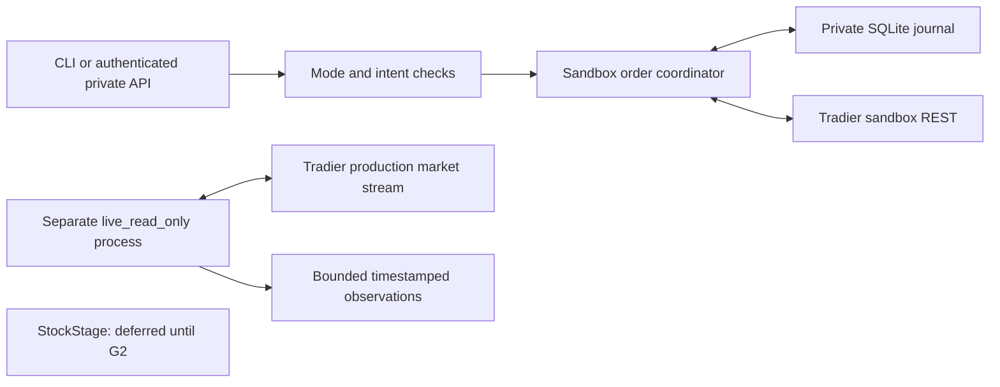

# Tradier standalone API plan

Prepared 2026-09-08, Asia/Riyadh (+03). Brief: local `Astra_Trading_Master_Prompt.md` (SHA-256 `d714da7e5d039f7006df6f5139345a6476420b2aae34423382bf70a49a2496f9`).

## Authorization and sequence

The original request was **PLAN_ONLY**. These documents precede application code. The owner's subsequent instruction authorizes implementation and progression without waiting for replies **when acceptance gates pass**, with progress reports over 24 hours and an overall service budget ceiling of **$200/month**. It supersedes the requirement to wait for the literal `IMPLEMENT_PHASE_1` message. The owner subsequently approved one VPS up to **$20/month total**, and commits/pushes/tests; **never merge to main without separate permission as the final step**. Missing evidence is not a pass; no real order or identity check on the owner's behalf is authorized.

1. Standalone local Tradier/Python validation: offline first, sandbox paper lifecycle second, separate production read-only observation third.
2. Deploy the same tested harness to one VPS after G1 and explicit hosting approval. Pass G2.
3. Inspect and integrate the owner's confirmed StockStage target only after G2. Read-only first, sandbox controls second. Preserve the independent tool.

The 24-hour follow-up deadline is 2026-09-09 21:48 +03. Two complete regular-market sessions may require longer; the deadline never waives G2. No profitability, fill, latency or bug-free guarantee is made. A live-order-capable release remains a separate safety review after the previous gates; testing never requires a real trade. Actual live orders require approval of account, symbol, side, quantity, limit price and loss/exposure limits.

## Verified baseline versus assumptions

| Evidence class | Finding |
| --- | --- |
| Verified repository | `origin` is `https://github.com/swonyu/StockSage-app.git`; `main` and `origin/main` were at `fc455ccf67415a9e45493a6471e4c6d28da52f00` after fetch and fast-forward pull. Planning branch: `codex/tradier-plan-only`. |
| Verified working tree | Four supplied brief/roadmap Markdown/PDF files were untracked. Preserve their bytes and keep them outside this task's staged changes. |
| Verified documentation/layout | README describes a Swift/SwiftUI StockSage app. Tracked paths include `StockSage/Sources/StockSage/`, `StockSage/Sources/Views/`, `StockSage/Sources/App/StockSageApp.swift`, Xcode project and tests. Root HANDOFF records recent integration work. Those historical app test counts were not rerun here. |
| Deferred inspection | StockStage in the brief is not assumed identical to StockSage in this checkout. No application source audit, integration contract, UI change, dependency edit or application build belongs to Phases 1–2. Orientation uses README, handoff and file inventory only. |
| Verified local tooling | `python3 --version` reports 3.14.6; `uv` is present at `/opt/homebrew/bin/uv`. Dependency compatibility and Linux installation are still untested. |
| Verified public docs | Sandbox data is delayed 15 minutes and has no market-data stream. Production market streaming needs a session-creation POST. See [source register](docs/SOURCES.md). These are documentation facts, not proof of account access. |
| Owner assumption | Single owner, Saudi citizen residing in Saudi Arabia. Country listing is supported by current public documentation; individual approval and entitlements remain unknown. |
| Not verified | Any credential's presence or validity, account approval, buying power, data entitlement, VPS access, production timing, actual broker lifecycle or StockStage interface. No secret files have been opened. |

Memory orientation: the supplied Codex registry had no matching StockSage/Tradier entry; repository README and the latest root HANDOFF section provide the relevant local history. Old handoff instructions do not authorize unrelated work.

## Location and language decision

Proposed independent root: `/Users/salman/Workspace/Codespace/tradier-lab`, a sibling of this checkout, with its own Git history, environment, tests and private evidence. Owner's autonomous continuation instruction permits this reversible location choice. Check for an existing folder before creating it; never overwrite it. Keep planning documents here for discovery. During Phases 1–2 only these planning documents and the root handoff may change in StockSage; application source/configuration/tests must remain byte-identical to the baseline.

**Choose supported CPython 3.14, asyncio, HTTPX, websockets, SQLite and pytest.** Pin the actual tested dependency set when implementing. Use `uv` for an isolated reproducible environment and lockfile. Standard-library Decimal, dataclasses, argparse, logging and sqlite3 are sufficient for the core.

| Alternative | Design assessment, not benchmark evidence |
| --- | --- |
| Python | Matches the explicit brief, shortens API/fixture work and has the requested async clients. Suitable starting point for the small I/O workload; throughput still needs measurement. |
| Go | A deployable binary and concurrency tools are useful, but a language switch adds work before there is evidence Python is the bottleneck. Reconsider only for a measured constraint. |
| Rust | Useful if a later measured CPU or memory hotspot needs native code; adds build and maintenance cost for this initial protocol test. |
| Swift | Relevant to the current checkout's documented app, but would couple the proof to integration too early. No app language is selected for the standalone tool. |

The expanded request for a usable API adds a **small authenticated localhost HTTP adapter** after core offline tests, using FastAPI/Uvicorn if the dependency check passes. It delegates to the same core as the CLI. This is a private diagnostic/sandbox API, not a public brokerage platform. Live trade mutations remain unavailable until the later release gate. Linux/VPS portability is required; Codespaces is an optional development location, not a reason to modify StockSage or expose ports now.

## Small module boundary (proposed files, not scaffolding authorization by themselves)

| Module | Responsibility and interface |
| --- | --- |
| `config.py` | Parse mode, selected account, symbols and policy; resolve only the selected credential; validate configuration without printing values. |
| `safety.py` | Intent validation, environment/method/path allowlists, freshness/session eligibility and pause checks. Must guard the final outbound transport. |
| `broker.py` | One pooled asynchronous HTTP client per mode; typed errors, response normalization, shared category limiter and bounded safe-read retries. No automatic mutation retries. |
| `orders.py` | Manual preview, submit, status, cancel and reconciliation; sole owner of order-write transitions. |
| `store.py` | SQLite journal, unique internal IDs, durable state transitions and single-writer lock. Serialize disk operations off the stream reader. |
| `stream.py` | One production market stream; normalize observations, reconnect and bound telemetry; never import order-submission code. |
| `cli.py`, `api.py` | Thin user interfaces. Same core validation and authorization; explicit SANDBOX/read-only labels and stable error results. API access credential is separate from broker credentials. |
| `tests/`, `docs/`, `reports/` | Synthetic fixtures and acceptance tests; sources/runbook/benchmarks; private ignored evidence. |

No generic broker/plugin framework. No database server, message broker, containers, strategy engine, AI decision loop, options, shorting, leverage, automated trade trigger, public UI, multi-user token sharing or second host. An offline rule may emit `WOULD_SUBMIT`; it cannot trigger a broker call.

## Configuration and transport contract

| Mode | Permitted behavior |
| --- | --- |
| `offline` default | Fixture parsing and diagnostics; no credential loading or network. Omitting mode for diagnostics selects offline; any network/order command requires an explicit supported mode. |
| `sandbox` | Account/profile, balances, positions, quotes, clock, order reads, and separately requested paper preview/submit/cancel. Host fixed to `https://sandbox.tradier.com/v1`. |
| `live_read_only` | Approved production GETs for profile, balances, positions, quotes and market clock; `POST /v1/markets/events/session`; WebSocket at `wss://ws.tradier.com/v1/markets/events`. No production order path, including preview. |
| `live_trade` | Reject as unsupported in initial phases; cannot be enabled by a flag, environment variable, API body or hidden route. |

Use names `TRADIER_SANDBOX_TOKEN`, `TRADIER_SANDBOX_ACCOUNT_ID`, `TRADIER_PRODUCTION_TOKEN`, `TRADIER_PRODUCTION_ACCOUNT_ID` and `TRADIER_LAB_API_KEY`. Never accept secret values as command-line arguments or HTTP order fields. Owner sets selected-process environment locally or a gitignored `.credentials` file with mode 0600; do not source unknown files as shell programs. Offline diagnostics show names/presence only. Account membership must be validated; even when a single account is returned require explicit selection for mutation. Live observer loads no sandbox credentials or mutation module.

The final transport validates scheme, exact hostname/port, method and normalized path before adding authentication. Reject redirects, URL userinfo, path traversal, arbitrary base URLs and cross-environment accounts. Keep TLS verification on and ambient proxy inheritance off by default. Recheck any broker-returned stream URL against the fixed WebSocket endpoint. Treat stream session IDs as secrets. These restrictions remain enforced even when a production token itself can trade.

HTTP API proposal: private `/health`, `/account`, `/preview`, `/paper/orders`, `/paper/orders/{id}`, `/paper/orders/{id}/cancel`, `/reconcile` and `/pause` routes. These are **internal proposed routes**, not StockStage or Tradier endpoints. Bind loopback, authenticate all diagnostic/account/order routes, reject CORS by default, bound bodies and keep credentials out of responses. Host-wide mode is chosen at startup; a request cannot switch it. No generic broker proxy route. Do not start a listener in the normal offline unit suite.

## Intent and evidence schemas

An intent is an internal JSON object. It is never forwarded directly to Tradier:

| Field | Rule |
| --- | --- |
| `intent_id` | Caller-created UUID; durable uniqueness. Same ID and identical content returns existing observation; same ID with changed content is rejected. |
| `mode` | Exactly `sandbox` for order operations. Must match process mode. |
| `account_id` | Required string matching selected sandbox profile/account; redact in exported evidence. |
| `symbol` | Explicit member of owner-configured 1–3 U.S. equity symbols; no example interpreted as a recommendation. |
| `side` | `buy` or `sell`; sell must not exceed available owned long shares after open sell commitments. |
| `quantity` | Positive whole-share integer; reject bool, fractional, missing or coerced values. |
| `order_type`, `duration` | Exactly `limit` and `day`. |
| `limit_price` | Required positive finite decimal string; parse with Decimal; reject float ambiguity and unsupported tick precision rather than round silently. |

Unknown fields, absent price/quantity, unsupported symbols/classes, insufficient funds, unset sandbox safety limits or unavailable eligibility data fail closed. Owner supplies test inputs and sandbox caps; fixture values are synthetic. Do not infer investment choices. Preview sends form fields with `class=equity`, `type=limit`, `duration=day`, mapped price and `preview=true`; submission is a separate manual action with `preview=false`. A successful preview is bound to the immutable intent, not a transferable blanket permission.

Evidence records: schema version, run ID, code revision, mode, test ID, UTC timestamp, PASS/FAIL/BLOCKED, reason, synthetic/sandbox/production-read-only provenance and redacted evidence path. Order observations include internal ID, private broker ID, raw broker status, normalized state and cumulative filled quantity. Measurements include sample count, units, window, percentile method and error count. Store UTC, display reports in Asia/Riyadh; interpret exchange schedules with America/New_York and broker calendar/clock, including DST and holidays. Never hard-code Saudi session times.

## Order safety and recovery

Persist intent before preview and before submit; commit `SUBMITTING` **before** a request can leave. Record broker ID on acknowledgement, then poll boundedly to an observed terminal state. HTTP success/`ok` is not a fill. Preserve pending/open/partial/filled/canceled/rejected/expired and unknown broker statuses; unknown values stop eligibility.

A timeout, malformed acknowledgement, connection loss after send or crash in `SUBMITTING` becomes `UNKNOWN_SUBMISSION`. Never resend automatically. Reconcile against sandbox broker orders using account, time window, order attributes and optional correlation tag. A tag is not broker idempotency; no invented Idempotency-Key. If no unique defensible match can be established, keep actions paused for review. Local deduplication does not claim exactly-once broker execution.

Only one order writer may hold the journal lock. On restart, unresolved records prevent new orders until reconciled. Immediate fill or a fill/cancel race is valid evidence; do not generate replacement orders to force a desired result. Confirm cancellation via status, not the cancel acknowledgement. Timeout during cancel requires status lookup. No automatic replace path. A persistent pause blocks new submissions and replacements; it never liquidates and never bulk-cancels implicitly.

401/403 stop the credential flow. Read retries use jittered bounded backoff and a total deadline; mutation retries are disabled. Honor rate-limit headers by credential/category. Current documented limits: trading 60/minute in both environments; standard/market data 120/minute production and 60/minute sandbox. Proposed ordinary trading cap is 30/minute including previews, leaving recovery headroom; do not evade limits with tokens/hosts. Initial status observation uses REST; beta account-event streaming is not a dependency. [Rate limits](https://docs.tradier.com/docs/rate-limiting)

Stream receiver performs only receive, timestamp and validation before handing off bounded observations. REST and SQLite work must not block it. Reconnect serially with fresh sessions as required; never overlap streams. Overflow, journal failure, exhausted retry budget, stale/missing data or uncertain account/session eligibility produces a visible non-trading state. Quote telemetry may coalesce with explicit counters; critical order transitions cannot be silently dropped. Sandbox prices retain their 15-minute-delay label and need a separately validated freshness policy; never treat them as live. No freshness threshold is an invented financial limit.

## Performance, one VPS and future integration

Measure before optimizing: warm REST round trips, connection setup, event receive-to-validation, acknowledgement and fill observation separately. Use monotonic timing for local duration; source-to-receive age is only a freshness estimate with known clock/timestamp semantics. Report p50/p95/p99, sample counts, errors, reconnects, queue depth and resource usage. Initial local processing target: p95 below 10 ms for 1–3 symbols; it is a proposed target, not measured or a broker SLA. Explain any miss before considering native code. No benchmark load may manufacture real orders or exhaust broker limits.

Phase 2 candidate: one U.S. East Linux Lightsail host, listed 1 GB RAM/2 vCPUs/public IPv4 at $7/month. This is a candidate, not purchased capacity or an all-in quote. Verify region, taxes, backups, transfer, limits and terms before owner approval. Use a non-root service account, venv, systemd, key-only restricted SSH, synchronized time, security updates, private secrets/journal, bounded logs and an SSH tunnel. No public application port. Stop local broker connections before moving to the VPS; one stream/order writer across the handover. Start read-only, test restart/reboot/network/rotation/restore/rollback, then observe two complete regular sessions. A second host needs separate justification and approval; compare sequentially and retire unused resources.

Phase 3 documents the real target's auth, users, runtime and order paths first. Choose in-process reuse if suitable; otherwise a thin authenticated private service adapter. Keep broker secrets on the execution side and reuse one stream for all observers. Establish personal versus distributed data-use rights before exposure. Test read-only views before sandbox controls, duplicate clicks, stale/offline state, auth, RTL where applicable and rollback. No app adapter or `STOCKSTAGE_CONTRACT.md` is written before G2.

## Budget and blockers

Local incremental hosting cost is $0 because the existing machine is used; no paid service was ordered. Public list-price baselines are $0/month Tradier Lite, $7/month candidate hosting, or $17/month hosting plus optional $10 Pro. These exclude taxes, data/account/bank charges, backups and overages; the $200 ceiling is not a spending target. **Selected broker: Tradier Lite**, matching the brief and supported-country listing; owner is willing to sign up and has no approved API account yet. Pro is not required for paper testing. One VPS is approved up to $20/month total after G1; verify the final quote fits before provisioning, and obtain further approval for any excess or second host. [Tradier pricing](https://tradier.com/individuals/pricing), [Lightsail pricing](https://aws.amazon.com/lightsail/pricing/)

| Prerequisite | Status / effect | Owner action, without values in chat |
| --- | --- | --- |
| Phase 1 authorization | Verified by later owner instruction | No further implementation confirmation needed. |
| Approved brokerage/API access | Owner confirmed no approved API account yet; blocks real sandbox/live checks, not offline work | Sign up for selected Tradier Lite; complete onboarding/identity directly with broker. |
| Selected sandbox account, token, test symbols/intent/caps | Unverified; blocks sandbox mutations | Configure locally and report readiness only. |
| Production token/data rights | Unverified; blocks live observation | Configure only in read-only process; establish entitlement. |
| Runtime/dependency compatibility | Not yet tested | Implementer validates isolated local environment and later Linux lock resolution. |
| VPS spend/access | One VPS approved up to $20/month total; G1/access still pending; no host purchased | Supply hosting access through a secure local mechanism after G1. |
| Full-session windows | Not yet observed | Keep G2 blocked until two full regular sessions are recorded. |
| StockStage target and usage rights | Unconfirmed; blocks G3 | Identify target after G2; resolve private/distributed permission. |
| Live pilot parameters | Not provided or authorized | Separate later reviewed release and explicit order approval. |

See [ROADMAP.md](ROADMAP.md) for execution order and [TEST_MATRIX.md](TEST_MATRIX.md) for the gates. Missing access is BLOCKED, not FAIL, and never PASS.
