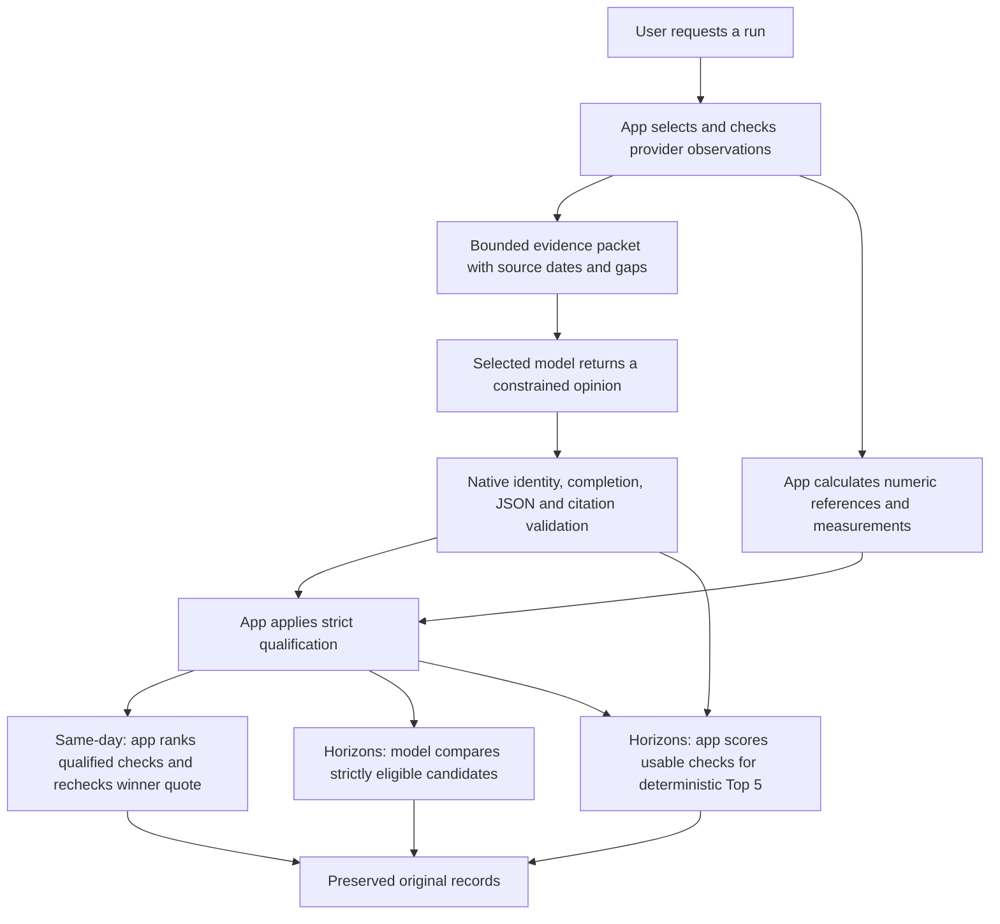

# Gemma in StockSage: model, evidence, research, and reproducibility

Prepared for **Saleh**

Prepared **20 September 2026** from the **uncommitted integration working tree** identified under Source provenance below and the supplied upstream-source and local-model identity receipts. This guide describes the manual research implementation, including integration repairs that are not present in its base commit alone. It is not a claim that a particular installed app, model server, hosted GPU, provider entitlement, or release gate is currently ready.

**Living edition 5 · Updated 20 September 2026, 04:36 Asia/Riyadh.** This edition adds the Mac WhatsApp paste workflow, closes a shared opinion-validation gap, and records the passing 100-test Mac behavior gate. The API credential-status and evidence-recovery repairs are applied, with their focused Mac gate passing 115 tests with no failures. Current work is **macOS only**: the owner has paused iOS and widget work while preserving their existing changes. Completed checks, provisional older-app API observations, and unresolved validation are recorded in section 13. Final combined Mac release validation, installation/reopening, new-build API acceptance, and the requested hosted 24-worker run remain pending. The owner requires final API and UI checks in the new Release build after installation.

StockSage uses a pretrained Gemma model to interpret bounded evidence and return constrained opinions. StockSage code retrieves the evidence, measures prices and indicators, calculates entry/stop/target references, enforces qualification, ranks candidates, and preserves records. **No StockSage Gemma training or fine-tuning was found in the inspected application and runtime paths.** Providing a model with new market evidence at inference time does not update its weights.

The current product has three manual research destinations: **Same-day**, **1–7 trading days**, and **7–14 trading days**. Same-day can publish one qualified pick with numerical references. Each longer horizon has a saved deterministic Top 5 alongside a separate strict model comparison. A visible ranked row is not automatically a qualified Buy. Runs, retries, and outcome reviews require an explicit request; this guide does not authorize scheduled research, model/server startup, paid compute, or orders.

On Mac, **Watchlist** and **Markets** remain direct main-sidebar destinations alongside the three research destinations and **Library**. Library holds the remaining supporting tools and the new **WhatsApp messages** entry. The preserved iPhone implementation retains its four primary destinations; its recorded checks are historical, not authorization to resume iOS work. These navigation changes are present in the integration source and exercised by focused native tests; the installed app has not yet been replaced by this candidate.

### Mac quick-use checklist

This describes the candidate workflow for use after the new Mac build is installed. It is not a request to repeat checks in the older installed app.

1. **Check data access.** Open **Settings → Data sources**. An existing saved Massive key is not displayed in the field; use **Test connection** to check snapshot access. For a new or replacement key, enter it and explicitly choose **Save key** first. Testing uses the saved credential, not an unsaved edit. If the app reports **Keychain unavailable**, unlock or restore StockSage's access and retry; that message does not establish that the key is missing. A passing snapshot does not verify every add-on.
2. **Save optional private context.** Open **Library → WhatsApp messages**, or the **WhatsApp messages** button in Chat. Paste one excerpt, include its exact ticker, set the actual **Message date**, optionally label its source, and choose **Save excerpt**. Saving does not run Gemma. These notes are used by matching Chat/manual individual assessments, not the three research scans; see section 10.
3. **Choose and run a manual workflow.** Check the displayed model status in **Library → Events & model setup**, then explicitly run **Same-day**, **1–7 trading days**, or **7–14 trading days**. Same-day can produce one qualified pick; each longer horizon preserves its deterministic Top 5 separately from strict comparison. Opening a destination does not authorize a run.
4. **Read the dated result and blockers.** Check evidence dates, provider/model failures, qualification status, failed gates, and the app-calculated entry/stop/target references. A historical result, incomplete source, or visible not-qualified rank is not a new accepted Buy. Retry or check saved outcomes only when you choose to do so.

## 1. What the model names actually identify

| Name or property | Meaning in this implementation |
| --- | --- |
| Gemma 4 | Upstream model family. It does not identify an exact downloaded file. |
| 31B | The selected dense size variant. The upstream card describes approximately 30.7 billion parameters. |
| `it` | Upstream instruction-tuned lineage. It is not a StockSage training designation. |
| `QAT` | Upstream quantization-aware training lineage. StockSage does not perform QAT in the inspected code. |
| `Q4_0` | The selected quantized GGUF variant. The local inventory contract requires four-bit quantization metadata. This does not mean the whole runtime, every tensor, and its caches occupy exactly four bits per value. |
| `google/gemma-4-31b-qat` | The canonical application model identifier. A server advertising this name alone does not attest to its weight bytes. |
| GGUF | The model artifact used by the inspected local/hosted inference setup. It is distinct from the upstream BF16 Safetensors release. |

The supplied local identity receipt records `gemma-4-31B-it-QAT-Q4_0.gguf`, **17,651,001,280 bytes**, GGUF version 3, 833 tensors, architecture `gemma4`, size label `31B`, 60 blocks, and metadata context length **262,144**. Its recorded SHA-256 is:

```text
6f63619c9e33826a2a8ab195a344c79ecae7c82341d5567e28fd8863df056a7b
```

This task read that receipt; it did not rehash the large model or inspect a running server. The receipt's human-readable metadata includes `Google_Gemma 4 31B It Qat Q4_0 Unquantized` and `it-qat-unquantized`. Those strings describe upstream/intermediate lineage; they do not override the selected final Q4_0 artifact or establish an owner fine-tune. The file's metadata also includes sampling defaults, but StockSage's actual request overrides temperature to 0.2. Metadata is not proof of effective serving settings.

The runtime preparation source pins community distribution `lmstudio-community/gemma-4-31B-it-QAT-GGUF` at revision `12e5eae7a583b0a8bac91919fa99ae1fb27e6de4`, downloads the file above as `gemma.gguf`, and checks the same expected hash. The Google model repositories establish upstream lineage, not byte identity with this community distribution. [Google instruction-tuned release](https://huggingface.co/google/gemma-4-31B-it), [Google QAT GGUF release](https://huggingface.co/google/gemma-4-31B-it-qat-q4_0-gguf).

## 2. Upstream training: what is documented and what remains unknown

The supplied verification notes cite Google DeepMind's report revision 2, dated 24 July 2026. It describes pretraining broadly following Gemma 3, using web documents, code, and images, with a stated January 2025 pretraining cutoff. Audio training is discussed for other specified variants, not the selected 31B audio capability. It describes filtering for contamination, safety, and recitation; instruction tuning with optional thinking; post-training filtering; and QAT deployment formats including blockwise Q4_0. These are upstream processes, not steps performed by StockSage. [Gemma 4 technical report, sections 2.4, 2.5, and 3](https://arxiv.org/html/2607.02770v2).

The family card describes multilingual web data, code, mathematics, and images. The selected dense 31B model supports text and image input, has 60 layers and a 256K advertised context, and has no audio encoder. StockSage's inspected research path supplies **text**; upstream image capability does not establish image use here. The card's filtering descriptions are not guarantees that sensitive content, bias, incorrect knowledge, or unsafe output have been eliminated. [Google Gemma 4 model card](https://ai.google.dev/gemma/docs/core/model_card_4).

Google's QAT documentation distinguishes half-precision weights extracted from QAT from deployable quantized formats. Its quality and memory goals do not establish that every task retains BF16 quality, that the community file is identical to Google's distribution, or that this model was trained as a stock-selection specialist. [Google QAT release documentation](https://huggingface.co/google/gemma-4-31B-it-qat-q4_0-gguf).

The reviewed upstream material does **not** provide a complete reproducible training recipe: every dataset and mixture proportion, exact token counts, optimizer schedule, all supervised/reinforcement stages and reward details, and full QAT training/calibration settings are not established by these notes. “Similar to Gemma 3” is not evidence that every earlier recipe detail applies. Lack of disclosure does not prove a source or method was unused. StockSage's runtime scripts cannot fill those gaps. [Gemma 4 technical report](https://arxiv.org/html/2607.02770v2).

Further official references are the [Gemma 4 prompt format](https://ai.google.dev/gemma/docs/core/prompt-formatting-gemma4), [thinking capability documentation](https://ai.google.dev/gemma/docs/capabilities/thinking), and [fine-tuning documentation](https://ai.google.dev/gemma/docs/tune). These describe upstream capabilities and practices; their existence is not evidence StockSage has fine-tuned a model or enabled thinking.

## 3. What StockSage adds at inference time



The model does not log into providers, browse arbitrary sites, or operate a broker through these research requests. The app ultimately sends a system message and a user message to an inference API. It compiles observed facts and attributed source claims, keeps important missing-data notices, constrains output, and validates the answer. These mechanisms reduce specific failure modes; they do not make the model's reasoning factually or financially correct.

The inspected runtime scripts download an existing artifact and build/run an inference server. Their benchmark replays frozen inference requests and labels its Python checks preliminary, with `native_validation: "not_run"`. Neither inference, replay evaluation, an allocation optimizer elsewhere in the app, nor saved outcome calculation constitutes neural-model training. No weight update, adapter application, training optimizer, or backpropagation was found in these inspected paths. This is a bounded source finding, not a claim about every historical experiment outside the repository.

Primary source: [LocalModelServer](../StockSage/Sources/StockSage/StockSageLocalModelServer.swift), especially `chatRequest`, `completeDetailed`, and strict completion validation.

## 4. Local and hosted runtime contracts

| Property | Managed local Gemma | Managed hosted Gemma |
| --- | --- | --- |
| App endpoint | `http://127.0.0.1:1234` | `http://127.0.0.1:18080` |
| Expected identifier | `google/gemma-4-31b-qat` | Same exact identifier |
| Profile boundary | Canonical identifier, loopback, port 1234, root path | Canonical identifier, HTTP, loopback, port 18080, root path |
| Discovery | LM Studio inventory with verified GGUF / `gemma4` / `31B` / `Q4_0` / four-bit metadata | `/v1/models` must contain exactly the selected model row |
| Serving readiness | A unique canonical loaded instance, verified context, parallelism 1 | `/props` must establish an awake context of at least 16,384 tokens |
| Accepted advertised research workers | 1 for the strict local serving contract | 1, 2, 4, 8, 16, or 24; an unsupported slot count falls back to 1 |
| Data destination | Configured local server | Off-device processing through the private tunnel, despite the loopback app URL |
| Failure | Explicit unavailable/unverified status | Explicit unavailable/unverified status; no silent local fallback for a different remote model |

A passive probe does not imply model loading. Actual AI-use callers can invoke `prepare`; on macOS, the managed local path uses a shared loader. The toggle is labeled **Load Gemma when StockSage opens**, backed by `stocksage.model.autoLoadOnLaunch`, which defaults to `false`. Choosing **Use LM Studio · Gemma 4 31B** also enables that setting and starts preparation; launch loading is therefore not a separate opt-in in that preset flow. Choosing **Use RunPod GPU · Gemma 4 31B** disables it. Model preparation does not itself perform research. [Model settings and preset actions](../StockSage/Sources/Views/CatalystsSection.swift).

Explicit recovery retries preparation from the saved local configuration; it does not silently enable launch loading or replay the research question that failed. Shared loading checks configuration revisions and cancellation. An uncertain previous load is retained as uncertain rather than immediately submitting a duplicate load.

**Readiness improvements retained from edition 4.** Passive managed-local discovery now carries the verified serving context to its callers. For example, a verified 16,384-token server gives Chat a 16,384-token request budget instead of losing that information and falling back to Chat's 32,768-token upper limit. A missing or malformed native LM Studio inventory produces an explicit verification failure; the managed Gemma profile no longer treats a name advertised by a generic endpoint as verified discovery. Other explicitly configured generic backends retain their own discovery routes.

On iPhone, managed-local preparation is read-only and requires a uniquely identified loaded instance with at least 16K context and one worker before reporting readiness. Downloaded weights, an unloaded instance, an undersized window, or ambiguous instances are insufficient. Mac preparation retains its existing shared loader. These changes repair readiness and request sizing; they do not modify Gemma's weights, prompts, sampling, qualification arithmetic, or trading levels. A loopback address on an iPhone still refers to that iPhone, not to its paired Mac.

Normal Mac quit attempts to unload the selected supported local model and cancels inference activity. It does not delete model files, terminate the server, or establish that a hosted pod has stopped. Remote GPU lifecycle must be established independently by the operator. The app's local cleanup has a bounded deadline and cannot promise success against an unavailable server. [Local model startup and recovery](../StockSage/Sources/StockSage/StockSageLocalModelStartup.swift), [application lifecycle](../StockSage/Sources/App/StockSageApp.swift).

The inspected **external** runtime source lives in the task workspace at `work/b300-runtime`, not inside this repository. Its intended configuration is:

- `llama.cpp` revision `8172e6577ac2b35de1ec1e5d1c0aaad6c4a2129f`, Release CUDA build, CUDA toolkit 13.0.
- A pinned Jinja template with expected SHA-256 `6a1015c47ccfcfa67c3b772385bccee357a4d37c3cda37bd202e9047f391ab82`; the inspected template defaults thinking off. Its attribution header was not independently authenticated here.
- Server loopback port 8080, no web UI, explicit template, total context `16,384 × workers`, unified KV with 16,384 per slot, workers limited to the six values above.
- Full GPU-layer request, batch 2048, microbatch 512, 16 CPU threads, f16 K/V caches, automatic flash attention, no context checkpoints, no RAM prompt cache, metrics enabled.
- A default **benchmark** alias, `stocksage-gemma4-31b-qat-benchmark`. The launcher also accepts the app alias explicitly; leaving the benchmark alias unchanged will fail the app's strict identity check.

These are script settings, **not evidence that the script ran**, a pod is running, the GPU can sustain 24 useful workers, every layer actually fits, or this configuration is optimal. The scripts contain stop-deadline checks; this guide neither executes them nor supplies activation instructions. Worker count is a capacity ceiling, not 24 simultaneous full-context responses guaranteed at a particular latency. Horizon analysis is capped at 24 and rechecks capacity after collection. Provider preparation overlaps at most two stocks for the managed hosted profile and one otherwise; the model-worker count is not a provider-concurrency setting. Acceptance still checks each request's evidence and lifecycle state.

## 5. API-to-Gemma wiring: what can reach each request

**There is no universal “all APIs connected to Gemma” feed.** Four separate questions must be answered: is a data source wired into this workflow; did the request succeed with current access; was a record offered after selection and context fitting; and did the model cite it? A settings toggle or a populated market table answers none of the later questions by itself.

The matrix describes current source wiring. “Shared background” means the same-day collector first uses the horizon public-evidence gatherer, then adds its own intraday facts. It does not mean those daily observations qualify as same-day confirmation. The two longer horizons share collection families but have different prompts and screening windows.

| API or data family | Same-day | 1–7 trading days | 7–14 trading days | Chat and other explanation paths |
| --- | --- | --- | --- | --- |
| Massive active ticker directory and daily market activity | Shared selector chooses up to 500 Nasdaq common shares; Same-day then takes the first 24, with dated selection provenance | Shared selection of up to 500; records activity basis | Same ceiling, separate horizon result | Chat uses selected board symbols, not this universe scan. Browse/Markets visibility is not proof of analysis. |
| Massive split-adjusted daily OHLCV | Shared technical background | Completed daily history, measurements, bounded historical facts | Same history with longer lookbacks | Chat uses an existing price/rules snapshot; it does not call the horizon history collector. |
| Massive one-minute aggregates and fresh NBBO | Completed minutes, bid/ask, sizes, timestamp, scenario, and final winner quote recheck | No dedicated intraday collector; entry reference is a completed daily close | Same | Tape, trades, and live quote UI are not continuously streamed to Gemma. Chat does not run this same-day collector. |
| Massive quote condition reference data | Validates the quote's eligibility before it can qualify | Not a separate catalyst | Same | A validation dependency; no promise that the whole condition directory is prompt content. Trade/exchange directories support other display/tape paths. |
| Massive/Benzinga news, earnings, guidance, ratings, analyst insights, bulls/bears commentary, consensus ratings | Bounded shared snapshot and statuses; today's usable news may qualify | Bounded retained products, source states, and records | Same products, different horizon interpretation | Chat enriches the first explicit research ticker; Catalysts Explain also captures a snapshot. An analyst target stays an attributed opinion. |
| Benzinga analyst and firm metadata | Conditional joins for retained snapshot IDs | Same | Same | Up to three unique analyst IDs and three firm IDs are queried from retained records; not whole directories. |
| Generic Massive news | Fallback selected excerpts if dedicated Benzinga news yields no usable evidence; same-day catalyst needs today's date | Bounded recent excerpts and attempt status | Same; qualifying news age differs | Chat allows up to three excerpts for the first explicit ticker. Fallback attempts count as one news family, not independent corroboration. |
| Dedicated Massive/Benzinga forward earnings | Shared public background | A fresh separate next-earnings observation establishes holding-window status | Same lookup, fourteen-session window | Chat has board earnings and its Benzinga snapshot, not this dedicated horizon lookup. Board earnings separately supports Massive → Yahoo fallback. |
| Direct SEC ticker/CIK and submissions metadata | Shared filing identities/dates/status | Up to five 8-K, 10-Q, 10-K, 6-K, or 20-F metadata records | Same | Chat enrichment has no direct SEC collector. Catalysts Explain separately includes a recent 8-K reference; a link is not proof full filing content was analyzed. |
| Massive/SEC Form 4 | Fresh shared typed purchase/sale observations | Fresh research-local insider check, retained transaction/status facts | Same, with a longer qualifying source-age window | No explicit insider collector in Chat enrichment. Catalysts Explain separately uses the direct SEC Form 4 parser and up to three dated/linkable P/S citations. |
| Massive/SEC 8-K events, dividends, and existing company-event observations | Existing fresh answered observations can enter; a qualifying 8-K published today can support the catalyst rule | Existing source/status observations can enter | Same | Each scan does not freshly fetch every company-event feed. Extra UI event records need not be present in a model packet. |
| Yahoo chart quotes/history and earnings | Not the dedicated same-day research route | Not the dedicated daily-history or forward-earnings route | Same | Board fallback can indirectly contribute observed quote/earnings facts to Chat or an individual assessment. Dedicated evidence receipts retain their own provider semantics. |
| EODHD | Disabled | Disabled | Disabled | Retained names or old comments do not establish active use. |
| Imported or manually pasted WhatsApp leads | Not collected by this research gatherer | Not collected | Not collected | Optional local excerpts for Chat's first explicit ticker and manual individual stock assessment, marked unverified; can leave the device with a remote model. Mac has a paste/save sheet; no live WhatsApp API. |
| Broker balances, account IDs, journal notes, provider credentials | Not manual research evidence | Not manual research evidence | Not manual research evidence | Explicitly excluded from the app-created Chat snapshot. What the user types is a separate input boundary. |

Important endpoint distinctions are visible in code: Benzinga uses `/benzinga/v1/…`, with news at `/benzinga/v2/news`; Massive company events use `/stocks/filings/8-K/vX/disclosures`, `/stocks/filings/vX/form-4`, and `/stocks/v1/dividends`. Direct SEC submissions and filing-document requests are separate transports. None of these endpoint strings proves a subscription entitlement or a successful live response.

Source map: [ResearchUniverse](../StockSage/Sources/StockSage/StockSageResearchUniverse.swift), [HorizonResearch `gather`](../StockSage/Sources/StockSage/StockSageHorizonResearch.swift), [SameDayResearch `assess`](../StockSage/Sources/StockSage/StockSageSameDayResearch.swift), [Benzinga products](../StockSage/Sources/StockSage/StockSageBenzinga.swift), [BenzingaClient `snapshot`](../StockSage/Sources/StockSage/StockSageBenzingaClient.swift), [NewsService](../StockSage/Sources/StockSage/StockSageNewsService.swift), [MassiveEarnings](../StockSage/Sources/StockSage/StockSageMassiveEarnings.swift), [MassiveEvents](../StockSage/Sources/StockSage/StockSageMassiveEvents.swift), [MassiveTicks](../StockSage/Sources/StockSage/StockSageMassiveTicks.swift), [Chat enrichment](../StockSage/Sources/Views/StockSageChatSection.swift), [Catalyst evidence collection](../StockSage/Sources/Views/CatalystsSection.swift).

Optional content can be absent because of policy, credentials, entitlement, throttling, symbol mismatch, applicability, source limits, stale/failed status, or context fitting. The saved **offered facts**, source states, omitted keys/counts, and **cited facts** are the evidence for an individual completed call. An unavailable source must not be translated into “there is no news,” “no insider activity,” or “no earnings risk.”

## 6. Evidence and output contracts

An `EvidenceFact` preserves a stable key, prose, required/optional status, availability, fact class, attribution, observation/publication time, and optional typed insider transaction. Classes cover market, technical, fundamental, news, earnings, insider, imported lead, risk, and coverage gap. Packet version 2 preserves order, omitted-record count, and a canonical SHA-256 digest; duplicate IDs invalidate the packet. A coverage receipt distinguishes missing/unknown, offered, omitted, and cited keys. Coverage is a description of available material, not confidence or truth. [Evidence packet and assessment implementation](../StockSage/Sources/StockSage/StockSageAIAssessment.swift).

For a stock opinion, Gemma must return exactly four keys:

```json
{"action":"Hold","reason":"The supplied setup lacks adequate confirmation.","risk":"Missing evidence leaves the apparent catalyst uncertain.","evidence":["F1"]}
```

This is a **format illustration**, not an accepted real opinion: `F1` would have to exist in the actual offered packet and support the relevant interpretation. Allowed actions are Strong Buy, Buy, Hold, Avoid, Reduce, and Sell. At least one existing unique fact ID is required. The generation schema disallows additional keys and constrains actions, references, and prose. Reason and risk are requested as short qualitative English sentences with no numerical levels, dates, times, probabilities, or inline reference IDs; exact figures remain in the app's captured fact cards.

The shipped prompt/schema setting is **`explanationFirst` version 1**, whose schema generation order is reason → risk → evidence → action. `evidenceFirst` version 2 exists as an alternative; its presence does not make it the default. The illustrative JSON in the system text is not the authoritative generation-order setting.

The native parser additionally checks response size, exact keys and types, allowed actions, duplicate/unknown references, prose bounds, numerical/bracket patterns, certain repetition, and some unsupported earnings claims. Managed Gemma completion must identify the expected model, finish with an accepted complete `stop` state, and pass serving-context verification after generation. A syntactically valid citation still does not prove that the source entails the claim, that all contrary evidence was considered, or that an investment thesis is sound. Finite semantic checks cannot cover every paraphrase.

**Edition 5 claim-guard repair.** The shared stock-opinion validator now applies its existing finite English patterns for unsupported probability and absence-of-earnings-risk claims even when no typed earnings window is supplied. For example, “high probability of further upside” and “earnings risk is absent” are rejected in both reason and risk; explicit uncertainty or negation remains acceptable. This closes a Same-day path where valid minute/news citations previously allowed both unsupported opinions to qualify. Event-timing checks still depend on the typed earnings window; this is not general semantic fact-checking or a new probability model. Missing-citation repair cannot rescue one of these rejected claims. The change does not alter Gemma weights, prompts, schema, sampling, scoring, or qualification thresholds. [Shared validator and repair preflight](../StockSage/Sources/StockSage/StockSageAIAssessment.swift), [Same-day behavioral regression](../StockSageTests/StockSageSameDayResearchTests.swift).

| Request property | Current research behavior |
| --- | --- |
| Context | 16,384 tokens requested/reserved; distinct from the artifact's 262,144 metadata limit |
| Sampling | Temperature 0.2; seed and `top_p` unpinned |
| Generation | Non-streaming; managed Gemma requests non-thinking behavior |
| Initial stock-opinion output | 192 tokens; explicit incomplete-check retry starts at 384 |
| Output-limit recovery | Eligible managed-profile request can restart once with doubled output budget, using the same evidence and original deadline |
| Assessment deadline | One 90-second wrapper deadline, including eligible evidence-format repair |
| Format repair | Restricted repair must preserve the original action, reason, and risk; it cannot invent a replacement opinion |
| Context fitting | Whole optional records dropped from the end; required facts retained or the request fails; omissions recorded |

The common projection has a 12,000 UTF-8-byte target before final fitting. The final budget uses a conservative normalized UTF-8 heuristic, not an exact Gemma tokenizer. Source comments explicitly mark the general tokenizer bound unverified for Gemma; sampled historical observations are not a proof for all Unicode input. Research reserves retry output space before choosing optional records. Required facts that cannot fit cause an explicit budget failure, not silent truncation.

Inference profiles record model, endpoint profile, prompt/schema/packet versions, packet digest, temperature, context/output budgets, and retry reason. They leave unpinned seed and `top_p` unknown. Identical request configuration is neither identical evidence nor deterministic output. [LocalModelServer request/budget implementation](../StockSage/Sources/StockSage/StockSageLocalModelServer.swift).

## 7. Exactly how the three manual workflows differ

| Property | Same-day | 1–7 trading days | 7–14 trading days |
| --- | --- | --- | --- |
| Maximum listings analyzed per run | First 24 of the shared selection of up to 500 | Up to 500 | Up to 500 |
| Model boundary | Canonical strict-output Gemma required | Selected configured server; Gemma is the default, but generic backend support exists | Same |
| Market basis | Today's regular session and completed intraday observations | Completed adjusted daily history | Completed adjusted daily history |
| Setup emphasis | Observed intraday entry setup and invalidation; today's dated public catalyst | Near-term developments, price/volume confirmation, overnight risk | Persistence, follow-through, fading setups, intervening events, overnight risk |
| Numerical entry reference | Captured eligible ask, frozen as an entry ceiling | Last completed adjusted close | Last completed adjusted close |
| Stop reference | Lowest low of latest five completed minutes | Lowest low of latest five daily bars | Lowest low of latest ten daily bars |
| Target reference | Prior bounded-minute-window high, excluding latest minute | Prior twenty-bar high, excluding latest daily bar | Prior sixty-bar high, excluding latest daily bar |
| Published selection | One qualified winner, or a specific blocker | Deterministic visible five plus separate strict comparison | Independent deterministic five plus separate strict comparison |
| Outcome horizon | Dated receipt and freshness state; not automatically inserted into horizon scenario evaluation | Up to seven monitoring sessions | Up to fourteen monitoring sessions; monitoring does not wait until day seven |

All three use the same activity selector: up to 500 active US Nasdaq (`XNAS`) common shares (`CS`) denominated in USD, with supported ticker identity and verified volume × VWAP activity. Same-day subsequently truncates that selection to its first 24 listings. If the primary session has fewer than 500 eligible listings, the selector can try the previous activity session and replace the primary selection when the prior session has more eligible listings. That fallback is decided before the Same-day truncation, even when the primary session already contains 24 eligible listings. The selection receipt records the choice. This is not every exchange, every Nasdaq security, ETFs, or a financial-merit universe. [Shared universe selection](../StockSage/Sources/StockSage/StockSageResearchUniverse.swift), [Same-day truncation](../StockSage/Sources/StockSage/StockSageSameDayResearch.swift).

Trading-day holding windows differ from the elapsed-time news/filing freshness limits used by strict horizon qualification.

### Same-day: one pick or a blocker

The run requires market access, non-sample data, the strict Gemma profile, and durable receipt writing. Same-day and horizon scans cannot run together. Each shortlisted check is preserved, including failures. The app requires 30–60 completed minutes in a bounded last-hour window, the latest five consecutive with positive volume, and an eligible, condition-verified NBBO with spread no greater than 25 basis points. Missing minutes are disclosed rather than fabricated.

The stop must be below the ask entry and the target above it. Let `spread = ask − bid`. The observed spread-penalized screen is:

```text
(target − ask − spread) / (ask − stop + spread) >= 2
```

An accepted Buy/Strong Buy must cite both an available recent completed-minute fact and an available news/filing fact published on the same New York date. A today's publication date does not prove the underlying event happens today. Daily technical signals are background, not a substitute for intraday evidence. If no usable today's catalyst exists, that candidate does not make a same-day model request.

Candidate expiry is the earliest of background capture +300 seconds, completed-minute evidence +180 seconds, and regular close −300 seconds. No new entry publication occurs within the last five minutes of the verified regular session. These rules make the earliest qualifying run depend on at least thirty completed session minutes; early-close days use the supported calendar.

The app orders qualified, unexpired checks by reward/risk, then narrower spread, activity, and ticker. The winner receives another fresh quote check against its **frozen** entry/stop/target and spread constraints. Failure does not silently substitute a runner-up. The current card additionally requires the final verified quote to be at most five seconds old. A stored winner can therefore become historical shortly after publication; it is not a continuously renewed buy instruction. Persistence failure removes the published selection and displays a blocker. [SameDayResearch](../StockSage/Sources/StockSage/StockSageSameDayResearch.swift).

### Longer horizons: collection, measured screen, and explicit retries

The gatherer requests split-adjusted daily history and rejects wrong-symbol, unadjusted, incomplete/paginated, malformed, or stale responses. It needs at least thirty completed valid daily bars through the latest verified settled aggregate session. A fortnight target additionally requires more than sixty bars to obtain sixty prior highs excluding the latest bar; thirty bars alone cannot establish that target.

The app computes technical facts, obtains bounded news/Benzinga evidence, checks forward earnings independently of the board cache, obtains SEC filing metadata, and performs a fresh Form 4 observation. Full SEC filings are not generally read by this metadata gatherer. Longer historical lookbacks are analytical context, not permission to extend the requested holding horizon.

Suspended work rechecks external-access policy revisions, sample mode, provider credentials, model configuration revisions, cancellation, and shutdown. Resume and retry preserve original records and configuration identity. Comparison-only retry uses captured checks; it is distinct from recollecting incomplete candidates or starting a fresh run. An unavailable model, changed setting, incomplete capture, or invalid output cannot be converted into accepted research simply to fill five rows. [HorizonResearch](../StockSage/Sources/StockSage/StockSageHorizonResearch.swift).

## 8. Strict qualification and the two Top 5 paths

### Strict qualification version 1

The fixed screen requires an original Buy/Strong Buy plus all applicable measured conditions:

- Verified capture identity, USD basis, access, and timing; sufficient completed daily bars.
- Completed close above SMA20 and positive measured return over the selected seven/fourteen-bar horizon.
- Recent three-bar average volume at least 1.5 times the preceding twenty-bar average, and positive ATR14.
- Positive finite levels with `stop < entry < target`, reward/risk at least 2, stop distance at most 3 ATR, and target distance at most 3 ATR for week or 6 ATR for fortnight.
- A fresh earnings observation establishing a date outside the holding window. Missing timing is not evidence of absence of risk.
- A recent dated news or public insider filing record that was actually offered and cited by the model. For week/fortnight respectively, news age must fall within `3/7 × 86,400` elapsed seconds and public insider filing age within `7/14 × 86,400` elapsed seconds, measured from the record timestamp to the evidence clock. These are inclusive elapsed-time bounds, not calendar-date comparisons; future-dated records fail.

The numerical references come from app code, not Gemma-generated prices. Provider analyst targets do not replace the measured historical target. Technical confluence is additional neutral scoring evidence, not an extra strict gate or permission to change Gemma's original action. No benchmark series is wired into the current qualification capture, so relative strength is absent rather than inferred. These rules are deterministic assumptions, explicitly unvalidated as a predictive strategy. [ResearchQualification](../StockSage/Sources/StockSage/StockSageResearchQualification.swift).

### Saved deterministic Top 5

`StockSageTopFiveRanking` does not call a model. It fills qualified slots first, then usable nonqualified candidates, preserving original actions and failed-gate reasons. A Hold or Avoid can appear as a ranked **not-qualified** row. It returns at most five from the actual usable pool; failed/no-verdict checks are not invented into candidates. The capture adapter requires the listing-result set to have finished before ranking its usable checks.

Within each qualification group it sorts score descending and ticker ascending, with a concentration guard. Components are visible:

| Component | Current rule |
| --- | --- |
| Selected-horizon historical return | Scaled to 0–10 points, capped at 20% historical return |
| Technical confluence | Aligned 10, mixed 5, conflicted/insufficient 0 |
| Cited catalyst | 8 for the credited public-insider filing, otherwise 6; no citation earns no catalyst points |
| Volume-ratio proxy | Scaled to 0–10, capped at four times; not executable liquidity |
| Evidence freshness | Starts at 10; loses one point per hour, floored at zero, using the saved scoring clock |
| Insider evidence | Signed transaction contributions described below |
| Contrary technical checks | −2 per contrary check |
| Named penalties | −50 for unverified critical capture; −50 for contradictory measurement basis; −10 for no offered dated catalyst |

Insider base magnitude is six with linear decay over `14 × 86,400` elapsed seconds from the transaction date to the saved scoring clock. Purchases contribute positively and sales negatively; at least two distinct owners in the same direction within `7 × 86,400` elapsed seconds multiply eligible contributions by 1.5. Invalid or superseded amendment records remain visible with zero weight. These are transparent score assumptions, not evidence of insider motive, confidence, or a measured predictive edge.

The concentration guard ordinarily permits two per known group. An over-cap candidate is retained when any of three conditions holds: too few later candidates remain to fill that qualification group’s requested slots if it is skipped; no later candidate with a different concentration key exists; or its score leads the best such alternative by at least five points. A candidate with an unknown key can serve as that different-key alternative. The guard runs separately within qualified and nonqualified groups, so diversification cannot promote a failed screen above a qualified candidate, and the cap is not an unconditional limit of two across the combined five. The generic scorer supports sector or catalyst identity; the current production capture adapter supplies catalyst identity and does not establish complete sector coverage. [Ranking and concentration guard](../StockSage/Sources/StockSage/StockSageTopFiveRanking.swift).

The result and `scoredAt` are frozen when the capture completes, persisted independently of strict comparison success, and reused after display refresh, comparison retry, or relaunch. Legacy records without a saved original ranking disclose that absence instead of reconstructing one using today's clock. [TopFiveRanking](../StockSage/Sources/StockSage/StockSageTopFiveRanking.swift), [ResearchHistory](../StockSage/Sources/StockSage/StockSageResearchHistory.swift).

### Separate strict model comparison

Gemma compares only `scan.isEligible` candidates and returns exactly `min(5, eligibleCount)` unique symbols in preferred order. It may not invent explanations, scores, probabilities, prices, or additional symbols in this response. Buy and Strong Buy are eligibility labels, not automatic ranking tiers.

The current comparison protocol is version 3. Mandatory original cases, risks, dates, reference/scenario records, and coverage stay whole. Cited evidence is included as space allows; class-aware allocation records the omitted IDs/counts when full records cannot fit. Multi-round comparison carries earlier winners into later rounds and is explicitly approximate and grouping-dependent. Initial output is 256 tokens; eligible transient failures can retry a round once. Old saved protocols retain their original validation.

A strict comparison can produce fewer than five names, none, or a recorded failure. That does not erase the deterministic five or original checks, and a fallback ranked row never acquires a fabricated strict outcome scenario. [ResearchRanking](../StockSage/Sources/StockSage/StockSageResearchRanking.swift).

## 9. Buy, stop, target, and saved outcomes

In this app, “Buy,” “Stop-loss,” and “Target” on research are dated conditional references. A last close or captured ask is not a fill; a historical high is not a forecast; a stop reference does not create a stop order or guarantee an exit price. Gaps and spread changes can invalidate assumptions. The app does not turn a research result into an order.

Only accepted strict `scan.topBuys` become saved horizon outcome predictions. The saved run also retains its own strict comparison receipt/failure, coverage, and independent deterministic ranking. Choose **Saved research → Check active results** to request an outcome review after eligible monitoring sessions have settled. Opening the app does not fetch or rewrite outcomes. Same-day product receipts have their own history/freshness contract and are not automatically fed into the seven/fourteen-session evaluator.

New runs use **outcome policy 3**, `dailyBarOpeningFirst`, beginning on the next trading date after completion. The app evaluates one split-adjusted daily-bar basis. A known opening crossing is ordered first: opening at/below stop records the opening stop event; opening at/above target records the opening target event. If the session opens between the levels and later reaches both, the app conservatively records stop first because the daily bar cannot reveal intrabar order. Otherwise the first verified stop/target terminates the scenario, or the seventh/fourteenth monitoring-session close does. Fortnight monitoring begins with the first eligible session, not day seven.

Policy 2 keeps its original stop-precedence behavior. Older endpoint-only records keep their original semantics; new policy is not retroactively assigned. Later evaluations do not rewrite the original opinion or evidence. Missing or inconsistent prices remain unavailable. Separate adjusted captures cannot safely establish a return without a common adjustment basis; the UI discloses changed reference sessions/bases rather than inventing a percentage comparison. These are research scenario measurements, not broker fills, realized P&L, or proof of investment accuracy. [ResearchHistory](../StockSage/Sources/StockSage/StockSageResearchHistory.swift), [ResearchFreshness](../StockSage/Sources/StockSage/StockSageResearchFreshness.swift), [saved research UI](../StockSage/Sources/Views/StockSageResearchHistoryView.swift).

## 10. Persistence, privacy, and manual operation

Product history and transport diagnostics have different retention policies:

| Record | Current preservation behavior |
| --- | --- |
| Horizon runs and full checks | Original results/evidence and captured ranking retained without automatic age/count/aggregate-byte expiry. Full-check archive trust limit is 16 MiB; index limit is 4 MiB. Reaching a limit fails the save instead of deleting earlier evidence. |
| Same-day receipts | Durable sole product history; exempt from automatic completed-diagnostic pruning. Save failure blocks a published pick. |
| Other completed transport diagnostics | Active scans excluded. At most thirty completed non-same-day diagnostics are retained, also subject to the configured byte budget, default 512,000,000 bytes. The newest is kept even when it alone exceeds that byte budget. |
| Chat transcript | Sent turns preserved locally until explicit Clear history, subject to a 2,000,000-byte storage boundary and visible errors. The saved archive is not silently shortened to twenty-four turns. |
| Model inference Chat context | At most latest twenty-four eligible turns, potentially fewer after fitting. Full saved transcript is not automatically sent. |
| WhatsApp excerpts | Existing imports and Mac pasted messages share the local schema-1 file, limited to 10,000 messages and 5,000,000 bytes. Append preserves unknown export/message metadata and existing records; rejected input or unreadable storage is not replaced. |

Full-check reads validate integrity and preserve failed/non-Buy checks. Previously expired legacy evidence remains explicitly unavailable; the app does not claim to reconstruct deleted originals. Atomic writes and bounded reads protect against several corruption paths, but a storage warning still means durability was not established. Original bytes are not deliberately discarded merely to make a failed load look empty.

Transport diagnostics store bounded/redacted system, schema, prompt, and response payloads with byte counts, hashes, truncation flags, model/configuration, HTTP/completion/failure information, duration, and retry details. A hash of redacted/truncated stored content is not automatically the hash of the full unredacted wire request. Diagnostic directories/files use 0700/0600 permissions and atomic replacement. Chat also attempts protected atomic writes, 0600 permissions, and backup exclusion; its unsent draft remains in memory. [ResearchReceiptStore](../StockSage/Sources/StockSage/StockSageResearchReceiptStore.swift), [Chat/session persistence](../StockSage/Sources/StockSage/StockSageChat.swift).

### Pasting WhatsApp messages on Mac

Use **Library → WhatsApp messages**, or the same button in Chat. Paste one message or short excerpt of **1–2,500 characters**, include the exact stock ticker, and optionally add a source label of up to **300 characters**. Outer whitespace is trimmed; an empty source becomes **Pasted WhatsApp**. Set **Message date** to the actual original date: the app does not parse a date from the pasted text. The label and date are user-provided, not verified sender identity or proof of publication. Choose **Save excerpt**; the sheet reports success or keeps the draft with an error. **Done** asks before discarding an unsaved excerpt.

Retrieval selects at most **three distinct matching texts from the last 30 elapsed days**, newest first, using an exact ticker or one of the existing company aliases. Future messages are excluded. Chat adds leads only for its first explicit research ticker; manual individual stock assessment also reads matching leads. **Same-day, 1–7-day, and 7–14-day scan collectors do not use these messages.** Context fitting can omit leads, so a saved excerpt is not proof it was offered or cited. The quoted text is unverified context, cannot establish app-generated prices, and must not be followed as an instruction.

Opening or saving the sheet performs no inference, research run, WhatsApp connection, or training. Messages are stored in the local `StockSageResearch/whatsapp.json` file under Application Support. Appends retain existing source provenance and unknown message fields, keep original message dates, advance the import timestamp, and treat an exact normalized text/source/date duplicate as a no-op. The Mac reader rejects unreadable/oversized files and symlink targets. The writer uses an advisory lock, atomic replacement, private permissions, and attempted backup exclusion. This is the shared existing import store, not a new remote inbox. [Paste sheet](../StockSage/Sources/Views/StockSageWhatsAppMessagesView.swift), [bounded storage and retrieval](../StockSage/Sources/StockSage/StockSageResearchLeads.swift).

Local model inference does not make the whole app offline: public market evidence still requires permitted provider access. A hosted model receives its selected prompt off-device. For remote Chat that can include the question, bounded prior turns, news, and private imported or pasted WhatsApp excerpts; remote individual assessment can also include matching excerpts. Saving alone does not transmit them, but a later explicit model request may. The app snapshot excludes broker/account/journal/credential fields, but text typed by the user can contain private information. Do not paste secrets. The likely-secret detector elsewhere is a limited heuristic, not a guarantee that the paste sheet removes sensitive content.

External-access gates and configuration/credential revisions stop obsolete work from being accepted after settings change. Current research is manual. Optional explicitly configured price alerts are a separate feature; their existence does not authorize automatic research, outcome review, model assessments, or paper orders. Retained legacy paper code/history is not a current automatic-research product: new legacy runs are disabled and legacy open positions are not monitored after relaunch. [ToolPolicy](../StockSage/Sources/App/ToolPolicy.swift), [legacy history disclosure](../StockSage/Sources/Views/StockSagePaperAutomationPanel.swift).

## 11. Other model surfaces have different contracts

| Surface | Input/output boundary |
| --- | --- |
| General Chat | Up to four selected symbols, prioritizing explicit tickers and then watchlist/board. JSON `analysis` plus `evidence`; empty evidence is allowed for a general explanation. Old conversation is not current market evidence. Number-bearing prose is displayed as an unverified draft. |
| Chat request budget | Upper context 32,768, clamped to the verified serving window; output 512; timeout 300 seconds. A verified 16K runtime receives at most a 16K context request. Older server comments mentioning 4K do not override the executable caller. |
| Individual stock assessment | Shared evidence/opinion rules using the selected backend. UI assessment cache is in-memory; a fresh quote does not rewrite captured evidence or schedule a new inference. |
| Catalyst explanation | Selected-server route uses research context and separate explanation validation. Apple's on-device FoundationModels route is a different model and must not be called Gemma. |
| Headline sentiment | Separate positive/negative/neutral classification, sixteen output tokens and thirty-second timeout. A sentiment label is not an investment recommendation. |
| Legacy paper helper | A model call remains in preserved implementation source, but that does not establish an enabled automated product or authorize activation. |

Source: [Chat contracts](../StockSage/Sources/StockSage/StockSageChat.swift), [actual Chat caller](../StockSage/Sources/Views/StockSageChatSection.swift), [AIAssessment](../StockSage/Sources/StockSage/StockSageAIAssessment.swift), [CatalystNarrator](../StockSage/Sources/StockSage/StockSageCatalystNarrator.swift), [LocalSentiment](../StockSage/Sources/StockSage/StockSageLocalSentiment.swift).

## 12. Limits and how to interpret failures

The model can misunderstand correctly supplied evidence, cite a fact that does not establish its conclusion, overlook counterevidence, or produce a plausible but unsupported interpretation. A schema pass, low temperature, many available APIs, or an insider score is not a calibrated probability of profit. Provider facts can also be wrong, delayed, incomplete, revised, or unavailable.

The current Nasdaq schedule is explicitly **2026 only**. Unsupported years return unavailable; unexpected closures and broker-specific hours are not modeled. Daily aggregates are treated as complete only after the scheduled extended-session end, not simply regular close. This can keep daily research on the previous completed aggregate session after the cash market closes. [MarketHours](../StockSage/Sources/StockSage/StockSageMarketHours.swift).

| Observed state | What it establishes | Appropriate interpretation |
| --- | --- | --- |
| Model unavailable or wrong identity | No acceptable selected-model readiness | Check the disclosed server/profile problem; no replacement opinion was formed. |
| Source unchecked, throttled, unauthorized, stale, or missing | Evidence gap or access failure | Do not reinterpret it as absence of market risk. |
| Output incomplete or rejected | The acceptance contract was not satisfied | Partial text may help diagnose a failure; it is not a qualified pick. |
| No strict candidates | The measured screen did not produce eligible comparisons | Deterministic not-qualified rows can remain useful to inspect, without becoming buys. |
| Same-day result historical | Its freshness contract no longer holds | It records what was observed; it is not a fresh entry signal. |
| Interrupted/failed new run with older data visible | Prior saved data was retained | Read run timestamps and status; old results are not a successful new scan. |
| Storage failure | New persistence was not established | Do not assume reopening will recover the unsaved result. |

There is no demonstrated financial edge, current model throughput, comprehensive live-provider coverage, or final installed-release validation in this guide. Section 13 records one successful installed-app snapshot check and limited standalone API observations; those do not establish every entitlement, current executable data, or a completed research run. Source-defined behavior, successful mocked tests, successful real inference, and profitable live outcomes are separate evidence categories.

## 13. Existing tests and the verification boundary

The following suites contain relevant native regression sources. The initial guide inspected them as code; their listing alone does not assert a successful test run. This living edition additionally records the completed focused runs below from the lead's actual receipts.

| Suite | Representative contract |
| --- | --- |
| [LocalModelServerTests](../StockSageTests/StockSageLocalModelServerTests.swift) | Exact model variant and unique context; identity/finish verification; original retry deadline; request-derived recorded temperature; bounded observer payloads; cancellation and capacity/access checks |
| [SameDayResearchTests](../StockSageTests/StockSageSameDayResearchTests.swift) | Intraday/public-citation requirements; one frozen winner; no runner-up after stale winner; receipt retention; persistence failure; actionable preparation errors |
| [HorizonResearchTests](../StockSageTests/StockSageHorizonResearchTests.swift) | Failed comparison preserves checks; comparison-only retry; lifecycle revocation; outcome-policy session windows |
| [AIAssessmentTests](../StockSageTests/StockSageAIAssessmentTests.swift) | Prompt/schema fitting, citation and qualitative-output validation, evidence handling |
| [ResearchRankingTests](../StockSageTests/StockSageResearchRankingTests.swift) | Eligible candidate membership, comparison contracts, bounded evidence and saved protocol validation |
| [TopFiveRankingTests](../StockSageTests/StockSageTopFiveRankingTests.swift) | Deterministic scores, strict-group precedence, signed insider evidence and concentration behavior |
| [ResearchHistoryTests](../StockSageTests/StockSageResearchHistoryTests.swift) | Frozen scoring clock/check agreement, honest legacy absence, full-check retention, atomic preservation, opening-gap ordering, legacy policy compatibility |
| [ResearchLeadsImportTests](../StockSageTests/StockSageResearchLeadsImportTests.swift) | Mac append/reread/retrieval, unknown metadata retention, fractional-date duplicates, input/storage bounds, corruption and symlink preservation |

A native executed-test receipt needs the actual source identity, command, platform, result bundle, exit status, executed count, and failures. A typecheck or build is not an executed test suite. A frozen model replay excludes fresh providers, startup, and full app orchestration; a native end-to-end manual run is a separate validation. Schema acceptance and benchmark speed cannot establish investment quality.

### Latest completed focused checks — 20 September 2026

| Receipt | Observed result and coverage |
| --- | --- |
| `layout-polish-mac-12` | Passed; exit 0; 33 tests, 0 failures, 0 skipped. Focus: sidebar navigation, research inspector layout and horizontal scrolling, and Catalysts/model settings. |
| `layout-polish-ios-5` | Passed; exit 0; 33 tests, 0 failures, 0 skipped. Focus: iPhone presentation and navigation, including ordinary and accessibility text sizes, Browse, Chat, and research detail disclosures. |
| `layout-polish-ios-6` | Failed; exit 65; 32 tests passed and 1 failed. The research-filter interaction test assumed the exposed accessibility element was a UIKit button; the new SwiftUI Menu exposes an accessibility node. This run is not a passing UI gate. |
| `gemma-readiness-red` | Expected regression failure before the fix: 39 tests passed and 3 failed. Reproduced lost serving context, unverified alias fallback, and preparation accepting an unloaded, undersized, or ambiguous managed-local instance. |
| `gemma-readiness-green-ios` | Passed after the readiness fix; exit 0; 81 tests, 0 failures, 0 skipped across LocalModelServer, ManagedModelLifecycle, and Chat. Injected transports and synthetic inventories; no live model or provider calls. |
| `gemma-readiness-green-mac` | Passed after the readiness fix; exit 0; 132 tests, 0 failures, 0 skipped across LocalModelServer, ManagedModelLifecycle, LocalModelStartup, and Chat. Includes native Mac presentation checks within Chat's suite; no live inference. |
| `layout-polish-ios-7` | 74 passed, 1 failed; exit 65. Research filter interaction and model-client checks passed; the Journal harness found an offscreen field before its native view mounted. No passing whole-run claim. |
| `layout-polish-ios-8` | Passed after correcting the shared native-field lookup; exit 0; 33 tests, 0 failures, 0 skipped. iPhone presentation and navigation, including research-filter selection and Journal typed-price interactions. |
| `whatsapp-green-behavior-red-2` | Exit 65; 7 passed, 1 failed, 0 skipped. All six WhatsApp storage tests and the actual Mac native paste/save test passed. The separate Same-day behavioral test failed because both unsupported-probability and absent-earnings-risk opinions qualified despite valid citations. This is the before-fix behavioral receipt, not a passing whole gate. |
| `gemma-behavior-green` | Passed after the shared claim-guard repair; exit 0; 100 tests, 0 failures, 0 skipped. Full AIAssessment, SameDayResearch, and ResearchLeadsImport suites plus the native Mac WhatsApp paste/save test. Injected model/provider responses and synthetic temporary messages; no live Gemma call. |
| `api-credential-green` | Passed after credential-status and research-admission repairs; direct Mac `xcodebuild test`, exit 0; 115 tests, 0 failures, 0 skipped. Full Massive, HorizonResearch, and SameDayResearch suites; no new Release installation or live provider acceptance is established. |

These counts use each result bundle's top-level test summary; parameterized cases produce additional executions. Exact commands, exit statuses, and result-bundle locations are preserved as `work/<receipt-name>-receipt.json` in the lead task. They describe the integration working tree tested at those moments, not a final frozen combined commit. Gemma readiness was reproduced with failing regressions, repaired, and retested on both platforms; a subsequent wording change makes the failure message more actionable. Those checks establish request handling, not improved stock-selection performance.

**Current scope is Mac only.** Final combined Mac tests, complete Mac visual acceptance, release installation/reopening, and the requested hosted run remain pending. iOS/widget work is paused by the owner, with its source and earlier receipts preserved. The historical iOS7 review inspected 28 research images at default and AX3 sizes, and iOS8 subsequently passed presentation/navigation after the Journal harness correction; neither establishes every state or research-family AX5 visual coverage. Earlier WidgetKit work also has outstanding acceptance boundaries and is not a current release claim. Passing assertions alone do not establish every visual state is correct. The hosted run has no completed execution receipt; no trading-profit or 24-worker throughput claim follows from these tests.

### Provisional API history and remaining blockers

The lead separately exercised **Settings → Data sources → Test connection** in the **older installed Mac app**, using the owner's already saved key. It returned **HTTP 200 and parsed the AAPL snapshot**. This is **provisional historical evidence**, not acceptance of the new build. It establishes that older application's credential/snapshot path at the observed time; it does not validate the candidate build, current executable quote freshness, every endpoint, or every paid entitlement. No key value is included here. Final API and UI evidence must come from the newly installed Release build, as the owner requested.

Separate keyless command-line checks received **SEC HTTP 403** and **Yahoo HTTP 200 with JSON**. Those outcomes are specific to those requests; the Yahoo response is not a full research-contract validation, and the SEC rejection is not a Massive-key diagnosis. The command-line add-on check stopped at Keychain access, **made no add-on provider requests**, and did not expose the secret. The native-app snapshot success and CLI credential blocker are different access contexts.

**API credential-status repair applied and focused tests passed.** Explicit connection checks now distinguish a successfully resolved empty credential (**No market data key is configured**) from a thrown secure-storage read (**Keychain unavailable**, with unlock/access recovery guidance). Either blocker stops the probe before a provider request. An unreadable saved credential does not fall through to an environment key; the ordinary request getter still fails closed with an empty value. Fixed recovery text does not expose credentials, request URLs, or raw storage errors. Same-day admission and horizon operations needing new market data use the same distinction, after their other admission checks. A strict comparison-only retry still uses captured checks and does not acquire a new market-data-key requirement. [Credential access and probe](../StockSage/Sources/StockSage/StockSageMassive.swift), [Same-day admission](../StockSage/Sources/StockSage/StockSageSameDayResearch.swift), [horizon admission](../StockSage/Sources/StockSage/StockSageHorizonResearch.swift).

Benzinga's cached-authentication-rejection message now names the existing recovery action: **Settings → Data sources → Test connection**, then reopen the evidence; waiting for the short cache to expire remains an option. That action clears cached authorization failures, but its connection request checks the AAPL snapshot only. The affected product must be requested again; neither cache clearing nor snapshot success establishes its entitlement. [Evidence recovery wording](../StockSage/Sources/Views/StockSageBenzingaEvidenceView.swift), [Settings action](../StockSage/Sources/Views/StockSageMassiveKeyField.swift).

The focused **`api-credential-green`** Mac gate passed: **115 tests, 0 failures, 0 skipped, exit 0**, covering Massive, HorizonResearch, and SameDayResearch. These are native tests with injected credentials/transports; they do not establish live Keychain access or provider entitlements in a newly installed app. New Release installation and final in-app API/UI checks remain pending. Authentication, product access, response parsing, completeness, and freshness remain separate checks; no “all APIs verified” claim follows from the current evidence.

## 14. Reproducibility checklist and remaining questions

To reproduce a **captured research result**, preserve its original run ID/horizon, selected listings and activity session, source observations and clocks, ordered offered packet and digest, omitted/cited IDs, original opinion, inference profile, strict qualification policy, deterministic score version and `scoredAt`, comparison protocol/rounds, numerical basis, outcome policy, and any failures. Re-fetching today's APIs cannot recreate yesterday's evidence. The deterministic ranking should reproduce from the same validated inputs and saved clock; model text and model comparison are not promised byte-identical because server defaults, sampling, concurrency, and multi-round grouping can differ.

To reproduce an **inference environment**, separately record final app commit/build, model file name/bytes/hash, runtime source/build identity, template hash, actual served alias, verified serving context/slots, requested and effective inference parameters, hardware, and observed request/response timing. The model's advertised maximum context, a launcher argument, and a process advertising an alias are insufficient substitutes for these receipts. Preserve redaction/truncation metadata and avoid exporting secrets or private Chat/import content merely to make a benchmark portable.

The source and supplied receipt inspection leaves these explicit follow-ups:

1. **Final Mac release identity and validation:** the integration tree is still being finalized. Associate this document with the final commit and matching Mac/native UI receipts before calling it installed-release documentation. Preserve prior iOS work without resuming its paused validation.
2. **Active runtime identity:** this task did not verify that any server or pod is running, serving the supplied hash/template, or offering usable 24-worker capacity. Runtime activation requires its own authorization and current receipts.
3. **End-to-end capability and performance:** the older-app snapshot check is provisional history; repeat final API/UI acceptance in the new Release build after installation. API error-presentation changes are applied and passed their 115-test focused Mac gate; final new-build acceptance remains separate. Remaining add-on entitlements, SEC access, full research collection, semantic quality, throughput, latency, memory pressure, and best worker count are not established. Measure the complete bounded workflow, not just advertised slots.
4. **Upstream reproducibility and terms:** the full upstream training recipe remains undisclosed in the reviewed material. This guide is not a license audit or a reproduction of upstream training.
5. **Tokenizer and future calendar:** the context heuristic is not universally proven for Gemma, and the published calendar must be extended from verified notices before research can operate in an unsupported year.
6. **Financial evaluation:** outcome records are policy-bound scenario measurements. They do not establish executable returns, transaction costs, out-of-sample predictive quality, or a validated investment strategy.

### Source provenance for this document

| Source identity at this reconciliation | Recorded value |
| --- | --- |
| Worktree | `/Users/saleh/Documents/Codex/2026-09-19/me/work/stocksage-integration` |
| Branch | `codex/app-improvements-20260919` |
| Current HEAD after reviewed documentation integration | `303b4395b8b8bc9ee3fa3d44144b287dd66c20f1` |
| Historical implementation starting point | `74d6a81439a22e0f8270b2cae60775961751c637` |
| Source state | Uncommitted integration changes, including research preservation, provider-boundary, manual-flow, native UI, Mac WhatsApp paste, shared opinion-validation, and API credential-status/evidence-recovery repairs; this guide remains the living working-tree source |
| Reconciliation date | 20 September 2026 |
| Verification for this edition | Source inspection; preserved historical readiness/UI receipts; the failing Same-day behavioral receipt followed by the 100-test passing Mac gate; the passing 115-test API credential/admission gate; and the limited installed-app/standalone API observations in section 13. No live model inference establishes current runtime or research quality. |

The historical starting point and current HEAD identify committed snapshots, **not the full uncommitted implementation described here**. The newer documentation commit was fast-forwarded into this worktree after review; a preservation receipt confirms unchanged bytes for all 112 other dirty files. The separately authored `GEMMA_MODEL_AND_RESEARCH_GUIDE_2026-09-20.md` describes its own pinned source snapshot. Its E10/E11, SERVE.3, and RANK.12 clarifications were checked against this working tree before adoption; claims about behavior changed by later integration repairs cannot be transferred between those snapshots without checking source. Associate this guide with the final committed source and the lead’s actual validation receipts before treating it as released-app documentation.

### Maintaining the owner's PDF

The editable source is this unnumbered Markdown guide. The owner-designated PDF is `/Users/saleh/Library/Messages/Attachments/56/06/CF8D9A51-D97A-42B4-B772-8068E3542931/GEMMA_MODEL_AND_RESEARCH_GUIDE.pdf`. After completed StockSage changes or verification milestones, revise affected sections, advance the revision/date, and regenerate that PDF. Record verified results and remaining work accurately, including failures or unresolved limitations that change the documented status. Preserve a backup before replacement and check extracted text and rendered pages. This is part of the work session, not a recurring automation. Updating the local attachment does not update an already delivered recipient's copy; sending a new copy requires an explicit request.

The PDF's application-source links point to this local integration checkout. They require access to these files on this Mac; upstream references remain public web links. After integration, a later revision can replace local links with permanent links to the actual committed implementation.

The task's non-repository evidence inputs include `work/gemma-source-inventory.md`, `work/gemma-upstream-training-notes.md`, `work/gemma-upstream-source-links.json` (official links verified in the supplied receipt on 20 September 2026), `work/gemma-local-model-identity.json`, and the dated verification receipts named above. Runtime source was read from `work/b300-runtime/prepare-server.sh`, `start-server-concurrency.sh`, and `run_benchmark.py`. Application claims were cross-checked against current linked source. This document revision inspected source and receipts only; the live API observations are the lead's separate checks, not requests made by the document editor. No private message archive, credential value, model inference, pod, or broker was accessed to write this revision.
