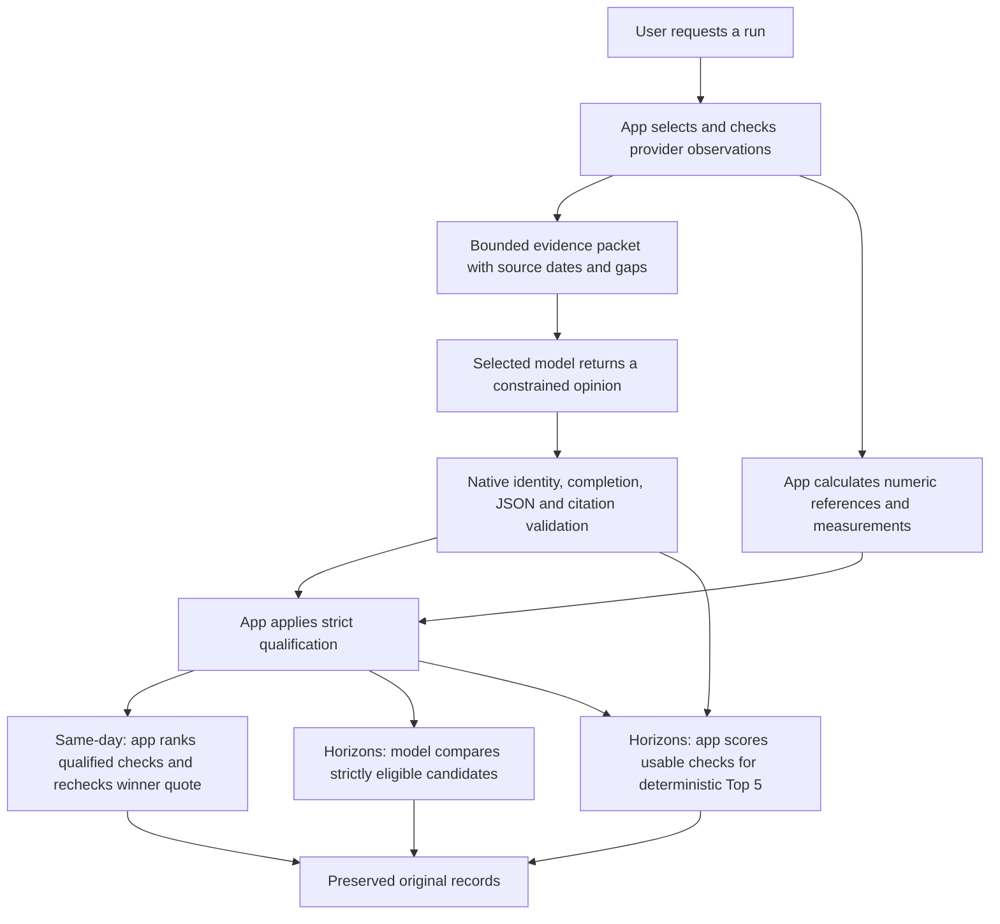

# Gemma in StockSage: model, evidence, research, and reproducibility

Prepared for **Saleh**

**Living edition 43 · Updated 22 September 2026, Asia/Riyadh.** The iPhone audit fixes passed the full iOS regression suite and focused Mac checks; a signed Release is ready. Installation is pending because the physical iPhone disconnected. Installed phone baseline remains `8744624`; previous Mac/Saleh observations retain their dates.

### iPhone audit and notification repairs — 22 September 2026

Notification taps are buffered until the workspace attaches, including launch from a stopped app; dismissed notifications do not navigate. Lost headphone/output routes stop the chime, brief and queue. Audio-session activation/release runs serially off the UI thread; stale callbacks cannot restart a stopped preview. Cancelled speech releases the session, foreground transitions leave system chime ownership intact, and rejected research deliveries may retry on a subsequent fresh update.

Settings now displays the actual notification permission, links to iOS notification settings and offers a five-second local test with a clear/cancel control. The test opens Saved research without running research or placing an order. Gain reads the bound preference store and survives reopening; changing a voice or tone stops the previous preview. The original four tunes, twenty-word brief limit, Silent behavior and foreground/background distinction remain.

**Verified source `5188ae1`:** `tools/gate.sh . all` passed (Mac 94 seconds, iOS 89 seconds, test-source check 233 seconds). Full iPhone 16 Pro Max/iOS 27 simulator suite: **3,140 definitions / 3,960 executions / zero failures / four existing skips**, **340.464 seconds**, no xcresult runtime warnings and a passing targeted native diagnostic check. Focused Mac suites: **97 definitions / 223 executions / zero failures or skips**, no runtime warnings. New cold-launch, failed-delivery, native mixing and normal/largest-text/RTL settings fixtures passed. The 463-file source manifest is unchanged. The audit retains initial test failures, corrected outdated expectations and the simulator window-scene failure resolved by a clean boot. Thirty initial destination viewports plus changed/representative captures were visually reviewed; all 586 final-run captures are retained locally.

**Built, not installed:** the signed iPhone Release and all four sound-resource hashes passed verification. Binary SHA-256 `4136b5d9dd41db0e0e2dd855be18895b02d180dfd0e0c539d591edf41a5a097f`. CoreDevice error 4016 reports the phone unavailable, so the installation attempt did not replace its existing app. Before disconnecting, the physical baseline rendered Watchlist/Settings and passed **HTTP 200, AAPL snapshot received** using its saved key. The stream still showed reconnecting; sustained live-feed readiness is unverified. Mirroring later required renewed Mac authentication. Actual sound, foreground/background delivery and unplugging headphones remain physical checks. Previous signed build and private app-data backups are preserved. [Audit, primary Apple sources and receipts](../docs/reviews/2026-09-22-iphone-heavy-verification.md).

No model loading, live research, paid GPU or broker action was used. The phone connection check verifies that snapshot route, not every phone provider entitlement. Widget behavior remains unverified.

### iPhone research notifications and audio — 22 September 2026

The owner requested light, comedic game-style chimes and chose **chime + short spoken brief**. A shared iPhone handler now serves existing price/Buy/Sell notifications and fresh research completions. Four original 1.45-second bell motifs replace default notification audio; routine full-refresh vibration is removed. New saved horizon results and terminal same-day/cap receipts ring once per fresh run; restored history, repeated outcome reviews and unfinished progress stay quiet. Briefs distinguish completed, incomplete and stopped checks without claiming an executed order. Tapping research notifications opens Saved research.

**Settings → Notification audio** exposes research alerts, chime/speech toggles, gain from −24 to 0 dB, mixing/ducking/pausing other audio, current speaker/output with the system route picker, voice selection, event-specific sounds and local previews. Foreground audio plays a chime followed by at most twenty words; only the newest pending brief is retained, with a ten-second cleanup bound. Background iOS notifications use the selected chime with gain baked into bounded local sound files. Background speech, continuous research execution and remote research pushes are not implemented by this handler. Silent mode, system volume and iOS notification permission still apply.

**Verified source `8744624`:** the complete `tools/gate.sh . all` passed (macOS, iOS and all test-source compilation); the focused serial native suites passed **46 definitions / 53 executions / zero failures or skips**, no xcresult runtime warnings, and the targeted UI diagnostic guard. The signed physical-phone Release passed strict signature checking, contains all four byte-matching sound resources and matches an unchanged 458-file source manifest. It was installed over the existing app and launched after owner unlock; process inspection matched main PID **8843** to the new container. The existing widget dependency compiled; widget behavior remains unverified. Hearing the actual phone output is a separate pending check, not established by the asset decoding tests. [Detailed receipt](../docs/reviews/2026-09-22-notification-audio.md).

No model prompt, model output schema, numeric arithmetic, qualification or ranking changed. No live research, model inference, paid GPU or broker action was used for this verification. The Mac UI retains its previous sound behavior. API connectivity findings below remain separate from this audio milestone.

### Current API and iPhone verification — 22 September 2026

Salman requested API verification after launching the Mac app, then explicitly requested building and running the phone app. This resumes the iPhone build/install scope. Native Mac Settings reported **HTTP 200, AAPL snapshot received**; the live SIP stream was receiving trades and quotes. The running DMG executable matches the verified `2f711da` artifact.

With the owner's one-time Keychain approval, **22 bounded endpoint checks returned HTTP 200**: snapshot, daily history, trades, quotes, news, dividends, splits, Massive 8-K/Form 4, all nine integrated Benzinga products, and four fundamentals routes. Median request latency was **548 ms**, range **510–1,629 ms**; this is a small sequential access sample, not a throughput or data-completeness benchmark. Keys remained in memory and were excluded from logs/receipts. The audit corrected its first consensus URL; current application source already uses the correct ticker path.

**Remaining gaps on Salman's Mac:** Telegram has no saved bot token. SEC contact is unset and direct SEC access was not retested. RunPod account authentication works, but no running GPU/Gemma pod exists in that accessible account; port 18080 remains unreachable and local LM Studio has no Gemma. No model loading, generation, research run, paid compute or broker action was started. Mac credentials do not prove iPhone credential availability.

**iPhone:** Release source `8df6d22` compiled and passed strict signature validation; the app was installed over the existing `com.salman.StockSageX` on the connected iPhone 16 Pro Max, iOS 27. Local external signing overrides preserved its app/team identity and left repository settings unchanged. The required existing widget dependency compiled; widget behavior was not verified. The initial locked-screen block was resolved after owner unlock: the main app launched as PID 8670. The later notification update above supersedes that build. [Endpoint and build receipts](../docs/reviews/2026-09-22-api-and-iphone.md).

### Mac and Gemma image build — 22 September 2026

**Current check on Salman's Mac: Gemma is not connected.** StockSage selects `localServerOnly`, canonical Gemma and `http://127.0.0.1:18080`, but there is no listener/tunnel at that port. LM Studio responds at 1234, but its current inventory has no Gemma model. The accessible RunPod account lists no Gemma pod and no running GPU pod. This does not inspect Saleh's separate account; the historical B300 receipts remain dated observations. Salman's installed app metadata identifies `b0ca7ac`, distinct from Saleh's last recorded `f578733` installation.

The latest application source `2f711da` built successfully as an arm64 Mac Release. The staged app is locally ad hoc signed and signature-verified; it is not Developer ID signed/notarized. The DMG checksum passed; all eight extracted ZIP and mounted DMG files match the staged bundle. At the initial packaging check these artifacts were not installed or launched. The later check above verifies Salman running the DMG app; the Applications copy is unchanged. Three serial native model suites passed **60 definitions / 137 executions / zero failures or skips**, with an empty xcresult runtime-warning list and a passing targeted UI diagnostic guard. macOS also logged nonfatal Apple `linkd.autoShortcut` connection messages. These are injected-transport tests, not live model inference.

A Linux amd64 RunPod image is built from the current official CUDA 13 server pinned by digest. It uses llama.cpp build **11096 / `c550d2f60`**, newer than the historical measured `8172e657`; previous latency, quality and GPU-memory results are not transferred to it. The pinned 17.65 GB GGUF's bounded metadata read verified `gemma4`, 833 tensors and the **same 18,682-byte embedded template hash** recorded below. Weights stay on a mounted volume and are fully checksum-verified before runtime start. The image contains no weights or private credentials, exposes SSH only and keeps inference on pod loopback. All twenty launcher options are supported by the binary. Network-disabled smoke checks passed for missing key, missing GPU and corrupt weights; no CUDA inference was run. [Container source and operating instructions](../deploy/gemma-runpod/README.md).

**Handoff decision:** the old 16 September requests for `InferenceProfile`, cohort comparison and production quality-report wiring are already implemented in current source. They were not reimplemented. Remaining model work is authorized registry publication/pod deployment, a private tunnel and live readiness/inference verification. No paid compute, provider research or broker action was started. [Build receipts and boundaries](../docs/reviews/2026-09-22-gemma-images.md).

### Extended-hours price display — 22 September 2026

The existing Mac polling and streaming schedule already covers pre-market and after-hours. The display filter previously excluded Form T because it does not update the official regular-session last sale, and Yahoo fallback only selected `regularMarketPrice`. The new path admits referenced Form T (`12`, exact reference name and volume-update metadata) only during the verified exchange calendar's extended sessions. Unknown/mixed disallowed conditions, invalid timestamps, unsupported dates and old participant timestamps retain rejection behavior. The raw-trade ordering cache remains separate from eligible display prices.

Yahoo fallback requests `interval=1m&includePrePost=true`, considers dated pre/post-market metadata and aligned minute closes, and selects only a valid newer extended observation no later than the parsing clock. The selected observation keeps its own timestamp and the genuine previous-close baseline. Yahoo retains its delayed provenance and cannot acquire paper-trade qualification.

Watchlist/idea price provenance now includes **Pre-market** or **Post-market** and **live**, **delayed**, **last** or **awaiting price**. A live label requires a same-day, current-session, uncached Massive observation within the existing ten-second freshness threshold. Cached or aged observations are last-known, Yahoo is delayed, and an observation from another session does not become live because the wall clock changed. These are display prices; saved research entries, stops, targets, qualification and model contracts remain unchanged. The supported calendar is still 2026; overnight trading outside its verified sessions is not newly enabled.

**Verification:** Mac compile and test-source checks passed; the serial native gate passed **158 definitions / 256 executions / zero failures or skips** across ten suites. The normal test build first stopped because this Mac lacks the project development certificate; a temporary external xcconfig used ad hoc test-host signing without changing project settings. No installed app or live-provider verification was performed. The eight changed source/test files matched their pre-test SHA-256 manifest afterward. The wrapper's targeted native diagnostic check passed. `tools/gate.sh . tests` intentionally skipped iOS under the owner's Mac-only direction. This is focused regression coverage, not a new full-suite or speed benchmark. [Review and reproducible commands](../docs/reviews/2026-09-22-extended-hours-prices.md).

Source: [display condition policy](../StockSage/Sources/StockSage/StockSageMassiveTicks.swift), [snapshots](../StockSage/Sources/StockSage/StockSageMassive.swift), [fallback parsing](../StockSage/Sources/StockSage/StockSageQuoteService.swift), [Mac price labels](../StockSage/Sources/Views/MarketsView.swift). Provider reference: [Massive extended-hours condition explanation](https://www.massive.com/blog/us-equities-move-to-23-5-trading). No live provider request, model inference, pod operation or broker action was used to implement this change.

Prepared from the installed Mac baseline verified on **20 September 2026**, with the owner-approved **21 September** update below. Historical Release `92be0b2` was installed at 23:34:07 Riyadh and passed 3,216 definitions / 4,135 executions. Those observations remain dated evidence; the current installed Release is `f578733`.

**Historical edition 38 update · 21 September 2026, 20:52 Asia/Riyadh.** The Micro cap float repair passed focused Mac verification; signed Release **71cf39e** and ZIP passed; installation remains pending. Signed Release **`f578733`** remains installed with scanner-linked news, retaining the SEC contact setting, all-matching momentum, Astra cap modes and **150-second setup cadence**. Installation completed at **19:50:42 Riyadh** and the matching executable reopened at **19:50:51**. All **twenty saved runs / 3,068 compared files** were byte-identical and preferences unchanged before tracking was restored. The screener and matched-news panel passed bounded installed inspection; **Load matched news was not clicked**, so live headline access remains unverified. Micro and Large cap tracking were restored under the owner’s prior authorization, both warming with zero ready symbols at enable and Telegram paired. Automatic checks began upon restoration; no manual Gemma, pod, broker, SEC or Telegram test was run. The owner’s SEC-access deferral remains in effect. Gemma research and outcome reviews remain manual; iOS/widget work remains paused.

**21 September live momentum follow-through, 20:49–20:52 Riyadh:** the owner supplied received Large cap Telegram observation messages for CBRS (17:39 UTC), SHOP (17:43) and GRAB (17:45). These establish owner-reported observation delivery, not accepted Astra research. Native saved history for SHOP (20:43:16 Riyadh) and GRAB (20:45:05) explicitly reports: “Codex research isolation could not be verified. No opinion was accepted.” CBRS’s saved review was not inspected. At the bounded UI snapshot, Large cap monitored 610 dated eligible symbols, with 385 ready and 225 stale or gapped; the counters showed zero pending Astra reviews, zero expired reviews and one revoked item. These aggregate counters cannot identify a particular event. A regular Large cap screen was active from 20:45:31. A separate metadata-only diagnostic using the current, unchanged Codex adapter passed version/login, both configuration checks and model catalog checks, then deliberately intercepted execution before inference. It did not reproduce or fix the installed failure, and no new stock review or message was requested. Root cause and successful installed stock Astra assessment remain unresolved. Source review confirms that queued reviews can also expire behind active research: their deadline remains the original observation plus 180 seconds, with no guaranteed cross-mode priority. That possible queue limitation is not the demonstrated cause of the SHOP/GRAB isolation errors. Local sanitized receipt: `work/astra-momentum-diagnostic/metadata-receipt.json`.

**Historical SEC-contact milestone — retained in the current build:** reviewed source **`9861561`** adds a locally saved contact email in **Mac Settings → Data sources** and a shared SEC User-Agent resolved afresh for each request. Explicit Save/Remove makes no network request; absent or invalid contact data retains the existing fallback. The final full Mac gate passed **3,220 definitions / 4,163 executions / zero failures / five skips**; the signed arm64 Release build, ZIP, subsequent installation and saved-record preservation are verified. Native synthetic Save/Remove/request checks and the installed empty-field accessibility/visual check are separate evidence. A real email remains absent and live SEC verification was explicitly deferred by the owner. Earlier `d0e42cb` HTTP 403 observations retain their dates and do not establish a new contact-based response.

**Historical 21 September diagnostic milestone — `d0e42cb`:** reviewed runtime commit `d0e42cb` makes Company Facts request failures specific: HTTP status, timeout, response-size limit, cancellation/access change, response mismatch or another transport failure. Only fixed messages and numeric HTTP status reach the existing unavailable metric/source notes; raw response bodies, error details and unexpected URLs are excluded. The shared optional SEC helper keeps its existing contract and rechecks access/cancellation after awaiting the typed result. URL/redirect restrictions, the 15-second timeout, 4 MiB cap and annual accounting rules remain intact. This diagnoses missing evidence; it does not restore blocked SEC access or manufacture ratios. The new 11-case regression failed on the previous source. Focused checks passed 66 definitions / 102 executions, then the final full Mac suite passed **3,217 definitions / 4,146 executions / zero failures / five existing skips**, with direct xcodebuild exit 0 and the targeted native diagnostic guard 0. The 576-file source manifest was unchanged. The full UI suite still logged six excessive-window-count warnings (five in the earlier baseline); a targeted guard pass is not an all-warning-free claim. The signed arm64 Release build also passed (exit 0), with executable SHA-256 `ea520825f353cdbc55b673e4da1c34ab2510a9fb07a4e0971a0fd21117538f21`. Its ZIP, `outputs/StockSageX-macOS-d0e42cb.zip`, is 9,093,304 bytes, SHA-256 `2b66a660863aa5fc2ff09cbd4b07f8fb4d06e4252e0118dcb1a918184692f84c`; all eight extracted file contents and the extracted signature were verified. The owner subsequently approved that restart, and `d0e42cb` was then installed; `9861561` subsequently superseded it before the current `f578733` installation. `work/sec-diagnostics/installation.json` binds the signed executable to the reopened PID; `record-preservation.json` confirms **twenty saved runs / 3,068 compared saved files**, hashes, saved-file sets/IDs, checked preferences and active-record image unchanged. The previous bundle is retained at `work/pre-sec-diagnostics-backup/previous-bundle`.

**Historical pre-update observation:** at **21 September 00:49 Riyadh**, both installed `92be0b2` cap pages again showed Automatic checks enabled, Telegram paired, and correctly paused outside the weekday tracking window. The executable still matched the installed `92be0b2` hash. A separate credential-free, no-redirect public AAPL Company Facts request, using the app's declared User-Agent and bounded to 15 seconds / 4 MiB, returned **HTTP 403 at 00:49:26 Riyadh**. This was not an installed-app request and does not retrospectively identify the earlier installed error. No live momentum, installed stock Astra assessment, delivery or successful SEC calculation is established. At that observation the app stayed open and the test host exited; the later approved installation is recorded above.

**Historical installed-app verification, `d0e42cb`, 21 September 01:27–01:31 Riyadh:** the first verified ratios reload captured **01:27:58**, with latest observed capture **01:29:52**. The installed `d0e42cb` view showed **4,989 provider rows / 316 invalid / 3,680 supported**; Micro **526 matched / 2,111 excluded / 1,043 unavailable**, Large **583 / 2,054 / 1,043**. AAPL Company quality captured **01:28:45**, with provider ratios dated **18 September**. Both annual ROCE and ROIC visibly and in accessibility text said **“SEC annual fundamentals unavailable: SEC returned HTTP 403.”** This is an actual installed-app result, distinct from the earlier direct public probe. The sheet was readable in the top/bottom visual review and closed; the screener was restored to Micro cap with empty search. Both trackers were explicitly re-enabled and showed Automatic checks enabled, Stop watching, Telegram paired and outside-window pause. The final view was Micro cap. Post-UI preservation again confirmed twenty runs and all 3,068 compared saved files, hashes/sets/IDs, checked preferences and active image unchanged; no matching new StockSageX or Sky helper crash reports were found since installation. This is bounded screener/company-sheet/tracker verification, not all-surface runtime, stock Astra, live-event or delivery proof. Receipt: `work/sec-diagnostics/installed-live-ui.json`.

| Status | Evidence at this revision |
| --- | --- |
| Extended-hours display: tested, not installed | Source `256f838`. Mac compile and test-source checks passed; the serial native gate passed **158 definitions / 256 executions / zero failures or skips** across ten suites. The normal test build first stopped because this Mac lacks the project development certificate; a temporary external xcconfig used ad hoc test-host signing without changing project settings. No installed app or live-provider verification was performed. |
| **Micro cap float repair: not installed** | A bounded Massive HTTP 200 read confirmed 5,000 clean first-page float rows and 1,856 second-page rows, one without a ticker and no duplicate identities. The old parser aborted the whole Micro cap screen before detailed collection. The source repair counts/discloses unidentified rows and retains valid identified floats; listings with absent or invalid dated float remain unavailable. Duplicate identities are rejected across pages even when one occurrence has invalid float values. All qualification thresholds remain unchanged; the screen count now measures reference rows. Optional persisted `unidentifiedFloatRows` preserves decoding of older records. The primary failure and duplicate-identity gap were reproduced by failing regressions. Final focused Mac checks passed **65 definitions / 93 executions / zero failures or skips**, direct exit 0 with unchanged 462-file manifest `403afb4be339dae1e4ffe6cc57392034ec971d17b89890a87efb72da153b64c0`; targeted native diagnostics and excessive-window warnings were both zero. Saved-warning fixtures at 660 and 1,000 points passed accessibility and individual visual checks. This is a focused gate, not a new full-suite run. Signed arm64 Release **71cf39e** and its extracted ZIP passed identity/signature checks; installation remains pending. Candidate executable SHA-256 `44bcb5182264364385165753150ee697fbc83bf30a26fa3f512eae791206963d`; ZIP SHA-256 `3ded12cf0862623d0fd0fa5d691fee656bb0a895c0b1647801c183988de25660`, 9,196,783 bytes. Receipts: `work/float-screen-fix/focused-receipt.json`, `release-identity.json`, `review.json`, and `live-diagnostic-pages.json`. The current app has not been replaced and no fresh installed screen has been validated with this repair. |
| Scanner-linked news: installed | Full Mac gate: **3,224 definitions / 4,167 executions / zero failures / five skips**, direct exit 0 and unchanged source manifest. Native controls/narrow layouts and signed Release/ZIP passed; five excessive-window-count warnings remain. **`f578733` installed 21 September 19:50:42 Riyadh, reopened 19:50:51**. All **20 runs / 3,068 compared files** were byte-identical and preferences unchanged before tracking was restored. The readable matched-news panel showed 526 matches / 0 processed; **Load matched news was not clicked**, so live headline access remains unverified. |
| **Installed and preserved** | Release `f578733`, signed executable SHA-256 `c10aa648…`; installed **21 September 19:50:42 Riyadh**, reopened 19:50:51. **20 runs / 3,068 compared saved files** were byte-identical and preferences unchanged before tracking restoration. Full identity is in section 14. |
| **Installed Mac gate** | **3,224 definitions / 4,167 executions / 0 failures / 5 skips**, direct exit 0; unchanged source manifest `641c48ef…`. Five excessive-window-count warnings remain; this is not an all-warning-free claim. |
| **SEC contact installed; access check deferred** | `f578733` retains the local Save/Remove and per-request User-Agent introduced in `9861561`. That earlier build passed synthetic request/setting checks and an installed empty-field review. The owner deferred SEC access verification; no new SEC request or contact-entry check is claimed. |
| **Installed UI verified** | `f578733`: screener reloaded at 19:51:29 Riyadh; matched-news panel readable with 526 matches / 0 processed. Micro tracking restored at 19:55:10 for 526 eligible symbols and Large at 19:55:25 for 584; both warming / 0 ready at enable, Telegram paired. Watchlist’s earlier “another process owns records” warning was absent after restart; its root cause is not established. Final view Watchlist, details closed. |
| **UI access boundary** | The original Codex SkyComputerUseService 26.916.1001103 crash was reproduced in an isolated screener host. The minimal heading workaround passed that reproduction and the installed `92be0b2` checks. Later user-navigation interruption is separate from the original failure. This is bounded controller compatibility, not every accessibility tool or all-route proof. |
| **Astra and Telegram** | The exact production adapter passed a **16.957-second synthetic canary**, requesting GPT-6 Astra/Ultra through the Codex subscription. The event stream did not report a model identity. This is not installed stock research or a quality guarantee. Direct Telegram verification confirmed @stocksage_bot. The owner completed pairing; the saved state reports ready. No alert delivery was tested. |
| **Company data** | Installed `f578733` reload **21 September 19:51:29 Riyadh**: **4,986 provider rows / 314 invalid / 3,680 supported**; Micro **526 matched / 2,110 excluded / 1,044 unavailable**. Earlier AAPL annual-metric HTTP 403 notes remain dated `d0e42cb` evidence. No successful SEC calculation is claimed. |
| **Installed all-matching runtime** | Release `f578733` retains the tested detector and queues. Detection has no 24-symbol or display-row cutoff; REST confirmation, dated eligibility, warm-up, cancellation and event expiry remain required. No live event or throughput result is claimed. |
| **Integrated concurrency and cadence** | Concurrency `18f29f0` merged through `94c6f14`; installed `f578733` retains 150-second setup checks for both cap modes. These changes passed the combined full gate and are in the verified installed bundle and matching ZIP. |
| **Historical installed-build ZIP** | `outputs/StockSageX-macOS-2e6493c.zip`, 9,020,119 bytes; eight extracted file contents and signature verified by the lead. It contains the previous baseline, not the new all-matching implementation. Full hash is in section 14. |
| **Verified current-build ZIP** | `outputs/StockSageX-macOS-f578733.zip`, **9,195,447 bytes**; extracted file contents/modes and signature verified. It matches the tested installed Release; full hash is in section 14. |
| **Preserved Gemma research** | Each horizon retains **1,500 saved checks**. Week: **1,475 accepted / 25 incomplete**, one strict-qualified candidate and comparison pick **BWIN**. Fortnight: **1,436 accepted / 64 incomplete**, eleven strict-qualified candidates, but strict comparison failed because complete candidate context could not fit. Both deterministic Top 5 records remain saved. |
| **Stopped compute and unresolved limits** | The Gemma pod was stopped at **10:00:45 UTC**, not terminated; persistent storage remains and final billing was not checked. The 4× speed goal, general semantic quality and definitive causality/repair of the earlier crash remain unproven. Historical timings, quality findings and earlier Releases are retained below. |

**Installed behavior:** Run Both publishes and checkpoints each stock’s week check before its fortnight check; Resume Both preserves each horizon independently. A matching week opinion may be supplied as historical context after native output validation. **This is not a requirement that automated quality be verified or strict Buy gates pass:** unverified-quality priors remain eligible with visible flags. Sampled live transport is verified; semantic benefit is not. Details are in section 7.

Installed `f578733` retains the preservation, outcome-review, acceptance/disclosure, cap, fundamentals, all-matching momentum, queues, concurrency and 150-second cadence implementation, plus the screener-heading workaround and SEC contact setting/header. Its new feature is manual scanner-linked news. Earlier `9861561`, `d0e42cb`, `92be0b2`, `d9765fa` and `2e6493c` observations remain dated history; each receipt applies only to its recorded source state. Work is **macOS only**. iOS/widget work remains paused. Detailed receipts and their boundaries are in section 13.

StockSage uses a pretrained Gemma model to interpret bounded evidence and return constrained opinions. StockSage code retrieves the evidence, measures prices and indicators, calculates entry/stop/target references, enforces qualification, ranks candidates, and preserves records. **No StockSage Gemma training or fine-tuning was found in the inspected application and runtime paths.** Providing a model with new market evidence at inference time does not update its weights.

The installed Gemma product has three manual research destinations: **Same-day**, **1–7 trading days**, and **7–14 trading days**. Same-day can publish one qualified pick with numerical references. Each longer horizon has a saved deterministic Top 5 alongside a separate strict model comparison. A visible ranked row is not automatically a qualified Buy. In these Gemma workflows, runs, retries, and outcome reviews require an explicit request. The separate Micro cap and Large cap tracking/assessment authorization below does not change those modes or authorize a new paid API, pod or order.

On Mac, **Micro cap, Large cap and Stock screener** now join the research destinations, **Watchlist, Markets and Library** in the main sidebar. Library retains supporting tools and **WhatsApp messages**. The sidebar and both cap pages were observed on previous `2e6493c`; after installing `d9765fa`, Same-day and both cap pages were revisited with the updated coverage/cadence copy. The later Stock screener control failure was attributed to the Codex helper and reproduced in isolation. The workaround was verified in `92be0b2` and is retained in installed `f578733`; the earlier lead-observed live reload, both presets, AAPL search and Company quality sheet remain dated evidence. The older loaded-results screenshot remains separate evidence, while unvisited routes remain unverified. This is not an all-route or changed-disclosure interaction check. The preserved iPhone implementation retains its earlier destinations; its recorded checks are historical, not authorization to resume iOS work.

### Mac quick-use checklist

These controls are in the installed expanded Mac Release. Both multi-day horizons can select up to 1,500 eligible Nasdaq plus reported S&P 500 stocks; Same-day still researches at most 24. See section 7 for eligibility, evidence gaps, and source provenance.

1. **Check data access.** Open **Settings → Data sources**. An existing saved Massive key is not displayed in the field; use **Test connection** to check snapshot access. For a new or replacement key, enter it and explicitly choose **Save key** first. Testing uses the saved credential, not an unsaved edit. If the app reports **Keychain unavailable**, unlock or restore StockSage's access and retry; that message does not establish that the key is missing. A passing snapshot does not verify every add-on.
2. **Save optional private context.** Open **Library → WhatsApp messages**, or the **WhatsApp messages** button in Chat. Paste one excerpt, include its exact ticker, set the actual **Message date**, optionally label its source, and choose **Save excerpt**. Saving does not run Gemma. These notes are used by matching Chat/manual individual assessments, not the three research scans; see section 10.
3. **Choose and run a manual workflow.** Check the displayed model status in **Library → Events & model setup**, then explicitly run **Same-day**, **1–7 trading days**, or **7–14 trading days**. Same-day can produce one qualified pick; each longer horizon preserves its deterministic Top 5 separately from strict comparison. Opening a destination does not authorize a run. Installed **Run Both / Resume Both** runs each stock week before fortnight and preserves matching saved checks independently, as described below.
4. **Read the dated result and blockers.** Check evidence dates, provider/model failures, qualification status, failed gates, and the app-calculated entry/stop/target references. A historical result, incomplete source, or visible not-qualified rank is not a new accepted Buy. Retry or check saved outcomes only when you choose to do so.
5. **Configure optional cap tracking and phone alerts.** Open **Micro cap → Set up Telegram alerts**, create a bot with BotFather, save/verify its token and complete private-chat pairing. The owner completed pairing; its saved ready state was verified, but delivery was not tested. Use **Enable tracking** separately for each cap mode; tracking requires the app open and Mac awake within the weekday window. First load **Stock screener → Load daily ratios** or complete the matching cap screen for dated cap/listing classifications; watchlist membership alone is insufficient. **Installed `f578733` retains detection across all dated eligible symbols and queues fresh events.** Its full Mac gate, signed build, ZIP, installation and preservation are verified. After the `f578733` restart, the lead verified the 19:51:29 Riyadh reload and restored Micro tracking at 19:55:10 and Large at 19:55:25; both were paired and warming with zero ready symbols at enable. These in-memory classifications and tracking state still require restoring after a future restart. Check the captured date and coverage before relying on classifications; previous `2e6493c` and its older ZIP retain the old 24-symbol momentum scope. A descriptive observation is not a qualified trade plan; manually loading the screener does not start a model run.

## 1. What the model names actually identify

| Name or property | Meaning in this implementation |
| --- | --- |
| Gemma 4 | Upstream model family. It does not identify an exact downloaded file. |
| 31B | The selected dense size variant. The upstream card describes approximately 30.7 billion parameters. |
| `it` | Upstream instruction-tuned lineage. It is not a StockSage training designation. |
| `QAT` | Upstream quantization-aware training lineage. StockSage does not perform QAT in the inspected code. |
| `Q4_0` | The selected quantized GGUF variant. The local inventory contract requires four-bit quantization metadata. This does not mean the whole runtime, every tensor, and its caches occupy exactly four bits per value. |
| `google/gemma-4-31b-qat` | The canonical application model identifier. A server advertising this name alone does not attest to its weight bytes. |
| GGUF | The model artifact used by the inspected local/hosted inference setup. It is distinct from the upstream BF16 Safetensors release. |

The supplied local identity receipt records `gemma-4-31B-it-QAT-Q4_0.gguf`, **17,651,001,280 bytes**, GGUF version 3, 833 tensors, architecture `gemma4`, size label `31B`, 60 blocks, and metadata context length **262,144**. Its recorded SHA-256 is:

```text
6f63619c9e33826a2a8ab195a344c79ecae7c82341d5567e28fd8863df056a7b
```

The local file identity above comes from the supplied historical inventory receipt; it does not imply a fresh verification of the local copy. Separately, the lead rehashed the remote B300 weights with `sha256sum`, matched the expected SHA-256, and verified the running server's health, canonical model alias and serving properties as recorded in section 4. The receipt's human-readable metadata includes `Google_Gemma 4 31B It Qat Q4_0 Unquantized` and `it-qat-unquantized`. Those strings describe upstream/intermediate lineage; they do not override the selected final Q4_0 artifact or establish an owner fine-tune. The file's metadata also includes sampling defaults, but StockSage's actual request overrides temperature to 0.2. Metadata is not proof of effective serving settings.

The runtime preparation source pins community distribution `lmstudio-community/gemma-4-31B-it-QAT-GGUF` at revision `12e5eae7a583b0a8bac91919fa99ae1fb27e6de4`, downloads the file above as `gemma.gguf`, and checks the same expected hash. The Google model repositories establish upstream lineage, not byte identity with this community distribution. [Google instruction-tuned release](https://huggingface.co/google/gemma-4-31B-it), [Google QAT GGUF release](https://huggingface.co/google/gemma-4-31B-it-qat-q4_0-gguf).

## 2. Upstream training: what is documented and what remains unknown

The supplied verification notes cite Google DeepMind's report revision 2, dated 24 July 2026. It describes pretraining broadly following Gemma 3, using web documents, code, and images, with a stated January 2025 pretraining cutoff. Audio training is discussed for other specified variants, not the selected 31B audio capability. It describes filtering for contamination, safety, and recitation; instruction tuning with optional thinking; post-training filtering; and QAT deployment formats including blockwise Q4_0. These are upstream processes, not steps performed by StockSage. [Gemma 4 technical report, sections 2.4, 2.5, and 3](https://arxiv.org/html/2607.02770v2).

The family card describes multilingual web data, code, mathematics, and images. The selected dense 31B model supports text and image input, has 60 layers and a 256K advertised context, and has no audio encoder. StockSage's inspected research path supplies **text**; upstream image capability does not establish image use here. The card's filtering descriptions are not guarantees that sensitive content, bias, incorrect knowledge, or unsafe output have been eliminated. [Google Gemma 4 model card](https://ai.google.dev/gemma/docs/core/model_card_4).

Google's QAT documentation distinguishes half-precision weights extracted from QAT from deployable quantized formats. Its quality and memory goals do not establish that every task retains BF16 quality, that the community file is identical to Google's distribution, or that this model was trained as a stock-selection specialist. [Google QAT release documentation](https://huggingface.co/google/gemma-4-31B-it-qat-q4_0-gguf).

The reviewed upstream material does **not** provide a complete reproducible training recipe: every dataset and mixture proportion, exact token counts, optimizer schedule, all supervised/reinforcement stages and reward details, and full QAT training/calibration settings are not established by these notes. “Similar to Gemma 3” is not evidence that every earlier recipe detail applies. Lack of disclosure does not prove a source or method was unused. StockSage's runtime scripts cannot fill those gaps. [Gemma 4 technical report](https://arxiv.org/html/2607.02770v2).

Further official references are the [Gemma 4 prompt format](https://ai.google.dev/gemma/docs/core/prompt-formatting-gemma4), [thinking capability documentation](https://ai.google.dev/gemma/docs/capabilities/thinking), and [fine-tuning documentation](https://ai.google.dev/gemma/docs/tune). These describe upstream capabilities and practices; their existence is not evidence StockSage has fine-tuned a model or enabled thinking.

## 3. What StockSage adds at inference time



In these Gemma research requests, the model does not log into providers, browse arbitrary sites, or operate a broker. The app sends a system message and a user message to an inference API. The newer Micro cap and Large cap candidates use the separate restricted Codex CLI boundary described in section 4. StockSage compiles observed facts and attributed source claims, keeps important missing-data notices, constrains output, and validates the answer. These mechanisms reduce specific failure modes; they do not make the model's reasoning factually or financially correct.

The inspected runtime scripts download an existing artifact and build/run an inference server. Their benchmark replays frozen inference requests and labels its Python checks preliminary, with `native_validation: "not_run"`. Later extracted Swift text checks cover a specific validator contract, not the complete application acceptance path. Neither inference, replay evaluation, an allocation optimizer elsewhere in the app, nor saved outcome calculation constitutes neural-model training. No weight update, adapter application, training optimizer, or backpropagation was found in these inspected paths. This is a bounded source finding, not a claim about every historical experiment outside the repository.

Primary source: [LocalModelServer](../StockSage/Sources/StockSage/StockSageLocalModelServer.swift), especially `chatRequest`, `completeDetailed`, and strict completion validation.

## 4. Local and hosted runtime contracts

| Property | Managed local Gemma | Managed hosted Gemma |
| --- | --- | --- |
| App endpoint | `http://127.0.0.1:1234` | `http://127.0.0.1:18080` |
| Expected identifier | `google/gemma-4-31b-qat` | Same exact identifier |
| Profile boundary | Canonical identifier, loopback, port 1234, root path | Canonical identifier, HTTP, loopback, port 18080, root path |
| Discovery | LM Studio inventory with verified GGUF / `gemma4` / `31B` / `Q4_0` / four-bit metadata | `/v1/models` must contain exactly the selected model row |
| Serving readiness | A unique canonical loaded instance, verified context, parallelism 1 | `/props` must establish an awake context of at least 16,384 tokens; the installed prior-enabled fortnight branch additionally requires verified capacity of 24,576 before POST |
| Research workers | 1 for the strict local serving contract | **Owner maximum 16.** The completed hosted run used four slots. Installed code also recognizes the historical 24-slot profile, which was not authorized for this run. Unsupported advertised counts fall back to 1. The pod is now stopped. |
| Data destination | Configured local server | Off-device processing through the private tunnel, despite the loopback app URL |
| Failure | Explicit unavailable/unverified status | Explicit unavailable/unverified status; no silent local fallback for a different remote model |

**Local Mac versus the pod:** the lead verified the owner’s Apple M5 Max with 48 GB unified memory. The selected 17.65 GB weight file fits within that capacity, but available memory must also cover runtime buffers, KV caches, macOS and other apps. Local Metal inference is supported; that does not establish B300-equivalent speed. There is no matched current Mac-versus-B300 benchmark using these exact requests, context settings and native acceptance checks, so no numeric Mac latency or 30-second guarantee is claimed. Older Qwen or differently configured Gemma measurements are not substitutes. The new four-slot, 24K/F16 B300 profile reported **57,394 MiB (about 56 GiB)** of GPU use, exceeding the Mac’s 48 GiB total shared memory. This measured pod footprint is not a claim that every Metal implementation uses identical memory; lower local concurrency and its performance require measurement.

### Micro cap and Large cap: setups and descriptive momentum

**Retained in installed `f578733`; owner-reported observation delivery, failed SHOP/GRAB Astra follow-through.** Both Mac destinations support manual same-day research and explicit **Enable watching**, with separate mode identities, saved receipt directories and setup claims. Their analyst is **`gpt-6-astra` with Ultra reasoning through the owner’s existing Codex subscription**, not local Gemma or a separate paid API. The earlier brief large-cap withdrawal was superseded by the explicit request for **both profiles**; Micro cap’s range is unchanged. The three Gemma modes and manual outcome reviews remain separate. The **13:26:04 UTC** catalog receipt establishes CLI **0.155.0-alpha.9.2**, ChatGPT login and model/effort support, not inference success. Earlier M5 inventory established file/runtime presence, not loading or speed. Receipt: `work/microcap-research/codex-model-catalog.json`.

**Regular-session setup screen and coverage — unchanged.** Micro cap retains active Nasdaq US-dollar common shares with **$50–300 million inclusive cap**, **free float below 20 million shares**, **opening gap at least 10%**, and time-matched **RVOL at least 5×** the mean of twenty preceding sessions. Float must be no older than ninety days; outstanding shares are not substituted. Large cap instead requires **at least $10 billion with no ceiling**, using active Nasdaq or eligible reported-S&P common shares. It does **not** apply Micro cap float/gap/RVOL thresholds: gap, RVOL, momentum and volatility are context, while complete activity coverage and subsequent shared qualification still apply. Neither is a validated strategy. Market-cap provenance records the requested date/retrieval time; no separate provider effective timestamp is supplied. Each regular-session setup scan still details at most **24 candidates**, with at most **four provider workers** per phase, preserving excluded, missing and unassessed classification rows. This setup-detail bound is separate from the new all-matching momentum detector. [Cap screening profiles](../StockSage/Sources/StockSage/StockSageMicrocapScreen.swift).

The opening gap uses the first regular-session minute open and the preceding session’s **Massive daily open-close regular close**, not an after-hours price or substituted last minute. RVOL compares matching elapsed regular-session windows. Annualized volatility remains a **minute-close proxy**, not official daily-close volatility. Missing coverage, ambiguous corporate-action basis, stale data or unsupported sessions remain failures. A passed preliminary screen still needs dated public catalyst evidence, eligible quote/scenario checks, native Astra output/citation acceptance and final fresh-quote verification. Each full setup run can publish **at most one dated qualified pick with code-calculated buy/stop/target**, not Astra-generated prices. [Shared assessment and qualification](../StockSage/Sources/StockSage/StockSageSameDayResearch.swift).

**Watching has two paths.** Enabled tracking runs **Monday–Friday, 11:00–23:00 Asia/Riyadh, with 23:00 excluded**, while StockSage is open and the Mac is awake; it does not wake the Mac or restore itself after relaunch. **Installed stream replacement:** momentum nominations come from completed streaming minutes, with the monitor inspecting current stream state every five seconds rather than polling every stock through REST every five minutes. Both cap groups use their complete dated eligible sets concurrently. The owner-requested regular-session setup cadence is **150 seconds (2.5 minutes) after the preceding cycle completes, for both Micro cap and Large cap**. This cadence is retained in installed `f578733`, covered by the combined full Mac gate and visibly stated on both installed cap pages. Setup research remains restricted to verified regular US sessions after thirty completed minutes and before the last five minutes. The five-second stream intake, twenty-minute detector warm-up, five-minute signal windows and 180-second event expiry are separate clocks and are unchanged. With Telegram paired, durable claims deduplicate setup admission before Astra; unknown attempts do not automatically retry. Stopping or changed access/pairing revokes affected work. No order or guaranteed same-day exit follows. [Watcher and setup claims](../StockSage/Sources/StockSage/StockSageMicrocapMonitor.swift).

**Completed-minute stream detection — installed; owner-reported observation delivery is dated above.** The shared authenticated stocks socket subscribes to **`T.*,Q.*,AM.*`**. A separate reducer retains up to sixty minute buckets for every configured eligible symbol; it does not use the 4,096-row display rotation or a first-24 slice. Above its **32,768-symbol safety bound**, admission fails explicitly instead of silently dropping a prefix. `AM` updates are provisional and can be corrected: each update replaces its candle rather than adding volume, and candidate identity depends on the completed twenty-minute input window, not unfinished candles. A nomination is not a financial fact, alert or accepted review. **REST must independently confirm** verified, split-adjusted completed bars before those outcomes. The dedicated candle route preserves valid uppercase dotted share symbols such as **BRK.B**, without broadening unrelated provider endpoint contracts or substituting trade-only data. [Stream reducer](../StockSage/Sources/StockSage/StockSageMomentumStream.swift), [socket and lifecycle](../StockSage/Sources/StockSage/StockSageLiveStream.swift), [bounded ingress](../StockSage/Sources/StockSage/StockSageFeedIngress.swift).

**Warm-up and gaps.** Each symbol needs **twenty consecutive completed minutes with positive volume** after its admission or a feed interruption. Missing, stale, malformed or gapped coverage remains visible and is not zero or proof that the stock was quiet. Per-symbol membership epochs retain uninterrupted symbols’ candle history when the other cap group changes, but remove history for a symbol removed and re-enabled between publication cycles. Old feed/configuration proofs cannot authorize later work; a socket failure, authorization reset, overload or detected consumer backlog invalidates that session and requires fresh warm-up. Its regressions passed the combined full Mac gate and the matching Release is installed; live warm-up/gap verification remains pending.

**Confirmed context and detail rows.** REST confirmation uses at most **four concurrent stock requests** across cap modes, with a shared SPY/QQQ cache valid for less than 120 seconds within the same access generation. SPY/QQQ are ETF price proxies, not entire-market breadth. The app calculates 1/5/15-minute close returns and stock-minus-proxy differences in **percentage points on exact matching boundaries**. Observations older than 180 seconds are unavailable; assessment-time checks do not renew original capture timestamps. The UI separates complete detection-coverage counts from lazily rendered **Confirmed momentum observations**, which retain the latest confirmed detail per symbol. Those detail rows are not the full monitored universe. No true-VWAP, executable-fill or current-quote claim follows. [Momentum calculations and candle transport](../StockSage/Sources/StockSage/StockSageMomentum.swift), [coverage and observations](../StockSage/Sources/Views/StockSageMicrocapActivityView.swift).

**Heavy momentum is descriptive.** Unvalidated defaults require an absolute five-minute return **≥3% for Micro cap or ≥1% for Large cap**, and latest-five-minute volume **≥3× the mean of the preceding three nonoverlapping five-minute windows**. All twenty completed minutes must have continuous positive-volume coverage; rising and falling moves can trigger. These measures do not establish institutions, a squeeze, catalyst, qualified Buy or future return. The new detector admits symbols only when matching cap/listing eligibility is established from captured screen/screener evidence no older than **seven New York calendar days**. Newer contradictory cap evidence takes precedence over older in-range evidence; watchlist membership alone is insufficient. The installed baseline’s cap-admission tests passed its focused and full gates. The stream integration passed the combined full Mac gate and is installed; live classification/trigger verification remains pending.

With verified private Telegram pairing, a fresh eligible heavy trigger can produce **a Telegram observation plus an Astra Ultra descriptive review throughout the tracking window, including premarket**. The review uses captured minutes, proxies and explicit gaps: news, filings, earnings, fundamentals, insiders and an eligible executable quote were **not collected for this review**. Its saved check stays **unqualified with no entry, stop or target**, even if its action label is Buy. Observation, model review and review-summary delivery retain separate stable IDs by mode/symbol/direction/Riyadh date and thirty-minute bucket. **The installed replacement retains separate confirmation, observation and Astra-review queues instead of discarding all but one pending review.** Replacements for the same event keep their queue position. Streaming intake does not await provider confirmation, Telegram or a model; provider work remains bounded and model work uses shared serial research admission. Current feed/configuration proof is checked per confirmation batch, and individual trigger freshness still expires after 180 seconds. Pending, unconfirmed, expired and revoked work is disclosed; monitoring every eligible symbol does not guarantee every burst can be confirmed, reviewed and delivered before expiry. An accepted review may send a separate dated summary; unknown delivery outcomes do not automatically retry. These queue changes passed the combined full Mac gate and signed Release build and are installed; live event processing remains unverified. [Descriptive assessment contract](../StockSage/Sources/StockSage/StockSageMomentumAssessment.swift), [event admission and queues](../StockSage/Sources/StockSage/StockSageMicrocapMonitor.swift).

**Live activity has a separate clock.** The latest coalesced print/quote, source time, freshness and feed-gap state appear alongside saved classifications. Incoming prints do not recompute frozen RVOL or renew old opinions. There is no complete-tape, Level 2, spoof/iceberg or verified halt/LULD-band claim. Opening the view does not itself open a socket. [Activity and saved rows](../StockSage/Sources/Views/StockSageMicrocapActivityView.swift).

**Codex boundary and synthetic verification.** The adapter checks CLI version, ChatGPT authentication, restricted configuration and model catalog, then requests ephemeral structured output and validates completion, schema/citations and any reported identity. It restricts external tools, memory and filesystem/network permissions; this is **not a zero-tool or no-file-access guarantee**. Codex can inherit global owner instructions, not this conversation’s history. The app copies no OAuth credential and supplies no API key, but evidence uses **hosted subscription capacity**, not wholly local M5 processing. The first synthetic canary rejected before inference at **15:59:36 UTC**, because isolation could not be verified (**76 ms**, CLI version matched). That failure is preserved in `work/microcap-research/astra-canary/receipt.json` as history.

The repaired exact production adapter passed a new synthetic canary from **16:18:56 to 16:19:13 UTC**, elapsed **16.957 seconds**, requesting **`gpt-6-astra` / Ultra** with pinned CLI **0.155.0-alpha.9.2**. It returned a completed four-key **Hold** response citing **F1**, with no numerals in its reason/risk prose. The event stream supplied **no reported model identifier**; the receipt records requested identity and completion, not independent backend attestation. This was a synthetic adapter check, **not installed-app stock research or a Telegram test**, and is not a general latency guarantee. Receipt: `work/microcap-research/astra-canary/receipt-production-fixed.json`.

Three compatibility corrections preserve the restricted contract: path strings no longer use JSON’s escaped slash in TOML overrides; disabled MCP entries receive inert `/usr/bin/false` transport definitions when execution omits owner configuration, without copying owner commands/URLs/credentials; and `code_mode_only` is explicitly disabled. The event parser permits exactly the pinned CLI’s known disabled-code-host notice **once, before the turn**, with exact shape/text checks. Other errors, tool items, unexpected ordering or identity mismatches remain rejected. [Codex research boundary](../StockSage/Sources/StockSage/StockSageCodexResearch.swift).

**Telegram setup and delivery.** Native-sheet setup guides the owner through BotFather, a separate **Keychain** token and bot verification. A random one-time `/start` nonce pairs an explicitly verified **private chat**; ambiguity is refused. Pairing is token-bound and invalidated by replacement/removal. Before any qualified-research alert, descriptive observation or review summary, its distinct delivery ID is durably recorded: **at most one automatic delivery attempt, no retry after an unknown outcome**. Returned chat/message identity is checked; requests are bounded, redirects blocked and token-bearing URLs/raw errors excluded from status. Telegram acceptance does not prove the phone notification was seen. **Pairing verified at 16:48:06 UTC / 19:48:06 Riyadh:** the owner reported Private chat paired, and a read-only check of the saved state confirmed @stocksage_bot, ready status, a private-chat identifier, a credential fingerprint and a cleared pairing challenge. Direct getMe verification also confirmed the bot. The sanitized receipt is `work/microcap-research/telegram-pairing-receipt.json`; it contains no token or chat identifier. There were zero saved delivery attempts. Pairing does not prove alert delivery; a delivery test remains pending explicit test approval. The installed sender waits while another Telegram operation is busy, rechecking cancellation, policy, pairing and event validity before saving its single attempt. Waiting does not create a sent receipt, and expiry can block the send. This change passed the combined full Mac gate and is installed; live delivery verification remains pending. [Telegram delivery](../StockSage/Sources/StockSage/StockSageTelegram.swift), [native setup](../StockSage/Sources/Views/StockSageTelegramSetupView.swift).

**Business-quality reference stays separate.** The Reddit ROCE/P/E process is context, not issuer evidence or an intraday strategy. Micro cap keeps **$50–300 million**; additional Large cap is a separate request. Ratios are not automatically normalized for one-offs/cycles; sourced sector-peer comparisons and aggregate insider ownership remain unavailable. SEC cautions about misleading recurring-cost exclusions and asymmetric adjustments do not authorize automatic normalization. [SEC non-GAAP guidance](https://www.sec.gov/rules-regulations/staff-guidance/corporation-finance-interpretations/non-gaap-financial-measures).

### Company fundamentals and the manual Stock screener

**Introduced in `2e6493c` and retained in installed `f578733`.** The lead reopened AAPL Company quality in `d0e42cb` on **21 September at 01:28:45 Riyadh**. Provider ratios dated 18 September were visible; both annual ROCE and ROIC explicitly reported **“SEC annual fundamentals unavailable: SEC returned HTTP 403.”** This verifies the installed diagnostic presentation, not successful SEC access or calculation. Earlier `92be0b2` observations remain historical. Company quality collects four bounded Massive v1 products: latest daily ratios, TTM income and cash-flow statements, and dated balance sheets. Provider ratios are **P/E, P/S, P/B, ROA, ROE and debt/equity**; ROA/ROE arrive as fractions and display as percentages. Missing or non-meaningful values remain unavailable. Periods, source status, formulas and input amounts stay visible. Latest daily ratios are not a historical-as-of reconstruction. Massive statement amounts lack explicit currency/scale tags in this contract, so they are not silently combined into app-calculated returns. [Fundamentals collection and packet](../StockSage/Sources/StockSage/StockSageFundamentals.swift), [Massive ratio contract](https://massive.com/docs/rest/stocks/fundamentals/ratios).

The separate SEC calculation requires explicit USD facts from a consistent annual filing and both beginning/end balance dates. **Operating-income ROCE (annual)** is annual operating income divided by average assets less current liabilities; it is not claimed to be normalized EBIT. **ROIC proxy (annual)** uses consolidated operating income after the reported effective tax rate, divided by average current debt plus noncurrent debt and finance leases plus **consolidated equity including noncontrolling interests**, less cash. The direct consolidated-equity tag is required at both dates: parent-only equity is not substituted, and overlapping parent/NCI totals are not summed. Missing debt is not zero; missing dates, ambiguous filings, nonpositive capital or other invalid inputs leave the calculation unavailable. These conservative annual measures are not TTM sums, shareholder ROI, sector rankings or forecasts. [SEC calculation and explicit inputs](../StockSage/Sources/StockSage/StockSageSECFundamentals.swift).

Full Micro cap and Large cap setup assessments retain captured business snapshots; the separate momentum-only review does not collect one. A **required `fundamentals.coverage` fact** carries a compact value/period/origin summary and missing-data caveats; separate formula and accounting-flag facts are optional and may be omitted during context fitting. Thus optional trimming must not be described as proof that no ratios were offered. This is business context, not a new numeric qualification gate or permission for Astra to invent prices. No successful integrated analyst run is claimed for this candidate.

The new Mac **Stock screener** is separate and manual: choose **Load daily ratios**, edit the market-cap range (default **$50–300 million**) and optional P/E ceiling, ROA minimum or debt/equity ceiling, then search/sort the results. New **Micro cap $50–300M** and **Large cap $10B+** presets preserve quality filters; the latter leaves the maximum empty. These additions passed the focused and full Mac gates and are retained in installed `f578733`. The owner’s earlier loaded-results screenshot remains historical evidence. The lead subsequently observed a live reload and both presets in `92be0b2`, followed by AAPL search and the Company quality sheet. It joins active Nasdaq US-dollar common shares with supported reported S&P membership, using the existing attributed DataHub/Wikipedia source rather than claiming the whole market. At most **10,000 ratio rows** are captured through bounded pagination; partial pages and missing coverage are explicit. Native controls show **50 rows per page**, with an option to include excluded/unavailable listings. Missing values never become zero, and ratios older than the screener's separate seven-day policy cannot match. ROCE/ROIC are detail-only, not fabricated bulk filters. [Screener collection and filters](../StockSage/Sources/StockSage/StockSageStockScreener.swift), [native screener](../StockSage/Sources/Views/StockSageStockScreenerView.swift).

**Owner-supplied loaded screener evidence:** the screenshot shows capture **20 September 2026, 19:53:30 Asia/Riyadh**, with ratios dated **18 September**, **4,989 ratio rows**, **316 invalid rows**, **3,680 supported listings**, **526 Micro cap filter matches**, **2,111 excluded** and **1,043 unavailable**, using the displayed **$50–300 million** range. This is the owner’s supplied image, not a new lead-controlled UI or provider observation; it is not embedded here. Its 526 filter matches are **not an exact monitor count**, proof of a fresh event, a qualified setup or an Astra/Telegram outcome. Monitor admission independently checks dated cap/listing eligibility, and uses those cap groups rather than the screener’s optional quality filters.

**Installed screener reload observed at 20 September 2026, 23:34:39 Riyadh.** The actual `92be0b2` view reported **4,989 provider rows, 316 invalid rows and 3,680 supported listings**. With the Micro cap preset it showed **526 matches / 2,111 excluded / 1,043 unavailable**; the Large cap preset showed **583 / 2,054 / 1,043**. These are filter classifications, not exact monitor counts or live events. **AAPL** search returned one row; its Company quality sheet displayed dated provider ratios, with the latest ratio date **18 September**, and explicitly unavailable annual SEC ROCE. The sheet was closed with Done, and the Micro cap preset and empty search were restored. Accessibility reads and the screenshot showed the filter heading, fields, search and rows contained, with the sheet readable. Receipt: `work/ui-controller-fix/live-ui.json`. No model assessment was needed for these checks.

**Stock screener accessibility workaround — tested, installed and observed.** The failure is in **Codex SkyComputerUseService 26.916.1001103**, not a StockSage crash. Resetting control and restarting the full Codex host did not resolve it; the owner’s updater reported that Codex was current. The lead reproduced the failure in a standalone host of the exact screener view using synthetic stubs and no network, and isolated the native **labeled filter `GroupBox`** as the trigger. Adding containment or separately removing the grids, sort controls or header did not fix that reproduction. Moving the visible **Your filters** heading inside the same, now-unlabeled group and retaining its accessibility heading trait allowed accessibility reads, a screenshot, fifty synthetic rows, size presets, search and the Company quality sheet to work in that fixture. The same heading workaround subsequently passed accessibility reads, screenshot review and the live installed screener interactions above. This remains bounded controller-compatibility evidence, not proof for every assistive tool or provider workflow.

**Historical 20 September screener-heading verification:** the production patch was limited to **three insertions and one deletion** in [the screener view](../StockSage/Sources/Views/StockSageStockScreenerView.swift). It changes the heading’s placement in the accessibility hierarchy, retaining the visible label and controls; filters, financial calculations, persistence, model contracts and research admission are unchanged. Runtime commit **`92be0b2`** passed the **canonical full Mac gate: 3,216 definitions / 4,135 passing executions, zero failures and five skips**, with direct `xcodebuild` exit **0** and native UI diagnostic guard **0**. The matching **signed arm64 Release build passed** and was installed after the owner explicitly approved the restart, at **20:34:07 UTC / 23:34:07 Riyadh**, reopening as **PID 4038**. Post-reopen checks preserve all twenty saved runs and 3,068 saved files/preferences/record image. In-memory screener and tracking state required restoring; the lead completed a new ratios reload, restored the Micro cap preset/empty search and enabled Micro cap tracking. Large cap tracking was also restored and verified enabled; both trackers show Stop watching and Telegram paired while Sunday-paused. Eleven diagnostic apps were closed, and the installed app remains open as approved. No live event, stock Astra assessment or Telegram delivery follows from these UI checks.

**Company quality** is an explicit row action available outside the intraday session. Its current sheet starts expanded and requests the shared detailed snapshot without running a model, changing either cap profile’s rules or starting research. Screener/detail snapshots remain **in memory only**, survive neither app shutdown nor replacement by a reload, and are not saved research runs; assessed cap-setup snapshots are saved separately with their checks. Constructors do not fetch data. Access-generation/cancellation guards reject obsolete responses, and detailed collection is bounded to four concurrent Massive requests before any separate SEC request.

**Observed access, not final integration proof:** at **14:50:28–31 UTC on 20 September**, direct AAPL requests to all four Massive v1 endpoints returned **HTTP 200**. The ratio row was dated **18 September**; returned statements included the period ending **27 June**. Receipt: `work/microcap-research/provider-fundamentals/receipt.json`. A direct SEC Company Facts request using the app's exact User-Agent returned **HTTP 403**. The SEC offline fixtures passed the focused and first full Mac gates described in section 13, while live ROCE/ROIC collection remained unavailable; no values or successful SEC calculation are inferred from the Massive responses.

**External screener and community research:** the lead subsequently used authenticated **Finviz Elite** at **15:02:44 UTC**, with Nasdaq, $50–300 million cap, float below 20 million, RVOL over 5 and a 10% upward gap. It displayed **zero total matches on Sunday**. Thresholds were not loosened to produce a pick. Finviz defines relative volume against recent three-month average daily volume with an intraday adjustment whose exact algorithm is not documented; Current Volume may refer to today or the last trading session, and Gap compares the opening price with the prior close. This differs from StockSage's completed regular-session windows and twenty-session baseline. Sunday's zero is the observed filter intersection, not proof that market closure caused it or that StockSage would return zero. This observation creates no Finviz integration or fresh trade recommendation. [Finviz screener definitions](https://finviz.com/help/screener). Receipt: `work/microcap-research/finviz-elite-screen-2026-09-20.json`; [observed Elite screener](https://elite.finviz.com/screener?v=111&f=cap_micro%2Cexch_nasd%2Csh_float_u20%2Csh_relvol_o5%2Cta_gap_u10&ft=4).

The [Reddit/X companion review](MICROCAP_COMMUNITY_RESEARCH_2026-09-20.md) retains eight original-post references: five readable Reddit posts and three X references with explicitly partial/index/mirror access. Claimed personal profits and identities were not verified; promotion and contradictory or losing accounts remain visible. Recurring practices concern dated catalysts/dilution terms, spreads and exit liquidity, chasing, halt/reopening risk, and plan adherence. These anecdotes do not validate StockSage's thresholds, cadence, stop fills or profitability. The separate multi-year business-quality process is not same-day strategy evidence.

### Gemma preparation and runtime evidence

A passive probe does not imply model loading. Actual AI-use callers can invoke `prepare`; on macOS, the managed local path uses a shared loader. The toggle is labeled **Load Gemma when StockSage opens**, backed by `stocksage.model.autoLoadOnLaunch`, which defaults to `false`. Choosing **Use LM Studio · Gemma 4 31B** also enables that setting and starts preparation; launch loading is therefore not a separate opt-in in that preset flow. Choosing **Use RunPod GPU · Gemma 4 31B** disables it. Model preparation does not itself perform research. [Model settings and preset actions](../StockSage/Sources/Views/CatalystsSection.swift).

Explicit recovery retries preparation from the saved local configuration; it does not silently enable launch loading or replay the research question that failed. Shared loading checks configuration revisions and cancellation. An uncertain previous load is retained as uncertain rather than immediately submitting a duplicate load.

**Installed capacity-failure diagnostics.** The post-generation metadata probe keeps its existing **2.5-second maximum**, also bounded by the original request deadline. A completed HTTP response can still fail acceptance if `/props` or managed-local inventory cannot verify enough context. The new diagnostic preserves that generation response’s HTTP status, `stop` state, body size and usage alongside a separate bounded capacity-check status, elapsed time, observed context and failure category. Timeout, malformed metadata, HTTP failure and insufficient capacity remain failures; no additional inference or automatic retry is introduced. This explains the failure without fixing the underlying runtime problem or claiming faster performance. [Completion and metadata checks](../StockSage/Sources/StockSage/StockSageLocalModelServer.swift).

**Readiness improvements retained from edition 4.** Passive managed-local discovery now carries the verified serving context to its callers. For example, a verified 16,384-token server gives Chat a 16,384-token request budget instead of losing that information and falling back to Chat's 32,768-token upper limit. A missing or malformed native LM Studio inventory produces an explicit verification failure; the managed Gemma profile no longer treats a name advertised by a generic endpoint as verified discovery. Other explicitly configured generic backends retain their own discovery routes.

On iPhone, managed-local preparation is read-only and requires a uniquely identified loaded instance with at least 16K context and one worker before reporting readiness. Downloaded weights, an unloaded instance, an undersized window, or ambiguous instances are insufficient. Mac preparation retains its existing shared loader. These changes repair readiness and request sizing; they do not modify Gemma's weights, prompts, sampling, qualification arithmetic, or trading levels. A loopback address on an iPhone still refers to that iPhone, not to its paired Mac.

Normal Mac quit attempts to unload the selected supported local model and cancels inference activity. It does not delete model files, terminate the server, or establish that a hosted pod has stopped. Remote GPU lifecycle must be established independently by the operator. The app's local cleanup has a bounded deadline and cannot promise success against an unavailable server. [Local model startup and recovery](../StockSage/Sources/StockSage/StockSageLocalModelStartup.swift), [application lifecycle](../StockSage/Sources/App/StockSageApp.swift).

The inspected **external** runtime source lives at `work/b300-runtime`, outside this repository. The pinned runtime basis and earlier verified four-worker operating profile are:

- `llama.cpp` revision `8172e6577ac2b35de1ec1e5d1c0aaad6c4a2129f`, Release CUDA build, CUDA toolkit 13.0.
- The same Jinja template, expected SHA-256 `6a1015c47ccfcfa67c3b772385bccee357a4d37c3cda37bd202e9047f391ab82`, with thinking off. Its attribution header was not independently authenticated here.
- **Four workers**, each with 16,384 tokens; separate KV rather than unified KV; batch and microbatch both 2,048; eight context checkpoints per slot; RAM prompt-cache setting 0 MiB.
- Canonical app alias `google/gemma-4-31b-qat`, server loopback port 8080, private SSH tunnel to app endpoint `http://127.0.0.1:18080`, and no web UI. The launcher's historical benchmark alias is not the active app identity.
- The earlier source configuration requested full GPU layers, 16 CPU threads, f16 K/V caches, automatic flash attention and metrics. Its original unified-KV, 512-microbatch and zero-checkpoint settings describe an earlier profile, not the verified four-worker profile above. Subsequent cuBLAS and batch-size experiments are recorded separately below.

The completed run was limited to **at most 16 workers**, targeted **30 seconds for each stock's individual horizon assessment**, and used **Gemma 4 31B only**: no substitute model, draft-model shortcut, training or evidence reduction. Four workers were selected. Installed code recognizes an older 24-slot ceiling; that is not authorization to use it. The final hosted profile had verified 24,576-token slots for scoped prior-enabled requests; earlier 16K profiles remain historical evidence. Provider preparation overlaps at most two stocks for the managed hosted profile and one otherwise; model-worker count is not provider concurrency. No cache may hide changed evidence, failed collection or validation. The pod is stopped; any new run requires a new explicit request.

### Initial B300 attempt and replay provenance

Owner-authorized pod `r6ghc432pyfuzp` passed health and identity checks at **03:30:40 UTC / 06:30:40 Asia/Riyadh** on 20 September. The lead verified weights against SHA-256 `6f63619c9e33826a2a8ab195a344c79ecae7c82341d5567e28fd8863df056a7b`. The historical readiness receipt, `work/b300-runtime/private-tunnel-readiness.json`, records healthy, awake canonical Gemma, Q4_0 and 16,384 tokens per slot. Its original 24 slots and native **24 research workers** label preceded the owner's new maximum and have been superseded by four configured slots. No API keys were copied to the pod; inference remains off-device despite the loopback app address.

The original authorization was **$16 / 7,200 seconds**, with a **05:03:55 UTC / 08:03:55 Asia/Riyadh** deadline (`1789880635`). The first extension approved **$32 total**, stop by **07:03:55 UTC / 10:03:55 Asia/Riyadh** (`1789887835`); `work/b300-runtime/receipts/spending-extension-receipt.json` records watchdog PID 22469. The final extension approved both full horizons under **$64 total**, stop by **20 September 2026, 11:03:55 UTC / 14:03:55 Asia/Riyadh** (`1789902235`), or earlier on completion. `fullscan-spending-extension.json` records replacement watchdog PID 38849 verified at **06:48:06 UTC** before retiring the earlier guard. **Stop succeeded at 10:00:45 UTC after both horizons completed**, before that deadline: `fullscan-stop-after-completion-20260920.json`. This was stop, not termination; the pod and persistent storage remain. Exact final charges were not checked. Historical budget approval is not renewed authority to restart or schedule research.

The initial **Research both horizons** selection returned **1,500 stocks from 3,560 eligible listings and 12,592 activity observations**, using **18 September 2026** activity and **503 reported S&P members**, retrieved at **03:31:31 UTC / 06:31:31 Asia/Riyadh**. Actual app requests occupied all 24 initial slots, but all first 24 week checks reached their 90-second deadline with no accepted opinion. The lead stopped that scan around **03:34 UTC**, retaining **24 incomplete checks and 1,476 unchecked listings**. This failure remains part of the record; the later measured improvement does not turn it into a successful run.

Two replay limitations must remain distinct. The older `frozen24` corpus had seeded requests, outdated instructions/schema and incompatible fitting; it was rejected as a current-production benchmark, not as a production-app defect. The first reconstruction of today's 24 diagnostic requests also **sorted schema keys into action-first order**. Edition 10's statement that this reconstruction preserved production schema order was incorrect. Its manifest, `work/b300-runtime/live-replay/manifest.json`, is historical diagnostic provenance, not faithful production-order benchmark proof. A subsequent **native request exporter passed one test, exit 0**, and restored all 24 exact current prompts, request serialization and reason-first schema order for the benchmark. This corrected the benchmark fixture; production prompts, schema and sampling were unchanged. Current cases use captured Massive-backed public evidence with no private WhatsApp leads. See `work/b300-runtime/current-replay-blockers.md` and `work/b300-runtime/current-performance-receipt.json`.

### Measured four-worker performance and quality limits

The earlier performance receipt, updated at **04:11:23 UTC / 07:11:23 Asia/Riyadh**, separates benchmark transport, first-four elapsed timings and all retained app checks:

| Measurement | Observed result and limit |
| --- | --- |
| Native-exported 24-request benchmark, four workers | **24/24 HTTP completions with `stop`**, no retries, failures or timeouts. **18.252–20.075 seconds each**, median **19.090 seconds**; whole batch **115.676 seconds**. Full native reply validation was not run on these benchmark responses. |
| First four live week checks | All accepted by the app. **26.404–26.994 seconds since the empty selected-universe checkpoint**, a conservative approximation including evidence gathering and native model validation after selection. It excludes the earlier universe-selection duration and is not a universal end-to-end guarantee. |
| First four live fortnight checks | All accepted, following the corresponding week work sequentially. Model plus validation took **20.352–20.800 seconds**; cumulative time since selection was **46.916–47.585 seconds**, including the preceding week stage. |
| All retained week checks | **24 accepted:** 13.685–22.508 seconds, median 19.423; zero above 30 seconds. Native model call plus validation only; preceding evidence gathering and queued work excluded. |
| All retained fortnight checks | **20 accepted:** 19.659–20.845 seconds, median 20.343; zero above 30 seconds. Same timing boundary. |
| Completion boundary | These timings describe retained checks from the earlier interrupted run, not the later completed 1,500-stock horizons. MSTR had a native week opinion with failed strict qualification; BTGO was ungenerated in that snapshot. The timing sample does not establish a 30-second end-to-end guarantee. |

**Historical requested-stock snapshot:** `work/b300-runtime/live-app/MSTR.week.json` preserves a native **MSTR 1–7 trading-day Buy**, captured around **04:01:30 UTC**. Native validation accepted it; automated quality was **unverified** for an uncited insider record, and strict qualification failed on recent volume and the absence of a defensible resistance target above entry. It was **not a qualified trade plan**. BTGO was ungenerated at that observation; this historical receipt does not establish its later final-scan state. Native acceptance does not resolve semantic weaknesses.

**Run Both timing boundary:** the 30-second target is per horizon assessment. The first week results completed about 26–27 seconds after initial selection; paired fortnight results arrived about 47 seconds after that same checkpoint because each stock's horizons run sequentially. Neither both opinions for one stock nor an entire 1,500-stock scan is claimed to finish within 30 seconds.

**Earlier installed-app crash — causality unresolved.** At **04:02:45 UTC / 07:02:45 Asia/Riyadh**, Release `e671a98`, PID 15510, aborted during live research, retaining **24 accepted week and 20 accepted fortnight checks**. The runs were interrupted, not completed. A reopened PID 29121 was observed before the later deliberate Release replacement. `work/b300-runtime/live-app/latest-crash.json` records `SIGABRT` and an AppKit constraints-update path through `NSWindow`, `NSHostingView.SizeConstraints` and `SplitViewChildController.hostingView(_:didUpdateMinSize:maxSize:)`. The exact crash has not been reproduced. The pane-sizing change passed its focused and full Mac gates, was installed as `ddad675` and is retained in `a745d3`, `3476847` and subsequent `8a11d8b`, `2e6493c`, `d9765fa`, `92be0b2`, `d0e42cb` and `9861561` and current `f578733`; bounded live recovery is recorded below. These observations do not establish the precise cause, definitive repair or sustained full-scan stability.

**Historical `ddad675` installed Release observation:** the lead started Run Both at **04:52:30 UTC** and observed 1,500 selected stocks at **04:52:35 UTC**. At **04:56:54 UTC**, `work/b300-runtime/live-app/new-build/runtime-timing-semantic-audit.json` recorded **20 published, validated/accepted checks per horizon**, zero incomplete checks and no retries, using only `google/gemma-4-31b-qat`. All 40 native assessment-plus-validation measurements were **17.897–23.003 seconds**, median **20.893**. **Supplemental-evidence-start to validation** was **21.312–27.852 seconds for week** and **42.056–48.550 seconds for fortnight**. The saved `Result.at` clock starts **after initial daily-history collection and parsing**, before supplemental fetching; it is not the start of complete evidence acquisition or a full end-to-end clock. The fortnight interval also includes the preceding week work because the paired horizons share that clock and run sequentially for each stock. Scan-start-to-first-validation was **33.002 seconds for week** and **54.541 seconds for fortnight**, including initial selection and queue time. Presence in the checkpoint confirms publication, but exact individual publication times are unavailable. This timing snapshot was still below the earlier 24-week/20-fortnight crash-count boundary. It is neither full-scan completion nor a general 30-second end-to-end pass. The owner continued to report the workflow as slow; the subsequent controlled profiling below preserves Gemma 31B, evidence and validation.

**Later historical `ddad675` progress snapshot:** at **04:58:40 UTC**, `work/streaming-layout-live-ui.json` recorded **32 week checks (31 accepted)** and **28 fortnight checks (27 accepted)**. In both horizons, **BRK.B** retained its listing and daily close but had **no opinion**, because supplemental evidence contracts do not support that symbol. The same PID 54938 remained running, and the latest recorded app crash was still the earlier report. These counts exceed the previous 24/20 failure point. That is useful bounded stability evidence, not proof of the crash mechanism, every layout state or completion of either horizon.

The companion technical review, `work/b300-runtime/SPEED-FINDINGS-REVIEW-2026-09-20.md`, checks the earlier speed findings against their receipts. It distinguishes replay HTTP timing from native validation and bounded first-result observations from general latency guarantees. Six-worker impossibility, a flag-only unified-KV benefit and aggregate wall-time shares were not established. It adds no benchmark, quality pass or authorization to this guide.

The lead observed reuse of an **exact 730-token unchanged prefix on 20 of 24 benchmark requests**. This is token/KV-prefix reuse, **not a semantic answer cache**: changed evidence still belongs in the newly evaluated request, and failures must remain visible. A RAM prompt-cache setting of zero does **not** disable all in-slot reuse. Context checkpoints help rewind sliding-window-attention state to a reusable prefix. The same weights, template and full evidence are retained; no seed or `top_p` was added. These bounded measurements demonstrate improvement for this profile and sample, not proof of an optimal worker count or a 30-second guarantee for every stock.

**Speed is not a quality pass.** The earlier four-worker audit reviewed all 24 replies against unchanged native requests and facts. Its actions were **10 Buy, 13 Hold and one Avoid**; every raw Buy conflicts with at least one supplied measured strict gate. It found **ten uncited offered Form 4 records**, along with material grounding defects: a congressman's sale described as a corporate-insider sale; corrupted Rule 10b5-1 plan wording; bullish sentiment attributed to the wrong issuer; unsupported IPO/near-term-event wording; and loss of the STRC preferred-security distinction in MSTR repurchase prose. Spelled-out figures/dates can also evade digit-only checks. This audit's benchmark `nativeValidation` remains **not run**; it does not show that production qualification was bypassed. An app-accepted opinion is separate from strict qualification, complete citation support and a profitable trade.

The earlier 16-reply audit found six raw Buys conflicting with supplied gates and took 57.38–59.45 seconds per reply. Fifteen of the sixteen common replies differ in JSON content in the current four-worker batch, and one changes Buy to Hold. Without a controlled acceptance/outcome comparison, unchanged requests and faster transport do **not** establish quality equivalence, improvement, or “no quality sacrifice”; nor can differences be attributed to concurrency alone. Preserve original actions, failed gates and typed quality warnings. See `work/b300-runtime/live-replay/native/quality-audit-four-workers.md` for that four-worker batch and `quality-audit.md` for the earlier batch. These audits do not cover the new cuBLAS variants.

### Controlled speed work after the refill release

The owner's new target is **300% more throughput**, meaning **4× the baseline rate** without changing Gemma 31B, evidence or acceptance requirements. `work/b300-runtime/speed-goal-current.json` and the dated cohort summaries record the same 24 exact native-exported requests replayed against the existing weight file and template. Baseline batch time was **117.546 seconds**; the target is **29.386 seconds or less**. The earlier 30-second target concerns one stock's individual horizon assessment, not both horizons or a full scan.

| Controlled replay profile | 24-request batch | Per-request median / maximum | Batch speed versus baseline |
| --- | --- | --- | --- |
| Original MMQ, four workers, batch/microbatch 2,048 | 117.546 s | 19.598 / 20.495 s | 1.00× |
| cuBLAS, four workers, batch/microbatch 8,192 | 67.876 s | 11.103 / 12.235 s | 1.732× |
| cuBLAS, eight workers, batch/microbatch 8,192 | 64.238 s | 21.556 / 38.527 s | 1.830× |
| cuBLAS, sixteen workers, batch/microbatch 8,192 | 66.268 s | 46.178 / 61.560 s | 1.774× |
| cuBLAS, four workers, batch/microbatch 8,192, unified KV | 80.312 s | 13.434 / 14.630 s | 1.464× |
| vLLM F16, corrected string-content format, four workers | 216.183 s | 35.065 / 41.483 s | 0.544× |

Each listed batch returned **24/24 HTTP completions with `stop`, with no HTTP failures**. These are frozen public-fact request replays: they exclude fresh provider collection and full app scheduling, and request timing excludes time waiting for a replay worker. Four workers currently favor individual latency; eight have slightly better measured batch throughput. The four-worker separate-KV cuBLAS profile was selected and restored for its lower individual latency; none of these profiles meets the 4× goal. Increasing batch/microbatch without the cuBLAS build did not produce a material gain. The completed unified-KV variant took **80.312 seconds**, versus **67.876 seconds** for the preferred four-worker separate-KV profile, and was rejected as slower. Its 24 replies all finished with `stop`, with no HTTP failures; full native validation was not run on that batch. The exact summary is `work/b300-runtime/live-replay/native/abcublas-b8192-u8192-n4-unified-20260920/summary.json`.

The extracted current Swift text validator passed **96/96 replies across four batches**: original MMQ four-worker baseline, cuBLAS four-worker 2,048 batch, and cuBLAS 8,192 batch at four and eight workers. Its invocation uses **`earningsWindow=nil`**. This confirms only that bounded text contract; it does not exercise typed earnings-window checks, complete native admission, qualification, providers or semantic correctness. These outputs and the exact extracted validator are under `work/b300-runtime/receipts/native-ab-validation/`. A fresh exact-byte rerun reconciled earlier raw-stream hashes versus reformatted artifact files, again accepting all 96 with identical row outcomes while preserving the original artifacts. Its receipt, `byte-verified-rerun.json`, has SHA-256 `07e95e5202c4e2809654a92ba60b8b33b0c268e8415999ed8ae162de125fba68`. This artifact reconciliation does not enlarge the validator's scope.

**Paired semantic review completed:** `work/b300-runtime/live-replay/native/speed-ab-quality-review.md` compares all **48 replies** from the baseline and preferred four-worker cuBLAS batch against their supplied facts. All 24 action labels match, but no complete reply JSON is identical. Both batches have **13/24 replies with substantive citation-support gaps**. Clear issuer/role/transaction errors fall from **3 to 2**, malformed plan terminology from **3 to 2**, while stale relative-expiry wording rises from **1 to 2**. Of 14 offered Form 4 records, uncited records rise from **9 to 10**, and records omitted from prose remain **6** in each batch. These overlapping counts are not an accuracy score. All ten raw Buys in each batch fail at least one supplied strict gate. With one unseeded run per profile, mixed changes establish **neither quality noninferiority nor a backend-caused regression**; the quality requirement remains unproven.

**vLLM experiment completed and rejected.** Its isolated 0.29 / PyTorch 2.13 / CUDA 13 environment used the unchanged GGUF. Earlier startup attempts encountered occupied port 8081, BF16/F16 cache mismatch and a missing `ninja` path; F16 activations/F16 KV on port 8082 subsequently ran. A content-format setting was corrected to use the template's string path. Live `/tokenize` checks for all 24 requests matched the audited CPU string render's exact token IDs; historical llama token counts matched, but its token IDs were not saved, so full cross-runtime token identity is unproven. The corrected `vllm-f16-string-n4-20260920` batch returned **24/24 HTTP `stop`, zero failures**, in **216.183269 seconds**, median **35.0654**, maximum **41.4829 seconds** per request. It was slower than the selected llama profile and was rejected. A separate extracted Swift check accepted **24/24** with `earningsWindow=nil`; full app admission and model equivalence remain unestablished. The earlier 06:11 UTC disk observation was **17.45 GB free**; disk capacity was not the observed startup blocker.

Both halves of the vLLM semantic review found mixed outcomes: malformed plan wording and some stale relative-expiry statements improved, but AMD's unsupported issuer-specific bullish-options direction and GOOG's politician/insider misclassification persisted. AVGO changed **Hold → Buy** despite failed measured gates, and insider/citation coverage remained incomplete. These one-run comparisons establish neither quality noninferiority nor a causal backend regression. Exact reports: `work/b300-runtime/receipts/vllm-semantic-first12.md` and `vllm-semantic-last12.md`; tokenization evidence: `vllm-string-live-tokenization.json`.

**RoPE warning, narrowly checked:** `work/b300-runtime/receipts/vllm-speed-rope-audit.json` records a source review and comparison of the actual 1,024-byte `rope_freqs.weight` tensor. It matches the pinned converter's proportional-RoPE mask: **64 ones and 192 large suppression factors**, not a learned parameter. vLLM reconstructs the active-frequency layout from matching configuration. This is **not bitwise runtime equivalence**: vLLM uses exact zero for inactive frequencies, while llama.cpp suppresses them with float32 values around `1e30`; the power computations can also round differently. The CPU-only check did not execute CUDA rotary kernels, inspect an active engine or establish whole-model numerical or quality equivalence. It narrows the skipped-tensor warning only.

**Experimental attribution prompt completed, not promoted.** The isolated `quality-attribution-v1` replay changed only system-message content; facts, schema, model and request limits remained unchanged. Its 24 requests completed with `stop` and zero HTTP failures in **68.704024 seconds**, and **24/24** passed the separate extracted Swift text validator with no earnings window. Semantic review found targeted improvements in GOOG's politician role, AMD's sector-versus-issuer wording and several plan descriptions, alongside lost insider records, unsupported citations and new imprecision. AVGO contained corrupted text such as **“September webinars”** and stray **“F .”** fragments despite passing the text validator. Other raw Buys still failed strict supplied gates. The prompt is **not in production**; its attribution wording was not adopted. Installed paired requests separately add the prior-context boundary in section 7. Full paired findings are `work/b300-runtime/receipts/quality-attribution-first12.md` and `quality-attribution-last12.md`. These results do not demonstrate quality retention or a speed gain.

**Historical runtime restoration and full-scan authorization.** `work/b300-runtime/receipts/speed-cublas-restored-after-vllm-launch.json` records healthy **PID 38006 at 06:32:51 UTC**, canonical Gemma Q4_0, four 16,384-token slots, cuBLAS, batch/microbatch 8,192, separate KV, F16 caches, eight checkpoints and zero-MiB RAM prompt cache. The localhost:18080 app route was restored. Week research resumed around **06:37 UTC**; a **06:44:40 UTC** pause retained 128 checks, and the owner-requested full scan resumed around **06:46 UTC** without stopping the pod. The subsequent 158-check snapshot included unsupported BRK.B. The then-current plan was week followed by fortnight with six preserved checks; later installed per-stock paired resume superseded that plan. Final completion and stop are recorded below, separately from these early observations.

**First 24 new native acceptances, with measured boundaries.** `work/b300-runtime/live-app/refill-cublas/20260920T064417Z/summary.md` and its `receipt.json` preserve actual installed-app diagnostics, selected by earliest acceptance after the supplemental-capture cutoff rather than by fastest duration. All 24 had one initial HTTP 200 call, canonical requested/returned Gemma alias, `stop`, 16K context, temperature 0.2 and output budget 192, without output-limit retries. Maximum observed request overlap was four.

| Native interval | Median | Maximum | Boundary |
| --- | --- | --- | --- |
| Model-request event start → response end | **8.055 s** | **11.689 s** | Request interval only. |
| Assessment context start → accepted diagnostic outcome | **8.102 s** | **11.908 s** | Assessment and acceptance; excludes earlier gathering. |
| Supplemental capture start → accepted diagnostic outcome | **11.489 s** | **17.003 s** | Excludes initial daily-history retrieval and parsing/`buildIdeas`; not complete UI-resume-to-result latency. |

The earliest selected supplemental capture was **06:37:18.813 UTC** and the twenty-fourth acceptance **06:38:47.323 UTC**, an **88.510-second rolling segment** with provider work and queues, not a matched replay batch. All 24 were natively accepted, but saved quality reports were **11 verified / 13 unverified** and **all 24 retained strict-qualification failures**. Twelve carried an uncited-insider flag; CRWV carried `insiderSaleFramedAsBuying`, but its prose separately mentions Cathie Wood buying and a CEO sale, so that heuristic flag has **not been adjudicated as a reversed transaction**. The segment does not establish semantic accuracy or the refill fix's isolated causal effect. The bounded earlier checkpoint held 117 total checks—eight old, 108 new validated and one unsupported BRK.B—which precedes the later 128/158 observations. No snapshot is relabeled as 1,500 completed opinions.

**Hosted capacity used for the completed paired run, verified 08:07:21 UTC:** `work/b300-runtime/receipts/paired-context24576-n4-launch.json` records healthy server **PID 40872**, canonical Gemma Q4_0, **four slots of 24,576 tokens** (98,304 total), separate KV, cuBLAS, batch/microbatch 8,192, 16 CPU threads, F16 K/V, automatic flash attention, eight checkpoints and zero-MiB RAM prompt cache. Reported GPU memory use was **57,394 MiB**. Current-fact fitting and local/no-prior/week budgets remain 16K. This dated capacity check is neither a new latency/quality benchmark nor current readiness: the pod was subsequently stopped.

**Measured first 24 new paired fortnight acceptances.** The cohort is the first 24 by completed acceptance time, ending **08:11:07 UTC**, excluding the six preserved original checks. All 24 included prior context, with no output-limit restart or citation repair. Automated quality was **12 verified / 12 unverified**; strict qualification was **one pass / 23 failures**.

| Recorded interval | Median | Range |
| --- | --- | --- |
| Request envelope, all attempts | 8.912 s | 5.113–12.098 s |
| Assessment context to acceptance | 8.954 s | 5.178–12.330 s |
| Supplemental capture to acceptance | 11.499 s | 6.972–16.844 s |

These clocks exclude initial daily-history collection, technical-idea preparation, universe/queue time and final publication/checkpoint work. They are neither full-stock nor paired-run latency, pure GPU timing, a measured baseline speedup or proof of semantic improvement. No causal formatter or prior-context gain follows. Receipt: `work/b300-runtime/live-app/paired-first24-timing/report.json` and its `summary.md`.

### Mac CPU observation and installed formatter reuse

The lead’s **07:28 UTC** sample of installed PID **67610** places checkpoint work in **199 of 353 main-thread samples**. Within separate old/new receipt-validation branches, **43 samples** enter New York date formatting with ICU formatter regeneration. These nested stack counts are a short observation, not whole-run CPU percentages or proof of every GPU idle gap; the earlier PID 60102 is historical.

The formatter reuse introduced in Release `3476847` and retained in `8a11d8b` uses one private, identically configured New York formatter, separately from the existing UTC provider-date formatter. Calendar rules, date labels, freshness, fact text and checkpoint durability are unchanged. A standalone local Swift probe matched **24 explicit DST/year-boundary cases and 24 triples**. For 2,000 three-date operations, three alternating rounds measured medians **205.637 ms fresh versus 5.463 ms reused**. The **37.64× formatter-only ratio is not an app speedup**: it excludes calendar calculation, JSON validation, storage, providers and inference. The change’s end-to-end benefit remains unmeasured; no broad asynchronous persistence change or CPU offload was made. See `work/b300-runtime/receipts/cpu-feed-sample-review.md` and `earnings-formatter-reuse-probe.json`. [Formatter implementation](../StockSage/Sources/StockSage/StockSageMassiveEarnings.swift).

## 5. API-to-Gemma wiring: what can reach each request

**There is no universal “all APIs connected to Gemma” feed.** Four separate questions must be answered: is a data source wired into this workflow; did the request succeed with current access; was a record offered after selection and context fitting; and did the model cite it? A settings toggle or a populated market table answers none of the later questions by itself.

The matrix describes current source wiring. “Shared background” means the same-day collector first uses the horizon public-evidence gatherer, then adds its own intraday facts. It does not mean those daily observations qualify as same-day confirmation. The two longer horizons share collection families but have different prompts and screening windows. The newer fundamentals collector described in section 4 is used by **full Micro cap/Large cap setup assessments and explicit company-quality requests**, not automatically added to the installed Gemma horizon or Chat paths. Its required compact summary and optional detail are separate from the existing wiring below.

| API or data family | Same-day | 1–7 trading days | 7–14 trading days | Chat and other explanation paths |
| --- | --- | --- | --- | --- |
| Massive active ticker directory and daily market activity | Up to 500 Nasdaq common shares; Same-day takes the first 24, with dated selection provenance | Up to 1,500 eligible unique Nasdaq + reported S&P 500 stocks by dated activity | Same ceiling and pool, separate horizon result | Chat uses selected board symbols, not this universe scan. Browse/Markets visibility is not proof of analysis. |
| datasets/DataHub reported S&P 500 constituents, sourced from Wikipedia | Not requested | Public membership input to universe selection; source URL, retrieval time, SHA-256 and count retained | Same selection source | Not a direct Gemma evidence feed or an official index-effective-date record; no ETF holdings substitution. |
| Massive split-adjusted daily OHLCV | Shared technical background | Completed daily history, measurements, bounded historical facts | Same history with longer lookbacks | Chat uses an existing price/rules snapshot; it does not call the horizon history collector. |
| Massive one-minute aggregates and fresh NBBO | Completed minutes, bid/ask, sizes, timestamp, scenario, and final winner quote recheck | No dedicated intraday collector; entry reference is a completed daily close | Same | Tape, trades, and live quote UI are not continuously streamed to Gemma. Chat does not run this same-day collector. |
| Massive quote condition reference data | Validates the quote's eligibility before it can qualify | Not a separate catalyst | Same | A validation dependency; no promise that the whole condition directory is prompt content. Trade/exchange directories support other display/tape paths. |
| Massive/Benzinga news, earnings, guidance, ratings, analyst insights, bulls/bears commentary, consensus ratings | Bounded shared snapshot and statuses; today's usable news may qualify | Bounded retained products, source states, and records | Same products, different horizon interpretation | Chat enriches the first explicit research ticker; Catalysts Explain also captures a snapshot. An analyst target stays an attributed opinion. |
| Benzinga analyst and firm metadata | Conditional joins for retained snapshot IDs | Same | Same | Up to three unique analyst IDs and three firm IDs are queried from retained records; not whole directories. |
| Generic Massive news | Fallback selected excerpts if dedicated Benzinga news yields no usable evidence; same-day catalyst needs today's date | Bounded recent excerpts and attempt status | Same; qualifying news age differs | Chat allows up to three excerpts for the first explicit ticker. Fallback attempts count as one news family, not independent corroboration. |
| Dedicated Massive/Benzinga forward earnings | Shared public background | A fresh separate next-earnings observation establishes holding-window status | Same lookup, fourteen-session window | Chat has board earnings and its Benzinga snapshot, not this dedicated horizon lookup. Board earnings separately supports Massive → Yahoo fallback. |
| Direct SEC ticker/CIK and submissions metadata | Shared filing identities/dates/status | Up to five 8-K, 10-Q, 10-K, 6-K, or 20-F metadata records | Same | Chat enrichment has no direct SEC collector. Catalysts Explain separately includes a recent 8-K reference; a link is not proof full filing content was analyzed. |
| Massive/SEC Form 4 | Fresh shared typed purchase/sale observations | Fresh research-local insider check, retained transaction/status facts | Same, with a longer qualifying source-age window | No explicit insider collector in Chat enrichment. Catalysts Explain separately uses the direct SEC Form 4 parser and up to three dated/linkable P/S citations. |
| Massive/SEC 8-K events, dividends, and existing company-event observations | Existing fresh answered observations can enter; a qualifying 8-K published today can support the catalyst rule | Existing source/status observations can enter | Same | Each scan does not freshly fetch every company-event feed. Extra UI event records need not be present in a model packet. |
| Yahoo chart quotes/history and earnings | Not the dedicated same-day research route | Not the dedicated daily-history or forward-earnings route | Same | Board fallback can indirectly contribute observed quote/earnings facts to Chat or an individual assessment. Dedicated evidence receipts retain their own provider semantics. |
| EODHD | Disabled | Disabled | Disabled | Retained names or old comments do not establish active use. |
| Imported or manually pasted WhatsApp leads | Not collected by this research gatherer | Not collected | Not collected | Optional local excerpts for Chat's first explicit ticker and manual individual stock assessment, marked unverified; can leave the device with a remote model. Mac has a paste/save sheet; no live WhatsApp API. |
| Broker balances, account IDs, journal notes, provider credentials | Not manual research evidence | Not manual research evidence | Not manual research evidence | Explicitly excluded from the app-created Chat snapshot. What the user types is a separate input boundary. |

Important endpoint distinctions are visible in code: Benzinga uses `/benzinga/v1/…`, with news at `/benzinga/v2/news`; Massive company events use `/stocks/filings/8-K/vX/disclosures`, `/stocks/filings/vX/form-4`, and `/stocks/v1/dividends`. Direct SEC submissions and filing-document requests are separate transports. None of these endpoint strings proves a subscription entitlement or a successful live response.

**Scanner-linked news — installed; live access unverified:** Verification receipts: `work/scanner-news/verification.json`, `full-receipt.json`, `review.json`. The owner-approved first stage adds **Stock screener → Open matched news → Load matched news** for every symbol matching the financial filters and search; display pagination does not limit collection. Four rolling symbol workers share the existing three-HTTP-request limit. Each symbol receives up to five selected excerpts within seven days, retaining adverse and favorable headlines without a sentiment filter. Source/article dates and provider-check times accompany the excerpts; Coverage accounts for every symbol, including partial, unavailable, pending and not-checked results. Changing filters/search or reloading ratios invalidates the capture. Results stay in memory and start no model assessment, watcher or trade. Morning briefing and richer live filters remain next-stage work; this adds no macroeconomic calendar, live cumulative-volume input, paid Pro AI, squawk or Chat integration. [Collector](../StockSage/Sources/StockSage/StockSageScreenerNews.swift), [matched-news view](../StockSage/Sources/Views/StockSageScreenerNewsView.swift).

**SEC request identity — installed in edition 34.** A separate credential-free, no-redirect AAPL Company Facts probe at **2026-09-20T23:07:11Z / 21 September 02:07:11 Riyadh** returned **HTTP 403**, with an Akamai-served **4,819-byte HTML** response titled **“SEC.gov | Your Request Originates from an Undeclared Automated Tool”**. This was a direct public probe, not an installed-app request. [SEC guidance](https://www.sec.gov/about/webmaster-frequently-asked-questions) documents an application name and contact email in the User-Agent; the previous `d0e42cb` header named a GitHub handle without a contact email. That discrepancy does not establish the sole cause of rejection.

Installed `f578733` retains the contact setting introduced by `9861561` under **Mac Settings → Data sources**, stored as a local preference with explicit **Save** and **Remove**. Saving/removing makes no request. The shared header reads the setting afresh for each SEC request; absent or invalid contact data uses the existing fallback. A valid saved contact would be sent to SEC in request headers, so local storage does not mean the value stays on-device. The real address has not been supplied and is excluded from the repository and PDF. The earlier `9861561` empty-field check was readable in accessibility and screenshot review, with Save/Remove disabled. The owner explicitly deferred SEC access verification; no email was entered and no contact-based SEC request was made. Existing access/cancellation, URL/redirect, response-size and timeout guards, failure diagnostics and annual accounting rules remain intact. Tests and installation do not establish successful SEC access or calculated ROCE/ROIC; previous `d0e42cb` retains its separate dated HTTP 403 observations.

The shared `NewsService.safeLink` now rejects source URLs with credential-named query parameters: `token`, `api_token`, `apikey`, `api_key`, `key`, `authorization`, or `access_token`, matched case-insensitively after URL query parsing. Benzinga news, generic Massive news, and MassiveEvents use this helper. Rejected news links become unavailable while their article evidence remains; ordinary query parameters remain supported. This closes a reproduced link/citation exposure path using synthetic test values, not an observed owner-secret leak or a general secret detector. [Source-link validation](../StockSage/Sources/StockSage/StockSageNewsService.swift), [regression and retained-evidence checks](../StockSageTests/StockSageMassiveNewsTests.swift).

Source map: [ResearchUniverse](../StockSage/Sources/StockSage/StockSageResearchUniverse.swift), [HorizonResearch `gather`](../StockSage/Sources/StockSage/StockSageHorizonResearch.swift), [SameDayResearch `assess`](../StockSage/Sources/StockSage/StockSageSameDayResearch.swift), [Benzinga products](../StockSage/Sources/StockSage/StockSageBenzinga.swift), [BenzingaClient `snapshot`](../StockSage/Sources/StockSage/StockSageBenzingaClient.swift), [NewsService](../StockSage/Sources/StockSage/StockSageNewsService.swift), [MassiveEarnings](../StockSage/Sources/StockSage/StockSageMassiveEarnings.swift), [MassiveEvents](../StockSage/Sources/StockSage/StockSageMassiveEvents.swift), [MassiveTicks](../StockSage/Sources/StockSage/StockSageMassiveTicks.swift), [Chat enrichment](../StockSage/Sources/Views/StockSageChatSection.swift), [Catalyst evidence collection](../StockSage/Sources/Views/CatalystsSection.swift).

Optional content can be absent because of policy, credentials, entitlement, throttling, symbol mismatch, applicability, source limits, stale/failed status, or context fitting. The saved **offered facts**, source states, omitted keys/counts, and **cited facts** are the evidence for an individual completed call. An unavailable source must not be translated into “there is no news,” “no insider activity,” or “no earnings risk.”

## 6. Evidence and output contracts

An `EvidenceFact` preserves a stable key, prose, required/optional status, availability, fact class, attribution, observation/publication time, and optional typed insider transaction. Classes cover market, technical, fundamental, news, earnings, insider, imported lead, risk, and coverage gap. Packet version 2 preserves order, omitted-record count, and a canonical SHA-256 digest; duplicate IDs invalidate the packet. A coverage receipt distinguishes missing/unknown, offered, omitted, and cited keys. Coverage is a description of available material, not confidence or truth. [Evidence packet and assessment implementation](../StockSage/Sources/StockSage/StockSageAIAssessment.swift).

For a stock opinion, Gemma must return exactly four keys:

```json
{"action":"Hold","reason":"The supplied setup lacks adequate confirmation.","risk":"Missing evidence leaves the apparent catalyst uncertain.","evidence":["F1"]}
```

This is a **format illustration**, not an accepted real opinion: `F1` would have to exist in the actual offered packet and support the relevant interpretation. Allowed actions are Strong Buy, Buy, Hold, Avoid, Reduce, and Sell. At least one existing unique fact ID is required. The generation schema disallows additional keys and constrains actions, references, and prose. Reason and risk are requested as short qualitative English sentences with no numerical levels, dates, times, probabilities, or inline reference IDs; exact figures remain in the app's captured fact cards.

The shipped prompt/schema setting is **`explanationFirst` version 1**, whose schema generation order is reason → risk → evidence → action. `evidenceFirst` version 2 exists as an alternative; its presence does not make it the default. The illustrative JSON in the system text is not the authoritative generation-order setting.

The native parser additionally checks response size, exact keys and types, allowed actions, duplicate/unknown references, prose bounds, numerical/bracket patterns, certain repetition, and some unsupported earnings claims. Managed Gemma completion must identify the expected model, finish with an accepted complete `stop` state, and pass serving-context verification after generation. A syntactically valid citation still does not prove that the source entails the claim, that all contrary evidence was considered, or that an investment thesis is sound. Finite semantic checks cannot cover every paraphrase.

**Edition 5 claim-guard repair.** The shared stock-opinion validator now applies its existing finite English patterns for unsupported probability and absence-of-earnings-risk claims even when no typed earnings window is supplied. For example, “high probability of further upside” and “earnings risk is absent” are rejected in both reason and risk; explicit uncertainty or negation remains acceptable. This closes a Same-day path where valid minute/news citations previously allowed both unsupported opinions to qualify. Event-timing checks still depend on the typed earnings window; this is not general semantic fact-checking or a new probability model. Missing-citation repair cannot rescue one of these rejected claims. The change does not alter Gemma weights, prompts, schema, sampling, scoring, or qualification thresholds. [Shared validator and repair preflight](../StockSage/Sources/StockSage/StockSageAIAssessment.swift), [Same-day behavioral regression](../StockSageTests/StockSageSameDayResearchTests.swift).

| Request property | Current research behavior |
| --- | --- |
| Context | Baseline 16,384 tokens; hosted fortnight with prior context uses 24,576 after verified-capacity admission. Week, no-prior, local and Ollama retain 16K. Current evidence is still fitted at the unchanged 16K baseline. |
| Sampling | Temperature 0.2; seed and `top_p` unpinned |
| Generation | Non-streaming; managed Gemma requests non-thinking behavior |
| Initial stock-opinion output | 192 tokens; explicit incomplete-check retry starts at 384 |
| Output-limit recovery | Eligible managed-profile request can restart once with the same evidence and original deadline: 192→384, or explicit incomplete-check retry 384→768. Installed prior-enabled requests reserve the actual retry output before admission. |
| Assessment deadline | One 90-second wrapper deadline, including eligible evidence-format repair |
| Format repair | Preserves original action, reason and risk. Its replacement user prompt contains current facts and the exact draft; prior JSON is not resent during this format-only repair. |
| Context fitting | Whole optional records dropped from the end; required facts retained or the request fails; omissions recorded |

The common projection has a 12,000 UTF-8-byte target before final fitting. The final budget uses a conservative normalized UTF-8 heuristic, not an exact Gemma tokenizer. Source comments explicitly mark the general tokenizer bound unverified for Gemma; sampled historical observations are not a proof for all Unicode input. Research reserves retry output space before choosing optional records. Required facts that cannot fit cause an explicit budget failure, not silent truncation.

Inference profiles record model, endpoint profile, prompt/schema/packet versions, packet digest, temperature, context/output budgets, and retry reason. They leave unpinned seed and `top_p` unknown. Identical request configuration is neither identical evidence nor deterministic output. [LocalModelServer request/budget implementation](../StockSage/Sources/StockSage/StockSageLocalModelServer.swift).

## 7. Exactly how the three manual workflows differ

| Property | Same-day | 1–7 trading days | 7–14 trading days |
| --- | --- | --- | --- |
| Maximum listings analyzed per run | First 24 of a Nasdaq selection of up to 500 | Up to 1,500 unique eligible stocks | Up to 1,500 unique eligible stocks |
| Model boundary | Canonical strict-output Gemma required | Selected configured server; Gemma is the default, but generic backend support exists | Same |
| Market basis | Today's regular session and completed intraday observations | Completed adjusted daily history | Completed adjusted daily history |
| Setup emphasis | Observed intraday entry setup and invalidation; today's dated public catalyst | Near-term developments, price/volume confirmation, overnight risk | Persistence, follow-through, fading setups, intervening events, overnight risk |
| Numerical entry reference | Captured eligible ask, frozen as an entry ceiling | Last completed adjusted close | Last completed adjusted close |
| Stop reference | Lowest low of latest five completed minutes | Lowest low of latest five daily bars | Lowest low of latest ten daily bars |
| Target reference | Prior bounded-minute-window high, excluding latest minute | Prior twenty-bar high, excluding latest daily bar | Prior sixty-bar high, excluding latest daily bar |
| Published selection | One qualified winner, or a specific blocker | Deterministic visible five plus separate strict comparison | Independent deterministic five plus separate strict comparison |
| Outcome horizon | Dated receipt and freshness state; not automatically inserted into horizon scenario evaluation | Up to seven monitoring sessions | Up to fourteen monitoring sessions; monitoring does not wait until day seven |

**Installed 1,500-stock expansion.** Both multi-day horizons now use a combined pool of Nasdaq-listed (`XNAS`) common stocks and reported S&P 500 members on supported US listing exchanges. Outside Nasdaq, the current explicit exchange-code allowlist is `XNYS`, `XASE`, `ARCX`, `BATS`, `BATY`, `EDGA`, and `EDGX`; each such listing needs captured, ticker-specific membership. Unknown exchanges and OTC securities are excluded. The selector also requires active US stock listings, common-share type (`CS`), confirmed USD currency, a supported unique ticker, and positive dated volume × VWAP. It sorts activity descending, breaks ties by ticker, and selects at most 1,500 unique securities. Overlapping membership does not duplicate a ticker; distinct share classes remain distinct. The cap does not guarantee every reported S&P member is selected. ETFs, other listing types, missing observations, and nonqualifying currencies are excluded. Activity determines the research pool, not financial merit. [Shared universe selection](../StockSage/Sources/StockSage/StockSageResearchUniverse.swift), [multi-day caller](../StockSage/Sources/StockSage/StockSageHorizonResearch.swift).

The membership source is the public [datasets/DataHub CSV](https://raw.githubusercontent.com/datasets/s-and-p-500-companies/refs/heads/main/data/constituents.csv). Its [publisher metadata](https://raw.githubusercontent.com/datasets/s-and-p-500-companies/main/datapackage.json) identifies Wikipedia as the source and ODC-PDDL-1.0 as the declared license. It is **reported membership, not an official S&P feed or ETF proxy**. The CSV supplies no official membership effective date; its per-security `Date added` and the app's retrieval timestamp must not be presented as one. A separate public-source check retrieved 503 unique symbols on 20 September 2026; that does not validate an app run or freeze a permanent constituent list.

A fresh manual multi-day selection fetches the CSV without an extra API key. The bounded loader accepts at most 1,000,000 bytes and 450–550 unique supported tickers with the expected CSV header; present inclusion dates must be valid and not later than the retrieval day. Its ephemeral session has no cookie or credential store, sets no authorization header, rejects redirects, and checks cancellation/access before accepting the result. No Massive or model credential is forwarded. A failed membership fetch or validation blocks combined selection instead of silently falling back to Nasdaq alone, ETF holdings, or a static list. The receipt preserves the source URL, raw-byte SHA-256, retrieval timestamp, reported count, eligible count, selected activity and ticker-specific membership. Historical eligibility outside Nasdaq is checked against that captured receipt, not today's list. Resume and strict comparison-only retry retain the captured selection/checks. [Reported-membership loader](../StockSage/Sources/StockSage/StockSageSP500Constituents.swift), [history validation](../StockSage/Sources/StockSage/StockSageResearchHistory.swift).

**Same-day is unchanged:** it requests up to 500 eligible Nasdaq common shares with no S&P membership fetch, then researches only the first 24. All three workflows share the activity-selection machinery. If the primary session has fewer eligible listings than that workflow's selection limit and an earlier activity session is available, the selector may use the prior session when it offers more eligible listings. This happens before Same-day's 24-stock truncation, and the receipt records the fallback. The earlier installed `4a506a4` Release and its completed tests used the 500-stock Nasdaq ceiling for both multi-day horizons; those historical receipts are not relabeled as 1,500-stock runs. [Same-day caller and truncation](../StockSage/Sources/StockSage/StockSageSameDayResearch.swift).

**Selection is not a promise of an opinion.** The existing supplemental-evidence contract accepts alphabetic tickers only. Dotted share classes such as `BRK.B` and `BF.B` can enter the eligible selection, but after valid daily-history collection the research path retains their listing and daily close with an explicit unsupported-evidence note and **no opinion**. Other evidence failures can also prevent an opinion. The larger ceiling therefore does not mean 1,500 model opinions or five qualified recommendations are guaranteed. [Supplemental-evidence admission in the research collector](../StockSage/Sources/StockSage/StockSageHorizonResearch.swift).

**Installed single-slot refill repair.** Start, resume and retry now begin the next stock's capture and model work when **one serving slot becomes free**, rather than waiting for enough capacity to prepare a two-stock group. Preparation still overlaps at most two stocks, capacity is checked again after capture, and the model work remains bounded by verified capacity. The focused regression releases only one controlled worker and checks that exactly one pending stock starts while all other workers stay blocked; it covers initial, resume and retry paths and preserved original checks. This small scheduler change does not alter the model, evidence packet, prompts, numeric references or qualification. Its **isolated live performance effect is not established**; the new native timings also reflect the changed server profile. [Research scheduling](../StockSage/Sources/StockSage/StockSageHorizonResearch.swift), [single-slot refill regression](../StockSageTests/StockSageHorizonResearchTests.swift).

Trading-day holding windows differ from the elapsed-time news/filing freshness limits used by strict horizon qualification.

### Same-day: one pick or a blocker

The run requires market access, non-sample data, the strict Gemma profile, and durable receipt writing. Same-day and horizon scans cannot run together. Each shortlisted check is preserved, including failures. The app requires 30–60 completed minutes in a bounded last-hour window, the latest five consecutive with positive volume, and an eligible, condition-verified NBBO with spread no greater than 25 basis points. Missing minutes are disclosed rather than fabricated.

The stop must be below the ask entry and the target above it. Let `spread = ask − bid`. The observed spread-penalized screen is:

```text
(target − ask − spread) / (ask − stop + spread) >= 2
```

An accepted Buy/Strong Buy must cite both an available recent completed-minute fact and an available news/filing fact published on the same New York date. A today's publication date does not prove the underlying event happens today. Daily technical signals are background, not a substitute for intraday evidence. If no usable today's catalyst exists, that candidate does not make a same-day model request.

Candidate expiry is the earliest of background capture +300 seconds, completed-minute evidence +180 seconds, and regular close −300 seconds. No new entry publication occurs within the last five minutes of the verified regular session. These rules make the earliest qualifying run depend on at least thirty completed session minutes; early-close days use the supported calendar.

The app orders qualified, unexpired checks by reward/risk, then narrower spread, activity, and ticker. The winner receives another fresh quote check against its **frozen** entry/stop/target and spread constraints. Failure does not silently substitute a runner-up. The current card additionally requires the final verified quote to be at most five seconds old. A stored winner can therefore become historical shortly after publication; it is not a continuously renewed buy instruction. Persistence failure removes the published selection and displays a blocker. [SameDayResearch](../StockSage/Sources/StockSage/StockSageSameDayResearch.swift).

### Longer horizons: collection, measured screen, and explicit retries

The gatherer requests split-adjusted daily history and rejects wrong-symbol, unadjusted, incomplete/paginated, malformed, or stale responses. It needs at least thirty completed valid daily bars through the latest verified settled aggregate session. A fortnight target additionally requires more than sixty bars to obtain sixty prior highs excluding the latest bar; thirty bars alone cannot establish that target.

The app computes technical facts, obtains bounded news/Benzinga evidence, checks forward earnings independently of the board cache, obtains SEC filing metadata, and performs a fresh Form 4 observation. Full SEC filings are not generally read by this metadata gatherer. Longer historical lookbacks are analytical context, not permission to extend the requested holding horizon.

Suspended work rechecks external-access policy revisions, sample mode, provider credentials, model configuration revisions, cancellation, and shutdown. Resume and retry preserve original records and configuration identity. Comparison-only retry uses captured checks; it is distinct from recollecting incomplete candidates or starting a fresh run. An unavailable model, changed setting, incomplete capture, or invalid output cannot be converted into accepted research simply to fill five rows. [HorizonResearch](../StockSage/Sources/StockSage/StockSageHorizonResearch.swift).

### Installed paired processing and prior opinion

**Run Both processes each selected stock week first, then fortnight.** The week check is published and checkpointed before the fortnight assessment starts; different stocks can overlap within verified worker capacity. Standalone horizon runs remain available. If the week check has no usable validated opinion, the fortnight assessment can proceed independently and records that no prior was supplied. This is inference context, not training, weight updates or permanent model memory.

Native output validation, automated quality verification and strict trading qualification are separate. Current prior admission permits a natively validated opinion whose quality is unverified or whose strict gates failed; its recorded flags remain visible. No quality-verified-only rule is implemented by this edition.

The prior must come from the same ticker and canonical Gemma model in a matching pair: identical selected listings, selection receipt, scan start and configuration digest. The resolver does not search unrelated historical week runs. Saved metadata preserves original capture/scan times, diagnostic ID when available, the exact action/case/risk, full quality report and strict-screen status/reasons. The request quotes the full case and risk in separate JSON with explicit instructions: current facts are authoritative, earlier interpretation is untrusted, and disagreement is allowed. Old citation IDs and uncited-insider IDs are not added to the current fact-reference namespace.

**Current evidence is preserved before the prior is added.** The existing 16,384-token fit uses the route’s reserved output, then keeps its facts, order, F IDs, schema, omission receipt and provider-packet digest unchanged. Only a prior-enabled hosted fortnight request uses **24,576 tokens**, with verified serving capacity and a combined fit check before POST. Local/no-prior/week contracts remain 16K. If a supplied prior fails metadata checks, serving capacity is insufficient/unverified, or the complete prior cannot fit, the row is explicitly blocked before POST; the app does not silently drop that supplied context or shorten current evidence to proceed.

The four-key output schema and sampling remain unchanged. Initial and output-limit restart requests retain the full prior block. The existing citation-format repair instead sends current facts and the exact draft opinion in its replacement user prompt, without the prior JSON; it cannot change that draft’s action/case/risk and retains the scoped context limit. Attempt diagnostics and inference profiles record the requested context. A saved/prepared prior is **not proof of delivery or acceptance**: actual transport and validation diagnostics establish those outcomes.

**Resume Both preserves each horizon independently.** Matching saved selection/configuration and pending work are required. Existing captured checks—including incomplete opinions—are skipped on their own horizon; pending checks run week before fortnight. A completed week sibling retains its original run, completion time and rankings while pending fortnight work resumes. Old fortnight checks remain unchanged and are not retrospectively called prior-informed. Pending stocks obtain fresh evidence; original completed evidence stays intact. [Paired scheduling and admission](../StockSage/Sources/StockSage/StockSageHorizonResearch.swift), [format repair and schema](../StockSage/Sources/StockSage/StockSageAIAssessment.swift).

The focused gate passed **326 / 0 / 2**. The paired-change full Mac gate, including both later negative assertions, passed **3,074 / 0 / 5**, exit 0 and native guard 0. Release `3476847` was then installed; its historical runtime-capacity and sampled-delivery observations are separately recorded below. Current `8a11d8b` retains this behavior. This is not a semantic-benefit or paired-throughput result.

**Historical live preservation and delivery, 08:11:50 UTC:** Resume Both retained all **1,367 earlier week checks and six earlier fortnight checks**. The snapshot then held **43 fortnight checks**: 36 new rows with matching priors, plus an incomplete BRK.B row without usable prior. The old 13 incomplete weekly checks remained visible. The first five sampled requests—AAPL, MSFT, META, AMD and GOOGL—had matching prior metadata, valid chronology, initial transport proof and accepted native results. This audit did not rerun Swift semantic validation or compare fresh facts against an independent wire baseline. The native UI showed horizon counts and expanded AAPL prior details separately from current evidence/qualification. See `work/paired-horizon-live-verification.json` and `paired-horizon-live-ui.json`; final completion supersedes these counts below.

**Independent semantic check, first 12 new fortnight replies by capture time:** all 12 were accepted by native validation; six had unverified quality due to uncited Form 4 evidence. Four raw Buy labels appeared, but only CVX passed strict qualification. Review identified an AMD issuer/direction mistake, an unsupported NFLX politician-purchase-to-price-bottom inference, missing risk-support citations in META/AVGO/CVX, and weaker AMZN corporate-intent attribution. No invented earnings date or entry/stop/target was found in these twelve. Valid facts and prior transport do not prove accurate prose or improvement from the handoff; this small observational sample establishes neither causality nor general quality retention. Final report: `work/b300-runtime/receipts/paired-first12-semantic-review.md`; input SHA-256 `a61cb915322699e42dc879f24dc10fd88062e5ffa9287fb9cacc2582b70c63cf`.

**Installed insider-citation wording correction:** the missing-insider-citation warning now says **“An offered insider record was not cited in the evidence list.”** The previous **“not mentioned”** label overstated what the detector checks: prose can mention a transaction while omitting its fact ID from the evidence array. Only the shared presentation string, matching preserved iOS fixture and enum comment changed. The detector, stored finding, quality state, strict qualification, prior admission, configuration identity and output schema are unchanged. The Mac gate passed; iOS remains paused, and no new iOS execution is claimed. The earlier `3476847` used the previous label; installed `8a11d8b` includes the correction. Completed records are not retroactively changed.

### Completed 1,500-stock pair and audit limits

Both horizons reached terminal scan/comparison states on **20 September 2026**: week at **09:58:43 UTC**, fortnight at **09:58:46 UTC**. Each preserves **1,500 unique selected stocks and 1,500 checks**, with matching listing order, full-check archive and saved-history coverage. Exact original **1,367 week checks and six fortnight checks** remained unchanged.

| Saved result | 1–7 trading days | 7–14 trading days |
| --- | ---: | ---: |
| Accepted opinions | 1,475 | 1,436 |
| Incomplete checks | 25 | 64 |
| Raw Buy / Strong Buy labels | 240 | 213 |
| Strict-qualified candidates | 1 | 11 |
| Saved strict comparison picks | 1 — BWIN | 0 — comparison failed |
| Separate deterministic Top 5 | Five: one qualified, four not qualified | Five: all qualified |

The fortnight failure is retained as **“The complete candidate records do not fit a safe research comparison.”** It did not erase the completed scan, eleven strictly qualified candidates, or the separate deterministic five. Both checkpoints and full-check archives are below their **48 MiB per-file bound**. Counts and saved rankings were inspected; this audit did not rerun ranking arithmetic, qualification, native semantic validation or financial outcomes.

The two unchanged structural verifiers exited **0**. The unchanged exhaustive paired verifier exited **2 / `no_prior_rows_unresolved`**, with **zero prior-delivery proof failures**; it deliberately cannot assess independent requests. A complementary audit accounts for all **1,494 new fortnight checks**: **1,469 prior-bearing** (1,417 accepted, 52 incomplete), **18 independent model outcomes** (13 accepted, five incomplete), and **seven pre-model evidence failures**. The nonzero original verifier receipt is preserved, not relabeled a passing run or an application failure. Prior transport review covers initial calls and eligible output-limit restarts, not exhaustive citation-repair transport. Saved quality labels do not prove correct prose or profitable entries. Full evidence and scope: `work/b300-runtime/receipts/final-offline-20260920T100039Z-summary.md` and its linked structural, paired-delivery and independent-composite receipts.

## 8. Strict qualification and the two Top 5 paths

### Strict qualification version 1

The fixed screen requires an original Buy/Strong Buy plus all applicable measured conditions:

- Verified capture identity, USD basis, access, and timing; sufficient completed daily bars.
- Completed close above SMA20 and positive measured return over the selected seven/fourteen-bar horizon.
- Recent three-bar average volume at least 1.5 times the preceding twenty-bar average, and positive ATR14.
- Positive finite levels with `stop < entry < target`, reward/risk at least 2, stop distance at most 3 ATR, and target distance at most 3 ATR for week or 6 ATR for fortnight.
- A fresh earnings observation establishing a date outside the holding window. Missing timing is not evidence of absence of risk.
- A recent dated news or public insider filing record that was actually offered and cited by the model. For week/fortnight respectively, news age must fall within `3/7 × 86,400` elapsed seconds and public insider filing age within `7/14 × 86,400` elapsed seconds, measured from the record timestamp to the evidence clock. These are inclusive elapsed-time bounds, not calendar-date comparisons; future-dated records fail.

The numerical references come from app code, not Gemma-generated prices. Provider analyst targets do not replace the measured historical target. Technical confluence is additional neutral scoring evidence, not an extra strict gate or permission to change Gemma's original action. No benchmark series is wired into the current qualification capture, so relative strength is absent rather than inferred. These rules are deterministic assumptions, explicitly unvalidated as a predictive strategy. [ResearchQualification](../StockSage/Sources/StockSage/StockSageResearchQualification.swift).

### TSEM: the same Buy label can have different horizon outcomes

The saved **TSEM** assessments illustrate the difference between model opinion, evidence quality and strict qualification. Native inspection found a validated **Buy** in both horizons, each with **unverified quality because an offered Form 4 record was uncited**. Their strict results differed:

| Saved horizon | App-calculated scenario references | Strict result |
| --- | --- | --- |
| Week | Entry $223.60; stop $190.55; target $229.79 | **Fails**: reward/risk about 0.1873, below 2 |
| Fortnight, captured 20 September at 11:14:58 Riyadh | Same entry/stop; target $289.7317 | **Passes** the recorded screen: reward/risk about 2.00096 |

The entry reference is the **18 September close**, not a fresh executable quote. These are app-calculated historical scenario levels, not Gemma forecasts or promised fills. Passing the fortnight screen does not qualify the week opinion or remove either uncited-evidence flag. Native validation means the output passed its contract; automated quality and strict trading qualification answer separate questions.

Tower’s [official 17 September announcement](https://ir.towersemi.com/news-releases/news-release-details/newphotonicsr-and-tower-semiconductor-begin-high-volume) confirms that Tower and NewPhotonics announced volume shipments of optical-engine chips. That dated company report supports the shipment event; it does not establish either scenario target or a future stock return.

### GIPR: a separate supplemental opinion does not replace the saved result

The original **7–14-day GIPR** scenario passed its recorded strict arithmetic screen with app references **entry $0.7183, stop $0.3302 and target $1.887**, reward/risk about **3.0113**. The entry is the captured 18 September adjusted close, not a current executable quote; original quality was unverified.

At **09:34:06 UTC**, one owner-requested standalone Gemma 31B follow-up returned **Hold** after adding the [company’s 18 September warrant announcement](https://ir.gipreit.com/news-events/press-releases/detail/97/generation-income-properties-enters-into-warrant-exercise). It retained all 39 original facts and prior context, adding the announcement as F40. HTTP 200, `stop` and basic structural checks passed; **native app validation, fresh quality scoring and qualification were not rerun**. App records stayed untouched. The reply’s “current quote” was only the dated retained close, and present-tense issuance wording omitted conditional closing/approval details. The warrant strike is neither an entry recommendation nor demonstrated support. This follow-up shows why a strict scenario pass cannot settle fundamental risk; it is not a new accepted app result. Receipt and limitations: `work/b300-runtime/gipr-entry-review/gipr-entry-review.md` and `supplemental-14-receipt.json`.

### Saved deterministic Top 5

`StockSageTopFiveRanking` does not call a model. It fills qualified slots first, then usable nonqualified candidates, preserving original actions and failed-gate reasons. A Hold or Avoid can appear as a ranked **not-qualified** row. It returns at most five from the actual usable pool; failed/no-verdict checks are not invented into candidates. The capture adapter requires the listing-result set to have finished before ranking its usable checks.

Within each qualification group it sorts score descending and ticker ascending, with a concentration guard. Components are visible:

| Component | Current rule |
| --- | --- |
| Selected-horizon historical return | Scaled to 0–10 points, capped at 20% historical return |
| Technical confluence | Aligned 10, mixed 5, conflicted/insufficient 0 |
| Cited catalyst | 8 for the credited public-insider filing, otherwise 6; no citation earns no catalyst points |
| Volume-ratio proxy | Scaled to 0–10, capped at four times; not executable liquidity |
| Evidence freshness | Starts at 10; loses one point per hour, floored at zero, using the saved scoring clock |
| Insider evidence | Signed transaction contributions described below |
| Contrary technical checks | −2 per contrary check |
| Named penalties | −50 for unverified critical capture; −50 for contradictory measurement basis; −10 for no offered dated catalyst |

Insider base magnitude is six with linear decay over `14 × 86,400` elapsed seconds from the transaction date to the saved scoring clock. Purchases contribute positively and sales negatively; at least two distinct owners in the same direction within `7 × 86,400` elapsed seconds multiply eligible contributions by 1.5. Invalid or superseded amendment records remain visible with zero weight. These are transparent score assumptions, not evidence of insider motive, confidence, or a measured predictive edge.

The concentration guard ordinarily permits two per known group. An over-cap candidate is retained when any of three conditions holds: too few later candidates remain to fill that qualification group’s requested slots if it is skipped; no later candidate with a different concentration key exists; or its score leads the best such alternative by at least five points. A candidate with an unknown key can serve as that different-key alternative. The guard runs separately within qualified and nonqualified groups, so diversification cannot promote a failed screen above a qualified candidate, and the cap is not an unconditional limit of two across the combined five. The generic scorer supports sector or catalyst identity; the current production capture adapter supplies catalyst identity and does not establish complete sector coverage. [Ranking and concentration guard](../StockSage/Sources/StockSage/StockSageTopFiveRanking.swift).

The result and `scoredAt` are frozen when the capture completes, persisted independently of strict comparison success, and reused after display refresh, comparison retry, or relaunch. Legacy records without a saved original ranking disclose that absence instead of reconstructing one using today's clock. [TopFiveRanking](../StockSage/Sources/StockSage/StockSageTopFiveRanking.swift), [ResearchHistory](../StockSage/Sources/StockSage/StockSageResearchHistory.swift).

### Separate strict model comparison

Gemma compares only `scan.isEligible` candidates and returns exactly `min(5, eligibleCount)` unique symbols in preferred order. It may not invent explanations, scores, probabilities, prices, or additional symbols in this response. Buy and Strong Buy are eligibility labels, not automatic ranking tiers.

The current comparison protocol is version 3. Mandatory original cases, risks, dates, reference/scenario records, and coverage stay whole. Cited evidence is included as space allows; class-aware allocation records the omitted IDs/counts when full records cannot fit. Multi-round comparison carries earlier winners into later rounds and is explicitly approximate and grouping-dependent. Initial output is 256 tokens; eligible transient failures can retry a round once. Old saved protocols retain their original validation.

A strict comparison can produce fewer than five names, none, or a recorded failure. That does not erase the deterministic five or original checks, and a fallback ranked row never acquires a fabricated strict outcome scenario. [ResearchRanking](../StockSage/Sources/StockSage/StockSageResearchRanking.swift).

## 9. Buy, stop, target, and saved outcomes

In this app, “Buy,” “Stop-loss,” and “Target” on research are dated conditional references. A last close or captured ask is not a fill; a historical high is not a forecast; a stop reference does not create a stop order or guarantee an exit price. Gaps and spread changes can invalidate assumptions. The app does not turn a research result into an order.

Only accepted strict `scan.topBuys` become the saved run’s strict outcome predictions; its comparison receipt/failure, coverage and independent deterministic ranking stay unchanged. Installed `f578733` retains the `8a11d8b` action for reviewing these through **Saved research → Review strict comparison picks**; earlier `3476847` labeled this action **Check active results**. Same-day receipts keep their separate history/freshness contract and are not automatically fed into the seven/fourteen-session evaluator.

**Installed manual review beyond the shortlist.** **Saved research → Review all saved opinions** checks up to **25 due accepted opinions per press**, including Hold, Avoid, Reduce, Sell and nonshortlisted Buys. Persisted last-attempt times give unseen and least recently checked rows priority after relaunch. Rejected/incomplete checks retain their original evidence and failure without an accepted-opinion outcome. **Review strict comparison picks** keeps the existing shortlist route separate. Neither action calls Gemma, places an order or schedules another batch; cancellation or changed data-access credentials/policy discards late fetches.

Each all-opinion receipt separates the **full-horizon price return**—exact next-trading-date open to the seventh/fourteenth session close—from any valid **original captured long scenario**. A terminal stop/target observation remains fixed while the full-horizon measurement can finish later; later provider revisions or failed fetches do not overwrite either completed measurement. Hold/Avoid and other non-Buy actions receive no invented directional-win label or short-trade interpretation. Both measurements use verified, settled, split-adjusted observations; absent sessions or unavailable adjustment evidence remain explicit. Original checks, rankings, strict picks and their outcomes are never rewritten by this path.

**Installed acceptance and disclosure repairs:** a preserved legacy record can contain raw Buy prose alongside rejected validation metadata. The shared `hasAcceptedOpinion` predicate now drives the all-opinion measurement path, Saved Research accepted count and per-check status. Such a record remains visible with its original prose/evidence and legacy strict projection, but is not called an accepted opinion or offered for all-opinion review. Separately, direct inspection of the previously installed `3476847` confirmed that nested **Evidence captured / Evidence coverage** disclosures could become inert headings inside a native List. The shared Mac result detail now uses a native Button-based `DisclosureGroupStyle`, retaining expansion state and original content. A native regression presses an actual button and verifies the exact original F1 fact appears. Post-install interaction with this changed disclosure in `8a11d8b` remains unchecked. No detector, stored verdict, qualification, model prompt or evidence changes are implied. [Shared detail rendering](../StockSage/Sources/Views/StockSageResearchModesPanel.swift), [accepted-opinion predicate](../StockSage/Sources/StockSage/StockSageResearchHistory.swift), [history presentation](../StockSage/Sources/Views/StockSageResearchHistoryView.swift).

**Installed Mac entry visibility:** the research table’s **Buy entry / close** column shows the existing deterministic scenario entry, with the dated daily close separately beneath it. Missing levels remain a dash; the close is not substituted as an entry. Selection reveals the captured basis and evidence. This is a display change, not a Gemma price, recalculation, new qualification gate or order. [Research table](../StockSage/Sources/Views/StockSageResearchTable.swift), [entry display and detail](../StockSage/Sources/Views/StockSageResearchModesPanel.swift).

New runs use **outcome policy 3**, `dailyBarOpeningFirst`, beginning on the next trading date after completion. The app evaluates one split-adjusted daily-bar basis. A known opening crossing is ordered first: opening at/below stop records the opening stop event; opening at/above target records the opening target event. If the session opens between the levels and later reaches both, the app conservatively records stop first because the daily bar cannot reveal intrabar order. Otherwise the first verified stop/target terminates the scenario, or the seventh/fourteenth monitoring-session close does. Fortnight monitoring begins with the first eligible session, not day seven.

Policy 2 keeps its original stop-precedence behavior. Older endpoint-only records keep their original semantics; new policy is not retroactively assigned. Later evaluations do not rewrite the original opinion or evidence. Missing or inconsistent prices remain unavailable. Separate adjusted captures cannot safely establish a return without a common adjustment basis; the UI discloses changed reference sessions/bases rather than inventing a percentage comparison. These are research scenario measurements, not broker fills, realized P&L, or proof of investment accuracy. [ResearchHistory](../StockSage/Sources/StockSage/StockSageResearchHistory.swift), [ResearchFreshness](../StockSage/Sources/StockSage/StockSageResearchFreshness.swift), [saved research UI](../StockSage/Sources/Views/StockSageResearchHistoryView.swift).

## 10. Persistence, privacy, and manual operation

**Persistence distinction:** installed cap-setup assessments save their captured fundamentals, with separate history per mode. Descriptive momentum checks retain original triggers, stock/proxy evidence, raw response and acceptance/audit status without fabricating a qualified scenario or company snapshot. Standalone screener/Company quality snapshots remain in memory. The new all-matching stream history, pending nominations and queues are also process-local; relaunch requires renewed classification access, explicit enabling and stream warm-up. Existing durable setup/delivery claims and saved research remain separate. The streaming/queue changes passed their combined Mac gate and are retained in installed `f578733`, whose full Mac gate also passed. Twenty saved runs and the compared saved records were preserved. The lead verified the 19:51:29 Riyadh reload after the `f578733` restart and restored both trackers at 19:55; both were warming with zero ready symbols at enable. Future relaunches still require a new load and enabling.

Installed `f578733` retains the permanent per-run product evidence and additional inactive-diagnostic/interrupted-capture preservation introduced in `8a11d8b`. These behaviors passed the final Mac gate and are included in the verified installation:

| Record | Preservation behavior and release boundary |
| --- | --- |
| Horizon runs and full checks | Original results/evidence and captured ranking retained without automatic age/count/aggregate-byte expiry. The installed expansion raises the full-check archive trust limit from 16 to **48 MiB**; the index limit remains **4 MiB**. Reaching a limit fails the save instead of deleting earlier evidence. |
| Same-day receipts | Durable sole product history; exempt from automatic completed-diagnostic pruning. Save failure blocks a published pick. |
| Horizon assessment/comparison diagnostics | Earlier `3476847` could evict inactive JSONL at **128 MiB / 4,096 hot contexts**. The `8a11d8b` implementation retained by installed `f578733` instead moves exact inactive files into permanent `ResearchDiagnostics/Archive/<UUID>.jsonl` before removing them from that hot index. Archive lookup remains available without automatic age/count/aggregate expiry. **1 MiB per context remains**, as do text truncation limits; active contexts are protected. Failed archival preserves the original and fails the write. |
| Abandoned interrupted captures | Before a newer run replaces a recovery checkpoint, its exact original bytes are saved under `ResearchHistory/interrupted-archives/<horizon>-<SHA256>.json`. Earlier captures can be inspected/exported separately, without pretending an incomplete run has a completed-horizon outcome. Archive failure blocks replacement. |
| All-opinion outcomes | Separate `ResearchHistory/opinion-outcomes` records are bound to the original run/check digests, with the existing **48 MiB** file bound. Exact original checks remain unchanged. Original full checks and subsequent outcomes can be exported together; unverifiable saved outcomes block that export instead of silently disappearing. |
| Optional transport manifest store | `ResearchReceiptStore` supports 3,000,000-byte manifests, 1,500 attempts and defaults of thirty completed non-same-day scans / 512,000,000 bytes, with active scans and same-day product history protected. **It is not wired into the current production horizon launcher**; these capacities do not establish a manifest for this live scan. |
| Chat transcript | Sent turns preserved locally until explicit Clear history, subject to a 2,000,000-byte storage boundary and visible errors. The saved archive is not silently shortened to twenty-four turns. |
| Model inference Chat context | At most latest twenty-four eligible turns, potentially fewer after fitting. Full saved transcript is not automatically sent. |
| WhatsApp excerpts | Existing imports and Mac pasted messages share the local schema-1 file, limited to 10,000 messages and 5,000,000 bytes. Append preserves unknown export/message metadata and existing records; rejected input or unreadable storage is not replaced. |

The installed implementation persists optional prior-assessment metadata and a completed archive’s configuration digest within the existing **48 MiB** bound. Legacy archives still load without fabricated prior/configuration fields; absent configuration identity cannot establish paired-resume eligibility. Earlier interrupted checkpoints retain their recorded configuration digest and original checks.

Full-check reads validate integrity and preserve failed/non-Buy checks. Previously expired legacy evidence remains explicitly unavailable; the app does not claim to reconstruct deleted originals. Atomic writes and bounded reads protect against several corruption paths, but a storage warning still means durability was not established. Original bytes are not deliberately discarded merely to make a failed load look empty.

Current horizon JSONL diagnostics record context identity, bounded system/user/schema text and response bytes, original byte counts and truncation flags, model settings, HTTP/completion/failure details, attempt timestamps and validation outcome. Each model text/response capture is bounded to 24,000 bytes; outcome notes to 2,000 bytes. Endpoint URLs and request headers are omitted; this is not a general redaction guarantee for prompt/response content. Directories/files use 0700/0600 permissions, no-follow and single-link checks, and synchronized append. `diagnosticsComplete` reports successful recording at that instant; final publication freshness/policy checks remain separate. Installed archival preserves captured bytes—including rejected replies—and refuses conflicting/corrupt destinations; a corrupt hot file never falls back to an older archived copy. Permanent retention does not recover previously deleted or truncated bytes, bypass file caps, or guarantee unlimited disk capacity. These logs do not establish a hash of the complete wire request. The optional receipt store has distinct redaction/hash and atomic-write behavior. Chat separately attempts protected atomic writes, 0600 permissions and backup exclusion; its unsent draft remains in memory. [ResearchDiagnostics](../StockSage/Sources/StockSage/StockSageResearchDiagnostics.swift), [ResearchReceiptStore](../StockSage/Sources/StockSage/StockSageResearchReceiptStore.swift), [Chat/session persistence](../StockSage/Sources/StockSage/StockSageChat.swift).

### Pasting WhatsApp messages on Mac

Use **Library → WhatsApp messages**, or the same button in Chat. Paste one message or short excerpt of **1–2,500 characters**, include the exact stock ticker, and optionally add a source label of up to **300 characters**. Outer whitespace is trimmed; an empty source becomes **Pasted WhatsApp**. Set **Message date** to the actual original date: the app does not parse a date from the pasted text. The label and date are user-provided, not verified sender identity or proof of publication. Choose **Save excerpt**; the sheet reports success or keeps the draft with an error. **Done** asks before discarding an unsaved excerpt.

Retrieval selects at most **three distinct matching texts from the last 30 elapsed days**, newest first, using an exact ticker or one of the existing company aliases. Future messages are excluded. Chat adds leads only for its first explicit research ticker; manual individual stock assessment also reads matching leads. **Same-day, 1–7-day, and 7–14-day scan collectors do not use these messages.** Context fitting can omit leads, so a saved excerpt is not proof it was offered or cited. The quoted text is unverified context, cannot establish app-generated prices, and must not be followed as an instruction.

Opening or saving the sheet performs no inference, research run, WhatsApp connection, or training. Messages are stored in the local `StockSageResearch/whatsapp.json` file under Application Support. Appends retain existing source provenance and unknown message fields, keep original message dates, advance the import timestamp, and treat an exact normalized text/source/date duplicate as a no-op. The Mac reader rejects unreadable/oversized files and symlink targets. The writer uses an advisory lock, atomic replacement, private permissions, and attempted backup exclusion. This is the shared existing import store, not a new remote inbox. [Paste sheet](../StockSage/Sources/Views/StockSageWhatsAppMessagesView.swift), [bounded storage and retrieval](../StockSage/Sources/StockSage/StockSageResearchLeads.swift).

Local model inference does not make the whole app offline: public market evidence still requires permitted provider access. A hosted model receives its selected prompt off-device. For remote Chat that can include the question, bounded prior turns, news, and private imported or pasted WhatsApp excerpts; remote individual assessment can also include matching excerpts. Saving alone does not transmit them, but a later explicit model request may. The app snapshot excludes broker/account/journal/credential fields, but text typed by the user can contain private information. Do not paste secrets. The likely-secret detector elsewhere is a limited heuristic, not a guarantee that the paste sheet removes sensitive content.

External-access gates and configuration/credential revisions stop obsolete work from being accepted after settings change. Installed Gemma research is manual. Installed Micro cap and Large cap setups, descriptive momentum reviews and Telegram alerts have separate owner authorization. Both trackers were initially enabled outside their weekday window; later owner-reported observation delivery is recorded above. Installed SHOP/GRAB Astra follow-through failed the isolation check; no accepted stock opinion or review-summary delivery is established. Enabling either watcher does not enable the manual Gemma modes. Optional explicitly configured price alerts are a separate feature; their existence does not authorize automatic research, outcome review, model assessments, or paper orders. Retained legacy paper code/history is not a current automatic-research product: new legacy runs are disabled and legacy open positions are not monitored after relaunch. [ToolPolicy](../StockSage/Sources/App/ToolPolicy.swift), [legacy history disclosure](../StockSage/Sources/Views/StockSagePaperAutomationPanel.swift).

## 11. Other model surfaces have different contracts

| Surface | Input/output boundary |
| --- | --- |
| General Chat | Up to four selected symbols, prioritizing explicit tickers and then watchlist/board. JSON `analysis` plus `evidence`; empty evidence is allowed for a general explanation. Old conversation is not current market evidence. Number-bearing prose is displayed as an unverified draft. |
| Chat request budget | Upper context 32,768, clamped to the verified serving window; output 512; timeout 300 seconds. A verified 16K runtime receives at most a 16K context request. Older server comments mentioning 4K do not override the executable caller. |
| Individual stock assessment | Shared evidence/opinion rules using the selected backend. UI assessment cache is in-memory; a fresh quote does not rewrite captured evidence or schedule a new inference. |
| Catalyst explanation | Selected-server route uses research context and separate explanation validation. Apple's on-device FoundationModels route is a different model and must not be called Gemma. |
| Headline sentiment | Separate positive/negative/neutral classification, sixteen output tokens and thirty-second timeout. A sentiment label is not an investment recommendation. |
| Legacy paper helper | A model call remains in preserved implementation source, but that does not establish an enabled automated product or authorize activation. |

Source: [Chat contracts](../StockSage/Sources/StockSage/StockSageChat.swift), [actual Chat caller](../StockSage/Sources/Views/StockSageChatSection.swift), [AIAssessment](../StockSage/Sources/StockSage/StockSageAIAssessment.swift), [CatalystNarrator](../StockSage/Sources/StockSage/StockSageCatalystNarrator.swift), [LocalSentiment](../StockSage/Sources/StockSage/StockSageLocalSentiment.swift).

## 12. Limits and how to interpret failures

The model can misunderstand correctly supplied evidence, cite a fact that does not establish its conclusion, overlook counterevidence, or produce a plausible but unsupported interpretation. A schema pass, low temperature, many available APIs, or an insider score is not a calibrated probability of profit. Provider facts can also be wrong, delayed, incomplete, revised, or unavailable.

The current Nasdaq schedule is explicitly **2026 only**. Unsupported years return unavailable; unexpected closures and broker-specific hours are not modeled. Daily aggregates are treated as complete only after the scheduled extended-session end, not simply regular close. This can keep daily research on the previous completed aggregate session after the cash market closes. [MarketHours](../StockSage/Sources/StockSage/StockSageMarketHours.swift).

| Observed state | What it establishes | Appropriate interpretation |
| --- | --- | --- |
| Model unavailable or wrong identity | No acceptable selected-model readiness | Check the disclosed server/profile problem; no replacement opinion was formed. |
| Source unchecked, throttled, unauthorized, stale, or missing | Evidence gap or access failure | Do not reinterpret it as absence of market risk. |
| Output incomplete or rejected | The acceptance contract was not satisfied | Partial text may help diagnose a failure; it is not a qualified pick. |
| Generation completed; capacity verification failed | HTTP `stop` does not establish the required serving context | Installed diagnostics preserve both stages. Inspect the metadata failure; text remains rejected and no performance fix is implied. |
| No strict candidates | The measured screen did not produce eligible comparisons | Deterministic not-qualified rows can remain useful to inspect, without becoming buys. |
| Same-day result historical | Its freshness contract no longer holds | It records what was observed; it is not a fresh entry signal. |
| Interrupted/failed new run with older data visible | Prior saved data was retained | Read run timestamps and status; old results are not a successful new scan. |
| Storage failure | New persistence was not established | Do not assume reopening will recover the unsaved result. |

The current expanded Release retains pane sizing and single-slot refill, and adds paired processing, scoped prior context and formatter reuse. Matching test, build, installation and preservation receipts are complete; Resume Both has sampled delivery evidence. Earlier `ddad675` research exceeded the old crash-count boundary, but this is not proof of current full-scan stability. Neither the handoff nor older timings isolate a pairing or formatter speed gain. Replay gains remain below the 4× goal and do not establish semantic quality. Definitive crash repair, financial edge, comprehensive provider coverage and a general 30-second guarantee remain unproven. Source behavior, mocked tests, real inference and profitable outcomes are separate evidence categories.

## 13. Existing tests and the verification boundary

**Scanner-news installation, 21 September:** signed Release `f578733` was installed at **19:50:42 Riyadh** and reopened at **19:50:51**. Before tracking restoration, **20 saved runs / 3,068 compared files** were byte-identical and preferences unchanged. The **19:51:29** ratios reload returned **4,986 rows / 314 invalid / 3,680 supported**, with Micro **526 matched / 2,110 excluded / 1,044 unavailable**. The matched-news panel was readable: **526 matches / 0 processed**; **Load matched news was not clicked**. Micro tracking was restored at **19:55:10** for **526 eligible** symbols, Large at **19:55:25** for **584 eligible**; both were Telegram paired and **warming / 0 ready** at enable. Automatic checks started under prior owner authorization; this is not ready coverage, a completed stock assessment or delivery proof. The earlier Watchlist record-owner warning was absent after restart, without an established root-cause fix. Watchlist was left open with its unsaved INTC text restored, not added; the details sheet was closed. No manual Gemma, pod, broker, SEC or Telegram test was run. Receipts: `work/scanner-news/installation.json`, `record-preservation.json`, `installed-ui-verification.json`.

**SEC-contact source verification, subsequently installed in edition 34:** reviewed **`9861561ae3272378f37cf83b793ffba300f1a9f8`**. The executed regression failed **two parameter cases** against the old header. Final full Mac verification passed **3,220 test definitions / 4,163 parameter executions / zero failures / five existing skips**, direct exit **0** and targeted native diagnostic guard **0**. Its **576-file** source manifest was unchanged: **`6cbed5c57a8d513c0426554dde9a9696f6a1d403662754bc9deef88b6392e22b`**. Four excessive-window-count warnings and compiler warnings remain; this is not an all-warning-free claim. Native fixture checks verified request behavior, Save/Remove and reopening using only synthetic `example.com` contact data.

The first method selector executed **zero tests** and is not a pass. The initial targeted UI check failed in its accessibility/native-cast helper; correcting that helper produced a passing check. A pre-final full run was interrupted with **exit 75** while review-driven verification was strengthened; only the final full run above is the completed full-gate result. The signed arm64 Release build and ZIP verification passed, followed by the edition-34 installation below. The real contact address remains absent and the owner deferred live SEC verification; no new SEC success, research, inference or delivery is claimed.

**SEC-contact Release, ZIP and installation:** `work/sec-contact/release-identity.json` binds `9861561ae3272378f37cf83b793ffba300f1a9f8` and the unchanged source manifest to the signed arm64 Release build, exit **0**, executable SHA-256 **`65509c54d8ce72d473ededd8b335445695429a8be60f5dd218e9d07417dd733c`**. The ZIP is **`outputs/StockSageX-macOS-9861561.zip`**, **9,104,599 bytes**, SHA-256 **`f10cd27dbe83f16b889a619ca312f65b59bde9de2eb144f3e0ce2638ba16f90a`**. All **eight payload files and their modes** matched after extraction, and the extracted signature was verified. The owner quit the previous app and its process exited before replacement. `work/sec-contact/installation.json` verifies installation at **20 September 23:43:55 UTC / 21 September 02:43:55 Riyadh**, then the matching executable reopened as **PID 10680**, verified at **02:44:22 Riyadh**. `work/sec-contact/record-preservation.json` confirms **twenty runs and 3,068 saved files**, sets/IDs, compared preferences and active-record image unchanged. The previous bundle is retained at `work/pre-sec-contact-backup/previous-bundle`.

**Installed UI and owner deferral:** `work/sec-contact/installed-live-ui.json` records the **02:44:38 Riyadh** screener reload: **4,989 provider rows / 316 invalid / 3,680 supported**, Micro **526 matched / 2,111 excluded / 1,043 unavailable**. Both trackers were restored, enabled, Telegram paired and paused outside the weekday 11:00–23:00 window; their **2.5-minute cadence text was visible**; no timed or in-window cadence check was run. The new SEC contact field was readable in accessibility/screenshot checks, empty and focused for the owner, with Save/Remove disabled. The owner then chose to defer SEC access verification. No contact email was supplied or entered and no contact-based SEC request was made. Settings was closed; final view **Large cap**. Post-UI preservation again passed for twenty runs/all 3,068 compared files and checked preferences/image; no matching new crash reports were found. This does not establish in-window readiness, successful SEC annual calculations, a live event, stock Astra assessment or Telegram delivery.

**Historical 21 September SEC diagnostic verification:** code `d0e42cb`; full Mac result `work/sec-diagnostics-full.xcresult`, summary/unchanged source manifest in `work/sec-diagnostics/verification.json`, independent review in `work/sec-diagnostics/review.json`. The original source failed all 11 new failure-category cases (`work/sec-diagnostics-red.xcresult`); the focused successful run is `work/sec-diagnostics-green.xcresult`. The pre-update public endpoint and `92be0b2` tracker observations are recorded separately in `work/sec-diagnostics/public-probe.json` and `work/sec-diagnostics/installed-state.json`. The subsequent approved installation and preservation are recorded in `work/sec-diagnostics/installation.json` and `record-preservation.json`. That build's dated screener/tracker observations, including both explicit annual-metric HTTP 403 notes, are in `work/sec-diagnostics/installed-live-ui.json`. These receipts do not claim restored SEC access, new model inference or Telegram delivery. No iOS gate ran.

**Edition 29 screener-heading candidate:** the lead’s standalone synthetic reproduction isolates the labeled native filter group as the Codex accessibility-helper crash trigger. The minimal in-content heading workaround permits accessibility reads and the bounded fixture interactions described in section 4. Runtime commit **`92be0b2`** passed the **canonical full Mac gate: 3,216 passed test definitions / 4,135 passing parameter executions, zero failures and five skips**. Direct `xcodebuild` exit **0** and the native UI diagnostic guard **0** are recorded in `work/ui-controller-fix/mac-receipt.json` and `mac-summary.json`. The **629-file runtime manifest** is unchanged before/after: **`b2df061edae1ee6a03861b10696b7b9d86777a124507ce1fbc5a12509e86e3f8`**. The only changed runtime file is `StockSageStockScreenerView.swift`. The matching signed arm64 Release built with exit **0** and was installed at **20:34:07 UTC / 23:34:07 Riyadh**, reopening as **PID 4038**. Its executable SHA-256 is **`e11889ef5d75c24b11a68cbafbcb78d6f69b1936788825edf4c37f0011ba401c`**. Post-reopen checks preserve **twenty saved runs / 3,068 saved files**, preferences, sets/IDs and active-record image. Receipts: `work/ui-controller-fix/release-identity.json`, `record-preservation.json`, `zip-receipt.json` and `live-ui.json`. The original controller failure was retested on the installed view; live reload, both cap presets, AAPL search and its Company quality sheet passed. Both cap trackers are verified enabled with Stop watching and Telegram paired, while Sunday-paused. The bounded post-install inspection found no new StockSage or SkyComputerUseService crash reports since 20:34:07 UTC. The previous `d9765fa` gate and all earlier receipts below remain valid only for their recorded source states.

**Edition 27 focused verification history:** the all-matching stream, per-symbol membership continuity, completed-window revision, dotted candle transport, queued event processing, Telegram busy-wait and coverage UI changes are present in source. Relevant new regressions are in [FeedIngressTests](../StockSageTests/StockSageFeedIngressTests.swift), [LiveStreamTests](../StockSageTests/StockSageLiveStreamTests.swift), [MicrocapMonitorTests](../StockSageTests/StockSageMicrocapMonitorTests.swift), [MomentumTests](../StockSageTests/StockSageMomentumTests.swift), [TelegramTests](../StockSageTests/StockSageTelegramTests.swift) and [ChatTests](../StockSageTests/StockSageChatTests.swift). They cover whole-universe admission beyond display limits, correction/membership boundaries, queues/cancellation and both cap panels at 393/900 widths. **Focused2 passed 181 test definitions / 403 parameter executions, zero failures and zero skips, with xcodebuild exit 0.** Receipt: `work/microcap-research/all-universe-focused2.json`; log: `work/microcap-research/all-universe-focused2.log`. The preceding RED2 executed thirteen definitions and reproduced exactly two expected assertions against the old 24-symbol bound. Focused1 failed only during compilation of mutating `#expect` macros in the new feed tests; those harness expressions were repaired before Focused2. The lead individually inspected all four native Micro/Large activity captures at 393 and 900 points, finding no overlap or clipped text/actions. These show **stopped-state synthetic fixtures only**, not live installed stream activity; receipt: `work/microcap-research/all-universe-native/receipt.json`. **The subsequent combined full gate passed**, as recorded below; the 181-definition focused pass alone does not validate the later concurrency/cadence combination.

**Edition 27 combined final Mac verification:** concurrency `18f29f0` was merged through `94c6f14`, and runtime candidate **`d9765fa6fcf0284119b88390e5178df4cf13eb03`** includes the 150-second setup cadence for both cap modes. Canonical **`xcodebuild test` on macOS arm64, Debug, parallel testing disabled**, with no focused `only-testing` filter and the usual three excluded measurement/live suites, finished at **17:56:45 UTC / 20:56:45 Riyadh**. It passed **3,216 test definitions / 4,135 parameter executions, zero failures and five skips**, exit **0**, targeted native diagnostic guard **0**. The before/after source manifest is unchanged: **`0e126e2c818c2321adcd27cf5e986080b531867ec19c7bd0ba09d2276eff8099`**. Receipt: `work/all-universe/full-mac-receipt.json`; result: `/private/tmp/stocksage-all-universe-final-mac.xcresult`; log: `work/all-universe/full-all-universe-final-mac.log`. The lead individually reviewed all four final Micro/Large native captures at 393/900 points, including the **2.5-minute** interval copy, finding no overlap or clipped text/actions. Receipt: `work/all-universe/native/receipt.json`. These remain **isolated stopped-state native fixtures, not live installed detection**. iOS was not validated.

The matching **signed arm64 Release build passed with exit 0**, and its signature and separately packaged ZIP were verified. Receipt: `work/all-universe/release-identity.json`; executable SHA-256 **`1a490d12b44a42a4a0e1193a734c6cb302c78c35b7b8f7123213fa0a8814a4ce`**. The verified ZIP is recorded in section 14. **Installation completed after the owner quit the previous app**, at **19:24:42 UTC / 22:24:42 Riyadh**, to `/Applications/StockSageX.app`; the app reopened as **PID 8046**. The previous bundle is preserved at `work/pre-all-universe-backup/previous-bundle`. `work/all-universe/record-preservation.json` and the after-reopen check report all preservation checks passing, **twenty saved runs and 3,068 saved files unchanged**, with unchanged preferences, saved-file sets/IDs and active-record image. The lead observed Same-day and both cap pages with the new 2.5-minute/all-matching copy, Telegram paired and both trackers re-enabled but Sunday-paused. Toolbar connectivity and an absence of recent observations do not prove a completed stock workflow. Native control subsequently failed during Stock screener navigation; PID 8046 remained running and reload did not complete. The after-reopen check found no StockSage crash reports since installation. `work/all-universe/live-ui.json` records these bounded installed observations; they are not live event, stock Astra or delivery proof.

**Built-but-uninstalled `b9de1f2` baseline:** the focused fundamentals/SEC/screener/Same-day/navigation gate passed **52 definitions / 67 executions / zero failures / zero skips**, exit 0, at **15:08:53 UTC** (`work/microcap-research/fundamentals-screen-green2.json`). The first full Mac gate passed **3,160 tests / zero failures / five skips**, **4,009 executions**, exit 0/targeted native guard 0, at **15:14:10 UTC**, manifest `99cc31eed822b98cf2e582e72dfe052082adfca94ad586d7699b6198f8808085`. That earlier state is preserved under `work/microcap-research/before-sheet-polish/`.

**That baseline’s final gate and build completed; installation did not.** Native Telegram setup-sheet and expanded company-quality-sheet corrections passed **3,160 tests / zero failures / five skips**, **4,009 executions**, exit 0/targeted native guard 0, finished **15:21:31 UTC / 18:21:31 Riyadh**. Before/after manifest: `78fccd004b984d2a820522991a3a23a69aa3c3da8ff8bd828d57645319db3c63`; result `/private/tmp/stocksage-microcap-fundamentals-ui-final-mac.xcresult`. Matching signed arm64 Release `b9de1f26e5f2fb7fa4f137d4518afbf8a3cfbd69` built with exit 0; executable SHA-256 `ebf2a8eac9a198c93ea55ec95b83df60bd88d846b676e45c2b35fce41f54a549`. Preserved receipts: `work/microcap-research/b9de1f2-uninstalled-baseline/full-mac-receipt.json` and `release-identity.json`. **The subsequent cap/momentum Release `2e6493c` passed Focused6 and the final full gate, including the alert-label correction, then completed its signed build and installation.** These newer results are recorded separately below; they are not inferred from the older totals. It replaced installed `8a11d8b` with saved records preserved. The first failed synthetic Astra canary is superseded by the corrected production adapter’s 16.957-second synthetic success; installed stock research and delivery remain unverified.

The following suites contain relevant native regression sources. The initial guide inspected them as code; their listing alone does not assert a successful test run. This living edition additionally records the completed focused runs below from the lead's actual receipts.

| Suite | Representative contract |
| --- | --- |
| [LocalModelServerTests](../StockSageTests/StockSageLocalModelServerTests.swift) | Exact model variant and unique context; identity/finish verification; original retry deadline; request-derived recorded temperature; bounded observer payloads; cancellation and capacity/access checks |
| [SameDayResearchTests](../StockSageTests/StockSageSameDayResearchTests.swift) | Intraday/public-citation requirements; one frozen winner; no runner-up after stale winner; receipt retention; persistence failure; actionable preparation errors |
| [HorizonResearchTests](../StockSageTests/StockSageHorizonResearchTests.swift) | Failed comparison preserves checks; comparison-only retry; single-slot refill on start/resume/retry; lifecycle revocation; outcome-policy session windows |
| [AIAssessmentTests](../StockSageTests/StockSageAIAssessmentTests.swift) | Prompt/schema fitting, citation and qualitative-output validation, evidence handling, scoped context-profile recording |
| [HorizonAnalyzeTests](../StockSageTests/StockSageHorizonAnalyzeTests.swift) | Prior provenance, unchanged facts/schema/receipts, 192/384 initial budgets, capacity refusal and invocation-time prior lookup |
| [ResearchRankingTests](../StockSageTests/StockSageResearchRankingTests.swift) | Eligible candidate membership, comparison contracts, bounded evidence and saved protocol validation |
| [TopFiveRankingTests](../StockSageTests/StockSageTopFiveRankingTests.swift) | Deterministic scores, strict-group precedence, signed insider evidence and concentration behavior |
| [ResearchHistoryTests](../StockSageTests/StockSageResearchHistoryTests.swift) | Frozen ranking/check agreement; legacy policy compatibility; all-action outcomes, independent terminal measurements, digest binding, 1,500-row fair batches/relaunch, cancellation and exact interrupted archives |
| [ResearchDiagnosticsTests](../StockSageTests/StockSageResearchDiagnosticsTests.swift) | Inactive rejected-response retention, byte-exact reload, collisions, corrupted hot files, private permissions and archive redirects |
| [RunPodGemmaTests](../StockSageTests/StockSageRunPodGemmaTests.swift) | Generation/capacity diagnostic separation, unchanged rejection, one POST/one metadata GET and older diagnostic decoding |
| [ResearchLeadsImportTests](../StockSageTests/StockSageResearchLeadsImportTests.swift) | Mac append/reread/retrieval, unknown metadata retention, fractional-date duplicates, input/storage bounds, corruption and symlink preservation |

New source-level regressions are present in [FundamentalsTests](../StockSageTests/StockSageFundamentalsTests.swift), [SECFundamentalsTests](../StockSageTests/StockSageSECFundamentalsTests.swift) and [StockScreenerTests](../StockSageTests/StockSageStockScreenerTests.swift). They target issuer/date/numeric trust, missing ratios, annual USD/filing/denominator consistency, filtering/coverage and access/cancellation boundaries. Their baseline versions passed the focused and full gates above, including both sheet corrections. Later cap/preset integration and the subsequent alert-label correction passed the focused and final full cap/momentum gates.

Current source also has [MomentumTests](../StockSageTests/StockSageMomentumTests.swift) covering exact intervals, invalid/stale candles, access changes and trigger arithmetic, and [MomentumAssessmentTests](../StockSageTests/StockSageMomentumAssessmentTests.swift) covering descriptive-only output, explicit missing facts and expired/cancelled requests. Their installed-baseline versions passed the focused and final full cap/momentum gates; newer modified source needs its own gate. Test-source presence alone does not establish execution.

**Focused and final full cap/momentum gates passed.** Focused5 had one failing fixture assertion among **105 definitions / 201 executions**: numbered synthetic tickers passed the directory validator but were correctly unavailable at the existing alphabetic-only split endpoint. The fixture was changed to alphabetic symbols without weakening the 24 accepted/29 retained-row assertions. **Focused6 passed 107 definitions / 216 executions, zero failures and skips, exit 0**, finished **16:20:31 UTC**, receipt `work/microcap-research/cap-momentum-focused6.json`. It includes the exact adapter repair, cancellation protection preventing a finished screen from restoring subscriptions after stop, and persistent-completion-save regressions. Shared final receipt handling clears selection and publishes a storage blocker after any save failure, preventing monitor delivery while retaining in-memory checks.

The first 650/1100-width momentum captures exposed excessive empty grid columns. Native `ViewThatFits` sizing received an ideal-width adjustment and two 393-width Mac cases were added. The resulting **first full Mac gate passed 3,197 definitions / 4,106 executions, zero failures and five skips**, exit 0/targeted native diagnostic guard 0, finished **16:26:30 UTC**. Before/after source manifest matches **`476d9dd936ac81a94a05f1a3b16637b4e805f0c3fa63ed3d30937d26b88de887`**; receipt: `work/microcap-research/cap-momentum-before-alert-copy/full-mac-receipt.json`.

**Bounded native visual review:** all **30 primary-page Mac screenshots** at 900×700 and 1300×840 were individually inspected, with no blocking clipping, overlap or unreadable in-viewport content. Nine momentum captures were reviewed between the lead and the independent reviewer, covering populated and unavailable/gapped cards at 393, 650 and 1100 widths. Narrow captures show the final QQQ card through a second viewport; wider captures show readable paired cards. Historical dates, unavailable intervals and volume coverage remain explicit. These are synthetic Debug fixtures, not installed Release or live feed evidence. Native sidebar/chrome pixels are omitted by the known capture limitation; lower content and unvisited expanded states are not accepted by these images. The 650-width **AX3 image is byte-identical to its default counterpart**, so it does not prove enlarged-font accessibility coverage. Receipts: `work/microcap-research/native-primary-74304/receipt.json` and `momentum-visual-agent.json`; the lead inspected the other three momentum images.

The primary-page review also caught a global sentence implying all model assessments require a request. The subsequent copy-only correction scopes the saved-price alert control and explicitly identifies automatic Astra in Micro cap/Large cap, while Gemma research and outcome reviews remain manual. The **final canonical full rerun passed 3,197 definitions / 4,106 executions, zero failures and five skips**, exit 0/targeted native diagnostic guard 0, finished **16:33:54 UTC / 19:33:54 Riyadh**. Its before/after source manifest matches **`9ab41b89793b9e8e82e3966b15691641657cef353b5f5419d0674da383f3b1b1`**. Receipt: `work/microcap-research/full-mac-receipt.json`; result: `/private/tmp/stocksage-cap-momentum-copy-final-mac.xcresult`; log: `work/microcap-research/full-cap-momentum-copy-final-mac.log`. The earlier pass remains separately preserved. The matching signed Release was subsequently built and installed; bounded live UI observations are recorded below. Stock workflow/delivery checks remain unverified. The targeted guard is not a claim that all framework warnings are absent.

### Integrated Swift concurrency and combined verification

Commit **`18f29f0`** was independently developed from `cc124f0`, reviewed and merged through **`94c6f14`**. It is included in the **`d9765fa` combined full Mac pass, signed Release build and verified installation** above. Its audit records Xcode 27.0 with the **Swift 6.4 compiler building Swift 6 language mode**. The change explicitly sets complete concurrency checking for macOS app/test Debug and Release configurations, retaining the MainActor default, approachable concurrency and macOS 26.5 deployment floor. Swift 6 already enables complete checking; this is not a claim that the baseline lacked it. No warning suppression, new unchecked escape or unsafe isolation annotation was added.

The candidate uses checked `Mutex` state for bounded Codex output buffers, affected synchronous policy flags and test counters. Yahoo cooldown updates and persistence share one critical section; its documented Foundation `UserDefaults` boundary remains narrowly unchecked. Stateless native `URLProtocol` fixture boundaries and an excluded historical archive are retained rather than recast as newly safe production code. Elapsed model diagnostics use `SuspendingClock`; the independent request deadline remains unchanged. These changes do not alter model weights, the four-key schema, prompts/sampling, numerical gates or saved pairing/research contracts.

Codex process cancellation maps to the existing interrupted outcome. Shutdown invalidates admission and signals captured child processes synchronously, allows a **100 ms grace period**, kills remaining captured children and waits at most **one additional second**. A child that outlasts the bound remains registered and blocks new assessment admission. App quit awaits the cleanup result; failure leaves the app open. This establishes bounded child cleanup behavior, **not completion of every research task, receipt write or scratch-directory cleanup**, and it does not guarantee cleanup after forced process termination.

The independent native RED executed **16 definitions: 14 passed and two expected failures**, exit 65, exposing the wrong cancellation message and a SIGTERM-ignoring child surviving `stopAll()`. Its final focused GREEN passed **208 definitions across fourteen suites, zero failures and skips, exit 0**, recorded at **20:42 Asia/Riyadh**. Five targeted UI diagnostic guards were clean and the 464-file manifest stayed unchanged: **`14aacc7ea166336032a6d4b3641ce1ddfc91102cfdd8163cdc8fc43e859c1be8`**. These are separate-task results, not the combined gate or a Release build. Audit: `agent-docs/SWIFT_CONCURRENCY_AUDIT_2026-09-20.md` in the concurrency checkout; result and receipt files: `/Users/saleh/Documents/Codex/2026-09-20/stocksage-swift-concurrency/work/focused-green-final/`. No live model, provider, Telegram, broker or paid-infrastructure call was made in that task. The owner-requested **150-second setup cadence** is a separate subsequent change and is not validated by this concurrency receipt.

A native executed-test receipt needs the actual source identity, command, platform, result bundle, exit status, executed count, and failures. A typecheck or build is not an executed test suite. A frozen model replay excludes fresh providers, startup, and full app orchestration; a native end-to-end manual run is a separate validation. Schema acceptance and benchmark speed cannot establish investment quality.

**Historical paired-release verification boundary:** `work/paired-horizon-focused-2.json` records **326 passed, zero failed, two skipped**, exit 0 and native-guard exit 0, with identical before/after diff hashes. It covers HorizonResearch, HorizonAnalyze, ResearchHistory, AIAssessment, MassiveEarnings and ResearchQualification. The original paired scheduling/resume RED had exactly two new assertions failing; the focused GREEN is not a final-source full gate. Two final negative assertions were added afterward and passed the full Mac gate: **3,074 passed, zero failed, five skipped** (3,838 parameter executions), exit 0 and diagnostic guard 0. Before/after source manifest: `c0af8966e178e2f6d10534ad6a1dcd9745b74a5929aae60c36bc680df813e948`. Receipt: `work/paired-horizon-full-mac-receipt.json`. Matching signed installation and sampled live pairing are recorded separately; the gate alone is not their proof.

**Edition 20 installed-release verification:** `work/all-research-outcomes/full-mac-receipt.json` records **3,091 passed / 0 failed / 5 skipped**, **3,883 parameter executions**, exit 0 and native diagnostic guard 0, finished **10:42:20 UTC**. Source commit is `8a11d8be00e91e3b06ab60c8224fce71e19f826a`; the before/after 601-file manifest matches `fe449ac30476e6e6a6699f04ae684be3a1aa3d775c7271fb4acccab2282257d3`, excluding this guide. The canonical Mac `xcodebuild test` reused the Debug build directory and its normal suite exclusions, with no only-testing filter. Result bundle: `/private/tmp/stocksage-all-research-outcomes-final-mac.xcresult`. The signed arm64 Release build exited 0, its signature was verified, and the matching bundle was installed at **13:12:38 UTC**. Post-install record verification reports **20 saved runs** preserved, unchanged saved run IDs, compared saved-file hashes and relevant preferences, and `active_record_image_unchanged: true`. Reopening showed Same-day, Watchlist, Markets and Library; changed nested-disclosure interaction remains unchecked. Receipts: `work/all-research-outcomes/release-identity.json` and `post-install-record-verification.json`.

The earlier **3,090 / 0 / 5** gate (3,882 parameter executions, manifest `c4bc23d6…`, finished 10:10:59 UTC) predates the final acceptance/disclosure corrections. Its receipt and source manifest are retained as `work/all-research-outcomes/before-acceptance-label-fix-*`; its result bundle remains `stocksage-tests.dn6GCI/result.xcresult`. Earlier MP7nr0 failed at test compilation before executing any tests; corrected syntax and the legacy-projection regression subsequently passed. Historical failed and superseded attempts are not relabeled as final-source passes.

**Diagnostic boundary:** the final raw log still contains an uncommitted CATransaction warning and excessive live-window warnings; the earlier 3,090-test log also contained those warning categories. The result summary's empty `runtimeWarnings` array and the native guard's exit 0 do not establish absence of all framework warnings. The guard found none of its five targeted patterns. No causal fix for these remaining warnings is claimed.

**Final native/UI corrections included in that gate:** the sidebar-selection assertion follows the selected accessibility row's actual identity. Saved-outcome lookup is a pure read: legacy runs without full archives no longer publish false global errors; unavailable/corrupt outcomes stay distinguishable, explicit review reports failures, and exports still refuse unverifiable outcomes when original checks exist. The Mac table fits all six columns at the tested 900-pixel width with details closed; a narrow open detail pane retains native horizontal scrolling. These are bounded native tests, not a fresh installed all-screen visual review. [Native presentation tests](../StockSageTests/StockSageChatTests.swift), [table sizing](../StockSage/Sources/Views/StockSageResearchTable.swift), [outcome reads](../StockSage/Sources/StockSage/StockSageResearchHistory.swift).

### Recorded checks and release milestones — 20 September 2026

| Receipt | Observed result and coverage |
| --- | --- |
| `layout-polish-mac-12` | Passed; exit 0; 33 tests, 0 failures, 0 skipped. Focus: sidebar navigation, research inspector layout and horizontal scrolling, and Catalysts/model settings. |
| `layout-polish-ios-5` | Passed; exit 0; 33 tests, 0 failures, 0 skipped. Focus: iPhone presentation and navigation, including ordinary and accessibility text sizes, Browse, Chat, and research detail disclosures. |
| `layout-polish-ios-6` | Failed; exit 65; 32 tests passed and 1 failed. The research-filter interaction test assumed the exposed accessibility element was a UIKit button; the new SwiftUI Menu exposes an accessibility node. This run is not a passing UI gate. |
| `gemma-readiness-red` | Expected regression failure before the fix: 39 tests passed and 3 failed. Reproduced lost serving context, unverified alias fallback, and preparation accepting an unloaded, undersized, or ambiguous managed-local instance. |
| `gemma-readiness-green-ios` | Passed after the readiness fix; exit 0; 81 tests, 0 failures, 0 skipped across LocalModelServer, ManagedModelLifecycle, and Chat. Injected transports and synthetic inventories; no live model or provider calls. |
| `gemma-readiness-green-mac` | Passed after the readiness fix; exit 0; 132 tests, 0 failures, 0 skipped across LocalModelServer, ManagedModelLifecycle, LocalModelStartup, and Chat. Includes native Mac presentation checks within Chat's suite; no live inference. |
| `layout-polish-ios-7` | 74 passed, 1 failed; exit 65. Research filter interaction and model-client checks passed; the Journal harness found an offscreen field before its native view mounted. No passing whole-run claim. |
| `layout-polish-ios-8` | Passed after correcting the shared native-field lookup; exit 0; 33 tests, 0 failures, 0 skipped. iPhone presentation and navigation, including research-filter selection and Journal typed-price interactions. |
| `whatsapp-green-behavior-red-2` | Exit 65; 7 passed, 1 failed, 0 skipped. All six WhatsApp storage tests and the actual Mac native paste/save test passed. The separate Same-day behavioral test failed because both unsupported-probability and absent-earnings-risk opinions qualified despite valid citations. This is the before-fix behavioral receipt, not a passing whole gate. |
| `gemma-behavior-green` | Passed after the shared claim-guard repair; exit 0; 100 tests, 0 failures, 0 skipped. Full AIAssessment, SameDayResearch, and ResearchLeadsImport suites plus the native Mac WhatsApp paste/save test. Injected model/provider responses and synthetic temporary messages; no live Gemma call. |
| `api-credential-green` | Passed after credential-status and research-admission repairs; direct Mac `xcodebuild test`, exit 0; 115 tests, 0 failures, 0 skipped. Full Massive, HorizonResearch, and SameDayResearch suites with injected credentials/transports; live provider access is a separate check. |
| `tabs-review-full-mac` | Full configured Mac gate passed; exit 0; **3,056 passed, 0 failed, 5 skipped**. Native diagnostic guard exit 0; no runtime warnings in the receipt. Before/after source manifests match the hash below and bind the implementation committed as `4a506a4a0b636637489a54b27ec14a5d3a9347c1`. This is the historical 500-stock implementation, before the now-installed expansion. |
| `new-build-native-review` | Native Debug test host, PID 99861 from that full Mac gate: **33 screenshots individually inspected**—15 routes at 900 × 700 and 1300 × 840, plus three WhatsApp captures at 660 × 700. No visible clipping, overlap, or contrast blocker found in captured content. `work/new-build-native-review/review.md` and its hash/timestamp manifest preserve the evidence. Native sidebar/chrome omitted by `cacheDisplay`, unvisited expanded/scrolled/error states, installed Release, and live APIs are outside this visual receipt. |
| `tabs-review-release-identity.json` | Signed arm64 Release build exited 0; installed at `/Applications/StockSageX.app` on 20 September at 04:45:56 Asia/Riyadh and reopened as PID 1574. The old process exited before replacement. Code identity and executable hash are recorded below; the previous bundle is retained for rollback. |
| `tabs-review-new-build-api-ui.json` | At 04:47:50 Asia/Riyadh, the installed `4a506a4` Release's native Settings test returned HTTP 200 and an AAPL snapshot using the saved key. Six main sidebar routes were observed. No inference was run; add-on entitlements and live market freshness were not established. |
| `tabs-review-record-preservation.json` | Install comparison retained 14 saved run IDs, seven watchlist entries, and one holding. Relevant preferences and saved JSON file sets/hashes—including ResearchHistory, SameDayResearch, StockSageResearch/WhatsApp, StockSageChat, and SharedRecords—were unchanged. No private record contents are reproduced here. |
| `universe1500-green-2` | Focused Mac `xcodebuild test` passed; exit 0; **250 passed, 0 failed, 1 skipped**, with no runtime warnings in the receipt. Covers ResearchUniverse, HorizonResearch, ResearchHistory, ResearchReceiptStore, SP500Constituents, ResearchRanking, SameDayResearch, and JournalCSVImport. This is native test evidence, not a live combined-universe Gemma run. |
| `universe1500-first-pass-full-mac` | First expanded full Mac gate passed; exit 0; **3,066 passed, 0 failed, 5 skipped**, matching before/after manifest `c025fbd…` and diagnostic-guard exit 0. It predates the final news-link guard. Native log warnings remain a separate investigation; this is not a warning-free claim. |
| `universe1500-native-review` | **33 fresh PNGs individually inspected**, PID 11639: 30 route viewports at 900 × 700 / 1300 × 840 and three WhatsApp views at 660 × 700. The new 1,500-stock labels fit; no visible content-layout blocker was confirmed. Manifest and review are under `work/universe1500-native-review/`. Omitted native chrome, unseen scroll tails, collapsed disclosures, other states and installed Release are excluded. |
| `news-link-red` | Expected before-fix regression: exit 65; **11 passed, 1 failed, 0 skipped**. Credential-named query parameters remained in accepted source URLs and model citation text with synthetic values. No real credential was accessed. |
| `news-link-green` | After the shared URL guard: Mac `xcodebuild test` exit 0; **94 passed, 0 failed, 0 skipped**, across MassiveNews, NewsOutcome, Benzinga and MassiveEvents. The regression verifies rejected links, retained article evidence, and accepted ordinary queries. |
| `universe1500-full-mac` | Final Mac gate after the URL guard passed: exit 0; **3,067 passed, 0 failed, 5 skipped**. Before/after source manifest `53e834…` matches; native diagnostic guard exit 0. The wrapper set `CA_DEBUG_TRANSACTIONS=1`. The matching Release installation is recorded below; live scan validation remains separate. |
| `universe1500-native-diagnostics-final.md` | Historical log review found no new actionable warning or release blocker. CATransaction did not recur in that specific `CA_DEBUG_TRANSACTIONS=1` run; cause/fix were not established. It recurred in later preservation-candidate logs, which also report excessive live-window counts. Historical non-recurrence is not current resolution. |
| `universe1500-release-identity.json` | Signed arm64 Release build exited 0. Commit `e671a98` was installed at `/Applications/StockSageX.app` at 05:56:24 Asia/Riyadh and reopened as PID 15510. The prior process exited before replacement; the previous bundle is retained for rollback. Full identity and executable hash are in section 14. |
| `universe1500-record-preservation.json` | Before/after preferences, saved JSON file sets/hashes, and 14 saved run IDs were unchanged. The installation baseline contains four watchlist entries and one holding; WhatsApp, Chat, research and receipt stores were preserved. |
| `universe1500-new-build-api-ui.json` | At 06:07:45 Asia/Riyadh, the installed `e671a98` Release received HTTP 200 and an AAPL snapshot using the saved key. Six sidebar routes, research destinations, scrolled coverage assumptions, Library, WhatsApp sheet, model setup and data-source settings were checked. No fresh inference, add-on entitlement, or live-quote freshness was established. |
| `b300-runtime/private-tunnel-readiness.json` | At 03:30:40 UTC, the private localhost:18080 tunnel returned healthy, awake Gemma with the canonical alias, Q4_0, 16,384-token context per slot and 24 slots. The lead separately verified the expected weight hash and installed native ready status. This is the historical 24-worker configuration: its first 24 week checks timed out. The later four-worker profile and owner maximum of 16 supersede its operating count. |
| Initial live 1,500-stock attempt / `b300-runtime/live-replay/manifest.json` | Lead-observed selection: 1,500 of 3,560 eligible listings, 12,592 activity observations, 18 September activity and 503 reported members retrieved at 03:31:31 UTC. All first 24 week checks timed out at 90 seconds; scan stopped around 03:34 UTC, retaining 24 incomplete and 1,476 unchecked. The first diagnostic reconstruction sorted schema keys and is not faithful production-order proof; a later native exporter corrected the benchmark fixture. This initial attempt produced no accepted opinions. |
| `b300-runtime/current-performance-receipt.json` | Updated 04:11:23 UTC: exporter 1 passed / 0 failed, exit 0; benchmark 24/24 HTTP `stop`, 18.252–20.075 seconds each, batch 115.676 seconds, no benchmark native reply validation. All retained app checks: week 24 accepted at 13.685–22.508 seconds; fortnight 20 accepted at 19.659–20.845 seconds. App timings measure model plus validation, excluding gathering/queue. At that earlier snapshot, no active scan or completed full horizons; a subsequent new-build scan is recorded separately. |
| `b300-runtime/live-app/MSTR.week.json` | Fresh native MSTR week opinion: `Buy`, `validationOutcome: validated`, quality `unverified` with uncited insider evidence. Strict gates fail recent-volume confirmation and a target above entry; no qualified plan. BTGO remains ungenerated. |
| `b300-runtime/live-replay/native/quality-audit.md` | Read-only audit of an earlier 16-reply batch: six Buy labels conflict with supplied strict gates; citation/grounding weaknesses remain. Not a native validator receipt or a clean quality pass. |
| `b300-runtime/live-replay/native/quality-audit-four-workers.md` | Current 24-reply semantic audit: ten raw Buy labels each fail supplied strict gates; ten offered Form 4 records uncited; material role/plan/issuer/security/timing issues. Native replay acceptance not run; no demonstration of qualification bypass or quality equivalence. |
| `b300-runtime/live-app/latest-crash.json` | Installed `e671a98`, PID 15510, crashed at 04:02:45 UTC with `SIGABRT` and an AppKit/SwiftUI split-view constraints-update backtrace. The lead observed 24 week / 20 fortnight checks retained and accepted so far, and a reopened PID 29121. That run was interrupted. A later sizing change and installed checks do not establish exact crash causality or sustained stability. |
| `streaming-layout-red-4-summary.json` / `streaming-layout-red-4.log` | Baseline focused test failed only the sidebar accessibility-visibility assertion at width 900; width 1301 passed. It did not reproduce the exact installed constraints exception. |
| `streaming-layout-green-1-summary.json` / `streaming-layout-green-1.log` | After explicit zero minimum dimensions on the primary research pane: **one logical native test passed, two width cases, zero failures/skips; exit 0**. Both cases used 1,500 synthetic listings and four controlled workers, retaining 28 results per horizon. The subsequent full Mac gate passed 3,068 tests with zero failures and five skips. |
| `streaming-layout-full-mac-receipt.json` | Historical pane-sizing full Mac suite: **3,068 passed, zero failed, five skipped; exit 0; native diagnostic guard 0**. Before/after source manifest matched `5aa8033847f3ca2802444f58c92a285cfe319abedbd9c95f4c3bea9ff888745f`; result bundle `stocksage-tests.PrhWyl/result.xcresult`. Signed Release installation and bounded live checks are recorded separately below. |
| `streaming-layout-release-identity.json` / `streaming-layout-record-preservation.json` | Signed arm64 Release build exit 0; `ddad675` installed at 04:51:32 UTC, reopened as PID 54938. Saved JSON file sets/hashes, relevant preferences and 14 run IDs were unchanged; four watchlist entries and one holding retained. |
| `streaming-layout-live-ui.json` | UI observation 04:56:32 UTC: native saved-key HTTP 200/AAPL snapshot; visible sidebar, AAPL detail and native system zoom/restored size. Later 04:58:40 snapshot: same PID alive, 32 week / 28 fortnight checked, 31 / 27 accepted, BRK.B incomplete without an opinion in both. Counts exceeded the earlier crash point; divider movement and full-scan stability remain unverified. |
| `b300-runtime/live-app/new-build/runtime-timing-semantic-audit.json` | Observed 04:56:54 UTC: 20 published accepted checks per horizon, zero incomplete, no retries, only Gemma 31B. Assessment plus validation 17.897–23.003 seconds. The supplemental-start clock excludes initial daily-history collection/parsing; scan-start includes selection and queue. See section 4. |
| `b300-runtime/receipts/spending-extension-receipt.json` | Historical first extension: $32 total, stop by 07:03:55 UTC / 10:03:55 Riyadh; watchdog PID 22469 verified at 04:49:47 UTC. Superseded by the final $64 extension; completion/stop are recorded separately. |
| `research-refill-full-mac-receipt.json` | Historical refill source: **3,068 passed, zero failed, five skipped; exit 0; diagnostic guard 0**. Before/after manifest `b78776da4f15be8125c72ad89c4f700dad498588b0769ee4f30884e043f99342` matched; result bundle `stocksage-tests.hj1JKw/result.xcresult`. Includes the strengthened single-slot backpressure regression. |
| `research-refill-release-identity.json` / `research-refill-record-preservation.json` | Signed arm64 Release `a745d3` installed at 05:21:25 UTC and reopened as PID 60102. Executable identity matched; relevant preferences, saved-file sets/hashes and 14 run IDs were unchanged. Four watchlist entries and one holding retained. |
| `research-refill-live-ui.json` | At 05:35:14 UTC, installed PID 60102 received HTTP 200 and an AAPL snapshot using the saved key. Research was paused at that observation; eight week checks and fourteen saved runs were recorded. The lead additionally reported six retained fortnight checks. No full inference run or live price qualification is established. |
| `research-refill-integration.json` | At that integration, commit `a745d3` matched local main, origin/main and the integrated feature ref after push. No unmerged refs were reported; the preservation receipt covers 20 worktrees. This is historical integration evidence; the newer installed commit is bound by its own release identity receipt. |
| `paired-horizon-focused-2.json` | Earlier focused Mac gate: **326 passed / 0 failed / 2 skipped**, exit 0, native guard 0, before/after diff hash `20142d70403ce6a2d4d53012f8ceee15fd007f20d947d205d2b3bc01cc70cd11`. The final full Mac gate also passes both later negative assertions: 3,074 / 0 / 5, exit 0 and guard 0. |
| `paired-horizon-full-mac-receipt.json` / `paired-horizon-release-identity.json` | Historical paired full Mac **3,074 / 0 / 5**, 3,838 parameter executions, exit 0/guard 0, matching `c0af8966…` manifests. Signed arm64 build exit 0; `3476847` installed at 08:08:35 UTC and reopened as PID 87681 with matching executable hash. |
| `insider-citation-copy/full-mac-receipt.json` | Subsequent three-line wording candidate: **3,074 passed / 0 failed / 5 skipped**, 3,838 parameter executions, exit 0/native guard 0. Finished **08:44:49 UTC**; before/after manifest `9e020f8efa994cdd4a62bf20b67b17ae50d8d4ef25a0ad3a6eb9ccb1434af8d5` identical. Mac only; the matching signed build is recorded next. That separate candidate was not installed; its correction is included in historical `8a11d8b` and retained by `2e6493c`. |
| `insider-citation-copy/release-identity.json` | Wording-only `d78a48630da5249761b0a563d1375d59721d3b86` signed arm64 Release build exit 0, finished 08:51:09 UTC; executable SHA-256 `36a08a8cbcf9d715bad9ea2613a24edb0a7ea0f74a6fb7dde2e36b7bd07dec02`. Built candidate only, not installed. |
| `all-research-outcomes/retention-outcomes-red.json` | Expected before-fix RED: **99 passed / 2 failed / 1 skipped**, exit 65. New regressions demonstrated lost inactive rejected replies and missing outcome-review access for accepted opinions outside the strict shortlist. |
| `all-research-outcomes/capacity-diagnostic-red.json` | Expected before-fix RED: **7 passed / 1 failed / 0 skipped**, exit 65. Completed-generation metadata was lost after capacity rejection. Neither RED receipt is a passing candidate gate. |
| `b300-runtime/gipr-entry-review/supplemental-14-receipt.json` | One separate fortnight follow-up at 09:34:06 UTC: canonical Gemma 31B, HTTP 200/`stop`, Hold, 4.189 s; basic structural checks only, no native app validation or record replacement. |
| `paired-horizon-record-preservation.json` | All **3,075 compared files** identical across installation; saved-file sets, fourteen run IDs and relevant preferences preserved. Four watchlist entries and one holding retained. |
| `paired-horizon-live-ui.json` / `paired-horizon-live-verification.json` | At 08:11:50 UTC: all 1,367 prior week and six prior fortnight checks retained; 43 fortnight checks, 36 new matching priors and one new incomplete BRK.B row. Five initial transports/chronology verified; bounded native disclosure/UI observation. No complete scan or semantic rerun claimed. |
| `b300-runtime/receipts/paired-context24576-n4-launch.json` | At 08:07:21 UTC: healthy PID 40872, canonical Q4_0, four 24,576-token slots, 57,394 MiB GPU use and same deadline guard. No new speed/quality conclusion. |
| `b300-runtime/receipts/earnings-formatter-reuse-probe.json` | Standalone formatter equivalence and timing only: 24 expected boundary labels and 24 triples matched; medians 205.637 ms fresh / 5.463 ms reused per 2,000 triples. No application throughput claim. |
| `b300-runtime/speed-goal-current.json` | Controlled 24-request replay: baseline 117.546 s; cuBLAS batch/microbatch 8,192 takes 67.876 s at four workers, 64.238 s at eight and 66.268 s at sixteen. Each returns 24 `stop` completions and zero HTTP failures. The 29.386 s / 4× goal remains unmet; fresh providers and full native orchestration are excluded. |
| Unified-KV replay summary, `abcublas-b8192-u8192-n4-unified-20260920/summary.json` | Completed: 80.312 s for 24 `stop` replies, median 13.434 s, maximum 14.630 s, zero HTTP failures. Slower than separate KV at 67.876 s; rejected. Full native validation not run for this batch. |
| `b300-runtime/receipts/vllm-speed-rope-audit.json` | Source and actual 1,024-byte tensor comparison identify a converter-generated proportional-RoPE mask. CPU checks narrow the warning, with known inactive-frequency and rounding differences; no CUDA execution, engine-state or whole-model equivalence proof. |
| `vllm-f16-string-n4-20260920/summary.json` / vLLM semantic first/last-12 reports | Corrected string-template replay: 24 `stop`, zero HTTP failures, 216.183269 s batch; median 35.0654 s, maximum 41.4829 s. Separate extracted text validator 24/24; semantic defects remain. Rejected as slower; not app integration. |
| `quality-attribution-cublas-n4-20260920/summary.json` / attribution first/last-12 reports | Experimental system prompt: 24 `stop`, zero failures, 68.704024 s; separate extracted text validator 24/24. Mixed semantic outcomes include corrupted AVGO prose. Not promoted; production prompt unchanged. |
| `b300-runtime/receipts/speed-cublas-restored-after-vllm-launch.json` | At 06:32:51 UTC, PID 38006 healthy with canonical alias/Q4_0, four 16K slots, cuBLAS 8,192 batch/microbatch, separate KV and F16 caches. App endpoint restored; later native week resumption and bounded first-24 native timings are recorded separately. |
| `b300-runtime/live-app/refill-cublas/20260920T064417Z/summary.md` / `receipt.json` | First 24 new native week acceptances: request median/max 8.055/11.689 s; assessment 8.102/11.908 s; supplemental-start 11.489/17.003 s. Initial daily-history retrieval excluded. Quality 11 verified/13 unverified; all 24 strict failures. CRWV heuristic flag is not a confirmed semantic reversal. |
| `b300-runtime/receipts/fullscan-spending-extension.json` | Final authorization for both full horizons: $64 total, stop by 11:03:55 UTC / 14:03:55 Riyadh or earlier on completion. Watchdog PID 38849 verified at 06:48:06 UTC before replacing PID 22469. Both horizons subsequently completed and the pod was stopped early; this is historical authority, not automatic restart permission. |
| `b300-runtime/receipts/native-ab-validation/` | Four batches, **96/96**, pass the extracted Swift text validator with `earningsWindow=nil`. Covers baseline four-worker MMQ, four-worker cuBLAS at 2,048 and 8,192, and eight-worker cuBLAS at 8,192. No complete native admission or semantic-quality pass. |
| `b300-runtime/receipts/native-ab-validation/byte-verified-rerun.json` | Exact-byte rerun at 05:49:32 UTC reconciles earlier stream/file formatting hashes; all 96 accepted outcomes match, exit 0 for all four batches, original artifacts retained. Scope remains extracted text validation with no earnings window. |
| `b300-runtime/live-replay/native/speed-ab-quality-review.md` | Baseline versus preferred four-worker cuBLAS: 48 replies reviewed, 24/24 action labels unchanged, 13/24 substantive support gaps in each batch and mixed attribution, plan, timing and insider-citation changes. No quality-noninferiority or backend-causality conclusion. |
| `all-research-outcomes/before-acceptance-label-fix-full-mac-receipt.json` | Superseded 3,090 / 0 / 5 gate, 3,882 parameter executions, exit 0/guard 0, manifest `c4bc23d6…`. It predates the final accepted-count and disclosure repairs. |
| `all-research-outcomes/acceptance-label-red.json` / `acceptance-label-review.md` | One executed RED test reproduced three accepted-count/status failures. A separate nested-heading interaction did not reveal facts; subsequent direct installed-app inspection confirmed inert nested disclosures. A zero-test earlier selector attempt is retained as such. |
| `all-research-outcomes/acceptance-and-disclosure-green.json` | **Two native tests passed, zero failures/skips, exit 0** after the shared predicate and Mac disclosure style changes; the test exposes the exact original F1 fact and preserves raw rejected records. The subsequent full gate covers the final source. |
| `all-research-outcomes/full-mac-receipt.json` | Historical installed source `8a11d8b`: **3,091 passed / 0 failed / 5 skipped**, **3,883 parameter executions**, exit 0/native guard 0; matching 601-file manifest `fe449ac3…`; finished 10:42:20 UTC. No only-testing filter. Matching signed build and preserved installation subsequently succeeded; post-install changed-disclosure interaction remains unchecked. Remaining framework warnings are disclosed separately. |
| `all-research-outcomes/release-identity.json` / `post-install-record-verification.json` | Signed Release `8a11d8b`: build exit 0, signature verified, installed 13:12:38 UTC and reopened. Executable SHA-256 `f0408906ebe69db12d7b6e5195b6a825331fcb7ed024dfdb8aeb4b18355fae6e`. Twenty saved runs and their IDs, all compared saved files, relevant preferences and active record image preserved. Changed nested-disclosure interaction not yet rechecked live. |
| `microcap-research/codex-model-catalog.json` | 13:26:04 UTC: CLI 0.155.0-alpha.9.2, ChatGPT login status, app-server catalog advertises GPT-6 Astra and Ultra. No Micro cap implementation or live analyst/data-flow validation follows from this inventory. |
| `microcap-research/fundamentals-screen-green2.json` | Focused Mac gate finished 15:08:53 UTC: 52 definitions, 67 executions, zero failures/skips, exit 0. Fundamentals, SEC calculations, screener, Same-day and navigation. |
| `microcap-research/before-sheet-polish/full-mac-receipt.json` | First full Mac gate finished 15:14:10 UTC: 3,160 passed, zero failures, five skips; 4,009 executions; exit 0/targeted native guard 0; unchanged `99cc31ee…`. Predates both sheet corrections and the later Large cap/momentum additions. |
| `microcap-research/b9de1f2-uninstalled-baseline/{full-mac-receipt,release-identity}.json` | Baseline final gate finished 15:21:31 UTC: 3,160 passed, zero failures, five skips; 4,009 executions; exit 0/targeted native guard 0; unchanged `78fccd00…`. Includes both sheet corrections. Matching signed Release built with exit 0; **not installed**. Does not cover newer cap/momentum source. |
| `microcap-research/astra-canary/receipt.json` | Historical first synthetic canary, 15:59:36 UTC: rejected before inference because isolation could not be verified; CLI version matched, elapsed 76 ms. Retained unchanged; later exact-adapter success is separate. |
| `microcap-research/astra-canary/receipt-production-fixed.json` | Corrected exact production adapter, 16:18:56–16:19:13 UTC: synthetic success in 16.957 s; requested GPT-6 Astra/Ultra, CLI 0.155.0-alpha.9.2, completed Hold/F1 four-key reply, no reported-model event. Not stock research, installed UI or Telegram validation. |
| `microcap-research/cap-momentum-focused6.json` | Finished 16:20:31 UTC: 107 definitions / 216 executions / zero failures / zero skips, exit 0. Includes exact adapter, cancellation and terminal-save repairs. Predates the final ideal-width adjustment and added 393-width Mac cases, subsequently covered by the first full gate. |
| `microcap-research/cap-momentum-before-alert-copy/full-mac-receipt.json` | First full cap/momentum gate finished 16:26:30 UTC: 3,197 definitions / 4,106 executions / zero failures / five skips, exit 0/targeted native guard 0; unchanged `476d9dd9…`. Includes final momentum sizing; predates the price-alert wording correction. |
| `microcap-research/full-mac-receipt.json` | Final cap/momentum gate finished 16:33:54 UTC: 3,197 definitions / 4,106 executions / zero failures / five skips, exit 0/targeted native guard 0; unchanged `9ab41b89…`. Includes the copy-only price-alert correction. Matching build and installation subsequently succeeded; live stock/delivery checks remain separate. |
| `microcap-research/release-identity.json`; `record-preservation.json` | Signed arm64 Release `2e6493c`, build exit 0, installed 16:39:26 UTC; executable SHA-256 `4521c82e…`, bound to final `9ab41b89…` gate. Twenty saved runs and IDs, all compared saved records/preferences and active-record image unchanged. |
| `microcap-research/installed-ui-receipt.json` | Checked 16:41:15 UTC: installed PID 77738, Same-day/sidebar and Micro/Large pages verified; both trackers enabled with next check Monday 21 September 11:00 Riyadh. Control transport failed before screener verification; no live stock Astra request, paired Telegram or delivery. |
| `microcap-research/native-primary-74304/receipt.json`; `momentum-visual-agent.json` | Thirty primary-page and nine momentum native Debug captures reviewed across lead/reviewer. No blocking issue in reviewed content; sidebar material omissions and unvisited lower/expanded states remain limits. AX3/default identical bytes do not establish enlarged typography. |
| `microcap-research/provider-fundamentals/receipt.json` | Direct AAPL Massive v1 ratios/income/balance/cash-flow requests returned HTTP 200 at 14:50:28–31 UTC. Public payloads were retained for source validation. This is not an installed-app or full financial-calculation receipt; direct SEC Company Facts separately returned HTTP 403. |
| `microcap-research/finviz-elite-screen-2026-09-20.json` | Authenticated Elite observation at 15:02:44 UTC: strict Nasdaq $50–300m/float under 20m/RVOL over 5/gap up 10% showed zero total matches, on Sunday. No fresh pick, definition-equivalence or app-integration claim. |
| `b300-runtime/receipts/final-offline-20260920T100039Z-summary.md` | Both 1,500-check horizons preserved: week 1,475 accepted/25 incomplete, fortnight 1,436/64; strict-qualified counts 1/11. BWIN is the week strict pick; fortnight comparison failed for context capacity. Both deterministic fives retained. Structural exit 0; paired verifier's scope-limited exit 2 and complementary independent audit remain distinct. |
| `b300-runtime/receipts/fullscan-stop-after-completion-20260920.json` | Provider stop succeeded at 10:00:45 UTC, before the approved deadline. **Not terminated**; pod/storage retained; exact final charges unchecked. No automatic retry of incomplete opinions or failed comparison. |

These counts use each result bundle's top-level test summary; parameterized cases produce additional executions. Test commands, exit statuses, and result-bundle locations are preserved in the lead task's `work/<receipt-name>-receipt.json`; install, API, preservation, and visual records use the exact filenames above. Each receipt applies to its recorded source state. The 3,056-test full gate covers the earlier installed 500-stock baseline; the 3,066-test first expanded gate covers the universe/storage changes before the final URL guard. The historical 3,067-test gate covers both changes; the first 3,068-test gate adds the pane-sizing change and streaming regression. The subsequent 3,068-test gate covers the refill repair and strengthened existing regression. The historical 3,074-test gate adds paired prior-context/resume and formatter coverage. A later 3,074-test gate validates the three-line citation-warning wording candidate against a different manifest. The subsequent 3,090-test gate covers preservation/outcome/entry/diagnostic changes before the last review fixes. The final 3,091-test gate additionally covers accepted-opinion labels and nested evidence disclosures; the separate Release and preservation receipts establish the subsequent installation. Each has its own matching before/after source manifest; equal test totals do not mean identical source. Five tests remained skipped in each completed full gate. These checks establish tested application behavior, not improved stock-selection performance.

**Current scope is Mac only.** Installed `f578733` passed its full Mac gate, signed build/ZIP and installation checks; twenty saved runs and 3,068 compared files were unchanged before tracker restoration. The installed screener and matched-news panel were inspected without starting the news load; both restored cap trackers were warming with zero ready symbols at enable. Live headline access and comprehensive gap recovery remain unverified. The dated Large cap snapshot and owner-reported observation delivery are recorded above; saved SHOP/GRAB Astra attempts failed isolation verification. The owner’s SEC deferral remains in effect. Earlier `9861561` and `d0e42cb` checks retain their dates; earlier unvisited routes remain outside this bounded review. Model unloading remains unconfirmed by the earlier quit receipt. The Gemma pod remains stopped; iOS/widget work remains paused. Test/build/UI success does not establish financial quality or definitive repair of the earlier research crash.

### Installed layout change after the live crash

The current source gives the primary research pane explicit **zero minimum width and height**, allowing the enclosing window to own its minimum dimensions as results arrive. The real `MarketsView` regression starts both horizons with 1,500 synthetic listings and four controlled workers at widths **900 and 1301**, first reproducing the retained-count state of **24 week / 20 fortnight**, then reaching **28 results in each horizon at each width**. It checks native sidebar navigation and visibility, the Stop control, table/filter reachability, native scrolling and horizontal-scroller availability, arriving selected details, and detail close/reopen. The test injects synthetic evidence/results; it performs no live model or provider calls. [Research workspace sizing](../StockSage/Sources/Views/MarketsView.swift), [native streaming regression](../StockSageTests/StockSageChatTests.swift).

Baseline R4 failed the 900-width sidebar visibility assertion; it did **not** reproduce the installed constraints-loop exception. Focused green 1 passed both parameter cases after the sizing change. This establishes tested layout behavior, **not proof of the crash's cause or repair**. Test bitmaps omit native sidebar pixels; the separate installed-app observation confirms visible sidebar rendering within its recorded interval. The full Mac gate passed **3,068 tests, zero failures and five skips**, with exit 0, native diagnostic guard 0 and identical before/after source manifest `5aa8033847f3ca2802444f58c92a285cfe319abedbd9c95f4c3bea9ff888745f`. Signed Release `ddad675` was then built, installed and reopened as PID 54938. No sustained full-scan stability claim follows from these bounded checks.

### Disposition of the fifteen unfinished worktree files

The review found **five useful files or deltas already integrated**, covering Chat disclosure sizing, its native regression, and dormant legacy-relay compatibility/documentation. The **ten Benzinga prototype/historical files remain preserved in the archive**, rather than becoming ten new production components: the direct API was cancelled and the parallel evidence implementation superseded. Bounded provider notes are already retained by the supported implementation. One useful missing query-parameter guard was recovered in the shared news-link helper and verified by the red/green receipts above. This does not activate a direct Benzinga key, broker relay, automation, or model run. File-by-file judgments and preservation evidence are in `work/unfinished-five-review.md` and `work/unfinished-benzinga-review.md`; the latter's pending-guard wording describes its review-time snapshot.

### Installed Release API evidence and remaining blockers

For **historical Release `a745d3`**, reopened as **PID 60102**, the native saved-key test at **05:35:14 UTC** again returned **HTTP 200 with an AAPL snapshot**. At that observation, the app retained **eight week and six fortnight checks** with research paused by the owner, and **fourteen saved runs**; the later resumed week scan is recorded separately in section 4. The installation comparison preserves relevant preferences and saved-file sets/hashes exactly, including research, receipts, diagnostics, Chat and WhatsApp, with **four watchlist entries and one holding**. No private contents or keys are reproduced. The snapshot test establishes saved-key access and parsing at that time, not current price qualification, all entitlements or measured performance of the refill fix. See `work/research-refill-live-ui.json` and `work/research-refill-record-preservation.json`.

For the **historical `ddad675` Release**, `work/streaming-layout-live-ui.json` records observations at **04:56:32 UTC**: the saved-key test returned **HTTP 200 with an AAPL snapshot**; all six sidebar destinations were visible; incoming research results remained visible; captured AAPL details opened beside the table with failed strict gates; and native system zoom plus restored/original size worked without disappearance or crash through **20 week checks** at that visual observation. This does not verify every width or divider position. Manual divider dragging did not change its position, so that interaction is unverified. Run Both began at **04:52:30 UTC**, selecting 1,500 stocks by **04:52:35 UTC**. These are time-bounded observations, not an all-API, all-layout or completed-scan claim.

The matching `streaming-layout-record-preservation.json` confirms unchanged relevant preferences, saved JSON sets/hashes and run IDs, including research, receipts, diagnostics, Chat and WhatsApp. It retained **four watchlist entries, one holding and fourteen saved runs**. No private contents or credential values are reproduced.

**Historical expanded-build evidence:** After installing and reopening **Release `e671a98`**, the lead exercised **Settings → Data sources → Test connection** using the owner's saved key. At **06:07:45 Asia/Riyadh**, the native result was **“Connected — HTTP 200, AAPL snapshot received. Price qualification is checked separately.”** The credential was not reproduced. The six main sidebar destinations and the 1,500-stock scope label were observed; coverage assumptions were scrolled to the bottom, and the WhatsApp sheet was opened without edits. The lead also recorded **546 existing WhatsApp excerpts**, without copying their contents into this guide. These observations are bounded checks of the installed app, not an all-screens or all-API guarantee. Some native accessibility row-center clicks and scroll gestures did not activate their controls; exact visible buttons and native scrollbars exposed the underlying content.

The matching installation comparison preserved **four watchlist entries, one holding and fourteen saved runs**, with unchanged saved-file hashes. The earlier seven-entry watchlist belongs to the prior `4a506a4` installation baseline, before owner changes; comparing those different baselines does not demonstrate installation loss. The earlier successful `4a506a4` snapshot and its “Feed connected · no recent observation” status remain historical observations. Current add-on entitlements and live quote freshness are still unverified. The earlier installed-app model check reported **RunPod unavailable**. That state was superseded by verified private-tunnel readiness. The initial 24-worker scan then timed out; the four-worker profile produced measured early accepted results before the later installed-app crash interrupted research. Section 4 distinguishes those milestones, retained progress, the unresolved stability blocker and the owner maximum of 16 workers.

Earlier separate keyless command-line checks received **SEC HTTP 403** and **Yahoo HTTP 200 with JSON**. Those outcomes are specific to those requests; the Yahoo response is not a full research-contract validation, and the SEC rejection is not a Massive-key diagnosis. The command-line add-on check stopped at Keychain access, **made no add-on provider requests**, and did not expose the secret. The native-app snapshot success and CLI credential blocker are different access contexts.

**API credential-status repair applied and focused tests passed.** Explicit connection checks now distinguish a successfully resolved empty credential (**No market data key is configured**) from a thrown secure-storage read (**Keychain unavailable**, with unlock/access recovery guidance). Either blocker stops the probe before a provider request. An unreadable saved credential does not fall through to an environment key; the ordinary request getter still fails closed with an empty value. Fixed recovery text does not expose credentials, request URLs, or raw storage errors. Same-day admission and horizon operations needing new market data use the same distinction, after their other admission checks. A strict comparison-only retry still uses captured checks and does not acquire a new market-data-key requirement. [Credential access and probe](../StockSage/Sources/StockSage/StockSageMassive.swift), [Same-day admission](../StockSage/Sources/StockSage/StockSageSameDayResearch.swift), [horizon admission](../StockSage/Sources/StockSage/StockSageHorizonResearch.swift).

Benzinga's cached-authentication-rejection message now names the existing recovery action: **Settings → Data sources → Test connection**, then reopen the evidence; waiting for the short cache to expire remains an option. That action clears cached authorization failures, but its connection request checks the AAPL snapshot only. The affected product must be requested again; neither cache clearing nor snapshot success establishes its entitlement. [Evidence recovery wording](../StockSage/Sources/Views/StockSageBenzingaEvidenceView.swift), [Settings action](../StockSage/Sources/Views/StockSageMassiveKeyField.swift).

The 115-test credential gate establishes the injected failure/recovery contracts; the installed Release's snapshot receipt separately establishes its saved-key access and successful parsing at the observed time. Authentication, product entitlement, completeness, and freshness remain separate checks. Neither proves all APIs work, fresh executable prices, or a completed Gemma research run.

**Scanner-news installed Release, 21 September:** source `f578733960da4c4b4b588088e01082c86adeafb2`; executable SHA-256 `c10aa648e9ba84ef3d93aac6ea84b9aea8fba110b26e7693a801f5197b10ff84`; source manifest `641c48ef7fcf25fb16e0fd4229419fd19a9c63d6d29ae53b397391290710f238`. Signed arm64 Release build exit 0. Matching `outputs/StockSageX-macOS-f578733.zip`: **9,195,447 bytes**, SHA-256 `4b527033bda4c98bd710fb5a73aae7856cde25c9599024ef94a5fa37cc59c7c3`; extracted file contents/modes and signature verified. Installed at 19:50:42 Riyadh and reopened at 19:50:51, replacing `9861561`; preservation and bounded UI checks are recorded in section 13. Receipts: `work/scanner-news/release-identity.json` and `verification.json`.

## 14. Reproducibility checklist and remaining questions

To reproduce a **captured research result**, preserve its original run ID/horizon, selected listings and activity session, source observations and clocks, ordered offered packet and digest, omitted/cited IDs, original opinion, inference profile, strict qualification policy, deterministic score version and `scoredAt`, comparison protocol/rounds, numerical basis, outcome policy, and any failures. Expanded-universe runs also need the reported-membership source URL/hash/retrieval time/count and each selected listing's captured membership basis. Re-fetching today's APIs cannot recreate yesterday's evidence. The deterministic ranking should reproduce from the same validated inputs and saved clock; model text and model comparison are not promised byte-identical because server defaults, sampling, concurrency, and multi-round grouping can differ.

For prior-informed results, also preserve the original prior metadata, matching-pair configuration identity, exact system/user attempt text, scoped context budget and transport/acceptance status. A saved prior or unchanged current packet digest alone does not prove it was delivered or semantically used.

To reproduce an **inference environment**, separately record final app commit/build, model file name/bytes/hash, runtime source/build identity, template hash, actual served alias, verified serving context/slots, requested and effective inference parameters, hardware, and observed request/response timing. The model's advertised maximum context, a launcher argument, and a process advertising an alias are insufficient substitutes for these receipts. Preserve redaction/truncation metadata and avoid exporting secrets or private Chat/import content merely to make a benchmark portable.

The source and supplied receipt inspection leaves these explicit follow-ups:

1. **Keep stability evidence bounded:** earlier `e671a98` crashed during live research; later sizing changes passed native gates and bounded installed checks, and both saved scans now completed. The exact exception was not reproduced, so definitive causality/repair and every UI state remain unproven. Preserve paused iOS/widget work.
2. **Evaluate the completed research honestly:** retain all 1,500 checks per horizon, incomplete opinions, the failed fortnight comparison and separate deterministic rankings. The final offline audit and pod-stop receipt now establish completion/retention and stopped compute. They do not establish prediction accuracy, a causal benefit from priors/formatter reuse, 4× speed or general quality retention. Subsequent outcome checks remain manual. Final billing and retained-storage disposition have not been verified.
3. **Broader capability and quality:** final saved counts do not establish complete semantic quality, every add-on entitlement, complete SEC coverage, sustained latency, memory pressure or the best worker count. The secondary membership feed supplies no official effective date. Preserve evidence changes and failures through cache reuse, and assess complete workflows rather than advertised slots alone.
4. **Upstream reproducibility and terms:** the full upstream training recipe remains undisclosed in the reviewed material. This guide is not a license audit or a reproduction of upstream training.
5. **Tokenizer and future calendar:** the context heuristic is not universally proven for Gemma, and the published calendar must be extended from verified notices before research can operate in an unsupported year.
6. **Historical diagnostic follow-up:** `d0e42cb` passed its full Mac gate, signed build, ZIP verification, owner-approved installation and preservation checks. It retains the controller workaround verified on `92be0b2`. The reopened screener, both presets, AAPL Company quality and both restored trackers were checked. Both annual SEC metrics explicitly report HTTP 403; successful SEC annual calculations remain unverified. Live warm-up/gaps, stock Astra assessment and event delivery remain unverified. A Telegram delivery test still needs explicit test approval. These bounded UI checks do not establish financial quality, a fresh qualified setup or successful model unloading.

7. **SEC contact and live access:** `9861561` passed the full Mac gate, native setting/request checks and signed Release/ZIP verification, then was installed/reopened with saved records preserved. Its empty Settings field and restored screener/trackers passed bounded installed checks. **The owner deferred SEC access verification; no real email was supplied or entered.** The earlier direct 02:07 Riyadh HTTP 403 probe is not an installed-app result and does not guarantee that contact identification alone will restore access. No successful live SEC annual calculation is claimed.

### Source provenance for this document

| Source identity at this reconciliation | Recorded value |
| --- | --- |
| Worktree | `/Users/saleh/Documents/Codex/2026-09-19/me/work/stocksage-integration` |
| Historical refill integration refs | `main`, `origin/main` and feature ref match `a745d316d6a9629feb9b5d9937a78e35ff78bb64` in the integration receipt |
| Historical SEC-contact source, installed in edition 34 | `9861561ae3272378f37cf83b793ffba300f1a9f8` · full Mac 3,220 definitions / 4,163 executions / 0 failures / 5 skips; signed arm64 Release build/ZIP, installation and preservation verified |
| SEC-contact source manifest | 576 files; unchanged before/after `6cbed5c57a8d513c0426554dde9a9696f6a1d403662754bc9deef88b6392e22b` |
| Verified current installed executable SHA-256 | `c10aa648e9ba84ef3d93aac6ea84b9aea8fba110b26e7693a801f5197b10ff84`; signed arm64 Release build exit 0; receipts `work/scanner-news/release-identity.json` and `installation.json` |
| Verified current installed-build ZIP | `outputs/StockSageX-macOS-f578733.zip` · **9,195,447 bytes** · SHA-256 `4b527033bda4c98bd710fb5a73aae7856cde25c9599024ef94a5fa37cc59c7c3` · extracted contents/modes and signature verified |
| Current installed Release | `f578733960da4c4b4b588088e01082c86adeafb2` · installed **21 September 19:50:42 Riyadh** · reopened **19:50:51 Riyadh**; previous `9861561` installation remains recorded in section 13 |
| Previous SEC-diagnostic installed Release | `d0e42cb15d2b2e8e5f87e215880a6ef4cd4d92fd` · installed 21 September 01:27:00 Riyadh · historical PID 7665 |
| Historical screener-heading Release | `92be0b2489ad2e8828c861f44be55e24aed28bcf` · installed 20 September 23:34:07 Riyadh · reopened PID 4038 |
| Historical all-matching Release | `d9765fa6fcf0284119b88390e5178df4cf13eb03` · installed 19:24:42 UTC / 22:24:42 Riyadh · reopened PID 8046 |
| Historical cap/momentum Release | `2e6493cecea2264e2cdd37660914296990edb48c` |
| Previous SEC-diagnostic executable SHA-256 | `ea520825f353cdbc55b673e4da1c34ab2510a9fb07a4e0971a0fd21117538f21` |
| Historical screener-heading executable SHA-256 | `e11889ef5d75c24b11a68cbafbcb78d6f69b1936788825edf4c37f0011ba401c` |
| Historical all-matching executable SHA-256 | `1a490d12b44a42a4a0e1193a734c6cb302c78c35b7b8f7123213fa0a8814a4ce` |
| Historical cap/momentum executable SHA-256 | `4521c82e63f63b3eee4b885b6cf4f11cb8389049ccfb0e2d397d2ba368508824` |
| Historical preservation Release | `8a11d8be00e91e3b06ab60c8224fce71e19f826a` |
| Historical paired Release | `34768476e7023c0e901ffa881fa1eea93ccf841d` |
| Historical built but separately uninstalled wording candidate | `d78a48630da5249761b0a563d1375d59721d3b86` |
| Edition 18 failed test-compilation attempt manifest; zero executed tests | `51efb6c251719729ac9a016b77462a9d1f8ceff70be21548c7625fe5c1b84e36` |
| Historical refill Release | `a745d316d6a9629feb9b5d9937a78e35ff78bb64` |
| Historical pane-sizing Release | `ddad675e56e548b390983180055bbd9b82132d0a` |
| Historical first expanded Release | `e671a98b0118f2af4ada9788ffd07452d379767f` |
| Historical installed 500-stock Release | `4a506a4a0b636637489a54b27ec14a5d3a9347c1` |
| Historical preservation Release executable SHA-256 | `f0408906ebe69db12d7b6e5195b6a825331fcb7ed024dfdb8aeb4b18355fae6e` |
| Historical paired executable SHA-256 | `dbe59f5a317cade6aabd25a3e1bd72762feb5c26e905592b4f1689882c14462b` |
| Historical refill executable SHA-256 | `1a017c4d63f9fc5c69baf4256c3722224837fc8c0606c6cfaee2fd33c9b65bc7` |
| Historical pane-sizing executable SHA-256 | `721883f76e9681eeda59d6d1e63264900d5cda7036047e9508547107840d299a` |
| Historical first expanded executable SHA-256 | `7ce6d80d927397904013e78b41a57390639f9745b7ba114bee9c038f6557039b` |
| Historical 500-stock executable SHA-256 | `39c82a4959a25dfa2321e4b484ffecf8cb86e00c0a6bd01d348b6f83e9fa033d` |
| Earlier reviewed documentation integration | `303b4395b8b8bc9ee3fa3d44144b287dd66c20f1` |
| Historical implementation starting point | `74d6a81439a22e0f8270b2cae60775961751c637` |
| Source state | Installed `f578733` adds manual scanner-linked news. Full Mac **3,224 definitions / 4,167 executions / 0 failures / 5 skips**, direct exit 0; signed build/ZIP verified. Installed 19:50:42 Riyadh, reopened 19:50:51; **20 runs / 3,068 compared files** byte-identical and preferences unchanged before tracking restoration. Readable matched-news panel, no load requested; both restored trackers warming / 0 ready at enable. Later owner-reported Large cap observation delivery and partial ready coverage are recorded above; SHOP/GRAB Astra follow-through failed isolation verification. Live news and SEC access remain unverified. |
| Historical installed-build ZIP | `outputs/StockSageX-macOS-2e6493c.zip` · **9,020,119 bytes** · SHA-256 **`f0e9cabc1ca60a0f32a4261b56fe9e057a70a2e1abf76201c9c0fc94127bcd1c`**. Lead verified eight extracted file contents and the signature. Contains the historical `2e6493c` baseline, not current `d0e42cb`. |
| Historical combined Release; built and installed | **`d9765fa6fcf0284119b88390e5178df4cf13eb03`** · arm64 build exit 0, signature verified · executable SHA-256 **`1a490d12b44a42a4a0e1193a734c6cb302c78c35b7b8f7123213fa0a8814a4ce`** |
| Historical screener-heading runtime and full Mac manifest | `92be0b2` · **`b2df061edae1ee6a03861b10696b7b9d86777a124507ce1fbc5a12509e86e3f8`** · 629 runtime files, unchanged before/after · 3,216 passed definitions / 4,135 passing executions / 0 failed / 5 skipped · direct xcodebuild exit 0/native UI diagnostic guard 0. Only the screener view changed; signed Release built, installed and verified with the live screener. |
| Combined candidate full Mac manifest | **`0e126e2c818c2321adcd27cf5e986080b531867ec19c7bd0ba09d2276eff8099`** · unchanged before/after · 3,216 passed definitions / 4,135 executions / 0 failed / 5 skipped · exit 0/targeted native guard 0 |
| Historical screener-heading installed-build ZIP | **`outputs/StockSageX-macOS-92be0b2.zip`** · **9,088,696 bytes** · SHA-256 **`a4de9e5cca2e3496c734761b8f9315172bebf72604dc3a9b60ffdff90efc8d48`**. All eight extracted file contents and signature verified; separate installation receipt confirms the matching installed bundle. |
| Historical all-matching ZIP | **`outputs/StockSageX-macOS-d9765fa.zip`** · **9,089,428 bytes** · SHA-256 **`de6596e76b36dd407fce07b6544b1ca85aaf0bec70ab3f51e3329f551296b336`**. Lead verified all eight extracted file contents and signature. Separate installation and preservation receipts bind the installed bundle. |
| Historical cap baseline first full Mac manifest, before sheet corrections | `99cc31eed822b98cf2e582e72dfe052082adfca94ad586d7699b6198f8808085`; 3,160 passed / 0 failed / 5 skipped; 4,009 executions |
| Built-but-uninstalled cap baseline manifest and commit | `78fccd004b984d2a820522991a3a23a69aa3c3da8ff8bd828d57645319db3c63`; `b9de1f26e5f2fb7fa4f137d4518afbf8a3cfbd69`; 3,160 / 0 / 5, 4,009 executions, exit 0/targeted native guard 0; signed build exit 0, not installed |
| Built-but-uninstalled cap baseline executable SHA-256 | `ebf2a8eac9a198c93ea55ec95b83df60bd88d846b676e45c2b35fce41f54a549` |
| First full cap/momentum source verification | 3,197 definitions / 4,106 executions / 0 failures / 5 skips, exit 0/targeted native guard 0; unchanged `476d9dd936ac81a94a05f1a3b16637b4e805f0c3fa63ed3d30937d26b88de887`. Includes final momentum sizing; before alert-label correction |
| Historical cap/momentum baseline source | Final full gate: 3,197 definitions / 4,106 executions / 0 failures / 5 skips, exit 0/targeted native guard 0; unchanged `9ab41b89793b9e8e82e3966b15691641657cef353b5f5419d0674da383f3b1b1`, including alert-label correction. Matching signed Release built and installed |
| Historical full Mac source manifest, identical before/after | `4dc9523383f856e0eea515423b6f21d359c9f5303a4f8bc230ffbec05a52e9bc` |
| First expanded full-gate manifest, before the URL guard | `c025fbd08b437f58de59a9813ab005547d321847723010cc0e41bdc467882ce7` |
| Historical expanded-source manifest, before the pane-sizing change | `53e834356c37c26159bc479b2e7263d1cf65200ff182c6fc2059dcb551d78f77` |
| Historical pane-sizing full Mac source manifest | `5aa8033847f3ca2802444f58c92a285cfe319abedbd9c95f4c3bea9ff888745f` |
| Historical refill source manifest; full Mac gate passed 3,068 / 0 / 5 | `b78776da4f15be8125c72ad89c4f700dad498588b0769ee4f30884e043f99342` |
| Historical paired source manifest; full Mac gate passed 3,074 / 0 / 5 | `c0af8966e178e2f6d10534ad6a1dcd9745b74a5929aae60c36bc680df813e948` |
| Subsequent wording candidate manifest; full Mac gate passed 3,074 / 0 / 5 | `9e020f8efa994cdd4a62bf20b67b17ae50d8d4ef25a0ad3a6eb9ccb1434af8d5` |
| Earlier preservation-candidate manifest; full Mac gate passed 3,090 / 0 / 5 | `c4bc23d65122e942496186adc08dec641f8b181b83871ddff01ff6190c3a69f4` |
| Current installed runtime commit; signed build exit 0 | `f578733960da4c4b4b588088e01082c86adeafb2` |
| Previous SEC-diagnostic full Mac manifest | `d49a0cb5596fb50258a6f4f21e10aa0494eb65e28b44212e7a6f02da41e2edc9` · 576 files, unchanged before/after · 3,217 definitions / 4,146 executions / 0 failures / 5 skips |
| Previous SEC-diagnostic installed-build ZIP | `outputs/StockSageX-macOS-d0e42cb.zip` · **9,093,304 bytes** · SHA-256 `2b66a660863aa5fc2ff09cbd4b07f8fb4d06e4252e0118dcb1a918184692f84c` · eight extracted files and signature verified |
| Historical runtime publication, 20 September | Lead fast-forwarded clean `main` to `92be0b2489ad2e8828c861f44be55e24aed28bcf`, pushed it and verified the identical remote hash with `ls-remote`. Later documentation, including the verified edition-30 PDF, is separate from this installed runtime identity. |
| Previous documentation integration | Main `0502e3d`; documentation history is separate from runtime identity |
| Historical preservation Release 601-file manifest; full Mac gate passed 3,091 / 0 / 5 | `fe449ac30476e6e6a6699f04ae684be3a1aa3d775c7271fb4acccab2282257d3` |
| Historical edition 16 documentation integration | Main `601e176`; this documentation milestone is distinct from the installed application commit |
| Reconciliation date | 21 September 2026 |
| Historical installed baseline | Full Mac gate: 3,056 passed / 0 failed / 5 skipped; native diagnostic guard exit 0 and matching source manifests. Signed Release build exit 0, installation/reopening, saved-record preservation, and native HTTP 200 AAPL snapshot receipt. Earlier 100-test behavior and 115-test credential gates are retained. |
| Historical expanded-build verification | First full Mac gate: 3,066 passed / 0 failed / 5 skipped, exit 0. Subsequent shared-link guard: 94 passed / 0 failed / 0 skipped, exit 0. Final full Mac gate: 3,067 passed / 0 failed / 5 skipped, exit 0; source manifests match and diagnostic guard exit 0. Signed Release build exit 0, installation/reopening, unchanged saved records, and native HTTP 200 snapshot/UI receipts bind to `e671a98`. Runtime evidence is separate: the initial 24-worker batch timed out; four-worker benchmarking and early accepted app checks show bounded improvement. A later installed-app crash interrupted research with 24 week / 20 fortnight checks retained. That receipt predates later full-scan completion and does not establish crash causality or comprehensive quality; owner maximum 16. |

Historical Release `3476847` introduced paired processing, prior safeguards and formatter reuse alongside the earlier expansion, link guard, pane sizing and refill changes, bound to `c0af8966…`. Subsequent `8a11d8b`, `2e6493c`, `d9765fa`, `92be0b2`, `d0e42cb` and `9861561` and current `f578733` retain them. Editions 16–18 separately recorded its installation, the wording candidate and later preservation candidate, including a failed compilation attempt. Edition 19 recorded the now-superseded 3,090-test gate and completed scans/pod stop. **Edition 20 records installed runtime commit `8a11d8b`, the acceptance/disclosure follow-up, 3,091-test gate, successful signed build and preserved installation with twenty saved runs. Its changed nested-disclosure interaction remains unchecked live.** **Edition 21 records the subsequent source-implemented Micro cap workflow and its pending final verification/install/live boundary; it does not replace the installed edition-20 runtime identity.** **Edition 22 adds the source-implemented fundamentals/screener, precise consolidated-equity calculation boundary, direct Massive/SEC access observations and authenticated Finviz/community-research limits. It does not advance the installed runtime or claim a new passing gate.** Earlier receipts and their source hashes are retained. The dated `GEMMA_MODEL_AND_RESEARCH_GUIDE_2026-09-20.md` remains an older pinned snapshot; its checked E10/E11, SERVE.3 and RANK.12 clarifications do not transfer unrelated behaviour claims between versions.

### Maintaining the owner's PDF

**Edition 43 local export — 22 September 2026:** eleven pages, all rendered pages reviewed; changed pages 1, 2 and 10 additionally inspected at full size. Concise source SHA-256 `d8feefdc5c20464fa3bdc1d795996196232f61eabf23837ed584baa29577a984`; PDF SHA-256 `01017a93d614eec6bc3d777be48c564d6754c9d563b1ff8c073653bcac788e7e`. Application links pin to tested source `5188ae1`. Candidate/receipt: `/Users/salman/Documents/Codex/StockSage-iPhone-Audit-2026-09-22/`. Edition 42 and earlier exports remain preserved. The exact owner attachment path remains absent; no replacement or PDF sending occurred.

**Edition 40 local export — 22 September 2026:** ten pages, all rendered pages reviewed. Concise source SHA-256 `d1485a409669fa4fb96483fe6cecd313c3e62a0dba98a0ccb7063227c4675d7a`; PDF SHA-256 `15a72b0e7b2421229f4eb5980bf9a138636de26d25d595f606cb527e9cc25e85`. Local candidate and receipt: `/Users/salman/Documents/Codex/StockSage-Builds-2026-09-22/`. The prior edition-39 local export is preserved in its separate directory. The designated owner attachment under `/Users/saleh` is still absent; exact-path replacement remains pending and no PDF attachment was sent.

**Edition 42 local export — 22 September 2026:** eleven pages, concise source SHA-256 `18004568ff4ee6c4b4d967764dfb1161f8ac4d557a8cdcf53486f5e08f1b8656`, PDF SHA-256 `d8f2d0947cd900a63393eae74a8ddf96d2a98dd70c1a32949afc9fd81f31b163`. All rendered pages reviewed; changed pages inspected at full size. Verified app source `8744624`; native 46 definitions / 53 executions and complete compile gate passed; physical phone installed and launched. Actual phone audibility remains unverified. Earlier local PDFs are preserved. Candidate and receipts: `/Users/salman/Documents/Codex/StockSage-Builds-2026-09-22/notification-audio/`. The exact owner attachment path under `/Users/saleh` remains absent; no replacement there or PDF transmission is claimed.

**Edition 39 local export — 22 September 2026:** concise source SHA-256 `0893d5d085dc3248f8feb1bf2d37c0e039e101bc7b8a86bb4bf1e11f39201332`; ten-page PDF SHA-256 `a0fd0ad041d68afc35c0306862ad8eb4ad7b9af7e375f2930aeb97bfc0edcd69`. All ten pages passed visual review, with the changed opening/status pages also inspected at full size. Application links are pinned to tested code `256f838`; living-document links use `main`. Local candidate and receipt: `/Users/salman/Documents/Codex/StockSage-Extended-Hours-2026-09-22/`. The exact designated `/Users/saleh` attachment path does not exist on this Mac, so **owner-path replacement remains pending**. The previous owner PDF was not altered, and no PDF attachment was sent.

**Owner format update, 21 September 2026:** the published PDF is limited to **20 pages total**, including its cover and contents. Its readable, condensed source is [the concise guide](../agent-docs/GEMMA_MODEL_AND_RESEARCH_GUIDE_CONCISE.md). This full living reference preserves detailed source explanations, historical cases and verification receipts. Keep both sources current; retain substantive model, evidence, persistence and verification limits in the concise edition. Enforce the page cap and inspect every rendered page before replacement. The edition-30 condensation did not advance the 20 September runtime evidence. Later verification is explicitly dated and separated above.

**Publication record before the edition-34 export:** **edition 33, 12 pages** was verified and published, SHA-256 **`240f2b0a296fa001cc5c726314b53d5721b8c97795194351cdbdff6c0714e9c8`**, with all twelve pages visually reviewed. Earlier editions and their backups remain historical. Each replacement's final page count, source/PDF hashes, all-page visual review and preserved backup are attested separately by `work/gemma-pdf/update-receipt.json`; source text alone does not establish PDF publication.

This unnumbered Markdown file is the full technical reference; `GEMMA_MODEL_AND_RESEARCH_GUIDE_CONCISE.md` is the editable source for the PDF. The owner-designated PDF is `/Users/saleh/Library/Messages/Attachments/56/06/CF8D9A51-D97A-42B4-B772-8068E3542931/GEMMA_MODEL_AND_RESEARCH_GUIDE.pdf`. After completed StockSage changes or verification milestones, revise affected sections, advance the revision/date, and regenerate that PDF. Record verified results and remaining work accurately, including failures or unresolved limitations that change the documented status. Preserve a backup before replacement and check extracted text and rendered pages. This is part of the work session, not a recurring automation. Updating the local attachment does not update an already delivered recipient's copy; sending a new copy requires an explicit request.

The PDF renderer converts application-source links into GitHub links pinned to the recorded code commit. Opening them requires access to that repository; upstream references remain public web links. The editable Markdown retains relative source links for local review. The publication receipt records the source commit used by the renderer.

The retained edition 16 evidence additionally uses `work/b300-runtime/receipts/paired-horizon-guide-notes.md`, `work/paired-horizon-focused-2.json`, `work/b300-runtime/receipts/cpu-feed-review.md`, `cpu-feed-sample-review.md`, `app-cpu-sample-20260920T0729.txt` and `earnings-formatter-reuse-probe.json`. The source notes predate the focused GREEN; their older pending status is superseded by the full gate, installation and sampled live receipts: `work/paired-horizon-full-mac-receipt.json`, `paired-horizon-release-identity.json`, `paired-horizon-record-preservation.json`, `paired-horizon-live-ui.json`, `paired-horizon-live-verification.json` and `work/b300-runtime/receipts/paired-context24576-n4-launch.json`. The document editor performed no tests, rendering, live model/provider requests or runtime actions for this revision.

Edition 17 used the citation-copy gate/source review. Edition 18 added its signed-build receipt, preservation RED receipts and GIPR report; MP7nr0 remains a historical compile failure. Edition 19 used the earlier full gate now retained under `before-acceptance-label-fix-*`, final offline scan audit, stop receipt and bounded Microcap notes. Edition 20 reads `work/all-research-outcomes/acceptance-label-review.md`, `acceptance-label-red.json`, `acceptance-and-disclosure-green.json`, the final `full-mac-receipt.json` and `full-final-mac.log`, the updated `release-identity.json` and `post-install-record-verification.json`, and `work/microcap-research/codex-model-catalog.json`, alongside the shared accepted predicate and Mac disclosure source. Reopening/sidebar observations and signature verification are the lead's reported checks; this editor did not repeat them. No tests, rendering, installation or runtime actions were performed by this document editor.

Edition 21 additionally inspected the then-current `StockSageMicrocapScreen`, shared `StockSageSameDayResearch`, `StockSageCodexResearch`, `StockSageMicrocapMonitor`, `StockSageMicrocapActivityView`, `StockSageTelegram` and `StockSageTelegramSetupView` source. Candidate gates and live validation were pending at that revision; later gate receipts are recorded above. No tests, API calls, credential reads or external actions were performed by this document editor.

The task's non-repository evidence inputs include `work/gemma-source-inventory.md`, `work/gemma-upstream-training-notes.md`, `work/gemma-upstream-source-links.json` (official links verified in the supplied receipt on 20 September 2026), `work/gemma-local-model-identity.json`, `work/universe1500/source-provenance.json` and its exact public CSV/publisher metadata, and the dated verification receipts named above. Runtime source was read from `work/b300-runtime/prepare-server.sh`, `start-server-concurrency.sh`, and `run_benchmark.py`; the historical corpus audit is `work/b300-runtime/current-replay-blockers.md`. Historical readiness responses are preserved in `work/b300-runtime/private-tunnel-readiness.json`. The initial diagnostic reconstruction is `work/b300-runtime/live-replay/manifest.json`; its schema-order limitation is superseded for benchmarking by the native exporter. Earlier measured app/replay results are in `work/b300-runtime/current-performance-receipt.json`, with the retained native MSTR week opinion in `work/b300-runtime/live-app/MSTR.week.json` and separate quality findings in `work/b300-runtime/live-replay/native/quality-audit-four-workers.md` and the earlier `quality-audit.md`; the latest paired speed/quality audit is `work/b300-runtime/live-replay/native/speed-ab-quality-review.md`. Historical layout receipts are the `work/streaming-layout-red-4` and `work/streaming-layout-green-1` summaries/logs; the historical pane-sizing full gate receipt is `work/streaming-layout-full-mac-receipt.json` (3,068 passed, zero failed, five skipped; exit 0; diagnostic guard 0). Historical pane-sizing Release identity, preservation and UI observations use `work/streaming-layout-release-identity.json`, `streaming-layout-record-preservation.json` and `streaming-layout-live-ui.json`; timing uses `work/b300-runtime/live-app/new-build/runtime-timing-semantic-audit.json`. Historical refill evidence uses `work/research-refill-full-mac-receipt.json`, `research-refill-release-identity.json`, `research-refill-record-preservation.json`, `research-refill-live-ui.json` and `research-refill-integration.json`. Controlled speed measurements use `work/b300-runtime/speed-goal-current.json` and the completed unified-KV summary under `work/b300-runtime/live-replay/native/abcublas-b8192-u8192-n4-unified-20260920/`. The bounded RoPE check is `work/b300-runtime/receipts/vllm-speed-rope-audit.json`; the unpromoted prompt experiment and its completed cohort are under `work/b300-runtime/live-replay/quality-attribution-v1/`. Its first/last-12 semantic reports and the corresponding vLLM reports are under `work/b300-runtime/receipts/`; the corrected vLLM cohort is `work/b300-runtime/live-replay/native/vllm-f16-string-n4-20260920/`. The selected-runtime restoration receipt is `work/b300-runtime/receipts/speed-cublas-restored-after-vllm-launch.json`. Extracted Swift text validation uses `work/b300-runtime/receipts/native-ab-validation/`. The first-24 native timing receipt is `work/b300-runtime/live-app/refill-cublas/20260920T064417Z/receipt.json` with `summary.md`. Historical spending authority is recorded in `work/b300-runtime/receipts/spending-extension-receipt.json`, superseded for the completed run by `work/b300-runtime/receipts/fullscan-spending-extension.json`; the companion speed review is `work/b300-runtime/SPEED-FINDINGS-REVIEW-2026-09-20.md`. The earlier crash report is `work/b300-runtime/live-app/latest-crash.json`. Weight-hash verification, native status, live selection/timing/timeout/stop observations, retained progress, reopened PID and the approved budget/deadline extension are the lead's observations, not runtime actions by this document editor. Application claims were cross-checked against current linked source. This document revision inspected source and receipts only; the live API observations are the lead's separate checks, not requests made by the document editor. No private message archive, credential value, model inference, pod, or broker was accessed to write this revision.

Edition 22 inspected the current fundamentals, SEC annual calculation, screener and shared Micro cap assessment source; the direct provider and authenticated Elite receipts; and the community companion. Review02 confirmed that the ROIC proxy requires the direct consolidated-equity tag including noncontrolling interests at both balance dates. The lead reported the direct SEC HTTP 403; this editor made no provider requests, read no credentials, ran no tests/builds and rendered or published no PDF for this revision.

Edition 23 reconciled the focused/final `78fccd00…` Mac gates and both sheet corrections. Edition 24 records the subsequent signed-but-uninstalled `b9de1f2` baseline and source-reviewed Large cap, presets, weekday tracking, exact momentum, Telegram observations and descriptive Astra reviews. It preserves the initial synthetic Astra isolation failure and records the corrected exact adapter’s synthetic success, while keeping stock and Telegram verification separate. The editor inspected current source and preserved receipts: the focused and final full cap/momentum gates passed, including the price-alert wording correction, and native visual reviews are bounded above. Those build/install steps were pending at edition 24 and are completed by edition 25. Publication of an updated owner attachment requires its separate exact-source/PDF receipt. No tests, builds, rendering, UI, provider, credential, model or runtime actions were performed by this document editor.

Edition 25 reads the current `work/microcap-research/release-identity.json`, `record-preservation.json` and `installed-ui-receipt.json`, and records the lead’s bounded installed UI observations: PID 77738, visible new sidebar and both cap pages, next scheduled check outside Sunday’s disabled window, then a failed native control connection before the screener check. It does not promote the synthetic Astra canary to stock-research proof or imply Telegram configuration/delivery. No tests, rendering, installation, UI or runtime actions were performed by this document editor.

Edition 26 records the owner-completed Telegram pairing and the lead’s sanitized saved-state verification at 16:48:06 UTC, plus a successful direct bot-identity check. It does not claim a stock assessment, Telegram message delivery or restored native UI control. The token and private chat identifier are excluded from this guide and its public source.


Edition 27 records the owner’s all-matching/fresh-event request, the source-reviewed AM detector and independent REST confirmation, per-symbol membership/correction handling, queued bounded processing, Telegram busy-wait and coverage/detail distinction. It preserves the installed `2e6493c` gate/identity, the owner-supplied screener screenshot counts, verified pairing with no delivery proof, the lead-verified installed-build ZIP, and edition 26 as the last verified PDF. The new focused gate passed 181 definitions / 403 executions with zero failures/skips and exit 0; all four stopped-state Micro/Large native captures at 393/900 points passed the lead’s visual review. Reviewed concurrency commit `18f29f0` has a separate 208-definition focused pass and was merged through `94c6f14`. The subsequent combined `d9765fa` candidate includes the owner-requested 150-second setup cadence, distinct from five-second stream intake. Its full Mac gate passed 3,216 definitions / 4,135 executions with zero failures and five skips, exit 0/targeted native guard 0; final four native captures were visually reviewed. Its signed Release build and new ZIP are verified. Receipts: `work/all-universe/full-mac-receipt.json`, `native/receipt.json` and `release-identity.json`. At edition 27 publication, installation was still pending the owner quitting the current app; edition 28 records its completion below. Live assessment/event/delivery verification remains separate. This editor changed only this guide and performed no tests, builds, PDF rendering, installation, UI, provider, credential, model or runtime actions.

Edition 28 reads the updated `work/all-universe/release-identity.json`, `live-ui.json` and bounded preservation summary, records the verified installation at 19:24:42 UTC and reopened PID 8046, and incorporates the lead’s observed cap-page copy, preserved pairing, re-enabled Sunday-paused tracking and connected stream status. The later native-control transport failure left the app process running and the screener reload incomplete; it is not recorded as a confirmed app crash. The unchanged runtime, gate and ZIP identities are retained. Edition 28 was subsequently published as a 62-page PDF, with the exact hash recorded above; its earlier rendering-pending status is historical. Only this guide was changed, with no tests, builds, PDF rendering, installation, UI, provider, credential, model or runtime actions by this editor.

Edition 29 records the Codex helper crash, isolated synthetic screener reproduction and minimal heading workaround, then the matching canonical full Mac pass for `92be0b2`, signed Release/ZIP, owner-approved installation and post-reopen preservation. It adds the lead-observed live screener reload at 23:34:39 Riyadh, both size presets, AAPL search and its readable Company quality sheet with explicit SEC ROCE unavailability. Both cap trackers were restored and verified enabled/Sunday-paused, with Telegram paired. The post-install inspection found no new StockSage or SkyComputerUseService crash reports since 20:34:07 UTC; the app remains open and temporary diagnostic windows are closed. The last published PDF remains edition 28 until edition 29 rendering and replacement are separately verified. No model behavior, stock assessment, live event or Telegram delivery is newly established. This editor changed only the guide and ran no tests, builds, rendering, UI, provider, credential, model, runtime or Git actions.


Edition 30 condenses the published PDF to the owner-requested maximum of twenty pages, preserves the detailed technical reference here, and adds a concise source with the same fourteen topics. Model behavior, application code and the recorded installed/runtime verification remain unchanged. The PDF workflow rejects exports longer than twenty pages.

Edition 32 records the owner-approved installation of `d0e42cb` at 21 September 01:27:00 Riyadh, reopened PID 7665, matching executable/ZIP and post-UI preservation. The lead verified screener reloads, both size presets, AAPL's explicit annual ROCE/ROIC SEC HTTP 403 notes, and both re-enabled, paired, outside-window-paused trackers. Model unloading remained unconfirmed; stock Astra, live momentum, Telegram delivery and successful SEC calculations remain unverified. Edition 32 was subsequently published as twelve pages, with its exact PDF hash recorded above; edition 33 requires a new export/publication receipt.

Edition 33 adds the reviewed SEC-contact candidate, executed regression/final full Mac gate and bounded native setting/request checks, plus the separate direct 02:07 Riyadh rejection-page probe. It preserves `d0e42cb` as installed, records the signed candidate build/ZIP as verified but not installed and keeps the real contact address outside source and PDF. No successful SEC access, new research, model, pod or Telegram action follows from this documentation update.

Edition 34 records the owner-approved installation of `9861561` at 21 September 02:43:55 Riyadh, matching reopened PID 10680 and preserved twenty runs/3,068 compared files, preferences, IDs and active-record image, including post-UI preservation. The installed empty SEC field, 02:44:38 screener reload and restored trackers were checked; Settings was closed and final view Large cap. The owner deferred SEC access verification and no real email was supplied or entered. No new stock research, Astra, pod or Telegram result is established. The previously published edition-33 PDF has twelve pages; edition 34 needs a separate export/publication receipt.

Edition 38 records owner-reported Large cap momentum observation delivery and native saved SHOP/GRAB isolation failures. The separate metadata-only check reached its deliberate pre-inference stop without reproducing that failure. No runtime code, research launch, Telegram test, installation or tracker change was made for this check. The float-repair candidate remains pending installation; the diagnosis remains unresolved.
