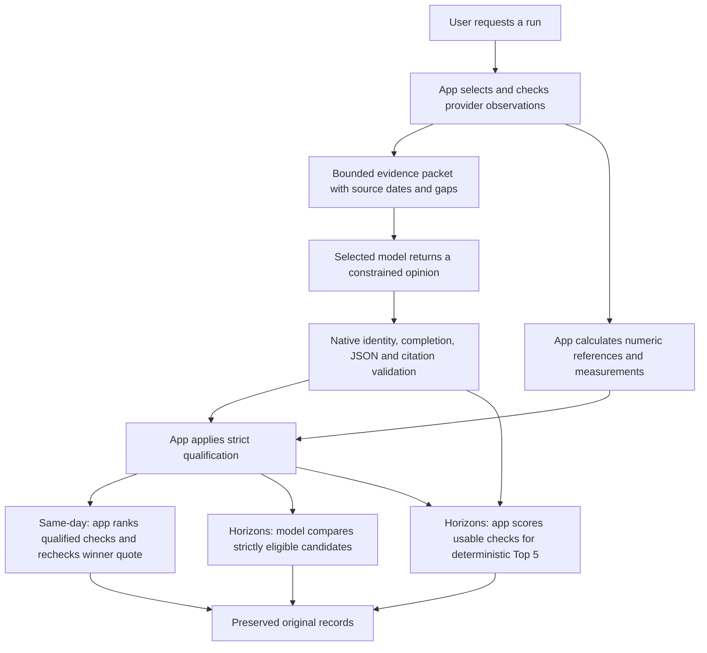

# Gemma in StockSage: model, evidence, research, and reproducibility

Prepared for **Saleh**

Prepared **20 September 2026** from the **installed Mac Release `ddad675e56e548b390983180055bbd9b82132d0a`**, its matching test/install/API and record-preservation receipts, dated live research observations, the earlier installed-app crash and subsequent layout change, and supplied upstream-source and model identity receipts. Earlier releases and 500-stock checks remain historical evidence. Installation and a successful snapshot request do not establish every provider entitlement or full-scan stability.

**Living edition 13 · Updated 20 September 2026, 08:00 Asia/Riyadh.** The owner requested **Nasdaq plus S&P 500, up to 1,500 total**, for both multi-day horizons. Same-day's selection of up to 500 Nasdaq stocks and maximum 24 checks are unchanged.

| Status | Evidence at this revision |
| --- | --- |
| **Installed** | Signed Release `ddad675` includes the 1,500-stock multi-day ceiling, news-link guard and primary-pane sizing change. Installed at **04:51:32 UTC**, reopened as **PID 54938**; its native saved-key test received HTTP 200 and an AAPL snapshot. Saved file hashes and relevant preferences were preserved. |
| **Tested** | Current installed source: **3,068 passed / 0 failed / 5 skipped**, with matching before/after manifests, exit 0 and diagnostic-guard exit 0. The focused native layout regression passed both width cases. Installation and bounded live UI observations are recorded in section 13. |
| **Current runtime** | Same Gemma 4 31B Q4_0 weights and template, **four configured slots**, 16K context each; the new manual Run Both was observed running. Owner maximum **16 workers**, target **30 seconds per stock, per horizon assessment**. Approved total cap **$32**, stop by **07:03:55 UTC / 10:03:55 Asia/Riyadh**. |
| **Measured progress** | At **04:58:40 UTC**, the new build had checked **32 week / 28 fortnight** stocks, with **31 / 27 accepted**. BRK.B remained incomplete without an opinion in each horizon. The earlier 40-check timing sample measured assessment plus validation at **17.897–23.003 seconds**; that is not the whole user wait. Performance work remains pending. |
| **Stability boundary** | The earlier `e671a98` Release crashed at **04:02:45 UTC**, retaining 24 week / 20 fortnight checks. At **04:58:40 UTC**, new PID 54938 remained alive with counts above that boundary and no newer recorded app crash. Earlier sidebar/detail/zoom observations were positive. Exact crash causality and full-scan stability remain unproven. |
| **Release verification** | The primary research pane has explicit zero minimum dimensions. Signed arm64 Release build and installation succeeded after the 3,068-test gate. Fresh native UI and API checks apply to `ddad675`; manual divider movement was not verified. |
| **Pending** | Full 1,500-stock horizons, final rankings, sustained stability and consistent achievement of the 30-second target remain unverified. BTGO has not been generated in the recorded evidence; MSTR opinions are separate from strict qualification and semantic quality. The earlier fast-batch audit found material errors. Completed shutdown and PDF publication require separate receipts. |

Work is **macOS only**. iOS/widget work is paused, with existing changes preserved. The detailed receipts and their boundaries are in section 13.

StockSage uses a pretrained Gemma model to interpret bounded evidence and return constrained opinions. StockSage code retrieves the evidence, measures prices and indicators, calculates entry/stop/target references, enforces qualification, ranks candidates, and preserves records. **No StockSage Gemma training or fine-tuning was found in the inspected application and runtime paths.** Providing a model with new market evidence at inference time does not update its weights.

The current product has three manual research destinations: **Same-day**, **1–7 trading days**, and **7–14 trading days**. Same-day can publish one qualified pick with numerical references. Each longer horizon has a saved deterministic Top 5 alongside a separate strict model comparison. A visible ranked row is not automatically a qualified Buy. Runs, retries, and outcome reviews require an explicit request; this guide does not authorize scheduled research, model/server startup, paid compute, or orders.

On Mac, **Watchlist** and **Markets** remain direct main-sidebar destinations alongside the three research destinations and **Library**. Library holds the remaining supporting tools and the **WhatsApp messages** entry. The six main destinations were observed in both the earlier expanded Release and the current `ddad675` Release. The preserved iPhone implementation retains its four primary destinations; its recorded checks are historical, not authorization to resume iOS work.

### Mac quick-use checklist

These controls are in the installed expanded Mac Release. Both multi-day horizons can select up to 1,500 eligible Nasdaq plus reported S&P 500 stocks; Same-day still researches at most 24. See section 7 for eligibility, evidence gaps, and source provenance.

1. **Check data access.** Open **Settings → Data sources**. An existing saved Massive key is not displayed in the field; use **Test connection** to check snapshot access. For a new or replacement key, enter it and explicitly choose **Save key** first. Testing uses the saved credential, not an unsaved edit. If the app reports **Keychain unavailable**, unlock or restore StockSage's access and retry; that message does not establish that the key is missing. A passing snapshot does not verify every add-on.
2. **Save optional private context.** Open **Library → WhatsApp messages**, or the **WhatsApp messages** button in Chat. Paste one excerpt, include its exact ticker, set the actual **Message date**, optionally label its source, and choose **Save excerpt**. Saving does not run Gemma. These notes are used by matching Chat/manual individual assessments, not the three research scans; see section 10.
3. **Choose and run a manual workflow.** Check the displayed model status in **Library → Events & model setup**, then explicitly run **Same-day**, **1–7 trading days**, or **7–14 trading days**. Same-day can produce one qualified pick; each longer horizon preserves its deterministic Top 5 separately from strict comparison. Opening a destination does not authorize a run.
4. **Read the dated result and blockers.** Check evidence dates, provider/model failures, qualification status, failed gates, and the app-calculated entry/stop/target references. A historical result, incomplete source, or visible not-qualified rank is not a new accepted Buy. Retry or check saved outcomes only when you choose to do so.

## 1. What the model names actually identify

| Name or property | Meaning in this implementation |
| --- | --- |
| Gemma 4 | Upstream model family. It does not identify an exact downloaded file. |
| 31B | The selected dense size variant. The upstream card describes approximately 30.7 billion parameters. |
| `it` | Upstream instruction-tuned lineage. It is not a StockSage training designation. |
| `QAT` | Upstream quantization-aware training lineage. StockSage does not perform QAT in the inspected code. |
| `Q4_0` | The selected quantized GGUF variant. The local inventory contract requires four-bit quantization metadata. This does not mean the whole runtime, every tensor, and its caches occupy exactly four bits per value. |
| `google/gemma-4-31b-qat` | The canonical application model identifier. A server advertising this name alone does not attest to its weight bytes. |
| GGUF | The model artifact used by the inspected local/hosted inference setup. It is distinct from the upstream BF16 Safetensors release. |

The supplied local identity receipt records `gemma-4-31B-it-QAT-Q4_0.gguf`, **17,651,001,280 bytes**, GGUF version 3, 833 tensors, architecture `gemma4`, size label `31B`, 60 blocks, and metadata context length **262,144**. Its recorded SHA-256 is:

```text
6f63619c9e33826a2a8ab195a344c79ecae7c82341d5567e28fd8863df056a7b
```

The local file identity above comes from the supplied historical inventory receipt; it does not imply a fresh verification of the local copy. Separately, the lead rehashed the remote B300 weights with `sha256sum`, matched the expected SHA-256, and verified the running server's health, canonical model alias and serving properties as recorded in section 4. The receipt's human-readable metadata includes `Google_Gemma 4 31B It Qat Q4_0 Unquantized` and `it-qat-unquantized`. Those strings describe upstream/intermediate lineage; they do not override the selected final Q4_0 artifact or establish an owner fine-tune. The file's metadata also includes sampling defaults, but StockSage's actual request overrides temperature to 0.2. Metadata is not proof of effective serving settings.

The runtime preparation source pins community distribution `lmstudio-community/gemma-4-31B-it-QAT-GGUF` at revision `12e5eae7a583b0a8bac91919fa99ae1fb27e6de4`, downloads the file above as `gemma.gguf`, and checks the same expected hash. The Google model repositories establish upstream lineage, not byte identity with this community distribution. [Google instruction-tuned release](https://huggingface.co/google/gemma-4-31B-it), [Google QAT GGUF release](https://huggingface.co/google/gemma-4-31B-it-qat-q4_0-gguf).

## 2. Upstream training: what is documented and what remains unknown

The supplied verification notes cite Google DeepMind's report revision 2, dated 24 July 2026. It describes pretraining broadly following Gemma 3, using web documents, code, and images, with a stated January 2025 pretraining cutoff. Audio training is discussed for other specified variants, not the selected 31B audio capability. It describes filtering for contamination, safety, and recitation; instruction tuning with optional thinking; post-training filtering; and QAT deployment formats including blockwise Q4_0. These are upstream processes, not steps performed by StockSage. [Gemma 4 technical report, sections 2.4, 2.5, and 3](https://arxiv.org/html/2607.02770v2).

The family card describes multilingual web data, code, mathematics, and images. The selected dense 31B model supports text and image input, has 60 layers and a 256K advertised context, and has no audio encoder. StockSage's inspected research path supplies **text**; upstream image capability does not establish image use here. The card's filtering descriptions are not guarantees that sensitive content, bias, incorrect knowledge, or unsafe output have been eliminated. [Google Gemma 4 model card](https://ai.google.dev/gemma/docs/core/model_card_4).

Google's QAT documentation distinguishes half-precision weights extracted from QAT from deployable quantized formats. Its quality and memory goals do not establish that every task retains BF16 quality, that the community file is identical to Google's distribution, or that this model was trained as a stock-selection specialist. [Google QAT release documentation](https://huggingface.co/google/gemma-4-31B-it-qat-q4_0-gguf).

The reviewed upstream material does **not** provide a complete reproducible training recipe: every dataset and mixture proportion, exact token counts, optimizer schedule, all supervised/reinforcement stages and reward details, and full QAT training/calibration settings are not established by these notes. “Similar to Gemma 3” is not evidence that every earlier recipe detail applies. Lack of disclosure does not prove a source or method was unused. StockSage's runtime scripts cannot fill those gaps. [Gemma 4 technical report](https://arxiv.org/html/2607.02770v2).

Further official references are the [Gemma 4 prompt format](https://ai.google.dev/gemma/docs/core/prompt-formatting-gemma4), [thinking capability documentation](https://ai.google.dev/gemma/docs/capabilities/thinking), and [fine-tuning documentation](https://ai.google.dev/gemma/docs/tune). These describe upstream capabilities and practices; their existence is not evidence StockSage has fine-tuned a model or enabled thinking.

## 3. What StockSage adds at inference time



The model does not log into providers, browse arbitrary sites, or operate a broker through these research requests. The app ultimately sends a system message and a user message to an inference API. It compiles observed facts and attributed source claims, keeps important missing-data notices, constrains output, and validates the answer. These mechanisms reduce specific failure modes; they do not make the model's reasoning factually or financially correct.

The inspected runtime scripts download an existing artifact and build/run an inference server. Their benchmark replays frozen inference requests and labels its Python checks preliminary, with `native_validation: "not_run"`. Neither inference, replay evaluation, an allocation optimizer elsewhere in the app, nor saved outcome calculation constitutes neural-model training. No weight update, adapter application, training optimizer, or backpropagation was found in these inspected paths. This is a bounded source finding, not a claim about every historical experiment outside the repository.

Primary source: [LocalModelServer](../StockSage/Sources/StockSage/StockSageLocalModelServer.swift), especially `chatRequest`, `completeDetailed`, and strict completion validation.

## 4. Local and hosted runtime contracts

| Property | Managed local Gemma | Managed hosted Gemma |
| --- | --- | --- |
| App endpoint | `http://127.0.0.1:1234` | `http://127.0.0.1:18080` |
| Expected identifier | `google/gemma-4-31b-qat` | Same exact identifier |
| Profile boundary | Canonical identifier, loopback, port 1234, root path | Canonical identifier, HTTP, loopback, port 18080, root path |
| Discovery | LM Studio inventory with verified GGUF / `gemma4` / `31B` / `Q4_0` / four-bit metadata | `/v1/models` must contain exactly the selected model row |
| Serving readiness | A unique canonical loaded instance, verified context, parallelism 1 | `/props` must establish an awake context of at least 16,384 tokens |
| Research workers | 1 for the strict local serving contract | **Four configured slots; owner maximum 16.** The new manual Run Both was observed running after installation. Installed code also recognizes the historical 24-slot profile; that is no longer authorized for this run. Unsupported advertised counts fall back to 1. |
| Data destination | Configured local server | Off-device processing through the private tunnel, despite the loopback app URL |
| Failure | Explicit unavailable/unverified status | Explicit unavailable/unverified status; no silent local fallback for a different remote model |

A passive probe does not imply model loading. Actual AI-use callers can invoke `prepare`; on macOS, the managed local path uses a shared loader. The toggle is labeled **Load Gemma when StockSage opens**, backed by `stocksage.model.autoLoadOnLaunch`, which defaults to `false`. Choosing **Use LM Studio · Gemma 4 31B** also enables that setting and starts preparation; launch loading is therefore not a separate opt-in in that preset flow. Choosing **Use RunPod GPU · Gemma 4 31B** disables it. Model preparation does not itself perform research. [Model settings and preset actions](../StockSage/Sources/Views/CatalystsSection.swift).

Explicit recovery retries preparation from the saved local configuration; it does not silently enable launch loading or replay the research question that failed. Shared loading checks configuration revisions and cancellation. An uncertain previous load is retained as uncertain rather than immediately submitting a duplicate load.

**Readiness improvements retained from edition 4.** Passive managed-local discovery now carries the verified serving context to its callers. For example, a verified 16,384-token server gives Chat a 16,384-token request budget instead of losing that information and falling back to Chat's 32,768-token upper limit. A missing or malformed native LM Studio inventory produces an explicit verification failure; the managed Gemma profile no longer treats a name advertised by a generic endpoint as verified discovery. Other explicitly configured generic backends retain their own discovery routes.

On iPhone, managed-local preparation is read-only and requires a uniquely identified loaded instance with at least 16K context and one worker before reporting readiness. Downloaded weights, an unloaded instance, an undersized window, or ambiguous instances are insufficient. Mac preparation retains its existing shared loader. These changes repair readiness and request sizing; they do not modify Gemma's weights, prompts, sampling, qualification arithmetic, or trading levels. A loopback address on an iPhone still refers to that iPhone, not to its paired Mac.

Normal Mac quit attempts to unload the selected supported local model and cancels inference activity. It does not delete model files, terminate the server, or establish that a hosted pod has stopped. Remote GPU lifecycle must be established independently by the operator. The app's local cleanup has a bounded deadline and cannot promise success against an unavailable server. [Local model startup and recovery](../StockSage/Sources/StockSage/StockSageLocalModelStartup.swift), [application lifecycle](../StockSage/Sources/App/StockSageApp.swift).

The inspected **external** runtime source lives at `work/b300-runtime`, outside this repository. The pinned runtime basis and current operating profile are:

- `llama.cpp` revision `8172e6577ac2b35de1ec1e5d1c0aaad6c4a2129f`, Release CUDA build, CUDA toolkit 13.0.
- The same Jinja template, expected SHA-256 `6a1015c47ccfcfa67c3b772385bccee357a4d37c3cda37bd202e9047f391ab82`, with thinking off. Its attribution header was not independently authenticated here.
- **Four workers**, each with 16,384 tokens; separate KV rather than unified KV; batch and microbatch both 2,048; eight context checkpoints per slot; RAM prompt-cache setting 0 MiB.
- Canonical app alias `google/gemma-4-31b-qat`, server loopback port 8080, private SSH tunnel to app endpoint `http://127.0.0.1:18080`, and no web UI. The launcher's historical benchmark alias is not the active app identity.
- The earlier source configuration requested full GPU layers, 16 CPU threads, f16 K/V caches, automatic flash attention and metrics. Its original unified-KV, 512-microbatch and zero-checkpoint settings describe the earlier profile, not the current four-worker measurement.

The owner now permits **at most 16 workers**, targets **30 seconds for each stock's individual horizon assessment**, and requires **Gemma 4 31B only**: no substitute model, draft-model shortcut, training or evidence reduction. The installed implementation recognizes capacity up to its older 24-slot ceiling, but the operational profile advertises four and must remain within the owner's 16-worker limit. Provider preparation overlaps at most two stocks for the managed hosted profile and one otherwise; model-worker count is not provider concurrency. No cache may hide changed evidence, failed collection or validation. Acceptance still checks each request's evidence and lifecycle state.

### Initial B300 attempt and replay provenance

Owner-authorized pod `r6ghc432pyfuzp` passed health and identity checks at **03:30:40 UTC / 06:30:40 Asia/Riyadh** on 20 September. The lead verified weights against SHA-256 `6f63619c9e33826a2a8ab195a344c79ecae7c82341d5567e28fd8863df056a7b`. The historical readiness receipt, `work/b300-runtime/private-tunnel-readiness.json`, records healthy, awake canonical Gemma, Q4_0 and 16,384 tokens per slot. Its original 24 slots and native **24 research workers** label preceded the owner's new maximum and have been superseded by four configured slots. No API keys were copied to the pod; inference remains off-device despite the loopback app address.

The original authorization was **$16 / 7,200 seconds**, with a **05:03:55 UTC / 08:03:55 Asia/Riyadh** deadline (`1789880635`). The owner subsequently approved **$32 total** and a further two hours, stopping **no later than 20 September 2026, 07:03:55 UTC / 10:03:55 Asia/Riyadh** (`1789887835`). `work/b300-runtime/receipts/spending-extension-receipt.json` records verification at **04:49:47 UTC** of replacement watchdog **PID 22469**, with the previous watchdog replaced only after the new guard was verified. The provider startup deadline deliberately remains the original fail-closed limit on restart. This extension does not authorize more than 16 workers; completed shutdown is not yet recorded.

The initial **Research both horizons** selection returned **1,500 stocks from 3,560 eligible listings and 12,592 activity observations**, using **18 September 2026** activity and **503 reported S&P members**, retrieved at **03:31:31 UTC / 06:31:31 Asia/Riyadh**. Actual app requests occupied all 24 initial slots, but all first 24 week checks reached their 90-second deadline with no accepted opinion. The lead stopped that scan around **03:34 UTC**, retaining **24 incomplete checks and 1,476 unchecked listings**. This failure remains part of the record; the later measured improvement does not turn it into a successful run.

Two replay limitations must remain distinct. The older `frozen24` corpus had seeded requests, outdated instructions/schema and incompatible fitting; it was rejected as a current-production benchmark, not as a production-app defect. The first reconstruction of today's 24 diagnostic requests also **sorted schema keys into action-first order**. Edition 10's statement that this reconstruction preserved production schema order was incorrect. Its manifest, `work/b300-runtime/live-replay/manifest.json`, is historical diagnostic provenance, not faithful production-order benchmark proof. A subsequent **native request exporter passed one test, exit 0**, and restored all 24 exact current prompts, request serialization and reason-first schema order for the benchmark. This corrected the benchmark fixture; production prompts, schema and sampling were unchanged. Current cases use captured Massive-backed public evidence with no private WhatsApp leads. See `work/b300-runtime/current-replay-blockers.md` and `work/b300-runtime/current-performance-receipt.json`.

### Measured four-worker performance and quality limits

The earlier performance receipt, updated at **04:11:23 UTC / 07:11:23 Asia/Riyadh**, separates benchmark transport, first-four elapsed timings and all retained app checks:

| Measurement | Observed result and limit |
| --- | --- |
| Native-exported 24-request benchmark, four workers | **24/24 HTTP completions with `stop`**, no retries, failures or timeouts. **18.252–20.075 seconds each**, median **19.090 seconds**; whole batch **115.676 seconds**. Full native reply validation was not run on these benchmark responses. |
| First four live week checks | All accepted by the app. **26.404–26.994 seconds since the empty selected-universe checkpoint**, a conservative approximation including evidence gathering and native model validation after selection. It excludes the earlier universe-selection duration and is not a universal end-to-end guarantee. |
| First four live fortnight checks | All accepted, following the corresponding week work sequentially. Model plus validation took **20.352–20.800 seconds**; cumulative time since selection was **46.916–47.585 seconds**, including the preceding week stage. |
| All retained week checks | **24 accepted:** 13.685–22.508 seconds, median 19.423; zero above 30 seconds. Native model call plus validation only; preceding evidence gathering and queued work excluded. |
| All retained fortnight checks | **20 accepted:** 19.659–20.845 seconds, median 20.343; zero above 30 seconds. Same timing boundary. |
| Completion boundary | These are retained checks from the interrupted run, not completed 1,500-stock horizons or final comparison. MSTR has a fresh native week opinion with failed strict qualification; BTGO remains ungenerated. These timings do not establish a 30-second end-to-end guarantee. |

**Requested-stock status:** `work/b300-runtime/live-app/MSTR.week.json` preserves a fresh native **MSTR 1–7 trading-day Buy opinion**, captured around **04:01:30 UTC**. Its `validationOutcome` is `validated`, while the typed quality state is **unverified** and flags an uncited insider record. Strict qualification fails on insufficient recent volume and the absence of a defensible resistance target above the entry reference. It is therefore **not a qualified trade plan**. This actual app result is distinct from the replay audit; native acceptance does not resolve the semantic weaknesses. **BTGO has not yet been generated.**

**Run Both timing boundary:** the 30-second target is per horizon assessment. The first week results completed about 26–27 seconds after initial selection; paired fortnight results arrived about 47 seconds after that same checkpoint because each stock's horizons run sequentially. Neither both opinions for one stock nor an entire 1,500-stock scan is claimed to finish within 30 seconds.

**Earlier installed-app crash — causality unresolved.** At **04:02:45 UTC / 07:02:45 Asia/Riyadh**, Release `e671a98`, PID 15510, aborted during live research, retaining **24 accepted week and 20 accepted fortnight checks**. The runs were interrupted, not completed. A reopened PID 29121 was observed before the later deliberate Release replacement. `work/b300-runtime/live-app/latest-crash.json` records `SIGABRT` and an AppKit constraints-update path through `NSWindow`, `NSHostingView.SizeConstraints` and `SplitViewChildController.hostingView(_:didUpdateMinSize:maxSize:)`. The exact crash has not been reproduced. The pane-sizing change passed its focused and full Mac gates and is now installed as `ddad675`; bounded live recovery is recorded below. These observations do not establish the precise cause, definitive repair or sustained full-scan stability.

**New installed Release observation:** the lead started Run Both at **04:52:30 UTC** and observed 1,500 selected stocks at **04:52:35 UTC**. At **04:56:54 UTC**, `work/b300-runtime/live-app/new-build/runtime-timing-semantic-audit.json` recorded **20 published, validated/accepted checks per horizon**, zero incomplete checks and no retries, using only `google/gemma-4-31b-qat`. All 40 native assessment-plus-validation measurements were **17.897–23.003 seconds**, median **20.893**. **Supplemental-evidence-start to validation** was **21.312–27.852 seconds for week** and **42.056–48.550 seconds for fortnight**. The saved `Result.at` clock starts **after initial daily-history collection and parsing**, before supplemental fetching; it is not the start of complete evidence acquisition or a full end-to-end clock. The fortnight interval also includes the preceding week work because the paired horizons share that clock and run sequentially for each stock. Scan-start-to-first-validation was **33.002 seconds for week** and **54.541 seconds for fortnight**, including initial selection and queue time. Presence in the checkpoint confirms publication, but exact individual publication times are unavailable. This timing snapshot was still below the earlier 24-week/20-fortnight crash-count boundary. It is neither full-scan completion nor a general 30-second end-to-end pass. The owner continued to report the workflow as slow; further bounded profiling is pending, preserving Gemma 31B, evidence and validation.

**Later progress snapshot:** at **04:58:40 UTC**, `work/streaming-layout-live-ui.json` recorded **32 week checks (31 accepted)** and **28 fortnight checks (27 accepted)**. In both horizons, **BRK.B** retained its listing and daily close but had **no opinion**, because supplemental evidence contracts do not support that symbol. The same PID 54938 remained running, and the latest recorded app crash was still the earlier report. These counts exceed the previous 24/20 failure point. That is useful bounded stability evidence, not proof of the crash mechanism, every layout state or completion of either horizon.

The companion technical review, `work/b300-runtime/SPEED-FINDINGS-REVIEW-2026-09-20.md`, checks the earlier speed findings against their receipts. It distinguishes replay HTTP timing from native validation and bounded first-result observations from general latency guarantees. Six-worker impossibility, a flag-only unified-KV benefit and aggregate wall-time shares were not established. It adds no benchmark, quality pass or authorization to this guide.

The lead observed reuse of an **exact 730-token unchanged prefix on 20 of 24 benchmark requests**. This is token/KV-prefix reuse, **not a semantic answer cache**: changed evidence still belongs in the newly evaluated request, and failures must remain visible. A RAM prompt-cache setting of zero does **not** disable all in-slot reuse. Context checkpoints help rewind sliding-window-attention state to a reusable prefix. The same weights, template and full evidence are retained; no seed or `top_p` was added. These bounded measurements demonstrate improvement for this profile and sample, not proof of an optimal worker count or a 30-second guarantee for every stock.

**Speed is not a quality pass.** The current four-worker audit reviewed all 24 replies against unchanged native requests and facts. Its actions were **10 Buy, 13 Hold and one Avoid**; every raw Buy conflicts with at least one supplied measured strict gate. It found **ten uncited offered Form 4 records**, along with material grounding defects: a congressman's sale described as a corporate-insider sale; corrupted Rule 10b5-1 plan wording; bullish sentiment attributed to the wrong issuer; unsupported IPO/near-term-event wording; and loss of the STRC preferred-security distinction in MSTR repurchase prose. Spelled-out figures/dates can also evade digit-only checks. This audit's benchmark `nativeValidation` remains **not run**; it does not show that production qualification was bypassed. An app-accepted opinion is separate from strict qualification, complete citation support and a profitable trade.

The earlier 16-reply audit found six raw Buys conflicting with supplied gates and took 57.38–59.45 seconds per reply. Fifteen of the sixteen common replies differ in JSON content in the current four-worker batch, and one changes Buy to Hold. Without a controlled acceptance/outcome comparison, unchanged requests and faster transport do **not** establish quality equivalence, improvement, or “no quality sacrifice”; nor can differences be attributed to concurrency alone. Preserve original actions, failed gates and typed quality warnings. See `work/b300-runtime/live-replay/native/quality-audit-four-workers.md` for the current batch and `quality-audit.md` for the earlier batch.

## 5. API-to-Gemma wiring: what can reach each request

**There is no universal “all APIs connected to Gemma” feed.** Four separate questions must be answered: is a data source wired into this workflow; did the request succeed with current access; was a record offered after selection and context fitting; and did the model cite it? A settings toggle or a populated market table answers none of the later questions by itself.

The matrix describes current source wiring. “Shared background” means the same-day collector first uses the horizon public-evidence gatherer, then adds its own intraday facts. It does not mean those daily observations qualify as same-day confirmation. The two longer horizons share collection families but have different prompts and screening windows.

| API or data family | Same-day | 1–7 trading days | 7–14 trading days | Chat and other explanation paths |
| --- | --- | --- | --- | --- |
| Massive active ticker directory and daily market activity | Up to 500 Nasdaq common shares; Same-day takes the first 24, with dated selection provenance | Up to 1,500 eligible unique Nasdaq + reported S&P 500 stocks by dated activity | Same ceiling and pool, separate horizon result | Chat uses selected board symbols, not this universe scan. Browse/Markets visibility is not proof of analysis. |
| datasets/DataHub reported S&P 500 constituents, sourced from Wikipedia | Not requested | Public membership input to universe selection; source URL, retrieval time, SHA-256 and count retained | Same selection source | Not a direct Gemma evidence feed or an official index-effective-date record; no ETF holdings substitution. |
| Massive split-adjusted daily OHLCV | Shared technical background | Completed daily history, measurements, bounded historical facts | Same history with longer lookbacks | Chat uses an existing price/rules snapshot; it does not call the horizon history collector. |
| Massive one-minute aggregates and fresh NBBO | Completed minutes, bid/ask, sizes, timestamp, scenario, and final winner quote recheck | No dedicated intraday collector; entry reference is a completed daily close | Same | Tape, trades, and live quote UI are not continuously streamed to Gemma. Chat does not run this same-day collector. |
| Massive quote condition reference data | Validates the quote's eligibility before it can qualify | Not a separate catalyst | Same | A validation dependency; no promise that the whole condition directory is prompt content. Trade/exchange directories support other display/tape paths. |
| Massive/Benzinga news, earnings, guidance, ratings, analyst insights, bulls/bears commentary, consensus ratings | Bounded shared snapshot and statuses; today's usable news may qualify | Bounded retained products, source states, and records | Same products, different horizon interpretation | Chat enriches the first explicit research ticker; Catalysts Explain also captures a snapshot. An analyst target stays an attributed opinion. |
| Benzinga analyst and firm metadata | Conditional joins for retained snapshot IDs | Same | Same | Up to three unique analyst IDs and three firm IDs are queried from retained records; not whole directories. |
| Generic Massive news | Fallback selected excerpts if dedicated Benzinga news yields no usable evidence; same-day catalyst needs today's date | Bounded recent excerpts and attempt status | Same; qualifying news age differs | Chat allows up to three excerpts for the first explicit ticker. Fallback attempts count as one news family, not independent corroboration. |
| Dedicated Massive/Benzinga forward earnings | Shared public background | A fresh separate next-earnings observation establishes holding-window status | Same lookup, fourteen-session window | Chat has board earnings and its Benzinga snapshot, not this dedicated horizon lookup. Board earnings separately supports Massive → Yahoo fallback. |
| Direct SEC ticker/CIK and submissions metadata | Shared filing identities/dates/status | Up to five 8-K, 10-Q, 10-K, 6-K, or 20-F metadata records | Same | Chat enrichment has no direct SEC collector. Catalysts Explain separately includes a recent 8-K reference; a link is not proof full filing content was analyzed. |
| Massive/SEC Form 4 | Fresh shared typed purchase/sale observations | Fresh research-local insider check, retained transaction/status facts | Same, with a longer qualifying source-age window | No explicit insider collector in Chat enrichment. Catalysts Explain separately uses the direct SEC Form 4 parser and up to three dated/linkable P/S citations. |
| Massive/SEC 8-K events, dividends, and existing company-event observations | Existing fresh answered observations can enter; a qualifying 8-K published today can support the catalyst rule | Existing source/status observations can enter | Same | Each scan does not freshly fetch every company-event feed. Extra UI event records need not be present in a model packet. |
| Yahoo chart quotes/history and earnings | Not the dedicated same-day research route | Not the dedicated daily-history or forward-earnings route | Same | Board fallback can indirectly contribute observed quote/earnings facts to Chat or an individual assessment. Dedicated evidence receipts retain their own provider semantics. |
| EODHD | Disabled | Disabled | Disabled | Retained names or old comments do not establish active use. |
| Imported or manually pasted WhatsApp leads | Not collected by this research gatherer | Not collected | Not collected | Optional local excerpts for Chat's first explicit ticker and manual individual stock assessment, marked unverified; can leave the device with a remote model. Mac has a paste/save sheet; no live WhatsApp API. |
| Broker balances, account IDs, journal notes, provider credentials | Not manual research evidence | Not manual research evidence | Not manual research evidence | Explicitly excluded from the app-created Chat snapshot. What the user types is a separate input boundary. |

Important endpoint distinctions are visible in code: Benzinga uses `/benzinga/v1/…`, with news at `/benzinga/v2/news`; Massive company events use `/stocks/filings/8-K/vX/disclosures`, `/stocks/filings/vX/form-4`, and `/stocks/v1/dividends`. Direct SEC submissions and filing-document requests are separate transports. None of these endpoint strings proves a subscription entitlement or a successful live response.

The shared `NewsService.safeLink` now rejects source URLs with credential-named query parameters: `token`, `api_token`, `apikey`, `api_key`, `key`, `authorization`, or `access_token`, matched case-insensitively after URL query parsing. Benzinga news, generic Massive news, and MassiveEvents use this helper. Rejected news links become unavailable while their article evidence remains; ordinary query parameters remain supported. This closes a reproduced link/citation exposure path using synthetic test values, not an observed owner-secret leak or a general secret detector. [Source-link validation](../StockSage/Sources/StockSage/StockSageNewsService.swift), [regression and retained-evidence checks](../StockSageTests/StockSageMassiveNewsTests.swift).

Source map: [ResearchUniverse](../StockSage/Sources/StockSage/StockSageResearchUniverse.swift), [HorizonResearch `gather`](../StockSage/Sources/StockSage/StockSageHorizonResearch.swift), [SameDayResearch `assess`](../StockSage/Sources/StockSage/StockSageSameDayResearch.swift), [Benzinga products](../StockSage/Sources/StockSage/StockSageBenzinga.swift), [BenzingaClient `snapshot`](../StockSage/Sources/StockSage/StockSageBenzingaClient.swift), [NewsService](../StockSage/Sources/StockSage/StockSageNewsService.swift), [MassiveEarnings](../StockSage/Sources/StockSage/StockSageMassiveEarnings.swift), [MassiveEvents](../StockSage/Sources/StockSage/StockSageMassiveEvents.swift), [MassiveTicks](../StockSage/Sources/StockSage/StockSageMassiveTicks.swift), [Chat enrichment](../StockSage/Sources/Views/StockSageChatSection.swift), [Catalyst evidence collection](../StockSage/Sources/Views/CatalystsSection.swift).

Optional content can be absent because of policy, credentials, entitlement, throttling, symbol mismatch, applicability, source limits, stale/failed status, or context fitting. The saved **offered facts**, source states, omitted keys/counts, and **cited facts** are the evidence for an individual completed call. An unavailable source must not be translated into “there is no news,” “no insider activity,” or “no earnings risk.”

## 6. Evidence and output contracts

An `EvidenceFact` preserves a stable key, prose, required/optional status, availability, fact class, attribution, observation/publication time, and optional typed insider transaction. Classes cover market, technical, fundamental, news, earnings, insider, imported lead, risk, and coverage gap. Packet version 2 preserves order, omitted-record count, and a canonical SHA-256 digest; duplicate IDs invalidate the packet. A coverage receipt distinguishes missing/unknown, offered, omitted, and cited keys. Coverage is a description of available material, not confidence or truth. [Evidence packet and assessment implementation](../StockSage/Sources/StockSage/StockSageAIAssessment.swift).

For a stock opinion, Gemma must return exactly four keys:

```json
{"action":"Hold","reason":"The supplied setup lacks adequate confirmation.","risk":"Missing evidence leaves the apparent catalyst uncertain.","evidence":["F1"]}
```

This is a **format illustration**, not an accepted real opinion: `F1` would have to exist in the actual offered packet and support the relevant interpretation. Allowed actions are Strong Buy, Buy, Hold, Avoid, Reduce, and Sell. At least one existing unique fact ID is required. The generation schema disallows additional keys and constrains actions, references, and prose. Reason and risk are requested as short qualitative English sentences with no numerical levels, dates, times, probabilities, or inline reference IDs; exact figures remain in the app's captured fact cards.

The shipped prompt/schema setting is **`explanationFirst` version 1**, whose schema generation order is reason → risk → evidence → action. `evidenceFirst` version 2 exists as an alternative; its presence does not make it the default. The illustrative JSON in the system text is not the authoritative generation-order setting.

The native parser additionally checks response size, exact keys and types, allowed actions, duplicate/unknown references, prose bounds, numerical/bracket patterns, certain repetition, and some unsupported earnings claims. Managed Gemma completion must identify the expected model, finish with an accepted complete `stop` state, and pass serving-context verification after generation. A syntactically valid citation still does not prove that the source entails the claim, that all contrary evidence was considered, or that an investment thesis is sound. Finite semantic checks cannot cover every paraphrase.

**Edition 5 claim-guard repair.** The shared stock-opinion validator now applies its existing finite English patterns for unsupported probability and absence-of-earnings-risk claims even when no typed earnings window is supplied. For example, “high probability of further upside” and “earnings risk is absent” are rejected in both reason and risk; explicit uncertainty or negation remains acceptable. This closes a Same-day path where valid minute/news citations previously allowed both unsupported opinions to qualify. Event-timing checks still depend on the typed earnings window; this is not general semantic fact-checking or a new probability model. Missing-citation repair cannot rescue one of these rejected claims. The change does not alter Gemma weights, prompts, schema, sampling, scoring, or qualification thresholds. [Shared validator and repair preflight](../StockSage/Sources/StockSage/StockSageAIAssessment.swift), [Same-day behavioral regression](../StockSageTests/StockSageSameDayResearchTests.swift).

| Request property | Current research behavior |
| --- | --- |
| Context | 16,384 tokens requested/reserved; distinct from the artifact's 262,144 metadata limit |
| Sampling | Temperature 0.2; seed and `top_p` unpinned |
| Generation | Non-streaming; managed Gemma requests non-thinking behavior |
| Initial stock-opinion output | 192 tokens; explicit incomplete-check retry starts at 384 |
| Output-limit recovery | Eligible managed-profile request can restart once with doubled output budget, using the same evidence and original deadline |
| Assessment deadline | One 90-second wrapper deadline, including eligible evidence-format repair |
| Format repair | Restricted repair must preserve the original action, reason, and risk; it cannot invent a replacement opinion |
| Context fitting | Whole optional records dropped from the end; required facts retained or the request fails; omissions recorded |

The common projection has a 12,000 UTF-8-byte target before final fitting. The final budget uses a conservative normalized UTF-8 heuristic, not an exact Gemma tokenizer. Source comments explicitly mark the general tokenizer bound unverified for Gemma; sampled historical observations are not a proof for all Unicode input. Research reserves retry output space before choosing optional records. Required facts that cannot fit cause an explicit budget failure, not silent truncation.

Inference profiles record model, endpoint profile, prompt/schema/packet versions, packet digest, temperature, context/output budgets, and retry reason. They leave unpinned seed and `top_p` unknown. Identical request configuration is neither identical evidence nor deterministic output. [LocalModelServer request/budget implementation](../StockSage/Sources/StockSage/StockSageLocalModelServer.swift).

## 7. Exactly how the three manual workflows differ

| Property | Same-day | 1–7 trading days | 7–14 trading days |
| --- | --- | --- | --- |
| Maximum listings analyzed per run | First 24 of a Nasdaq selection of up to 500 | Up to 1,500 unique eligible stocks | Up to 1,500 unique eligible stocks |
| Model boundary | Canonical strict-output Gemma required | Selected configured server; Gemma is the default, but generic backend support exists | Same |
| Market basis | Today's regular session and completed intraday observations | Completed adjusted daily history | Completed adjusted daily history |
| Setup emphasis | Observed intraday entry setup and invalidation; today's dated public catalyst | Near-term developments, price/volume confirmation, overnight risk | Persistence, follow-through, fading setups, intervening events, overnight risk |
| Numerical entry reference | Captured eligible ask, frozen as an entry ceiling | Last completed adjusted close | Last completed adjusted close |
| Stop reference | Lowest low of latest five completed minutes | Lowest low of latest five daily bars | Lowest low of latest ten daily bars |
| Target reference | Prior bounded-minute-window high, excluding latest minute | Prior twenty-bar high, excluding latest daily bar | Prior sixty-bar high, excluding latest daily bar |
| Published selection | One qualified winner, or a specific blocker | Deterministic visible five plus separate strict comparison | Independent deterministic five plus separate strict comparison |
| Outcome horizon | Dated receipt and freshness state; not automatically inserted into horizon scenario evaluation | Up to seven monitoring sessions | Up to fourteen monitoring sessions; monitoring does not wait until day seven |

**Installed 1,500-stock expansion.** Both multi-day horizons now use a combined pool of Nasdaq-listed (`XNAS`) common stocks and reported S&P 500 members on supported US listing exchanges. Outside Nasdaq, the current explicit exchange-code allowlist is `XNYS`, `XASE`, `ARCX`, `BATS`, `BATY`, `EDGA`, and `EDGX`; each such listing needs captured, ticker-specific membership. Unknown exchanges and OTC securities are excluded. The selector also requires active US stock listings, common-share type (`CS`), confirmed USD currency, a supported unique ticker, and positive dated volume × VWAP. It sorts activity descending, breaks ties by ticker, and selects at most 1,500 unique securities. Overlapping membership does not duplicate a ticker; distinct share classes remain distinct. The cap does not guarantee every reported S&P member is selected. ETFs, other listing types, missing observations, and nonqualifying currencies are excluded. Activity determines the research pool, not financial merit. [Shared universe selection](../StockSage/Sources/StockSage/StockSageResearchUniverse.swift), [multi-day caller](../StockSage/Sources/StockSage/StockSageHorizonResearch.swift).

The membership source is the public [datasets/DataHub CSV](https://raw.githubusercontent.com/datasets/s-and-p-500-companies/refs/heads/main/data/constituents.csv). Its [publisher metadata](https://raw.githubusercontent.com/datasets/s-and-p-500-companies/main/datapackage.json) identifies Wikipedia as the source and ODC-PDDL-1.0 as the declared license. It is **reported membership, not an official S&P feed or ETF proxy**. The CSV supplies no official membership effective date; its per-security `Date added` and the app's retrieval timestamp must not be presented as one. A separate public-source check retrieved 503 unique symbols on 20 September 2026; that does not validate an app run or freeze a permanent constituent list.

A fresh manual multi-day selection fetches the CSV without an extra API key. The bounded loader accepts at most 1,000,000 bytes and 450–550 unique supported tickers with the expected CSV header; present inclusion dates must be valid and not later than the retrieval day. Its ephemeral session has no cookie or credential store, sets no authorization header, rejects redirects, and checks cancellation/access before accepting the result. No Massive or model credential is forwarded. A failed membership fetch or validation blocks combined selection instead of silently falling back to Nasdaq alone, ETF holdings, or a static list. The receipt preserves the source URL, raw-byte SHA-256, retrieval timestamp, reported count, eligible count, selected activity and ticker-specific membership. Historical eligibility outside Nasdaq is checked against that captured receipt, not today's list. Resume and strict comparison-only retry retain the captured selection/checks. [Reported-membership loader](../StockSage/Sources/StockSage/StockSageSP500Constituents.swift), [history validation](../StockSage/Sources/StockSage/StockSageResearchHistory.swift).

**Same-day is unchanged:** it requests up to 500 eligible Nasdaq common shares with no S&P membership fetch, then researches only the first 24. All three workflows share the activity-selection machinery. If the primary session has fewer eligible listings than that workflow's selection limit and an earlier activity session is available, the selector may use the prior session when it offers more eligible listings. This happens before Same-day's 24-stock truncation, and the receipt records the fallback. The earlier installed `4a506a4` Release and its completed tests used the 500-stock Nasdaq ceiling for both multi-day horizons; those historical receipts are not relabeled as 1,500-stock runs. [Same-day caller and truncation](../StockSage/Sources/StockSage/StockSageSameDayResearch.swift).

**Selection is not a promise of an opinion.** The existing supplemental-evidence contract accepts alphabetic tickers only. Dotted share classes such as `BRK.B` and `BF.B` can enter the eligible selection, but after valid daily-history collection the research path retains their listing and daily close with an explicit unsupported-evidence note and **no opinion**. Other evidence failures can also prevent an opinion. The larger ceiling therefore does not mean 1,500 model opinions or five qualified recommendations are guaranteed. [Supplemental-evidence admission in the research collector](../StockSage/Sources/StockSage/StockSageHorizonResearch.swift).

Trading-day holding windows differ from the elapsed-time news/filing freshness limits used by strict horizon qualification.

### Same-day: one pick or a blocker

The run requires market access, non-sample data, the strict Gemma profile, and durable receipt writing. Same-day and horizon scans cannot run together. Each shortlisted check is preserved, including failures. The app requires 30–60 completed minutes in a bounded last-hour window, the latest five consecutive with positive volume, and an eligible, condition-verified NBBO with spread no greater than 25 basis points. Missing minutes are disclosed rather than fabricated.

The stop must be below the ask entry and the target above it. Let `spread = ask − bid`. The observed spread-penalized screen is:

```text
(target − ask − spread) / (ask − stop + spread) >= 2
```

An accepted Buy/Strong Buy must cite both an available recent completed-minute fact and an available news/filing fact published on the same New York date. A today's publication date does not prove the underlying event happens today. Daily technical signals are background, not a substitute for intraday evidence. If no usable today's catalyst exists, that candidate does not make a same-day model request.

Candidate expiry is the earliest of background capture +300 seconds, completed-minute evidence +180 seconds, and regular close −300 seconds. No new entry publication occurs within the last five minutes of the verified regular session. These rules make the earliest qualifying run depend on at least thirty completed session minutes; early-close days use the supported calendar.

The app orders qualified, unexpired checks by reward/risk, then narrower spread, activity, and ticker. The winner receives another fresh quote check against its **frozen** entry/stop/target and spread constraints. Failure does not silently substitute a runner-up. The current card additionally requires the final verified quote to be at most five seconds old. A stored winner can therefore become historical shortly after publication; it is not a continuously renewed buy instruction. Persistence failure removes the published selection and displays a blocker. [SameDayResearch](../StockSage/Sources/StockSage/StockSageSameDayResearch.swift).

### Longer horizons: collection, measured screen, and explicit retries

The gatherer requests split-adjusted daily history and rejects wrong-symbol, unadjusted, incomplete/paginated, malformed, or stale responses. It needs at least thirty completed valid daily bars through the latest verified settled aggregate session. A fortnight target additionally requires more than sixty bars to obtain sixty prior highs excluding the latest bar; thirty bars alone cannot establish that target.

The app computes technical facts, obtains bounded news/Benzinga evidence, checks forward earnings independently of the board cache, obtains SEC filing metadata, and performs a fresh Form 4 observation. Full SEC filings are not generally read by this metadata gatherer. Longer historical lookbacks are analytical context, not permission to extend the requested holding horizon.

Suspended work rechecks external-access policy revisions, sample mode, provider credentials, model configuration revisions, cancellation, and shutdown. Resume and retry preserve original records and configuration identity. Comparison-only retry uses captured checks; it is distinct from recollecting incomplete candidates or starting a fresh run. An unavailable model, changed setting, incomplete capture, or invalid output cannot be converted into accepted research simply to fill five rows. [HorizonResearch](../StockSage/Sources/StockSage/StockSageHorizonResearch.swift).

## 8. Strict qualification and the two Top 5 paths

### Strict qualification version 1

The fixed screen requires an original Buy/Strong Buy plus all applicable measured conditions:

- Verified capture identity, USD basis, access, and timing; sufficient completed daily bars.
- Completed close above SMA20 and positive measured return over the selected seven/fourteen-bar horizon.
- Recent three-bar average volume at least 1.5 times the preceding twenty-bar average, and positive ATR14.
- Positive finite levels with `stop < entry < target`, reward/risk at least 2, stop distance at most 3 ATR, and target distance at most 3 ATR for week or 6 ATR for fortnight.
- A fresh earnings observation establishing a date outside the holding window. Missing timing is not evidence of absence of risk.
- A recent dated news or public insider filing record that was actually offered and cited by the model. For week/fortnight respectively, news age must fall within `3/7 × 86,400` elapsed seconds and public insider filing age within `7/14 × 86,400` elapsed seconds, measured from the record timestamp to the evidence clock. These are inclusive elapsed-time bounds, not calendar-date comparisons; future-dated records fail.

The numerical references come from app code, not Gemma-generated prices. Provider analyst targets do not replace the measured historical target. Technical confluence is additional neutral scoring evidence, not an extra strict gate or permission to change Gemma's original action. No benchmark series is wired into the current qualification capture, so relative strength is absent rather than inferred. These rules are deterministic assumptions, explicitly unvalidated as a predictive strategy. [ResearchQualification](../StockSage/Sources/StockSage/StockSageResearchQualification.swift).

### Saved deterministic Top 5

`StockSageTopFiveRanking` does not call a model. It fills qualified slots first, then usable nonqualified candidates, preserving original actions and failed-gate reasons. A Hold or Avoid can appear as a ranked **not-qualified** row. It returns at most five from the actual usable pool; failed/no-verdict checks are not invented into candidates. The capture adapter requires the listing-result set to have finished before ranking its usable checks.

Within each qualification group it sorts score descending and ticker ascending, with a concentration guard. Components are visible:

| Component | Current rule |
| --- | --- |
| Selected-horizon historical return | Scaled to 0–10 points, capped at 20% historical return |
| Technical confluence | Aligned 10, mixed 5, conflicted/insufficient 0 |
| Cited catalyst | 8 for the credited public-insider filing, otherwise 6; no citation earns no catalyst points |
| Volume-ratio proxy | Scaled to 0–10, capped at four times; not executable liquidity |
| Evidence freshness | Starts at 10; loses one point per hour, floored at zero, using the saved scoring clock |
| Insider evidence | Signed transaction contributions described below |
| Contrary technical checks | −2 per contrary check |
| Named penalties | −50 for unverified critical capture; −50 for contradictory measurement basis; −10 for no offered dated catalyst |

Insider base magnitude is six with linear decay over `14 × 86,400` elapsed seconds from the transaction date to the saved scoring clock. Purchases contribute positively and sales negatively; at least two distinct owners in the same direction within `7 × 86,400` elapsed seconds multiply eligible contributions by 1.5. Invalid or superseded amendment records remain visible with zero weight. These are transparent score assumptions, not evidence of insider motive, confidence, or a measured predictive edge.

The concentration guard ordinarily permits two per known group. An over-cap candidate is retained when any of three conditions holds: too few later candidates remain to fill that qualification group’s requested slots if it is skipped; no later candidate with a different concentration key exists; or its score leads the best such alternative by at least five points. A candidate with an unknown key can serve as that different-key alternative. The guard runs separately within qualified and nonqualified groups, so diversification cannot promote a failed screen above a qualified candidate, and the cap is not an unconditional limit of two across the combined five. The generic scorer supports sector or catalyst identity; the current production capture adapter supplies catalyst identity and does not establish complete sector coverage. [Ranking and concentration guard](../StockSage/Sources/StockSage/StockSageTopFiveRanking.swift).

The result and `scoredAt` are frozen when the capture completes, persisted independently of strict comparison success, and reused after display refresh, comparison retry, or relaunch. Legacy records without a saved original ranking disclose that absence instead of reconstructing one using today's clock. [TopFiveRanking](../StockSage/Sources/StockSage/StockSageTopFiveRanking.swift), [ResearchHistory](../StockSage/Sources/StockSage/StockSageResearchHistory.swift).

### Separate strict model comparison

Gemma compares only `scan.isEligible` candidates and returns exactly `min(5, eligibleCount)` unique symbols in preferred order. It may not invent explanations, scores, probabilities, prices, or additional symbols in this response. Buy and Strong Buy are eligibility labels, not automatic ranking tiers.

The current comparison protocol is version 3. Mandatory original cases, risks, dates, reference/scenario records, and coverage stay whole. Cited evidence is included as space allows; class-aware allocation records the omitted IDs/counts when full records cannot fit. Multi-round comparison carries earlier winners into later rounds and is explicitly approximate and grouping-dependent. Initial output is 256 tokens; eligible transient failures can retry a round once. Old saved protocols retain their original validation.

A strict comparison can produce fewer than five names, none, or a recorded failure. That does not erase the deterministic five or original checks, and a fallback ranked row never acquires a fabricated strict outcome scenario. [ResearchRanking](../StockSage/Sources/StockSage/StockSageResearchRanking.swift).

## 9. Buy, stop, target, and saved outcomes

In this app, “Buy,” “Stop-loss,” and “Target” on research are dated conditional references. A last close or captured ask is not a fill; a historical high is not a forecast; a stop reference does not create a stop order or guarantee an exit price. Gaps and spread changes can invalidate assumptions. The app does not turn a research result into an order.

Only accepted strict `scan.topBuys` become saved horizon outcome predictions. The saved run also retains its own strict comparison receipt/failure, coverage, and independent deterministic ranking. Choose **Saved research → Check active results** to request an outcome review after eligible monitoring sessions have settled. Opening the app does not fetch or rewrite outcomes. Same-day product receipts have their own history/freshness contract and are not automatically fed into the seven/fourteen-session evaluator.

New runs use **outcome policy 3**, `dailyBarOpeningFirst`, beginning on the next trading date after completion. The app evaluates one split-adjusted daily-bar basis. A known opening crossing is ordered first: opening at/below stop records the opening stop event; opening at/above target records the opening target event. If the session opens between the levels and later reaches both, the app conservatively records stop first because the daily bar cannot reveal intrabar order. Otherwise the first verified stop/target terminates the scenario, or the seventh/fourteenth monitoring-session close does. Fortnight monitoring begins with the first eligible session, not day seven.

Policy 2 keeps its original stop-precedence behavior. Older endpoint-only records keep their original semantics; new policy is not retroactively assigned. Later evaluations do not rewrite the original opinion or evidence. Missing or inconsistent prices remain unavailable. Separate adjusted captures cannot safely establish a return without a common adjustment basis; the UI discloses changed reference sessions/bases rather than inventing a percentage comparison. These are research scenario measurements, not broker fills, realized P&L, or proof of investment accuracy. [ResearchHistory](../StockSage/Sources/StockSage/StockSageResearchHistory.swift), [ResearchFreshness](../StockSage/Sources/StockSage/StockSageResearchFreshness.swift), [saved research UI](../StockSage/Sources/Views/StockSageResearchHistoryView.swift).

## 10. Persistence, privacy, and manual operation

Product history and transport diagnostics have different retention policies:

| Record | Current preservation behavior |
| --- | --- |
| Horizon runs and full checks | Original results/evidence and captured ranking retained without automatic age/count/aggregate-byte expiry. The installed expansion raises the full-check archive trust limit from 16 to **48 MiB**; the index limit remains **4 MiB**. Reaching a limit fails the save instead of deleting earlier evidence. |
| Same-day receipts | Durable sole product history; exempt from automatic completed-diagnostic pruning. Save failure blocks a published pick. |
| Other completed transport diagnostics | The installed expansion raises each diagnostic manifest's bound to **3,000,000 bytes (3 MB)** and the attempt ceiling to 1,500. Active scans are excluded from pruning. At most thirty completed non-same-day diagnostics are retained, also subject to the configured byte budget, default 512,000,000 bytes. The newest is kept even when it alone exceeds that byte budget. |
| Chat transcript | Sent turns preserved locally until explicit Clear history, subject to a 2,000,000-byte storage boundary and visible errors. The saved archive is not silently shortened to twenty-four turns. |
| Model inference Chat context | At most latest twenty-four eligible turns, potentially fewer after fitting. Full saved transcript is not automatically sent. |
| WhatsApp excerpts | Existing imports and Mac pasted messages share the local schema-1 file, limited to 10,000 messages and 5,000,000 bytes. Append preserves unknown export/message metadata and existing records; rejected input or unreadable storage is not replaced. |

Full-check reads validate integrity and preserve failed/non-Buy checks. Previously expired legacy evidence remains explicitly unavailable; the app does not claim to reconstruct deleted originals. Atomic writes and bounded reads protect against several corruption paths, but a storage warning still means durability was not established. Original bytes are not deliberately discarded merely to make a failed load look empty.

Transport diagnostics store bounded/redacted system, schema, prompt, and response payloads with byte counts, hashes, truncation flags, model/configuration, HTTP/completion/failure information, duration, and retry details. A hash of redacted/truncated stored content is not automatically the hash of the full unredacted wire request. Diagnostic directories/files use 0700/0600 permissions and atomic replacement. Chat also attempts protected atomic writes, 0600 permissions, and backup exclusion; its unsent draft remains in memory. [ResearchReceiptStore](../StockSage/Sources/StockSage/StockSageResearchReceiptStore.swift), [Chat/session persistence](../StockSage/Sources/StockSage/StockSageChat.swift).

### Pasting WhatsApp messages on Mac

Use **Library → WhatsApp messages**, or the same button in Chat. Paste one message or short excerpt of **1–2,500 characters**, include the exact stock ticker, and optionally add a source label of up to **300 characters**. Outer whitespace is trimmed; an empty source becomes **Pasted WhatsApp**. Set **Message date** to the actual original date: the app does not parse a date from the pasted text. The label and date are user-provided, not verified sender identity or proof of publication. Choose **Save excerpt**; the sheet reports success or keeps the draft with an error. **Done** asks before discarding an unsaved excerpt.

Retrieval selects at most **three distinct matching texts from the last 30 elapsed days**, newest first, using an exact ticker or one of the existing company aliases. Future messages are excluded. Chat adds leads only for its first explicit research ticker; manual individual stock assessment also reads matching leads. **Same-day, 1–7-day, and 7–14-day scan collectors do not use these messages.** Context fitting can omit leads, so a saved excerpt is not proof it was offered or cited. The quoted text is unverified context, cannot establish app-generated prices, and must not be followed as an instruction.

Opening or saving the sheet performs no inference, research run, WhatsApp connection, or training. Messages are stored in the local `StockSageResearch/whatsapp.json` file under Application Support. Appends retain existing source provenance and unknown message fields, keep original message dates, advance the import timestamp, and treat an exact normalized text/source/date duplicate as a no-op. The Mac reader rejects unreadable/oversized files and symlink targets. The writer uses an advisory lock, atomic replacement, private permissions, and attempted backup exclusion. This is the shared existing import store, not a new remote inbox. [Paste sheet](../StockSage/Sources/Views/StockSageWhatsAppMessagesView.swift), [bounded storage and retrieval](../StockSage/Sources/StockSage/StockSageResearchLeads.swift).

Local model inference does not make the whole app offline: public market evidence still requires permitted provider access. A hosted model receives its selected prompt off-device. For remote Chat that can include the question, bounded prior turns, news, and private imported or pasted WhatsApp excerpts; remote individual assessment can also include matching excerpts. Saving alone does not transmit them, but a later explicit model request may. The app snapshot excludes broker/account/journal/credential fields, but text typed by the user can contain private information. Do not paste secrets. The likely-secret detector elsewhere is a limited heuristic, not a guarantee that the paste sheet removes sensitive content.

External-access gates and configuration/credential revisions stop obsolete work from being accepted after settings change. Current research is manual. Optional explicitly configured price alerts are a separate feature; their existence does not authorize automatic research, outcome review, model assessments, or paper orders. Retained legacy paper code/history is not a current automatic-research product: new legacy runs are disabled and legacy open positions are not monitored after relaunch. [ToolPolicy](../StockSage/Sources/App/ToolPolicy.swift), [legacy history disclosure](../StockSage/Sources/Views/StockSagePaperAutomationPanel.swift).

## 11. Other model surfaces have different contracts

| Surface | Input/output boundary |
| --- | --- |
| General Chat | Up to four selected symbols, prioritizing explicit tickers and then watchlist/board. JSON `analysis` plus `evidence`; empty evidence is allowed for a general explanation. Old conversation is not current market evidence. Number-bearing prose is displayed as an unverified draft. |
| Chat request budget | Upper context 32,768, clamped to the verified serving window; output 512; timeout 300 seconds. A verified 16K runtime receives at most a 16K context request. Older server comments mentioning 4K do not override the executable caller. |
| Individual stock assessment | Shared evidence/opinion rules using the selected backend. UI assessment cache is in-memory; a fresh quote does not rewrite captured evidence or schedule a new inference. |
| Catalyst explanation | Selected-server route uses research context and separate explanation validation. Apple's on-device FoundationModels route is a different model and must not be called Gemma. |
| Headline sentiment | Separate positive/negative/neutral classification, sixteen output tokens and thirty-second timeout. A sentiment label is not an investment recommendation. |
| Legacy paper helper | A model call remains in preserved implementation source, but that does not establish an enabled automated product or authorize activation. |

Source: [Chat contracts](../StockSage/Sources/StockSage/StockSageChat.swift), [actual Chat caller](../StockSage/Sources/Views/StockSageChatSection.swift), [AIAssessment](../StockSage/Sources/StockSage/StockSageAIAssessment.swift), [CatalystNarrator](../StockSage/Sources/StockSage/StockSageCatalystNarrator.swift), [LocalSentiment](../StockSage/Sources/StockSage/StockSageLocalSentiment.swift).

## 12. Limits and how to interpret failures

The model can misunderstand correctly supplied evidence, cite a fact that does not establish its conclusion, overlook counterevidence, or produce a plausible but unsupported interpretation. A schema pass, low temperature, many available APIs, or an insider score is not a calibrated probability of profit. Provider facts can also be wrong, delayed, incomplete, revised, or unavailable.

The current Nasdaq schedule is explicitly **2026 only**. Unsupported years return unavailable; unexpected closures and broker-specific hours are not modeled. Daily aggregates are treated as complete only after the scheduled extended-session end, not simply regular close. This can keep daily research on the previous completed aggregate session after the cash market closes. [MarketHours](../StockSage/Sources/StockSage/StockSageMarketHours.swift).

| Observed state | What it establishes | Appropriate interpretation |
| --- | --- | --- |
| Model unavailable or wrong identity | No acceptable selected-model readiness | Check the disclosed server/profile problem; no replacement opinion was formed. |
| Source unchecked, throttled, unauthorized, stale, or missing | Evidence gap or access failure | Do not reinterpret it as absence of market risk. |
| Output incomplete or rejected | The acceptance contract was not satisfied | Partial text may help diagnose a failure; it is not a qualified pick. |
| No strict candidates | The measured screen did not produce eligible comparisons | Deterministic not-qualified rows can remain useful to inspect, without becoming buys. |
| Same-day result historical | Its freshness contract no longer holds | It records what was observed; it is not a fresh entry signal. |
| Interrupted/failed new run with older data visible | Prior saved data was retained | Read run timestamps and status; old results are not a successful new scan. |
| Storage failure | New persistence was not established | Do not assume reopening will recover the unsaved result. |

The current expanded Release with the pane-sizing change passed the recorded Mac tests and was installed, with bounded native UI and snapshot checks. Earlier research crashed; new-build research has progressed past the earlier count boundary in the dated observation. These checks do not establish definitive crash repair, sustained full-scan stability, a financial edge, comprehensive provider coverage or consistent achievement of the 30-second target. Section 13 separates current evidence from historical observations. Source-defined behavior, mocked tests, real inference and profitable live outcomes are separate evidence categories.

## 13. Existing tests and the verification boundary

The following suites contain relevant native regression sources. The initial guide inspected them as code; their listing alone does not assert a successful test run. This living edition additionally records the completed focused runs below from the lead's actual receipts.

| Suite | Representative contract |
| --- | --- |
| [LocalModelServerTests](../StockSageTests/StockSageLocalModelServerTests.swift) | Exact model variant and unique context; identity/finish verification; original retry deadline; request-derived recorded temperature; bounded observer payloads; cancellation and capacity/access checks |
| [SameDayResearchTests](../StockSageTests/StockSageSameDayResearchTests.swift) | Intraday/public-citation requirements; one frozen winner; no runner-up after stale winner; receipt retention; persistence failure; actionable preparation errors |
| [HorizonResearchTests](../StockSageTests/StockSageHorizonResearchTests.swift) | Failed comparison preserves checks; comparison-only retry; lifecycle revocation; outcome-policy session windows |
| [AIAssessmentTests](../StockSageTests/StockSageAIAssessmentTests.swift) | Prompt/schema fitting, citation and qualitative-output validation, evidence handling |
| [ResearchRankingTests](../StockSageTests/StockSageResearchRankingTests.swift) | Eligible candidate membership, comparison contracts, bounded evidence and saved protocol validation |
| [TopFiveRankingTests](../StockSageTests/StockSageTopFiveRankingTests.swift) | Deterministic scores, strict-group precedence, signed insider evidence and concentration behavior |
| [ResearchHistoryTests](../StockSageTests/StockSageResearchHistoryTests.swift) | Frozen scoring clock/check agreement, honest legacy absence, full-check retention, atomic preservation, opening-gap ordering, legacy policy compatibility |
| [ResearchLeadsImportTests](../StockSageTests/StockSageResearchLeadsImportTests.swift) | Mac append/reread/retrieval, unknown metadata retention, fractional-date duplicates, input/storage bounds, corruption and symlink preservation |

A native executed-test receipt needs the actual source identity, command, platform, result bundle, exit status, executed count, and failures. A typecheck or build is not an executed test suite. A frozen model replay excludes fresh providers, startup, and full app orchestration; a native end-to-end manual run is a separate validation. Schema acceptance and benchmark speed cannot establish investment quality.

### Recorded checks and release milestones — 20 September 2026

| Receipt | Observed result and coverage |
| --- | --- |
| `layout-polish-mac-12` | Passed; exit 0; 33 tests, 0 failures, 0 skipped. Focus: sidebar navigation, research inspector layout and horizontal scrolling, and Catalysts/model settings. |
| `layout-polish-ios-5` | Passed; exit 0; 33 tests, 0 failures, 0 skipped. Focus: iPhone presentation and navigation, including ordinary and accessibility text sizes, Browse, Chat, and research detail disclosures. |
| `layout-polish-ios-6` | Failed; exit 65; 32 tests passed and 1 failed. The research-filter interaction test assumed the exposed accessibility element was a UIKit button; the new SwiftUI Menu exposes an accessibility node. This run is not a passing UI gate. |
| `gemma-readiness-red` | Expected regression failure before the fix: 39 tests passed and 3 failed. Reproduced lost serving context, unverified alias fallback, and preparation accepting an unloaded, undersized, or ambiguous managed-local instance. |
| `gemma-readiness-green-ios` | Passed after the readiness fix; exit 0; 81 tests, 0 failures, 0 skipped across LocalModelServer, ManagedModelLifecycle, and Chat. Injected transports and synthetic inventories; no live model or provider calls. |
| `gemma-readiness-green-mac` | Passed after the readiness fix; exit 0; 132 tests, 0 failures, 0 skipped across LocalModelServer, ManagedModelLifecycle, LocalModelStartup, and Chat. Includes native Mac presentation checks within Chat's suite; no live inference. |
| `layout-polish-ios-7` | 74 passed, 1 failed; exit 65. Research filter interaction and model-client checks passed; the Journal harness found an offscreen field before its native view mounted. No passing whole-run claim. |
| `layout-polish-ios-8` | Passed after correcting the shared native-field lookup; exit 0; 33 tests, 0 failures, 0 skipped. iPhone presentation and navigation, including research-filter selection and Journal typed-price interactions. |
| `whatsapp-green-behavior-red-2` | Exit 65; 7 passed, 1 failed, 0 skipped. All six WhatsApp storage tests and the actual Mac native paste/save test passed. The separate Same-day behavioral test failed because both unsupported-probability and absent-earnings-risk opinions qualified despite valid citations. This is the before-fix behavioral receipt, not a passing whole gate. |
| `gemma-behavior-green` | Passed after the shared claim-guard repair; exit 0; 100 tests, 0 failures, 0 skipped. Full AIAssessment, SameDayResearch, and ResearchLeadsImport suites plus the native Mac WhatsApp paste/save test. Injected model/provider responses and synthetic temporary messages; no live Gemma call. |
| `api-credential-green` | Passed after credential-status and research-admission repairs; direct Mac `xcodebuild test`, exit 0; 115 tests, 0 failures, 0 skipped. Full Massive, HorizonResearch, and SameDayResearch suites with injected credentials/transports; live provider access is a separate check. |
| `tabs-review-full-mac` | Full configured Mac gate passed; exit 0; **3,056 passed, 0 failed, 5 skipped**. Native diagnostic guard exit 0; no runtime warnings in the receipt. Before/after source manifests match the hash below and bind the implementation committed as `4a506a4a0b636637489a54b27ec14a5d3a9347c1`. This is the historical 500-stock implementation, before the now-installed expansion. |
| `new-build-native-review` | Native Debug test host, PID 99861 from that full Mac gate: **33 screenshots individually inspected**—15 routes at 900 × 700 and 1300 × 840, plus three WhatsApp captures at 660 × 700. No visible clipping, overlap, or contrast blocker found in captured content. `work/new-build-native-review/review.md` and its hash/timestamp manifest preserve the evidence. Native sidebar/chrome omitted by `cacheDisplay`, unvisited expanded/scrolled/error states, installed Release, and live APIs are outside this visual receipt. |
| `tabs-review-release-identity.json` | Signed arm64 Release build exited 0; installed at `/Applications/StockSageX.app` on 20 September at 04:45:56 Asia/Riyadh and reopened as PID 1574. The old process exited before replacement. Code identity and executable hash are recorded below; the previous bundle is retained for rollback. |
| `tabs-review-new-build-api-ui.json` | At 04:47:50 Asia/Riyadh, the installed `4a506a4` Release's native Settings test returned HTTP 200 and an AAPL snapshot using the saved key. Six main sidebar routes were observed. No inference was run; add-on entitlements and live market freshness were not established. |
| `tabs-review-record-preservation.json` | Install comparison retained 14 saved run IDs, seven watchlist entries, and one holding. Relevant preferences and saved JSON file sets/hashes—including ResearchHistory, SameDayResearch, StockSageResearch/WhatsApp, StockSageChat, and SharedRecords—were unchanged. No private record contents are reproduced here. |
| `universe1500-green-2` | Focused Mac `xcodebuild test` passed; exit 0; **250 passed, 0 failed, 1 skipped**, with no runtime warnings in the receipt. Covers ResearchUniverse, HorizonResearch, ResearchHistory, ResearchReceiptStore, SP500Constituents, ResearchRanking, SameDayResearch, and JournalCSVImport. This is native test evidence, not a live combined-universe Gemma run. |
| `universe1500-first-pass-full-mac` | First expanded full Mac gate passed; exit 0; **3,066 passed, 0 failed, 5 skipped**, matching before/after manifest `c025fbd…` and diagnostic-guard exit 0. It predates the final news-link guard. Native log warnings remain a separate investigation; this is not a warning-free claim. |
| `universe1500-native-review` | **33 fresh PNGs individually inspected**, PID 11639: 30 route viewports at 900 × 700 / 1300 × 840 and three WhatsApp views at 660 × 700. The new 1,500-stock labels fit; no visible content-layout blocker was confirmed. Manifest and review are under `work/universe1500-native-review/`. Omitted native chrome, unseen scroll tails, collapsed disclosures, other states and installed Release are excluded. |
| `news-link-red` | Expected before-fix regression: exit 65; **11 passed, 1 failed, 0 skipped**. Credential-named query parameters remained in accepted source URLs and model citation text with synthetic values. No real credential was accessed. |
| `news-link-green` | After the shared URL guard: Mac `xcodebuild test` exit 0; **94 passed, 0 failed, 0 skipped**, across MassiveNews, NewsOutcome, Benzinga and MassiveEvents. The regression verifies rejected links, retained article evidence, and accepted ordinary queries. |
| `universe1500-full-mac` | Final Mac gate after the URL guard passed: exit 0; **3,067 passed, 0 failed, 5 skipped**. Before/after source manifest `53e834…` matches; native diagnostic guard exit 0. The wrapper set `CA_DEBUG_TRANSACTIONS=1`. The matching Release installation is recorded below; live scan validation remains separate. |
| `universe1500-native-diagnostics-final.md` | No new actionable native warning or release blocker identified in the final log. The earlier uncommitted CATransaction warning did not recur under `CA_DEBUG_TRANSACTIONS=1`; its cause was not identified and no fix is proven. Existing navigation and fixture-window warnings remain. |
| `universe1500-release-identity.json` | Signed arm64 Release build exited 0. Commit `e671a98` was installed at `/Applications/StockSageX.app` at 05:56:24 Asia/Riyadh and reopened as PID 15510. The prior process exited before replacement; the previous bundle is retained for rollback. Full identity and executable hash are in section 14. |
| `universe1500-record-preservation.json` | Before/after preferences, saved JSON file sets/hashes, and 14 saved run IDs were unchanged. The installation baseline contains four watchlist entries and one holding; WhatsApp, Chat, research and receipt stores were preserved. |
| `universe1500-new-build-api-ui.json` | At 06:07:45 Asia/Riyadh, the installed `e671a98` Release received HTTP 200 and an AAPL snapshot using the saved key. Six sidebar routes, research destinations, scrolled coverage assumptions, Library, WhatsApp sheet, model setup and data-source settings were checked. No fresh inference, add-on entitlement, or live-quote freshness was established. |
| `b300-runtime/private-tunnel-readiness.json` | At 03:30:40 UTC, the private localhost:18080 tunnel returned healthy, awake Gemma with the canonical alias, Q4_0, 16,384-token context per slot and 24 slots. The lead separately verified the expected weight hash and installed native ready status. This is the historical 24-worker configuration: its first 24 week checks timed out. The later four-worker profile and owner maximum of 16 supersede its operating count. |
| Initial live 1,500-stock attempt / `b300-runtime/live-replay/manifest.json` | Lead-observed selection: 1,500 of 3,560 eligible listings, 12,592 activity observations, 18 September activity and 503 reported members retrieved at 03:31:31 UTC. All first 24 week checks timed out at 90 seconds; scan stopped around 03:34 UTC, retaining 24 incomplete and 1,476 unchecked. The first diagnostic reconstruction sorted schema keys and is not faithful production-order proof; a later native exporter corrected the benchmark fixture. This initial attempt produced no accepted opinions. |
| `b300-runtime/current-performance-receipt.json` | Updated 04:11:23 UTC: exporter 1 passed / 0 failed, exit 0; benchmark 24/24 HTTP `stop`, 18.252–20.075 seconds each, batch 115.676 seconds, no benchmark native reply validation. All retained app checks: week 24 accepted at 13.685–22.508 seconds; fortnight 20 accepted at 19.659–20.845 seconds. App timings measure model plus validation, excluding gathering/queue. At that earlier snapshot, no active scan or completed full horizons; a subsequent new-build scan is recorded separately. |
| `b300-runtime/live-app/MSTR.week.json` | Fresh native MSTR week opinion: `Buy`, `validationOutcome: validated`, quality `unverified` with uncited insider evidence. Strict gates fail recent-volume confirmation and a target above entry; no qualified plan. BTGO remains ungenerated. |
| `b300-runtime/live-replay/native/quality-audit.md` | Read-only audit of an earlier 16-reply batch: six Buy labels conflict with supplied strict gates; citation/grounding weaknesses remain. Not a native validator receipt or a clean quality pass. |
| `b300-runtime/live-replay/native/quality-audit-four-workers.md` | Current 24-reply semantic audit: ten raw Buy labels each fail supplied strict gates; ten offered Form 4 records uncited; material role/plan/issuer/security/timing issues. Native replay acceptance not run; no demonstration of qualification bypass or quality equivalence. |
| `b300-runtime/live-app/latest-crash.json` | Installed `e671a98`, PID 15510, crashed at 04:02:45 UTC with `SIGABRT` and an AppKit/SwiftUI split-view constraints-update backtrace. The lead observed 24 week / 20 fortnight checks retained and accepted so far, and a reopened PID 29121. That run was interrupted. A later sizing change and installed checks do not establish exact crash causality or sustained stability. |
| `streaming-layout-red-4-summary.json` / `streaming-layout-red-4.log` | Baseline focused test failed only the sidebar accessibility-visibility assertion at width 900; width 1301 passed. It did not reproduce the exact installed constraints exception. |
| `streaming-layout-green-1-summary.json` / `streaming-layout-green-1.log` | After explicit zero minimum dimensions on the primary research pane: **one logical native test passed, two width cases, zero failures/skips; exit 0**. Both cases used 1,500 synthetic listings and four controlled workers, retaining 28 results per horizon. The subsequent full Mac gate passed 3,068 tests with zero failures and five skips. |
| `streaming-layout-full-mac-receipt.json` | Candidate full Mac suite: **3,068 passed, zero failed, five skipped; exit 0; native diagnostic guard 0**. Before/after source manifest matched `5aa8033847f3ca2802444f58c92a285cfe319abedbd9c95f4c3bea9ff888745f`; result bundle `stocksage-tests.PrhWyl/result.xcresult`. Signed Release installation and bounded live checks are recorded separately below. |
| `streaming-layout-release-identity.json` / `streaming-layout-record-preservation.json` | Signed arm64 Release build exit 0; `ddad675` installed at 04:51:32 UTC, reopened as PID 54938. Saved JSON file sets/hashes, relevant preferences and 14 run IDs were unchanged; four watchlist entries and one holding retained. |
| `streaming-layout-live-ui.json` | UI observation 04:56:32 UTC: native saved-key HTTP 200/AAPL snapshot; visible sidebar, AAPL detail and native system zoom/restored size. Later 04:58:40 snapshot: same PID alive, 32 week / 28 fortnight checked, 31 / 27 accepted, BRK.B incomplete without an opinion in both. Counts exceeded the earlier crash point; divider movement and full-scan stability remain unverified. |
| `b300-runtime/live-app/new-build/runtime-timing-semantic-audit.json` | Observed 04:56:54 UTC: 20 published accepted checks per horizon, zero incomplete, no retries, only Gemma 31B. Assessment plus validation 17.897–23.003 seconds. The supplemental-start clock excludes initial daily-history collection/parsing; scan-start includes selection and queue. See section 4. |
| `b300-runtime/receipts/spending-extension-receipt.json` | Owner-approved $32 total cap and stop by 07:03:55 UTC / 10:03:55 Asia/Riyadh; replacement watchdog PID 22469 verified at 04:49:47 UTC. Original restart deadline remains fail-closed; completed shutdown not yet recorded. |

These counts use each result bundle's top-level test summary; parameterized cases produce additional executions. Test commands, exit statuses, and result-bundle locations are preserved in the lead task's `work/<receipt-name>-receipt.json`; install, API, preservation, and visual records use the exact filenames above. Each receipt applies to its recorded source state. The 3,056-test full gate covers the earlier installed 500-stock baseline; the 3,066-test first expanded gate covers the universe/storage changes before the final URL guard. The historical 3,067-test gate covers both changes; the later 3,068-test gate adds the pane-sizing change and streaming regression. Both recorded identical before/after source manifests. Five tests remained skipped in each completed full gate. These checks establish tested application behavior, not improved stock-selection performance.

**Current scope is Mac only.** The expansion, URL guard and pane-sizing change are installed as `ddad675`, following the **3,068 / 0 / 5** full Mac gate. Saved records and relevant preferences were preserved. The original installed-app crash remains causally unresolved; new-build observations show incoming results, sidebar, details and system zoom working within the recorded interval. Previously observed navigation/window warnings remain; the earlier intermittent CATransaction warning did not recur, without an identified cause or proven fix. An empty summary warning array does not establish clean logs or every UI state. iOS/widget work stays paused. Full horizon completion, sustained stability, final strict rankings, comprehensive reply quality and universal achievement of the 30-second target remain unverified; the owner maximum is 16 workers.

### Installed layout change after the live crash

The current source gives the primary research pane explicit **zero minimum width and height**, allowing the enclosing window to own its minimum dimensions as results arrive. The real `MarketsView` regression starts both horizons with 1,500 synthetic listings and four controlled workers at widths **900 and 1301**, first reproducing the retained-count state of **24 week / 20 fortnight**, then reaching **28 results in each horizon at each width**. It checks native sidebar navigation and visibility, the Stop control, table/filter reachability, native scrolling and horizontal-scroller availability, arriving selected details, and detail close/reopen. The test injects synthetic evidence/results; it performs no live model or provider calls. [Research workspace sizing](../StockSage/Sources/Views/MarketsView.swift), [native streaming regression](../StockSageTests/StockSageChatTests.swift).

Baseline R4 failed the 900-width sidebar visibility assertion; it did **not** reproduce the installed constraints-loop exception. Focused green 1 passed both parameter cases after the sizing change. This establishes tested layout behavior, **not proof of the crash's cause or repair**. Test bitmaps omit native sidebar pixels; the separate installed-app observation confirms visible sidebar rendering within its recorded interval. The full Mac gate passed **3,068 tests, zero failures and five skips**, with exit 0, native diagnostic guard 0 and identical before/after source manifest `5aa8033847f3ca2802444f58c92a285cfe319abedbd9c95f4c3bea9ff888745f`. Signed Release `ddad675` was then built, installed and reopened as PID 54938. No sustained full-scan stability claim follows from these bounded checks.

### Disposition of the fifteen unfinished worktree files

The review found **five useful files or deltas already integrated**, covering Chat disclosure sizing, its native regression, and dormant legacy-relay compatibility/documentation. The **ten Benzinga prototype/historical files remain preserved in the archive**, rather than becoming ten new production components: the direct API was cancelled and the parallel evidence implementation superseded. Bounded provider notes are already retained by the supported implementation. One useful missing query-parameter guard was recovered in the shared news-link helper and verified by the red/green receipts above. This does not activate a direct Benzinga key, broker relay, automation, or model run. File-by-file judgments and preservation evidence are in `work/unfinished-five-review.md` and `work/unfinished-benzinga-review.md`; the latter's pending-guard wording describes its review-time snapshot.

### Installed Release API evidence and remaining blockers

For the **current `ddad675` Release**, `work/streaming-layout-live-ui.json` records observations at **04:56:32 UTC**: the saved-key test returned **HTTP 200 with an AAPL snapshot**; all six sidebar destinations were visible; incoming research results remained visible; captured AAPL details opened beside the table with failed strict gates; and native system zoom plus restored/original size worked without disappearance or crash through **20 week checks** at that visual observation. This does not verify every width or divider position. Manual divider dragging did not change its position, so that interaction is unverified. Run Both began at **04:52:30 UTC**, selecting 1,500 stocks by **04:52:35 UTC**. These are time-bounded observations, not an all-API, all-layout or completed-scan claim.

The matching `streaming-layout-record-preservation.json` confirms unchanged relevant preferences, saved JSON sets/hashes and run IDs, including research, receipts, diagnostics, Chat and WhatsApp. It retained **four watchlist entries, one holding and fourteen saved runs**. No private contents or credential values are reproduced.

**Historical expanded-build evidence:** After installing and reopening **Release `e671a98`**, the lead exercised **Settings → Data sources → Test connection** using the owner's saved key. At **06:07:45 Asia/Riyadh**, the native result was **“Connected — HTTP 200, AAPL snapshot received. Price qualification is checked separately.”** The credential was not reproduced. The six main sidebar destinations and the 1,500-stock scope label were observed; coverage assumptions were scrolled to the bottom, and the WhatsApp sheet was opened without edits. The lead also recorded **546 existing WhatsApp excerpts**, without copying their contents into this guide. These observations are bounded checks of the installed app, not an all-screens or all-API guarantee. Some native accessibility row-center clicks and scroll gestures did not activate their controls; exact visible buttons and native scrollbars exposed the underlying content.

The matching installation comparison preserved **four watchlist entries, one holding and fourteen saved runs**, with unchanged saved-file hashes. The earlier seven-entry watchlist belongs to the prior `4a506a4` installation baseline, before owner changes; comparing those different baselines does not demonstrate installation loss. The earlier successful `4a506a4` snapshot and its “Feed connected · no recent observation” status remain historical observations. Current add-on entitlements and live quote freshness are still unverified. The earlier installed-app model check reported **RunPod unavailable**. That state was superseded by verified private-tunnel readiness. The initial 24-worker scan then timed out; the four-worker profile produced measured early accepted results before the later installed-app crash interrupted research. Section 4 distinguishes those milestones, retained progress, the unresolved stability blocker and the owner maximum of 16 workers.

Earlier separate keyless command-line checks received **SEC HTTP 403** and **Yahoo HTTP 200 with JSON**. Those outcomes are specific to those requests; the Yahoo response is not a full research-contract validation, and the SEC rejection is not a Massive-key diagnosis. The command-line add-on check stopped at Keychain access, **made no add-on provider requests**, and did not expose the secret. The native-app snapshot success and CLI credential blocker are different access contexts.

**API credential-status repair applied and focused tests passed.** Explicit connection checks now distinguish a successfully resolved empty credential (**No market data key is configured**) from a thrown secure-storage read (**Keychain unavailable**, with unlock/access recovery guidance). Either blocker stops the probe before a provider request. An unreadable saved credential does not fall through to an environment key; the ordinary request getter still fails closed with an empty value. Fixed recovery text does not expose credentials, request URLs, or raw storage errors. Same-day admission and horizon operations needing new market data use the same distinction, after their other admission checks. A strict comparison-only retry still uses captured checks and does not acquire a new market-data-key requirement. [Credential access and probe](../StockSage/Sources/StockSage/StockSageMassive.swift), [Same-day admission](../StockSage/Sources/StockSage/StockSageSameDayResearch.swift), [horizon admission](../StockSage/Sources/StockSage/StockSageHorizonResearch.swift).

Benzinga's cached-authentication-rejection message now names the existing recovery action: **Settings → Data sources → Test connection**, then reopen the evidence; waiting for the short cache to expire remains an option. That action clears cached authorization failures, but its connection request checks the AAPL snapshot only. The affected product must be requested again; neither cache clearing nor snapshot success establishes its entitlement. [Evidence recovery wording](../StockSage/Sources/Views/StockSageBenzingaEvidenceView.swift), [Settings action](../StockSage/Sources/Views/StockSageMassiveKeyField.swift).

The 115-test credential gate establishes the injected failure/recovery contracts; the installed Release's snapshot receipt separately establishes its saved-key access and successful parsing at the observed time. Authentication, product entitlement, completeness, and freshness remain separate checks. Neither proves all APIs work, fresh executable prices, or a completed Gemma research run.

## 14. Reproducibility checklist and remaining questions

To reproduce a **captured research result**, preserve its original run ID/horizon, selected listings and activity session, source observations and clocks, ordered offered packet and digest, omitted/cited IDs, original opinion, inference profile, strict qualification policy, deterministic score version and `scoredAt`, comparison protocol/rounds, numerical basis, outcome policy, and any failures. Expanded-universe runs also need the reported-membership source URL/hash/retrieval time/count and each selected listing's captured membership basis. Re-fetching today's APIs cannot recreate yesterday's evidence. The deterministic ranking should reproduce from the same validated inputs and saved clock; model text and model comparison are not promised byte-identical because server defaults, sampling, concurrency, and multi-round grouping can differ.

To reproduce an **inference environment**, separately record final app commit/build, model file name/bytes/hash, runtime source/build identity, template hash, actual served alias, verified serving context/slots, requested and effective inference parameters, hardware, and observed request/response timing. The model's advertised maximum context, a launcher argument, and a process advertising an alias are insufficient substitutes for these receipts. Preserve redaction/truncation metadata and avoid exporting secrets or private Chat/import content merely to make a benchmark portable.

The source and supplied receipt inspection leaves these explicit follow-ups:

1. **Establish sustained stability:** earlier `e671a98` crashed during live research. The zero-minimum-pane change passed focused and full Mac gates, was installed as `ddad675`, and passed bounded live sidebar/detail/zoom checks. The exact exception was not reproduced; record longer-run behavior before claiming definitive repair or full-scan stability. Preserve paused iOS/widget work.
2. **Complete the bounded live validation:** the initial 24-worker failure is preserved; four-worker measurements and early app acceptance show improvement. Keep the owner maximum at 16 and the target at 30 seconds per horizon assessment, using only the same Gemma 31B. The earlier crash interrupted its run; the new installed Release has started another manual Run Both. Completed horizons, final strict comparison, BTGO's opinion and shutdown by the extended **07:03:55 UTC / 10:03:55 Asia/Riyadh** deadline still need receipts. The approved total cap is **$32**. MSTR's fresh native week Buy is preserved, but its quality is unverified and strict qualification fails; it is not a qualified plan. Neither historical replay nor HTTP completion substitutes for current native acceptance and quality review.
3. **Broader capability and quality:** the native snapshot and bounded timing checks do not establish every add-on entitlement, complete SEC coverage, all 1,500 results, semantic quality, sustained latency, memory pressure or the best worker count. The secondary membership feed supplies no official effective date. Preserve evidence changes and failures through any cache reuse, and assess the complete workflow rather than advertised slots alone.
4. **Upstream reproducibility and terms:** the full upstream training recipe remains undisclosed in the reviewed material. This guide is not a license audit or a reproduction of upstream training.
5. **Tokenizer and future calendar:** the context heuristic is not universally proven for Gemma, and the published calendar must be extended from verified notices before research can operate in an unsupported year.
6. **Financial evaluation:** outcome records are policy-bound scenario measurements. They do not establish executable returns, transaction costs, out-of-sample predictive quality, or a validated investment strategy.

### Source provenance for this document

| Source identity at this reconciliation | Recorded value |
| --- | --- |
| Worktree | `/Users/saleh/Documents/Codex/2026-09-19/me/work/stocksage-integration` |
| Branch | `codex/app-improvements-20260919` |
| Current installed Release | `ddad675e56e548b390983180055bbd9b82132d0a` |
| Historical first expanded Release | `e671a98b0118f2af4ada9788ffd07452d379767f` |
| Historical installed 500-stock Release | `4a506a4a0b636637489a54b27ec14a5d3a9347c1` |
| Current installed executable SHA-256 | `721883f76e9681eeda59d6d1e63264900d5cda7036047e9508547107840d299a` |
| Historical first expanded executable SHA-256 | `7ce6d80d927397904013e78b41a57390639f9745b7ba114bee9c038f6557039b` |
| Historical 500-stock executable SHA-256 | `39c82a4959a25dfa2321e4b484ffecf8cb86e00c0a6bd01d348b6f83e9fa033d` |
| Earlier reviewed documentation integration | `303b4395b8b8bc9ee3fa3d44144b287dd66c20f1` |
| Historical implementation starting point | `74d6a81439a22e0f8270b2cae60775961751c637` |
| Source state | The expansion, news-link guard, primary-pane sizing change and native streaming regression are committed in installed `ddad675`. Focused and full Mac gates passed; signed Release build, installation, preservation and bounded live checks have receipts. Guide-only updates can advance independently of the tested source manifest. |
| Historical full Mac source manifest, identical before/after | `4dc9523383f856e0eea515423b6f21d359c9f5303a4f8bc230ffbec05a52e9bc` |
| First expanded full-gate manifest, before the URL guard | `c025fbd08b437f58de59a9813ab005547d321847723010cc0e41bdc467882ce7` |
| Historical expanded-source manifest, before the pane-sizing change | `53e834356c37c26159bc479b2e7263d1cf65200ff182c6fc2059dcb551d78f77` |
| Current installed source manifest; full Mac gate passed 3,068 / 0 / 5 | `5aa8033847f3ca2802444f58c92a285cfe319abedbd9c95f4c3bea9ff888745f` |
| Reconciliation date | 20 September 2026 |
| Historical installed baseline | Full Mac gate: 3,056 passed / 0 failed / 5 skipped; native diagnostic guard exit 0 and matching source manifests. Signed Release build exit 0, installation/reopening, saved-record preservation, and native HTTP 200 AAPL snapshot receipt. Earlier 100-test behavior and 115-test credential gates are retained. |
| Historical expanded-build verification | First full Mac gate: 3,066 passed / 0 failed / 5 skipped, exit 0. Subsequent shared-link guard: 94 passed / 0 failed / 0 skipped, exit 0. Final full Mac gate: 3,067 passed / 0 failed / 5 skipped, exit 0; source manifests match and diagnostic guard exit 0. Signed Release build exit 0, installation/reopening, unchanged saved records, and native HTTP 200 snapshot/UI receipts bind to `e671a98`. Runtime evidence is separate: the initial 24-worker batch timed out; four-worker benchmarking and early accepted app checks show bounded improvement. A later installed-app crash interrupted research with 24 week / 20 fortnight checks retained. Stable operation, full runs and comprehensive quality validation remain pending; owner maximum 16. |

The installed code commit includes the expanded implementation, news-link guard, pane-sizing change and an earlier guide edition. Its full Mac receipt binds the tested source to manifest `5aa803…`; later application changes need new receipts. Guide revisions can reconcile later observations without implying they were known at the code commit. The separately authored `GEMMA_MODEL_AND_RESEARCH_GUIDE_2026-09-20.md` describes its older pinned snapshot. Its E10/E11, SERVE.3 and RANK.12 clarifications were checked before adoption; behavior claims cannot transfer across snapshots without checking source.

### Maintaining the owner's PDF

**Publication record:** this is living edition 13. Rendering and replacement are separate milestones: a publication receipt must identify the source edition/hash, rendered PDF hash and time, QA result and preserved backup. Consult that receipt for the owner attachment's installed edition; the document revision alone does not establish replacement.

The editable source is this unnumbered Markdown guide. The owner-designated PDF is `/Users/saleh/Library/Messages/Attachments/56/06/CF8D9A51-D97A-42B4-B772-8068E3542931/GEMMA_MODEL_AND_RESEARCH_GUIDE.pdf`. After completed StockSage changes or verification milestones, revise affected sections, advance the revision/date, and regenerate that PDF. Record verified results and remaining work accurately, including failures or unresolved limitations that change the documented status. Preserve a backup before replacement and check extracted text and rendered pages. This is part of the work session, not a recurring automation. Updating the local attachment does not update an already delivered recipient's copy; sending a new copy requires an explicit request.

The PDF renderer converts application-source links into GitHub links pinned to the recorded code commit. Opening them requires access to that repository; upstream references remain public web links. The editable Markdown retains relative source links for local review. The publication receipt records the source commit used by the renderer.

The task's non-repository evidence inputs include `work/gemma-source-inventory.md`, `work/gemma-upstream-training-notes.md`, `work/gemma-upstream-source-links.json` (official links verified in the supplied receipt on 20 September 2026), `work/gemma-local-model-identity.json`, `work/universe1500/source-provenance.json` and its exact public CSV/publisher metadata, and the dated verification receipts named above. Runtime source was read from `work/b300-runtime/prepare-server.sh`, `start-server-concurrency.sh`, and `run_benchmark.py`; the historical corpus audit is `work/b300-runtime/current-replay-blockers.md`. Historical readiness responses are preserved in `work/b300-runtime/private-tunnel-readiness.json`. The initial diagnostic reconstruction is `work/b300-runtime/live-replay/manifest.json`; its schema-order limitation is superseded for benchmarking by the native exporter. Current measured results are in `work/b300-runtime/current-performance-receipt.json`, with the retained native MSTR week opinion in `work/b300-runtime/live-app/MSTR.week.json` and separate quality findings in `work/b300-runtime/live-replay/native/quality-audit-four-workers.md` and the earlier `quality-audit.md`. Candidate layout receipts are the `work/streaming-layout-red-4` and `work/streaming-layout-green-1` summaries/logs; the full candidate gate receipt is `work/streaming-layout-full-mac-receipt.json` (3,068 passed, zero failed, five skipped; exit 0; diagnostic guard 0). Current Release identity, preservation and UI observations use `work/streaming-layout-release-identity.json`, `streaming-layout-record-preservation.json` and `streaming-layout-live-ui.json`; timing uses `work/b300-runtime/live-app/new-build/runtime-timing-semantic-audit.json`. Spending authority is recorded in `work/b300-runtime/receipts/spending-extension-receipt.json`; the companion speed review is `work/b300-runtime/SPEED-FINDINGS-REVIEW-2026-09-20.md`. The earlier crash report is `work/b300-runtime/live-app/latest-crash.json`. Weight-hash verification, native status, live selection/timing/timeout/stop observations, retained progress, reopened PID and the approved budget/deadline extension are the lead's observations, not runtime actions by this document editor. Application claims were cross-checked against current linked source. This document revision inspected source and receipts only; the live API observations are the lead's separate checks, not requests made by the document editor. No private message archive, credential value, model inference, pod, or broker was accessed to write this revision.
