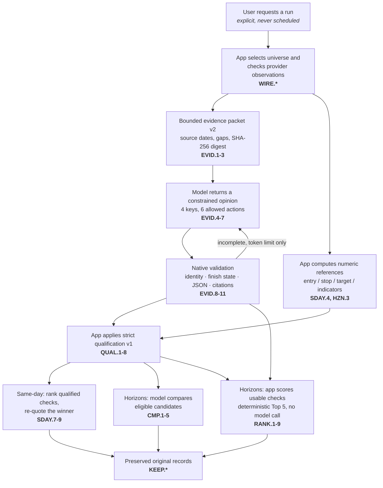

# Gemma in StockSage — model, evidence, research, reproducibility

**Revision B, 2026-09-20.** Supersedes revision A (the 16-page PDF of the same date).
Revision B re-derives every claim from source at a pinned commit, replaces every source
pointer with a `path:line` anchor, and **corrects nine statements in revision A that the
source contradicts** — see [§0.3 Errata](#03-errata-against-revision-a). If you are holding
revision A, stop using it: four of the nine errors are in the outcome-evaluation and
retention rules.

---

## 0. Read this first

### 0.1 What this document is

StockSage uses a **pretrained** Gemma model to interpret bounded evidence and return
constrained opinions. StockSage code does everything else: it retrieves the evidence,
measures prices and indicators, computes entry/stop/target references, enforces
qualification, ranks candidates, and preserves records.

No Gemma training or fine-tuning exists in this repository. I grepped `StockSage/Sources`
and `tools/` for weight updates, adapter/LoRA application, training optimizers and
backpropagation and found none in any model path `[R]`. Supplying a model with new market
evidence at inference time does not update its weights.

> **One known false positive.** `StockSageConvictionCalibration.swift:254-260` and `:429-431`
> accumulate a gradient and a 3×3 Hessian. That is a Newton solve for a logistic calibration
> curve over historical outcomes — statistics on StockSage's own records, not model training.
> A reviewer grepping for `gradient` will hit it; this note is here so they do not have to
> re-derive the answer.

### 0.2 How to read this guide — claim status

Revision A restated "a declared thing is not an observed thing" about forty times, in eight
different verb forms. That discipline is right and is preserved. It is now expressed once,
here, as three marks. **Unmarked text is `[R]`.**

| Mark | Means | Weight |
|---|---|---|
| `[R]` | **Read** — I opened the cited file at the pinned commit and read this. | Source-defined behaviour. Not evidence that it ran. |
| `[C]` | **Configured / declared** — a setting, launcher argument, file-metadata string, advertised name, or upstream document says this. | Says what something calls itself. Says nothing about served bytes or effective behaviour. |
| `[U]` | **Unverified here** — outside this repository, or requires a live run. | Needs its own receipt before anyone relies on it. |

Two standing rules, which replace every per-paragraph disclaimer in revision A:

1. **A gap is not a negative finding.** An unavailable, throttled, unauthorised, stale or
   omitted source establishes an *evidence gap*. It never establishes "there is no news,"
   "no insider activity," or "no earnings risk."
2. **Four evidence categories never substitute for each other**: source-defined behaviour
   `[R]` · passing mocked tests · a successful real inference · a profitable live outcome.
   This document supplies the first. It supplies none of the other three.

### 0.3 Errata against revision A

Nine statements in revision A are contradicted by source at the pinned commit. I verified
`dailyBarOpeningFirst` and `scoredAt` exist on **no branch** in any of the four checkouts on
this machine, so these are authoring errors, not branch drift.

| # | Revision A said | Source says | Anchor |
|---|---|---|---|
| E1 | "New runs use outcome policy **3**, `dailyBarOpeningFirst`" | `OutcomePolicy` has exactly one case, `dailyBarFirstHit = 2`. `dailyBarOpeningFirst` does not exist. New runs are saved with policy 2; the UI string literally reads "(outcome policy 2)". | `StockSageResearchHistory.swift:22-25`, `:227`, `:486` |
| E2 | "A known opening crossing is ordered first: opening at/above target records the opening target event" | **No opening-first ordering exists.** `bar.low <= stop` is tested before `bar.high >= target`, unconditionally. A bar that opens above target and also trades through the stop records a **stop hit** — the inversion of revision A. The open price only chooses the *fill price* when gapped, never which level fires. | `StockSageResearchHistory.swift:620-636` |
| E3 | "Policy 2 keeps its original stop-precedence behavior" (implying 2 is legacy) | Policy 2 **is** current. The genuine legacy case is an *absent* `outcomePolicy` (nil), which routes to the endpoint-only comparison path. | `StockSageResearchHistory.swift:96-97`, `:755-758` |
| E4 | "The result and `scoredAt` are frozen when the capture completes… reused after display refresh, comparison retry, or relaunch" | **Nothing is frozen.** `scoredAt` does not exist. The Top 5 is recomputed on every render with a live `Date()`. Because freshness and insider decay are clock-driven, the same capture re-renders with different scores and can reorder. | `grep scoredAt` → 0 hits; `StockSageResearchModesPanel.swift:335`, `:360`; `StockSageTopFiveRanking.swift:186-187`, `:275` |
| E5 | "Legacy records without a saved original ranking disclose that absence" | No record ever carries a saved ranking, so there is no such disclosure. The saved-research detail screen renders no Top 5 at all. | `grep StockSageTopFiveRankingSection` → definition + `:337`, `:362` only |
| E6 | "Opening the app does not fetch or rewrite outcomes" | The app requests a saved-outcome review whenever the scene becomes active **including launch** (`initial: true`), and that review performs provider fetches and writes evaluations. | `StockSageApp.swift:166-172` → `StockSageHorizonResearch.swift:292-296` |
| E7 | "The saved [Chat] archive is not silently shortened to twenty-four turns" | It is. `historyLimit = 24`; `turns.suffix(24)` then `save()`; the loader rejects any file with >24. Turn 25 evicts turn 1 from memory and disk. The app's own privacy copy says so. The 2,000,000-byte boundary is correct. | `StockSageChat.swift:379`, `:395`, `:435` |
| E8 | Full checks "retained without automatic age/count/aggregate-byte expiry… Reaching a limit fails the save instead of deleting earlier evidence" | Full-check archives **do** expire by count and aggregate bytes, and older ones are **deleted**: newest 20 runs within 128 MiB, ≤16 MiB per run. Only the 4 MiB *index* limit fails the save as described. | `StockSageResearchHistory.swift:1470-1473`, `:1613-1615`, `:1646-1650` |
| E9 | Same-day receipts are "exempt from automatic completed-diagnostic pruning" | No exemption exists in the pruner. `prune()` selects every finished non-active scan directory regardless of horizon and applies the same 30-count / 512,000,000-byte rule. | `StockSageResearchReceiptStore.swift:434-450` |

Two further corrections that are wording rather than contradiction:

- **E10 — "up to 24 Nasdaq common shares" is not a universe selection.** The universe
  selector always selects up to **500**, for all three workflows; the 24 is a truncation
  applied afterwards by same-day research to an already-500-wide `Selection`
  (`StockSageResearchUniverse.swift:127`, `StockSageHorizonResearch.swift:8`). This matters:
  the prior-activity-session fallback is decided at the 500 level, not the 24 level.
- **E11 — news and filing windows are elapsed-time, not calendar-day.** They are fixed
  `3/7 × 86,400 s` and `7/14 × 86,400 s` measured from the record's timestamp to the run's
  evidence clock, not calendar-date comparisons (`StockSageResearchQualification.swift:187`,
  `:200`). Revision A's bolded **calendar** is misleading. See the units key in §0.6.

### 0.4 Provenance — what this was read from

| | |
|---|---|
| Worktree | `/Users/saleh/StockSage-wt/main-integration.yPdibq` |
| Branch | `main` |
| HEAD | `74d6a81439a22e0f8270b2cae60775961751c637` ("Verify complete qualified Gemma prompts against evidence capacity") |
| Authored | 2026-09-19 22:54:16 +0300 |
| Tree state | clean, 0 dirty paths |
| Build/test run for this document | **none** `[U]` |

Every `path:line` below is relative to that worktree root and valid at that commit. Revision A
said only "the current integration source," which is why its errata could not be localised.

> **Do not read this document against `codex/integration-20260917`.** That branch is two days
> behind and `StockSageSameDayResearch.swift`, `StockSageResearchReceiptStore.swift` and
> `StockSageResearchFreshness.swift` do not exist in it. Of the four checkouts on this
> machine, only `main-integration.yPdibq` resolves every symbol named here.

### 0.5 Authority and scope

**Do without asking.** Read source and saved receipts. Run `tools/gate.sh`. Run
`tools/runtests.sh` with an exact suite filter. Replay frozen requests against local fixtures
with `tools/research_model_replay.py`. Write analysis.

**Requires an explicit owner request, every time — not once.** Starting a research run, a
retry, or an outcome review. Starting a model server or loading a model. Spending paid
compute (RunPod). Anything that reaches a broker.

**This document authorises none of the above.** It is a description of source. It is not a
release gate, a readiness claim, a licence audit, or evidence that any installed app, model
server, hosted GPU or provider entitlement is currently working `[U]`.

### 0.6 Units key — read before §7 and §8

Four different time units appear within single lists in this document. They are not
interchangeable.

| Unit | Means | Used for |
|---|---|---|
| **bar** | one completed adjusted daily OHLC bar | stop/target lookbacks, SMA20, ATR14, measured return |
| **session** | one completed monitoring trading session | outcome horizons (7 / 14) |
| **minute** | one completed one-minute aggregate | every same-day price gate |
| **calendar day (86,400 s)** | wall-clock elapsed time, weekends and holidays included | news, filing and insider freshness |

Seven bars and seven calendar days are different windows and routinely cover different spans.
Price and horizon windows count in bars and sessions; freshness windows count in elapsed
seconds.

### 0.7 The four numbers called "context"

Revision A used four context figures across four sections without ever relating them.

| Value | Unit | What it is |
|---|---|---|
| **262,144** | tokens | the GGUF artifact's metadata maximum. **Identical to the "256K" the model card advertises** — 256 × 1024 = 262,144, one number in two spellings. StockSage never requests it. `[C]` |
| **16,384** | tokens | `researchContextTokens` — the per-slot serving context, the hosted readiness floor, and the local ready-gate floor. `StockSageLocalModelServer.swift:207` |
| **32,768** | tokens | Chat's *upper* requested context, clamped to `min(32_768, probe.servingContext)` — so on a verified 16K server, Chat gets 16,384. `StockSageChat.swift:8`, `StockSageLocalModelServer.swift:661` |
| **12,000** | **UTF-8 bytes** | the evidence projection target before final fitting. A byte budget, not a token budget. `StockSageAIAssessment.swift:325` |

> **Caution when grepping.** `262144` also appears as an unrelated HTTP response byte cap at
> `StockSageLocalModelServer.swift:421` and `StockSageLocalModelStartup.swift:110`. A grep for
> the number alone returns both meanings.

### 0.8 Terms used throughout

Defined here in pipeline order, so §5 onward can be read without forward references.

- **check** — a preserved per-symbol assessment record, *including failures*. Checks are not candidates.
- **evidence packet** — the bounded, ordered, digested set of facts sent to the model. Version 2.
- **offered facts** — what the app put in the packet. **cited facts** — what the model referenced back. They are different sets and both are saved.
- **coverage receipt** — a record distinguishing missing / unknown / offered / omitted / cited keys. A description of available material, never of confidence or truth.
- **qualification** — the app's measured screen (strict v1, §8). Passing it makes a check *qualified*.
- **eligible** (`scan.isEligible`) — a check whose original model action was Buy or Strong Buy *and* that carries a valid qualification receipt whose recorded action matches the verdict and whose qualified flag is set. Input to the strict comparison only.
- **deterministic Top 5** — app-scored, **no model call**, always produced from the usable pool, may contain not-qualified Hold/Avoid rows.
- **strict comparison** — one model call over eligible candidates, returning exactly `min(5, eligibleCount)` symbols or a recorded failure.
- **accepted strict buys** (`scan.topBuys`) — the accepted output of that comparison. **Only these become saved horizon outcome predictions.** Collapses to empty on failure.
- **blocker** — the same-day refusal string published instead of a pick.
- **outcome scenario** — a policy-bound measurement over settled daily bars. Not a broker fill, not realised P&L.

> **Three different objects are called "Top 5."** The deterministic Top 5, the strict
> comparison, and accepted strict buys are distinct, produced differently, and can disagree.
> A visible ranked row is **not** a qualified Buy.

---

## 1. Contents and clause IDs

Every normative statement below carries a stable ID. Cite the ID, not the page.

| § | Title | Clause IDs |
|---|---|---|
| 2 | What the model names identify | `IDENT.*` |
| 3 | Upstream training: documented vs unknown | `UPSTREAM.*` |
| 4 | What StockSage adds at inference time | `PIPE.*` |
| 5 | Serving profiles: local and hosted | `SERVE.*` |
| 6 | The external runtime (out of repository) | `RUNTIME.*` |
| 7 | API wiring: what can reach a request | `WIRE.*` |
| 8 | Evidence and output contracts | `EVID.*` |
| 9 | Same-day: one pick or a blocker | `SDAY.*` |
| 10 | Horizons, strict qualification, insider parsing | `HZN.*`, `QUAL.*` |
| 11 | Ranking: deterministic Top 5 and strict comparison | `RANK.*`, `CMP.*` |
| 12 | Outcomes and what they measure | `OUT.*` |
| 13 | Persistence, privacy, manual operation | `KEEP.*` |
| 14 | Other model surfaces | `SURF.*` |
| 15 | Failure triage | `FAIL.*` |
| 16 | Before you change a threshold | `CHG.*` |
| 17 | Tests and the verification boundary | `TEST.*` |
| 18 | Reproducibility checklist | `REPRO.*` |
| A | Consolidated constants | — |
| B | Source map | — |
| C | Version registry | — |
| D | References | — |
| E | `AGENTS.md` integration | — |
| F | Quarantined third-party claims | — |

---

## 2. What the model names identify

**`IDENT.1`** Each part of the name establishes only a lineage claim. None of them identifies bytes.

| Token | What it establishes | Status |
|---|---|---|
| `Gemma 4` | upstream model family. Not an exact file. | `[C]` |
| `31B` | the selected dense size variant; the card describes ≈30.7 B parameters. | `[C]` |
| `it` | upstream instruction-tuned lineage. **Not** a StockSage designation. | `[C]` |
| `QAT` | upstream quantization-aware-training lineage. StockSage performs no QAT. | `[C]` |
| `Q4_0` | the selected quantized GGUF variant. The inventory contract requires four-bit *metadata*; it does not mean every tensor and cache occupies four bits per value. | `[R]` |
| `google/gemma-4-31b-qat` | the canonical application identifier. A server advertising this name establishes only what it calls itself; the SHA-256 identifies the bytes. | `[R]` `StockSageLocalModelServer.swift:215` |
| `GGUF` | the artifact format used by the inspected setups; distinct from the upstream BF16 Safetensors release. | `[C]` |

**`IDENT.2`** The supplied local identity receipt records `[C]`:

```
file            gemma-4-31B-it-QAT-Q4_0.gguf
size            17,651,001,280 bytes
gguf version    3
tensors         833
architecture    gemma4
size label      31B
blocks          60
context length  262,144        (= the card's "256K"; 256 × 1024)
sha256          6f63619c9e33826a2a8ab195a344c79ecae7c82341d5567e28fd8863df056a7b
```

This document read that receipt. It did not rehash the model and did not inspect a running
server `[U]`.

**`IDENT.3`** The receipt's human-readable metadata includes
`Google_Gemma 4 31B It Qat Q4_0 Unquantized` and `it-qat-unquantized`. Those strings describe
upstream and intermediate lineage. The selected final artifact is the Q4_0 file above; the
strings establish no owner fine-tune `[C]`.

**`IDENT.4`** The file's metadata also carries sampling defaults. StockSage's request overrides
temperature to 0.2 (`SERVE.7`). File metadata establishes only what the file declares, never
the settings a server actually serves with.

**`IDENT.5`** The runtime preparation source pins community distribution
`lmstudio-community/gemma-4-31B-it-QAT-GGUF` at revision
`12e5eae7a583b0a8bac91919fa99ae1fb27e6de4`, downloads the file above as `gemma.gguf`, and
checks the same expected hash `[U]` — that script is outside this repository (§6). The Google
repositories establish upstream lineage, not byte identity with the community distribution.

---

## 3. Upstream training: documented vs unknown

All of §3 is `[C]`/`[U]`: it comes from supplied verification notes about Google documents, not
from this repository.

**`UPSTREAM.1`** The notes cite Google DeepMind's report revision 2, dated 24 July 2026. It
describes pretraining broadly following Gemma 3 over web documents, code and images, with a
stated January 2025 pretraining cutoff; filtering for contamination, safety and recitation;
instruction tuning with optional thinking; post-training filtering; and QAT deployment formats
including blockwise Q4_0. These are upstream processes. StockSage performs none of them.

**`UPSTREAM.2`** *(corrects a garbled sentence in revision A)* The report discusses audio
training only for variants **other than** the selected 31B; it documents no audio capability
for the 31B, and the family card confirms the 31B has no audio encoder. Revision A's
"Audio training is discussed for other specified variants, not the selected 31B audio
capability" was ungrammatical and read as the opposite claim.

**`UPSTREAM.3`** The selected dense 31B supports text and image input and has 60 layers. The
inspected research path supplies **text only**; upstream image capability establishes no image
use here. The card's filtering descriptions establish intent, not that sensitive content, bias,
incorrect knowledge or unsafe output have been eliminated.

**`UPSTREAM.4`** Google's QAT documentation distinguishes half-precision weights extracted from
QAT from deployable quantized formats. Its quality and memory goals establish neither that every
task retains BF16 quality, nor that the community file is identical to Google's distribution,
nor that this model was trained as a stock-selection specialist.

**`UPSTREAM.5`** The reviewed material provides **no** complete reproducible training recipe:
dataset mixture proportions, exact token counts, optimizer schedule, all supervised and
reinforcement stages with reward details, and full QAT calibration settings are not established
by these notes. "Similar to Gemma 3" is not evidence that every earlier detail applies, and
non-disclosure is not evidence a source or method was unused. The runtime scripts cannot fill
these gaps.

**`UPSTREAM.6`** Official prompt-format, thinking-capability and fine-tuning documentation exist.
Their existence establishes upstream capability only. StockSage has not fine-tuned a model, and
requests non-thinking behaviour explicitly (`EVID.4`).

---

## 4. What StockSage adds at inference time



**`PIPE.1`** The app sends one system message and one user message to an inference API. Through
these research requests the model does not log into providers, browse arbitrary sites, or
operate a broker.

**`PIPE.2`** The app compiles observed facts and attributed source claims, records missing-data
notices, constrains the output, and validates the answer. These mechanisms reduce specific
failure modes. They do not make the model's reasoning factually or financially correct.

**`PIPE.3`** Neither inference, replay evaluation, an allocation optimizer, nor saved outcome
calculation constitutes neural-model training. See the `ConvictionCalibration` note in §0.1 for
the one grep that looks like training and is not.

**Source:** `StockSage/Sources/StockSage/StockSageLocalModelServer.swift` (1,292 lines) —
`chatRequest` at `:658`, `completeDetailed` retry loop at `:1231`, `Config.reservedOutputTokens`
at `:323`.

---

## 5. Serving profiles: local and hosted

| Property | Managed **local** | Managed **hosted** |
|---|---|---|
| App endpoint | `http://127.0.0.1:1234` `:214` | `http://127.0.0.1:18080` `:216` |
| Expected identifier | `google/gemma-4-31b-qat` `:215` | same, exactly |
| Profile boundary | identifier + loopback + port 1234 + root path. **Scheme is not constrained on this path.** `:310` | identifier + `http` scheme + loopback + port 18080 + root path `:317` |
| Loopback means | `127.0.0.1`, `localhost`, `::1`, `[::1]` — nothing else `:366` | same |
| Discovery | LM Studio inventory with GGUF + `gemma4` + `31B` + `Q4_0` + `bits_per_weight == 4`, hard-scoped to the canonical key `:581`, `:589` | `/v1/models` must return **exactly one** row whose id is the selected model `:450` |
| Serving readiness | exactly one loaded instance with that id and `config.parallel == 1` `:635`; **and** verified context ≥ 16,384 (`StockSageLocalModelStartup.swift:122`) | `/props` non-sleeping slot with `16,384 ≤ n_ctx < 1,048,576` `:506` |
| Worker slots accepted | 1 (strict local serving contract) | 1, 2, 4, 8, 16, 24; any other or absent value falls back to 1 `:506` |
| Data destination | the configured local server | **off-device**, through the private tunnel, despite the loopback URL |
| Failure | explicit unavailable / unverified status | explicit unavailable / unverified; **no silent local fallback** `:450`, `:468` |

**`SERVE.1`** Revision A's local row said only "verified context." The local ready gate also
requires ≥ 16,384 — the same floor as hosted (`StockSageLocalModelStartup.swift:122`).

**`SERVE.2`** A passive probe does not load a model. Only `prepare()` can; on macOS the managed
local path routes through the shared loader (`:621`).

**`SERVE.3`** *(corrects a findability problem in revision A)* The launch-loading setting's real
UI label is **"Load Gemma when StockSage opens"** — the string "Load Gemma at launch" appears
nowhere in the app. Key `stocksage.model.autoLoadOnLaunch`, default `false`. Note it is not
reliably a *separate* opt-in: pressing **"Use LM Studio · Gemma 4 31B"** sets
`automaticModelStartup = true` as a side effect (`Views/CatalystsSection.swift:461-472`).

**`SERVE.4`** Explicit recovery retries preparation from the saved local configuration. It does
not silently enable launch loading and does not replay the research question that failed. Shared
loading checks configuration revisions and cancellation; an uncertain previous load is retained
as uncertain rather than immediately re-submitting a duplicate load.

**`SERVE.5`** Normal Mac quit attempts to unload the selected local model and cancels inference.
Deadline 8 seconds total, 2-second per-request timeout (`:526`). It does **not** delete model
files, terminate the server, or establish that a hosted pod stopped. **Remote GPU lifecycle is
the operator's responsibility** — the app cannot promise success against an unavailable server.

**`SERVE.6`** Shared-loader budget: 120 s total; load POST timeout 110 s; read-only polls 2.5 s;
up to 30 retries at 500 ms (`StockSageLocalModelStartup.swift:132`).

**`SERVE.7`** Concurrency: horizon model analyses are capped at `min(24, max(1, parallelism()))`
**simultaneous in-flight requests**, rechecked after collection (`:575`, `:589`, `:883`, `:896`).
Provider preparation overlaps at most 2 for the managed hosted profile and 1 otherwise. **This is
a concurrency ceiling, not the 500-symbol universe ceiling (§10) and not a provider-concurrency
setting.** Acceptance still checks each request's evidence and lifecycle state.

**Source:** `StockSageLocalModelServer.swift`, `StockSageLocalModelStartup.swift`,
`StockSageModelIdentityMigration.swift`, `Views/CatalystsSection.swift`, `App/StockSageApp.swift`.

---

## 6. The external runtime — out of repository

> **OUT OF REPOSITORY — NOT EDITABLE FROM THIS TREE.** `work/b300-runtime/prepare-server.sh`,
> `start-server-concurrency.sh` and `run_benchmark.py` are **not present in this checkout** —
> `grep -rn 'b300-runtime\|prepare-server\|run_benchmark' .` returns nothing. Everything in §6
> is recorded for identity only. **Do not create these files and do not reconstruct them from
> this document.** All of §6 is `[U]`.

Recorded intended configuration:

- `llama.cpp` revision `8172e6577ac2b35de1ec1e5d1c0aaad6c4a2129f`, Release CUDA build, CUDA toolkit 13.0.
- A pinned Jinja template with expected SHA-256 `6a1015c47ccfcfa67c3b772385bccee357a4d37c3cda37bd202e9047f391ab82`; the inspected template defaults thinking off. Its attribution header was not independently authenticated.
- **Server loopback port 8080 on the pod.** The app reaches it at `127.0.0.1:18080` — the local end of the private tunnel forwarding to 8080. *The loopback app URL does not mean local processing; see the Data destination row in §5.*
- No web UI; explicit template; total context `16,384 × workers`; unified KV with 16,384 per slot; workers limited to the six values in §5.
- Full GPU-layer request, batch 2048, microbatch 512, 16 CPU threads, f16 K/V caches, automatic flash attention, no context checkpoints, no RAM prompt cache, metrics enabled.
- Default benchmark alias `stocksage-gemma4-31b-qat-benchmark`. The launcher also accepts the app alias explicitly; **leaving the benchmark alias unchanged will fail the app's strict identity check.**

**`RUNTIME.1`** These are script settings. They are not evidence that the script ran, that a pod
is running, that the GPU sustains 24 useful workers, that every layer fits, or that the
configuration is optimal. Worker count is a capacity ceiling, not 24 guaranteed simultaneous
full-context responses at a given latency.

### 6.1 Standing the runtime back up

Each step names its **proof**, not its intention. All steps are `[U]` from this tree.

1. Locate `work/b300-runtime`. **If absent, STOP** — it is not in this repository and cannot be reconstructed from this document.
2. `prepare-server.sh` pins the community repo at revision `12e5eae…` and downloads `gemma.gguf`. *Proof:* the SHA-256 in `IDENT.2` matches.
3. Start the server with the **app alias**, not the benchmark alias. *Proof:* `/v1/models` returns exactly one row whose id is `google/gemma-4-31b-qat`.
4. Confirm serving capacity. *Proof:* `/props` reports a non-sleeping slot with `16,384 ≤ n_ctx < 1,048,576` and `total_slots` ∈ {1,2,4,8,16,24}.
5. Confirm the tunnel. *Proof:* the app's hosted probe reaches `127.0.0.1:18080` and reports ready rather than "RunPod unavailable."
6. Only then is a research run possible — and it still requires an explicit owner request (§0.5).

---

## 7. API wiring: what can reach a request

**`WIRE.1`** There is no universal "all APIs connected to Gemma" feed. Four separate questions
must each be answered yes:

1. Is the source wired into *this* workflow?
2. Did the request succeed with current access?
3. Was the record offered after selection and context fitting?
4. Did the model cite it?

A settings toggle or a populated market table answers **none** of questions 2–4.

**`WIRE.2`** "Shared background" means the same-day collector first uses the horizon
public-evidence gatherer, then adds its own intraday facts. It does not mean daily observations
qualify as same-day confirmation. The two longer horizons share collection families but use
different prompts and screening windows.

### 7.1 Wiring matrix

| Source family | Same-day | 1–7 days | 7–14 days | Chat / explanation |
|---|---|---|---|---|
| Massive ticker directory & daily activity | universe truncated to **24** from the shared 500-wide selection (E10); dated provenance | 500 | 500, separate result | selected board symbols only; Browse/Markets visibility is not proof of analysis |
| Massive split-adjusted daily OHLCV | shared technical background | completed daily history, bounded historical facts | same history, longer lookbacks | existing price/rules snapshot; does not call the horizon collector |
| Massive one-minute aggregates + fresh NBBO | completed minutes, bid/ask, sizes, timestamp, scenario, final winner re-quote | no dedicated intraday collector; entry is a completed daily close | same | tape and live quote UI are not streamed to the model; Chat does not run this collector |
| Massive quote-condition reference | validates quote eligibility before qualification | not a separate catalyst | same | a validation dependency; no promise the whole condition directory is prompt content |
| Massive/Benzinga news, earnings, guidance, ratings, insights, bulls/bears, consensus | bounded shared snapshot + statuses; today's usable news may qualify | bounded retained products, source states, records | same products, different horizon interpretation | enriches the first explicit research ticker; Catalysts Explain captures its own snapshot |
| Benzinga analyst & firm metadata | conditional joins for retained snapshot IDs | same | same | ≤3 analyst IDs and ≤3 firm IDs from retained records; not whole directories |
| Generic Massive news | fallback excerpts if Benzinga yields nothing; **same-day catalyst needs today's date** | bounded recent excerpts + attempt status | same; qualifying age differs | ≤3 excerpts for the first explicit ticker; fallback counts as *one* news family, not independent corroboration |
| Dedicated forward earnings | shared public background | fresh next-earnings observation → holding-window status | same lookup, 14-session window | board earnings + Benzinga snapshot, not this dedicated lookup |
| Direct SEC ticker/CIK + submissions | shared filing identities/dates/status | ≤5 of 8-K, 10-Q, 10-K, 6-K, 20-F metadata records | same | no direct SEC collector in Chat enrichment; Catalysts Explain includes a recent 8-K reference — **a link is not proof the filing content was analysed** |
| Massive/SEC Form 4 | fresh shared typed purchase/sale observations | fresh research-local insider check, retained transaction/status facts | same, longer qualifying source-age window | no explicit insider collector in Chat; Catalysts Explain uses the direct Form 4 parser, ≤3 dated/linkable P/S citations |
| Massive/SEC 8-K, dividends, company events | existing fresh answered observations may enter; an 8-K published today can support the catalyst rule | existing source/status observations may enter | same | each scan does not freshly fetch every company-event feed |
| Yahoo charts/history/earnings | **not** the dedicated same-day route | **not** the dedicated daily-history or forward-earnings route | same | board fallback can indirectly contribute quote/earnings facts to Chat or an individual assessment |
| **EODHD** | **disabled** | **disabled** | **disabled** | retained names or old comments do not establish active use |
| Imported WhatsApp leads | not collected | not collected | not collected | optional local-import excerpts for Chat's first explicit ticker, **marked unverified**; can leave the device with a remote model. No live WhatsApp API. |
| Broker balances, account IDs, journal notes, credentials | not research evidence | not research evidence | not research evidence | **explicitly excluded** from the app-created Chat snapshot. What the user types is a separate input boundary. |

**`WIRE.3`** Endpoint shapes visible in code: Benzinga at `/benzinga/v1/…` with news at
`/benzinga/v2/news`; Massive company events at `/stocks/filings/8-K/vX/disclosures`,
`/stocks/filings/vX/form-4`, `/stocks/v1/dividends`. Direct SEC submissions and filing-document
requests are separate transports. **None of these strings proves a subscription entitlement or a
successful live response** `[U]`.

**`WIRE.4`** Optional content can be absent for policy, credentials, entitlement, throttling,
symbol mismatch, applicability, source limits, stale/failed status, or context fitting. The saved
**offered facts**, source states, omitted keys/counts and **cited facts** are the evidence for an
individual completed call. Standing rule 1 (§0.2) applies: absence is a gap, never a negative
finding.

**Source:** `StockSageResearchUniverse.swift`, `StockSageHorizonResearch.swift` (`gather` at
`:863`), `StockSageSameDayResearch.swift`, `StockSageBenzingaClient.swift`,
`StockSageNewsService.swift`, `StockSageMassiveEarnings.swift`, `StockSageMassiveEvents.swift`,
`StockSageMassiveTicks.swift`, `StockSageChat.swift`, `StockSageCatalystNarrator.swift`.

---

## 8. Evidence and output contracts

**`EVID.1`** An `EvidenceFact` (`StockSageAIAssessment.swift:31`) preserves a stable key, prose,
required/optional status, availability, fact class, attribution, observation/publication time,
and an optional typed insider transaction. Classes: market, technical, fundamental, news,
earnings, insider, imported lead, risk, coverage gap.

**`EVID.2`** An `EvidencePacket` (`:60`) is **version 2** (`:90-96`) and preserves order, omitted-record
count, and a canonical SHA-256 digest. Duplicate IDs invalidate the packet.

**`EVID.3`** A coverage receipt distinguishes missing/unknown, offered, omitted and cited keys.
**Coverage describes available material. It is not confidence and it is not truth.**

**`EVID.4`** For a stock opinion the model must return exactly four keys:

```json
{"action":"Hold","reason":"The supplied setup lacks adequate confirmation.","risk":"Missing evidence leaves the apparent catalyst uncertain.","evidence":["F1"]}
```

This is a **format illustration, not an accepted opinion** — `F1` would have to exist in the
actual offered packet and support the interpretation.

**`EVID.5`** Allowed actions, exactly six: **Strong Buy, Buy, Hold, Avoid, Reduce, Sell**
(`:598`). At least one existing unique fact ID is required; duplicates rejected; maximum is the
fact count. The schema sets `additionalProperties: false`.

**`EVID.6`** Reason and risk are short qualitative English sentences, 1–600 characters, with **no**
numeric-type scalars and none of `< > [ ] " \` or control characters. Exact figures live in the
app's captured fact cards, never in model prose.

**`EVID.7`** Shipped prompt/schema is **`explanationFirst` version 1** (`:554`), generation order
`reason → risk → evidence → action`. `evidenceFirst` version 2 exists but is **not** the default;
source at `:529-530` states v2 is not adopted until a measured corpus shows it at least as good.
The illustrative JSON in the system text is not the authoritative generation order.

**`EVID.8`** The native parser additionally checks response size, exact keys and types, allowed
actions, duplicate/unknown references, prose bounds, numerical and bracket patterns, certain
repetition, and some unsupported earnings claims. Managed Gemma completion must identify the
expected model, finish with an accepted complete `stop` state, and pass serving-context
verification after generation.

**`EVID.9`** A syntactically valid citation does **not** prove the source entails the claim, that
contrary evidence was considered, or that a thesis is sound. Finite semantic checks cannot cover
every paraphrase.

### 8.1 Request budgets

| Property | Value | Defined at |
|---|---|---|
| Serving context | 16,384 tokens | `StockSageLocalModelServer.swift:207`, `:335`, `:421` |
| Sampling | temperature **0.2**; `top_p` and seed **deliberately not sent** — the served model owns both, recorded `nil` | `:212`, `:556-557`, `:671` |
| Generation | non-streaming; managed Gemma sends `reasoning_effort: "none"` | `:670-672` |
| Stock-opinion output | **192 tokens initially.** On an incomplete response whose finish reason is exactly `.tokenLimit`, an eligible managed-profile request restarts **once** with the budget doubled to **384**, reusing the same evidence and the original deadline. **There is no second doubling.** | `StockSagePaperAutomation.swift:12` (192); `StockSageLocalModelServer.swift:1231-1241`, `:1431` |
| Doubling eligibility | strict (managed) profile only, initial budget in `1...512` | `:323-325` |
| Assessment deadline | **90 s**, one wrapper, covering eligible evidence-format repair | `:668-670` |
| Format repair | restricted: may repair only a draft whose keys are exactly `{action, reason, risk}`, and must preserve the original action, reason and risk. **It cannot invent a replacement opinion.** | `StockSageAIAssessment.swift` |
| Context fitting | whole *optional* records dropped from the end; **required facts are never dropped** — they cause an explicit budget failure, not silent truncation. Omissions recorded. | `StockSageAIAssessment.swift` |
| Evidence projection | **12,000 UTF-8 bytes** target before final fitting, plus a 128-byte prompt-framing allowance | `StockSageAIAssessment.swift:325`, `:270` |
| Max response body | 1,048,576 bytes | `StockSageLocalModelServer.swift:216-217` |

> **`EVID.10` — the sharpest trap in this file.** `reservedOutputTokens(for:)` doubles the budget
> **only** when `requiresStrictOutput` is set *and* the initial budget is in `1...512`
> (`:323-325`). **Setting any initial output budget above 512 silently disables the
> incomplete-response retry.** Nothing warns you; the restart simply stops happening.

**`EVID.11`** The final byte budget uses a conservative normalised UTF-8 heuristic, **not** a
Gemma tokenizer. Source comments explicitly mark the ≤1-token-per-NFC-byte bound **unverified for
Gemma**, with a measured floor of exactly 1.0 bytes/unit and **zero margin** (`:218-238`). Sampled
historical observations are not a proof for all Unicode input. Research reserves retry output
space before choosing optional records.

**`EVID.12`** Inference profiles record model, endpoint profile, prompt/schema/packet versions,
packet digest, temperature, context/output budgets and retry reason. They leave seed and `top_p`
unknown by design. **Identical request configuration is neither identical evidence nor
deterministic output.** A replay test must assert byte-identical *requests*, not identical
*responses*.

---

## 9. Same-day: one pick or a blocker

Universe ceiling **24** (truncated from the shared 500 — E10). Requires market access,
non-sample data, the **strict Gemma profile** (`config.requiresStrictOutput` and
`config.model == google/gemma-4-31b-qat`, hard-gated at `:266` — the horizon path has no such
identity requirement), and durable receipt writing. Same-day and horizon scans cannot run
together. Every shortlisted check is preserved, including failures.

### 9.1 The gates, in order

| # | Gate | Value | Anchor |
|---|---|---|---|
| `SDAY.1` | earliest run | regular open + 1800 s | `StockSageSameDayResearch.swift:68` |
| `SDAY.2` | shortlist identity | unique tickers, active, type `CS`, `primary_exchange` `XNAS`, currency USD | `StockSageResearchUniverse.swift:155-157` |
| `SDAY.3` | completed minutes | **30–60** in a bounded last-hour window (request window 3600 s floored at the regular open; per-bar recency bound 3660 s) | `:363`, `:367` |
| `SDAY.4` | consecutive volume | latest **5** minutes, exactly 60 s apart, volume > 0 | `:374-376` |
| `SDAY.5` | NBBO spread | **≤ 25 bps**, condition-verified | `:202` |
| `SDAY.6` | quote freshness | **5 s** — `NBBO.usableAge`, enforced inside *every* `spreadBps(at:)` call, so it gates the per-candidate screen, the winner re-quote **and** the card | `StockSageNBBO.swift:28`, `:40-51` |
| `SDAY.7` | spread-penalised screen | `(target − ask − spread) / (ask − stop + spread) ≥ 2`, where `spread = ask − bid` | `:379-381` |
| `SDAY.8` | candidate expiry | earliest of: background capture **+300 s**, completed-minute evidence **+180 s**, regular close **−300 s** | `:272` |
| `SDAY.9` | no new entry | within **300 s** of the scheduled regular close | `:358` |

**`SDAY.10`** *(revision A omitted these)* `scenario()` enforces four further preconditions, any
one of which blocks a pick: `intraday.verifiedMinutes` (the provider payload must self-report
`adjusted: true` **and** a `resultsCount` exactly equal to the returned bar count),
`intraday.fresh(at:)`, strictly positive bar lows, and a live session window
(`StockSageSameDayResearch.swift:362`, `:366-373`). The trade-only intraday fallback has a 120 s
max age and carries **zero** bars — so it can never satisfy `SDAY.3` and can never qualify.

**`SDAY.11`** References: entry = the captured eligible **ask**, frozen as a ceiling. Stop =
lowest low of the latest five completed minutes. Target = **highest high of the same bounded
last-hour window used for `SDAY.3` (30–60 completed minutes), excluding the latest minute** — so
the target lookback length *varies* with how many session minutes are available. Stop must be
below the ask entry and target above it.

**`SDAY.12`** An accepted Buy/Strong Buy must cite **both** an available recent completed-minute
fact (recency bound 360 s at `:393`) **and** an available news/filing fact published on the same
New York date. At most 3 news facts and at most 1 8-K fact are offered. A today publication date
does not prove the underlying event happens today. Daily technical signals are background, not a
substitute for intraday evidence. **With no usable today catalyst, the candidate does not make a
same-day model request at all.**

**`SDAY.13`** The app orders qualified, unexpired checks by reward/risk, then narrower spread,
activity, ticker. The winner gets one more fresh quote check — **which is not a re-run of
`scenario()`**: it compares the fresh **ask** against the *frozen* entry (`quote.ask <= plan.entry`)
and the fresh **bid** against the stop (`quote.bid > plan.stop`), an asymmetric test
(`:201-204`). Failure does **not** silently substitute a runner-up; persistence failure removes
the published selection and displays a blocker. A stored winner can become historical within
seconds of publication. **It is not a continuously renewed buy instruction.**

**`SDAY.14`** Missing minutes are disclosed by the collector rather than fabricated. Same-day
model output budget is 192 tokens.

### 9.2 One same-day run, end to end

1. **Universe select** — active XNAS common shares, USD, verified volume × VWAP, 500-wide selection, then truncated to 24. A prior activity session may substitute when it gives wider verified coverage; **the selection receipt records the choice.**
2. **Shared background capture** — horizon public-evidence gatherer runs first (`WIRE.2`).
3. **Intraday collection** — 30–60 completed minutes, NBBO. *Can refuse:* `SDAY.3`–`SDAY.6`, `SDAY.10`.
4. **Scenario screen** — compute entry/stop/target, apply `SDAY.7`. *Can refuse:* ratio < 2.
5. **Catalyst check** — today-dated news or 8-K. *Can refuse:* `SDAY.12` (no request is made).
6. **Model request** — strict profile, 192 tokens, temperature 0.2, 90 s deadline.
7. **Validation** — `EVID.8`–`EVID.9`. *Can refuse:* identity, finish state, JSON, citations.
8. **Qualification** — `qualifies(_:)` at `:385`.
9. **Rank and re-quote the winner** — `SDAY.13`. *Can refuse:* stale or moved quote → blocker.
10. **Persist** — receipt under `ResearchReceipts/scan-<runUUID>/`. *Can refuse:* save failure → the pick is withdrawn and a blocker shown.

Every refusal above is a **designed refusal**, not a bug. See §15 before filing one.

---

## 10. Horizons: collection and strict qualification

**`HZN.1`** Universe ceiling **500** for both horizons (`StockSageHorizonResearch.swift:8`).
Minimum **30** completed daily bars; accepted range 30…5000 (`:241`).

**`HZN.2`** The gatherer requests split-adjusted daily history and rejects wrong-symbol,
unadjusted, incomplete/paginated, malformed or stale responses. It needs at least 30 completed
valid daily bars through the latest verified settled aggregate session.

**`HZN.3`** References:

| | 1–7 days | 7–14 days |
|---|---|---|
| Entry | last completed adjusted close | last completed adjusted close |
| Stop | lowest low of latest **5** daily bars | lowest low of latest **10** daily bars |
| Target | prior **20**-bar high, latest bar excluded | prior **60**-bar high, latest bar excluded |
| Bars required for the target | > 20 (always met by the 30-bar floor) | **> 60** — thirty bars alone cannot establish it |

**`HZN.4`** The app computes technical facts, obtains bounded news/Benzinga evidence, checks
forward earnings independently of the board cache, obtains SEC filing metadata, and performs a
fresh Form 4 observation. Full SEC filings are not generally read by this metadata gatherer.
Longer historical lookbacks are analytical context, **not permission to extend the holding
horizon**.

**`HZN.5`** Suspended work rechecks external-access policy revisions, sample mode, provider
credentials, model configuration revisions, cancellation and shutdown. Resume and retry preserve
original records and configuration identity. Comparison-only retry uses captured checks and is
distinct from recollecting incomplete candidates or starting a fresh run. **An unavailable model,
changed setting, incomplete capture or invalid output cannot be converted into accepted research
simply to fill five rows.**

### 10.1 Strict qualification, version 1

Requires an original Buy/Strong Buy plus **all** applicable measured conditions
(`StockSageResearchQualification.swift`, `version = 1` at `:6`):

| # | Condition | Value | Anchor |
|---|---|---|---|
| `QUAL.1` | capture identity, USD basis, access, timing | freshness 300 s | `:187` area |
| `QUAL.2` | completed close above SMA20 | period 20 | `:379` |
| `QUAL.3` | positive measured return over the horizon | 7 bars / 14 bars | `:380` |
| `QUAL.4` | recent 3-bar average volume vs preceding 20-bar average | **≥ 1.5×** | `:381`, `:150-151` |
| `QUAL.5` | positive ATR14 (Wilder) | period 14 | `:382` |
| `QUAL.6` | `stop < entry < target`, reward/risk **≥ 2** | `(target − entry) / (entry − stop)`, **no spread penalty** | `:389` area |
| `QUAL.7` | stop distance ≤ **3 ATR14**; target distance ≤ **3 ATR14** (week) / **6 ATR14** (fortnight) | | `:389` |
| `QUAL.8` | fresh earnings observation with a date **outside** the holding window (`relation == "outside"`) | | `:404-406` |
| `QUAL.9` | a recent dated news or public-insider filing record **actually offered and cited by the model** | news **3 / 7** × 86,400 s; insider filing **7 / 14** × 86,400 s (elapsed, see E11) | `:187`, `:200`, `:254` |

> **`QUAL.6` vs `SDAY.7`.** Both say "reward/risk ≥ 2" and they are **not comparable**. The
> horizon form is unpenalised because its entry is a completed adjusted close; the same-day form
> subtracts the spread from the numerator and adds it to the denominator because its entry is a
> live ask. At identical prices the same-day screen is strictly harder.

**`QUAL.10`** *(revision A omitted these)* Further gates in the same file: news
source-observation freshness **300 s**; insider source-observation freshness **86,400 s and the
same UTC day** as `evidenceAsOf` (`:262`); candidate-catalyst cap **13** (`:251`).

**`QUAL.11`** Missing timing is not evidence of absence of risk. The numerical references come
from app code, **not** from Gemma-generated prices. Provider analyst targets do not replace the
measured historical target. Technical confluence is additional neutral scoring evidence, not an
extra strict gate and not permission to change the model's original action. No benchmark series
is wired into the qualification capture, so relative strength is **absent rather than inferred**.
These rules are deterministic assumptions, **explicitly unvalidated as a predictive strategy**.


### 10.2 Insider evidence: what the Form 4 parser actually extracts

**`HZN.6`** `StockSageInsider.Code` (`StockSageInsider.swift:29-44`) models **seven** SEC Table I
transaction codes, not four:

| Code | Meaning | Surfaced? |
|---|---|---|
| `P` | open-market purchase — own money, own choice | **yes** |
| `S` | open-market sale | **yes** |
| `A` | award/grant from the company | **no** |
| `M` | exercise of a derivative — mechanical | **no** |
| `F` | shares withheld to cover tax — the insider chose nothing | **no** |
| `G` | gift | **no** |
| `?` | unrecognised (`init(rawCode:)` falls back here) | **no** |

**`HZN.7`** `isDiscretionary` is true for **`P` and `S` only** (`:43`), and the parser
`continue`s past everything else while counting it as `excluded` (`:135`). Grants and option
exercises are therefore **not scored at reduced weight — they are excluded entirely**. The count
of excluded rows is retained, so "no discretionary activity" is distinguishable from "nothing
filed."

**`HZN.8`** Parsing is **Table I only**: the regex matches `<nonDerivativeTransaction>` blocks
(`:127`), and a derivative contract is explicitly not treated as a share trade. Values are read
*inside* each transaction block rather than from document-wide arrays, because independent arrays
shift when a value is absent (`:124-126`).

**`HZN.9`** Integrity guards that reject the **whole summary**, not just one row: a missing or
empty `transactionCode`; a share quantity that is non-finite, ≤ 0, or ≥ `Int.max` (it would trap
when catalyst citations render shares as `Int`); and — importantly — a
`transactionAcquiredDisposedCode` that disagrees with the transaction code, i.e. anything other
than `A` for `P` or `D` for `S` (`:144`). A disputed row can reverse the net, so the summary is
withheld rather than partially trusted.

**`HZN.10`** Amendment handling (`StockSageTopFiveRanking.swift:255-285`): transactions are grouped
by an `EconomicKey` of **(owner, date, direction)**. Within a group containing amendments, only the
**last** amendment scores; every other record stays visible with **zero** contribution, so
superseded evidence is never hidden. `MassiveEvents` applies the same
derivative/non-derivative distinction at parse time, accepting `"non-derivative"` and
`"non_derivative"` and rejecting `"derivative"` (`StockSageMassiveEvents.swift:412-415`).


---

## 11. Ranking: deterministic Top 5 and strict comparison

> **`RANK.0` — corrected.** Revision A described this ranking as *saved*, *frozen at capture*,
> and carrying a `scoredAt` stamp. **None of that is true** (E4, E5). `StockSageTopFiveRanking`
> calls no model and stores nothing. `Run` has no field for a ranking result, and
> `rankedTopFive(horizon:now:)` is invoked with a live `Date()` on every render
> (`Views/StockSageResearchModesPanel.swift:335`, `:360`). Because `RANK.6` (freshness) and
> `RANK.7` (insider decay) are clock-driven, **the same capture re-renders with different scores
> and can reorder after a refresh or relaunch.** The saved-research detail screen renders no
> Top 5 at all. Treat "deterministic" as *deterministic given `(capture, now)`* — not as
> *persisted*.

**`RANK.1`** The ranking fills qualified slots first, then usable nonqualified candidates,
preserving original actions and failed-gate reasons. A Hold or Avoid can appear as a ranked
**not-qualified** row. It returns at most five from the actual usable pool; failed or no-verdict
checks are never invented into candidates. The capture adapter requires the listing-result set to
have finished before ranking its usable checks.

**`RANK.2`** Within each qualification group it sorts score descending, then ticker ascending.

| Component | Rule | Anchor (`StockSageTopFiveRanking.swift`) |
|---|---|---|
| `RANK.3` horizon return | 0–10 points, capped at 20% return | `:164` |
| `RANK.4` technical confluence | aligned 10, mixed 5, conflicted/insufficient 0 | `:169-171` |
| `RANK.5` cited catalyst | 8 credited public-insider filing, else 6; **0 without a citation** | `:177-178` |
| `RANK.6` volume-ratio proxy | 0–10, capped at 4× — **not executable liquidity** | `:183` |
| `RANK.7` evidence freshness | starts at 10, **−1 per hour**, floored at 0, **live clock** | `:186-187` |
| `RANK.8` insider evidence | base **6.0**, linear decay over **14 days**; ≥2 distinct owners in the same direction within **7 days** multiplies eligible contributions by **1.5**. Purchases positive, sales negative. Invalid or superseded amendments remain visible with **zero** weight. | `:259`, `:274`, `:275-276` |
| `RANK.9` contrary technical checks | **−2** each | `:18`, `:197-199` |
| `RANK.10` named penalties | **−50** unverified critical capture · **−50** contradictory measurement basis · **−10** no offered dated catalyst | `:15-17`, `:207-210` |

> **Scale.** Maximum positive total is roughly **57** points (10 + 10 + 8 + 10 + 10 + up to 9).
> A single −50 therefore demotes a candidate below essentially every unpenalised peer. That is
> its intent: it is a **disqualifying marker expressed as a score**, not a weight.

**`RANK.11`** These are transparent scoring assumptions. They are not evidence of insider motive,
insider confidence, or a measured predictive edge.

**`RANK.12` Concentration guard.** Cap **2** per known key (`:26`), applied separately within the
qualified and nonqualified groups — so diversification can never promote a failed screen above a
qualified candidate. *(Corrected)* Revision A gave only one escape hatch. There are **three**
(`:322-336`): an over-cap candidate is also kept when (a) too few candidates remain after it to
still fill the requested slots (`remainingAfter >= stillNeeded` fails), or (b) no different-key
alternative exists later in the sort, or (c) it leads the best alternative by the material-advantage
margin of **5.0** points (`:29`). The generic scorer supports sector or catalyst identity; the
current production capture adapter supplies **catalyst** identity and does **not** establish
complete sector coverage.

### 11.1 Separate strict model comparison

**`CMP.1`** Gemma compares only `scan.isEligible` candidates (§0.8) and returns exactly
`min(5, eligibleCount)` unique symbols in preferred order (`StockSageResearchRanking.swift:398`).
It may **not** invent explanations, scores, probabilities, prices, or additional symbols. Buy and
Strong Buy are eligibility labels, not automatic ranking tiers.

**`CMP.2`** Comparison protocol **version 3** (`:393` accepts 1, 2, 3). Mandatory original cases,
risks, dates, reference/scenario records and coverage stay whole. Cited evidence is included as
space allows; class-aware allocation records omitted IDs/counts when full records cannot fit.

**`CMP.3`** Initial output **256 tokens** (`:233`). Multi-round comparison carries earlier winners
into later rounds and is **explicitly approximate and grouping-dependent**.

**`CMP.4`** Retry: **one** per round, and only for a transient network error or HTTP 500/502/503/504
(`:339-350`). Old saved protocols retain their original validation.

**`CMP.5`** A strict comparison can produce fewer than five names, none, or a recorded failure.
That does **not** erase the deterministic ranking or the original checks, and a fallback ranked
row never acquires a fabricated strict outcome scenario.

---

## 12. Outcomes and what they measure

**`OUT.1`** In this app "Buy," "Stop-loss" and "Target" are **dated conditional references**. A
last close or captured ask is not a fill; a historical high is not a forecast; a stop reference
creates no stop order and guarantees no exit price. Gaps and spread changes can invalidate the
assumptions. The app does not turn a research result into an order.

**`OUT.2`** Only accepted strict `scan.topBuys` become saved horizon outcome predictions. The
saved run also retains its strict comparison receipt/failure and coverage. *(Corrected)* It does
**not** retain a deterministic ranking — `Run` has no such stored property and `snapshot(...)`
never writes one (`StockSageResearchHistory.swift:80-101`).

**`OUT.3` — corrected (E1–E3).** New runs use **`OutcomePolicy.dailyBarFirstHit`, raw value 2** —
the only case defined (`:22-25`), assigned at `:227`. There is no policy 3 and no
`dailyBarOpeningFirst` in any branch. Unknown raw values throw on decode rather than downgrading.
The genuine legacy case is an **absent** `outcomePolicy` (nil), which routes to the endpoint-only
comparison path (`:96-97`, `:755-758`).

**`OUT.4` — corrected (E2).** Evaluation is `terminalEvent(bars:stop:target:horizonEnded:)` at
`:620-636`. It walks settled adjusted daily bars chronologically and, **within each bar, tests
`bar.low <= stop` before `bar.high >= target`, unconditionally**:

```swift
for bar in bars {
    let stopHit = bar.low <= stop
    let targetHit = bar.high >= target
    if stopHit {
        let gapped = bar.open <= stop
        return TerminalEvent(kind: .stopHit, bar: bar, price: gapped ? bar.open : stop,
                             sameBar: targetHit, gapped: gapped)
    }
    if targetHit { … }
}
```

A session that **opens at or above the target** but also trades down through the stop records a
**stop hit priced at the stop**, with `sameBar: true`. The opening price is used only to choose
the *fill price* when the bar gapped through the level the low/high test already selected
(`gapped ? bar.open : level`). It never chooses *which* level fires. This is conservative — the
daily bar cannot reveal intrabar order — but it is the **opposite** of what revision A described.

**`OUT.5`** Evaluation begins on the next trading date after completion and ends at the first
verified stop/target event or the 7th/14th monitoring-session close. Fortnight monitoring begins
with the **first eligible session**, not day seven.

**`OUT.6` — corrected (E6).** The app requests a saved-outcome review whenever the scene becomes
active, **including launch** (`App/StockSageApp.swift:166-172`, `initial: true`), and that review
performs provider fetches and writes evaluations
(`StockSageHorizonResearch.checkSavedOutcomes`, `:292-296`). `isChecking` is the single-flight
guard and the app does not poll while closed or backgrounded — but revision A's "Opening the app
does not fetch or rewrite outcomes" is false. **Saved research → Check active results** remains
the manual entry point.

**`OUT.7`** Same-day product receipts have their own history/freshness contract and are **not**
automatically fed into the seven/fourteen-session evaluator.

**`OUT.8`** Later evaluations do not rewrite the original opinion or evidence. Missing or
inconsistent prices remain unavailable. Separate adjusted captures cannot safely establish a
return without a common adjustment basis; the UI discloses changed reference sessions/bases
rather than inventing a percentage comparison. **These are research scenario measurements — not
broker fills, not realised P&L, not proof of investment accuracy.**

---

## 13. Persistence, privacy, manual operation

| Record | Behaviour | Anchor |
|---|---|---|
| Horizon runs & full checks | *(Corrected, E8)* Full-check archives **expire by count and bytes and older ones are deleted**: newest **20** runs within **128 MiB** (134,217,728 B), **≤16 MiB per run**. The **4 MiB index** limit does fail the save rather than deleting evidence. Shipped policy string: *"Original full checks: newest 20 runs within 128 MiB, at most 16 MiB per run. Older full-check archives expire; saved shortlists and outcomes remain."* | `StockSageResearchHistory.swift:1470-1473`, `:1613-1615`, `:1646-1650` |
| Same-day receipts | Durable sole product history. *(Corrected, E9)* **No pruning exemption exists** — `prune()` selects every finished non-active scan directory regardless of horizon. Save failure blocks a published pick. | `StockSageResearchReceiptStore.swift:434-450` |
| Other completed transport diagnostics | Active scans excluded; at most **30** completed non-active diagnostics retained, subject to a **512,000,000-byte** default budget. The newest is kept even when it alone exceeds the budget. | `StockSageResearchReceiptStore.swift` |
| Chat transcript | *(Corrected, E7)* The saved archive **is** capped at **24 turns** — `historyLimit = 24`, `turns.suffix(24)` then `save()`, and the loader rejects any file with more than 24. Turn 25 evicts turn 1 from memory and disk. The **2,000,000-byte** storage boundary is correct. | `StockSageChat.swift:379`, `:380`, `:395`, `:435` |
| Model-inference Chat context | at most the latest **24** eligible turns, potentially fewer after fitting. The full saved transcript is not automatically sent. | `StockSageChat.swift` |

**`KEEP.1`** Full-check reads validate integrity and preserve failed/non-Buy checks. Previously
expired legacy evidence remains explicitly unavailable; the app does not claim to reconstruct
deleted originals. Atomic writes and bounded reads protect against several corruption paths, but a
storage warning still means durability was not established. Original bytes are not discarded
merely to make a failed load look empty.

**`KEEP.2`** Transport diagnostics store bounded/redacted system, schema, prompt and response
payloads with byte counts, hashes, truncation flags, model/configuration, HTTP/completion/failure
information, duration and retry details. **A hash of redacted/truncated stored content is not the
hash of the full unredacted wire request.** Diagnostic directories/files use 0700/0600 permissions
and atomic replacement. Chat also attempts protected atomic writes, 0600 permissions and backup
exclusion; its unsent draft remains in memory.

**`KEEP.3`** Local model inference does not make the whole app offline: public market evidence
still requires permitted provider access. A hosted model receives its selected prompt
**off-device**. For remote Chat that can include the question, bounded prior turns, news, and
private imported WhatsApp excerpts. Those imports are not made public merely because they sit
beside public evidence. The app snapshot excludes broker/account/journal/credential fields, but
**text typed by the user can contain private information**, and the likely-secret detector is a
limited heuristic, not a comprehensive privacy guarantee.

**`KEEP.4`** External-access gates and configuration/credential revisions stop obsolete work from
being accepted after settings change. Current research is **manual**. Optional explicitly
configured price alerts are a separate feature and do not authorise automatic research, outcome
review, model assessments, or paper orders. Retained legacy paper code/history is not a current
automatic-research product: new legacy runs are disabled and legacy open positions are not
monitored after relaunch.

---

## 14. Other model surfaces

| Surface | Input/output boundary |
|---|---|
| `SURF.1` General Chat | up to **4** selected symbols, prioritising explicit tickers then watchlist/board. JSON `analysis` plus `evidence`; empty evidence allowed for a general explanation. Old conversation is not current market evidence. Number-bearing prose is displayed as an **unverified draft**. |
| `SURF.2` Chat request budget | upper context **32,768** clamped to the verified serving window; output **512**; timeout **300 s**. A verified 16K runtime therefore receives at most a 16K context request. Older server comments mentioning 4K do not override the executable caller. |
| `SURF.3` Individual stock assessment | shared evidence/opinion rules using the selected backend. The UI assessment cache is in-memory; a fresh quote does not rewrite captured evidence or schedule a new inference. |
| `SURF.4` Catalyst explanation | selected-server route using research context and separate explanation validation. **Apple's on-device FoundationModels route is a different model and must not be called Gemma.** |
| `SURF.5` Headline sentiment | separate positive/negative/neutral classification, **16** output tokens, **30 s** timeout. A sentiment label is not an investment recommendation. |
| `SURF.6` Legacy paper helper | a model call remains in preserved implementation source. That does not establish an enabled automated product or authorise activation. |

**Source:** `StockSageChat.swift`, `StockSageAIAssessment.swift`, `StockSageCatalystNarrator.swift`,
`StockSageLocalSentiment.swift`.

---

## 15. Failure triage

**`FAIL.1`** The model can misunderstand correctly supplied evidence, cite a fact that does not
establish its conclusion, overlook counterevidence, or produce a plausible but unsupported
interpretation. A schema pass, a low temperature, many available APIs, or an insider score is
**not** a calibrated probability of profit. Provider facts can also be wrong, delayed, incomplete,
revised or unavailable.

**`FAIL.2` Calendar expiry — this is a dated operational hazard, not a caveat.**
`StockSageMarketHours.nasdaqDay(at:)` hard-fails for any date outside **calendar year 2026**
(`:109`), so `session(at:)` returns nil and **same-day research cannot start at all once 2026
ends**, until the holiday table is extended from verified notices. Daily aggregates are treated as
complete only after the scheduled **extended**-session end, not the regular close — which can keep
daily research on the previous completed aggregate session after the cash market closes.

> *(Corrected)* Revision A implied one calendar artifact. There are **at least three**, with
> different coverage windows and different holiday sets, so "extend the calendar" is **not one
> edit** and they do not expire together: `StockSageMarketHours.nasdaqDay` (2026 only, 10 exchange
> holidays, `:109`/`:111`); a separate gate in `StockSagePaperAutomation.swift:324-326`; and the
> **Tadawul** path in the same MarketHours file, which has **no holiday table at all and no year
> gate** — a bare Sun–Thu weekday/hours schedule, a materially weaker guarantee. The source states
> both limits under an explicit honesty banner at `StockSageMarketHours.swift:5-12`.

### 15.1 Triage table

| Observed state | Layer | Real failure or designed refusal? | First thing to check | Must **not** be concluded |
|---|---|---|---|---|
| Model unavailable / wrong identity | server | real | the disclosed server/profile problem; `/v1/models` row count and id | that a replacement opinion was formed — none was |
| Source unchecked, throttled, unauthorised, stale or missing | evidence | gap, not failure | saved source states and omitted keys | absence of market risk (standing rule 1) |
| Output incomplete or rejected | contract | real | finish reason; only `.tokenLimit` triggers the one restart (`EVID.10`) | that partial text is a usable opinion — it may help diagnose, nothing more |
| No strict candidates | screen | **designed refusal** | eligible count; the measured screen simply produced no eligible comparisons | that the deterministic not-qualified rows are buys — they remain useful to inspect only |
| Same-day blocker published | screen | **designed refusal** | which of `SDAY.1`–`SDAY.13` fired; every shortlisted check including failures is preserved | that the run broke |
| Same-day result now historical | freshness | expected | `SDAY.6` (5 s) and `SDAY.8` expiry | that it is a fresh entry signal — it records what was observed |
| Interrupted/failed new run, older data visible | persistence | real, but data intact | run timestamps and status | that old results are a successful new scan |
| Storage failure | persistence | real | the save error; a published pick is withdrawn | that reopening will recover the unsaved result |
| Date outside 2026 | calendar | **hard stop** (`FAIL.2`) | `nasdaqDay` year gate | that the market was closed |

**`FAIL.3`** This document contains **no** demonstrated financial edge, current throughput,
live-provider connectivity, or final installed-release validation `[U]`.

---

## 16. Before you change a threshold

**`CHG.1`** Compile gate — **the only ground truth for compilation**:

```bash
tools/gate.sh . all          # or: macos | ios | tests
```

**`CHG.2`** Tests — **serial by design**; under a parallel full-suite run the same test names fail
across unrelated suites and pass in isolation:

```bash
tools/runtests.sh . --filter StockSageSameDayResearchTests
```

`--filter` takes an **exact suite identifier**, not a regex.

**`CHG.3`** SourceKit diagnostics in this repo are **systematically false** — cross-file symbols
report "cannot find X in scope" and `Testing` reports "no such module" on files that compile
cleanly. Do not act on them; run `CHG.1`.

**`CHG.4`** Coupled-edit table. Changing any value on the left without the middle column silently
desynchronises saved receipts from the policy strings shown to the owner.

| Threshold | Defined at | Must land in the same change | Bump | Suite that pins it |
|---|---|---|---|---|
| Same-day spread ≤ 25 bps | `StockSageSameDayResearch.swift:202` | the saved policy string; any duplicated literal | — | `StockSageSameDayResearchTests` |
| Spread-penalised screen `≥ 2` | `:379-381` | the displayed formula text | — | `StockSageSameDayResearchTests` |
| NBBO usable age 5 s | `StockSageNBBO.swift:28` | **three** call sites gate on it (screen, re-quote, card) | — | `StockSageSameDayResearchTests` |
| Strict screen values (SMA20, 1.5×, ATR14, RR≥2, 3/6 ATR) | `StockSageResearchQualification.swift:379-389` | `version` at `:6` — **saved receipts record the version they were judged under** | `QUAL` v1 → v2 | `StockSageResearchQualificationTests` |
| News / insider age windows | `:187`, `:200`, `:254` | the units key (§0.6); these are elapsed seconds, not calendar dates | `QUAL` version | `StockSageResearchQualificationTests` |
| Top 5 scoring weights and penalties | `StockSageTopFiveRanking.swift:15-29`, `:164-210` | the ~57-point scale note in `RANK.10`; nothing is persisted, so old records re-score under new weights | — | `StockSageTopFiveRankingTests` |
| Comparison protocol | `StockSageResearchRanking.swift:393` | the accepted-version set `[1,2,3]` — old saved protocols must keep their original validation | `CMP` v3 → v4 | `StockSageResearchRankingTests` |
| `OutcomePolicy` | `StockSageResearchHistory.swift:22-25` | a **new case**, never a redefinition — unknown raw values throw on decode; the UI basis string at `:486` | new raw value | `StockSageResearchHistoryTests` |
| Output budgets | `StockSagePaperAutomation.swift:12`, `StockSageLocalModelServer.swift:323-325` | **`EVID.10`** — anything above 512 disables the retry | — | `StockSageLocalModelServerTests` |
| Prompt / schema | `StockSageAIAssessment.swift:554` | v1 is frozen against a measured corpus (`:486-492`); v2 is not adopted until measured at least as good (`:529-530`) | `PromptVersion` | `StockSageAIAssessmentTests` |
| Sampling (`top_p`, seed) | `StockSageLocalModelServer.swift:556-557` | **do not start sending these without a re-benchmark** — new sampling parameters move the output distribution off the frozen baseline. Record them as unpinned instead. | — | `StockSageLocalModelServerTests` |
| Nasdaq calendar | `StockSageMarketHours.swift:109-111` | **plus** `StockSagePaperAutomation.swift:324-326`, **plus** the Tadawul path — three artifacts (`FAIL.2`) | — | `StockSageMarketHoursTests` |

---

## 17. Tests and the verification boundary

**`TEST.1`** **No build or test was run to produce this document, and no pass count is asserted
here** `[U]`.

**`TEST.2`** Revision A listed seven suites under abbreviated names. Their real identifiers and
paths:

| Suite (real name) | Path | Representative contract |
|---|---|---|
| `StockSageLocalModelServerTests` | `StockSageTests/StockSageLocalModelServerTests.swift` | exact model variant and unique context; identity/finish verification; original retry deadline; request-derived recorded temperature; bounded observer payloads; cancellation; capacity/access checks |
| `StockSageSameDayResearchTests` | same dir | *(corrected)* **8 tests.** Covers entry cutoff / early close / calendar coverage, observed levels, production-Top-5 blocking. It does **not** cover "persistence failure" or "actionable preparation errors" as revision A claimed |
| `StockSageHorizonResearchTests` | same dir | failed comparison preserves checks; comparison-only retry; lifecycle revocation; outcome-policy session windows |
| `StockSageAIAssessmentTests` | same dir | prompt/schema fitting; citation and qualitative-output validation; evidence handling |
| `StockSageResearchRankingTests` | same dir | eligible candidate membership; comparison contracts; bounded evidence; saved protocol validation |
| `StockSageTopFiveRankingTests` | same dir | deterministic scores; strict-group precedence; signed insider evidence; concentration behaviour |
| `StockSageResearchHistoryTests` | same dir | scoring-clock/check agreement; honest legacy absence; full-check retention; atomic preservation; opening-gap ordering; legacy policy compatibility |

**`TEST.3` — revision A's list was materially incomplete.** `StockSageTests/` holds **239 files**.
At least **22 further Gemma/research-relevant suites** carry **353 `@Test` declarations** —
*more* than the 318 in the seven listed. The two most consequential omissions are the suites that
most directly back this document's own claims:

- **`StockSageModelHarnessTests`** — 42 tests, `@Suite("Model harness — budget, truncation and identity across every backend")`, at `:46`.
- **`StockSageHorizonAnalyzeTests`** — 39 tests, `@Suite("Horizon research — the real analyze() path")`.
- **`StockSageResearchQualificationTests`** — 25 tests, the strict-qualification gate itself.
- **`StockSageManagedModelLifecycleTests`**, `StockSageResearchReceiptStoreTests`, `StockSageResearchFreshnessTests`, and others.

**`TEST.4`** A native executed-test receipt needs the actual source identity, command, platform,
result bundle, exit status, executed count and failures. **A typecheck or build is not an executed
test suite.** A frozen model replay excludes fresh providers, startup and full app orchestration; a
native end-to-end manual run is a separate validation. Schema acceptance and benchmark speed cannot
establish investment quality.

**`TEST.5`** Last measured counts available to this document, from the 2026-09-16 handoff and
**not re-run here** `[U]`: Ranking 23/23, Benzinga 17/17, LocalModelServer 34/34, HorizonAnalyze 33
passed / 1 skipped, gate `macos=OK tests=OK`.

---

## 18. Reproducibility checklist

### 18.1 Where each preserved item lives

All under `~/Library/Application Support/`, 0700 directories / 0600 files, atomic replacement.

| Artifact | Path | Holds | Retention hazard |
|---|---|---|---|
| Same-day / scan receipts | `StockSage/ResearchReceipts/scan-<runUUID>/` | run identity, universe & activity-session selection receipt, per-check status **including failures** | pruned at 30 completed non-active diagnostics / 512,000,000 B — **no same-day exemption** (E9) |
| Full-check archives | research history store | original results, evidence, checks | **newest 20 runs within 128 MiB, ≤16 MiB per run; older ones are deleted** (E8) |
| Archive index | research history store | pointers and state (`available`, `legacyCheckpoint`, `missing`, `expired`, `corrupt`) | 4 MiB limit **fails the save** rather than deleting |
| Chat transcript | Chat local history | sent turns | **capped at 24 turns; turn 25 evicts turn 1 from disk** (E7) |
| Transport diagnostics | diagnostics directory | bounded/redacted payloads, hashes, truncation flags, timings | hash is of redacted content, not the wire request (`KEEP.2`) |

### 18.2 To reproduce a captured research result

Preserve: original run ID and horizon · selected listings and activity session · source
observations and clocks · ordered offered packet and digest · omitted and cited IDs · original
opinion · inference profile · strict qualification policy version · comparison protocol and rounds
· numerical basis · outcome policy · all failures.

**`REPRO.1`** Re-fetching today's APIs cannot recreate yesterday's evidence.

**`REPRO.2`** The deterministic ranking reproduces **only** from the same validated inputs *and
the same `now`* — it is not persisted (`RANK.0`), so you must supply the clock. Revision A's
"saved scoring clock" does not exist.

**`REPRO.3`** Model text and model comparison are **not** promised byte-identical: server defaults,
sampling, concurrency and multi-round grouping can differ. The server owns `top_p` and the seed
(§8.1). Assert byte-identical **requests**, not responses.

### 18.3 To reproduce an inference environment

Separately record: final app commit/build · model file name/bytes/hash · runtime source and build
identity · template hash · actual served alias · verified serving context and slots · requested and
effective inference parameters · hardware · observed request/response timing. The model's advertised
maximum context, a launcher argument, and a process advertising an alias are **insufficient
substitutes** for these receipts. Preserve redaction/truncation metadata; do not export secrets or
private Chat/import content to make a benchmark portable.

### 18.4 Open follow-ups

1. **Final release identity and validation** — associate this document with the final commit and the lead's actual Mac/iPhone native UI result receipts before calling it installed-release documentation.
2. **Active runtime identity** — nothing here verified that a server or pod is running, serving the supplied hash/template, or offering usable 24-worker capacity. Runtime activation needs its own authorisation and current receipts.
3. **End-to-end capability and performance** — no new provider/model call established live entitlement, full API coverage, semantic quality, throughput, latency, memory pressure, or best worker count. Measure the complete bounded workflow, not advertised slots.
4. **Upstream reproducibility and terms** — the full upstream training recipe remains undisclosed (`UPSTREAM.5`). This document is not a licence audit.
5. **Tokenizer and future calendar** — the byte heuristic is unproven for Gemma with **zero margin** (`EVID.11`), and **three** calendar artifacts must be extended before research can operate past 2026 (`FAIL.2`).
6. **Financial evaluation** — outcome records are policy-bound scenario measurements (`OUT.8`). They establish no executable returns, transaction costs, out-of-sample predictive quality, or validated investment strategy.

### 18.5 Provenance of this document

Application claims were read from source at `main @ 74d6a81` (§0.4). Non-repository evidence
inputs were `work/gemma-source-inventory.md`, `work/gemma-upstream-training-notes.md`,
`work/gemma-upstream-source-links.json`, and `work/gemma-local-model-identity.json` — **none of
which is in this repository** `[U]`. Runtime claims derive from
`work/b300-runtime/prepare-server.sh`, `start-server-concurrency.sh` and `run_benchmark.py`, also
absent (§6). No private owner records, runtime case payloads, credentials, model services,
providers, pods or brokers were accessed to write this document.

---

## Appendix A — consolidated constants

Every load-bearing number, with its unit and source. Values marked `[C]`/`[U]` are declared, not
read from this repository.

### A.1 Artifact identity `[C]`

| Constant | Value |
|---|---|
| File | `gemma-4-31B-it-QAT-Q4_0.gguf` |
| Size | 17,651,001,280 bytes |
| GGUF version / tensors / blocks | 3 / 833 / 60 |
| Metadata context | 262,144 tokens (= "256K") |
| SHA-256 | `6f63619c9e33826a2a8ab195a344c79ecae7c82341d5567e28fd8863df056a7b` |
| Community repo | `lmstudio-community/gemma-4-31B-it-QAT-GGUF` @ `12e5eae7a583b0a8bac91919fa99ae1fb27e6de4` |

### A.2 Serving

| Constant | Value | Anchor (`StockSageLocalModelServer.swift` unless noted) |
|---|---|---|
| Canonical identifier | `google/gemma-4-31b-qat` | `:215` |
| Local / hosted port | 1234 / 18080 | `:214`, `:216` |
| Research context | 16,384 tokens | `:207` |
| Hosted `n_ctx` band | 16,384 … 1,048,575 | `:506` |
| Accepted slots | 1, 2, 4, 8, 16, 24 (else 1) | `:506` |
| Local parallelism | exactly 1 | `:635` |
| Max response body | 1,048,576 bytes | `:216-217` |
| Quit unload | 8 s total, 2 s per request | `:526` |
| Shared loader | 120 s total, 110 s POST, 2.5 s poll, 30 retries @ 500 ms | `StockSageLocalModelStartup.swift:132` |
| Horizon analysis concurrency | min(24, parallelism) | `:575`, `:589` |
| Provider preparation overlap | 2 hosted / 1 otherwise | — |
| Launch-load key | `stocksage.model.autoLoadOnLaunch`, default `false` | `Views/CatalystsSection.swift:52` |

### A.3 Request budgets

| Constant | Value | Anchor |
|---|---|---|
| Temperature | 0.2 | `:212`, `:556` |
| `top_p` / seed | unpinned, not sent, recorded `nil` | `:557` |
| Stock-opinion output | 192 → 384 (one restart) | `StockSagePaperAutomation.swift:12`; `:1431` |
| Doubling eligibility | strict profile, initial ∈ 1…512 | `:323-325` |
| Assessment deadline | 90 s | `:668-670` |
| Evidence projection | 12,000 UTF-8 bytes (+128 framing) | `StockSageAIAssessment.swift:325`, `:270` |
| Comparison output | 256 tokens | `StockSageResearchRanking.swift:233` |
| Catalyst output | 240 tokens | `StockSageAIAssessment.swift:1074` |
| Chat context / output / timeout | 32,768 (clamped) / 512 / 300 s | `StockSageChat.swift:8`; `:661` |
| Sentiment output / timeout | 16 tokens / 30 s | `StockSageLocalSentiment.swift:118` |

### A.4 Same-day gates

| Constant | Value | Anchor (`StockSageSameDayResearch.swift` unless noted) |
|---|---|---|
| Universe ceiling | 24 (from a 500-wide selection) | `:294`; `StockSageResearchUniverse.swift:127` |
| Earliest run | open + 1800 s | `:68` |
| Completed minutes | 30 … 60 | `:363` |
| Request window / bar recency | 3600 s / 3660 s | `:367` |
| Consecutive positive-volume minutes | 5, exactly 60 s apart | `:374-376` |
| NBBO spread | ≤ 25 bps | `:202` |
| Quote usable age | 5 s | `StockSageNBBO.swift:28` |
| Spread-penalised RR | ≥ 2 | `:379-381` |
| Expiry legs | capture +300 s · evidence +180 s · close −300 s | `:272` |
| No-new-entry cutoff | 300 s before regular close | `:358` |
| Cited-minute recency | 360 s | `:393` |
| Catalyst facts offered | ≤3 news, ≤1 8-K | — |
| Close hours | 16:00 ET; 13:00 ET early-close (2026-11-27, 2026-12-24) | `StockSageMarketHours.swift` |

### A.5 Horizon and qualification

| Constant | 1–7 days | 7–14 days | Anchor |
|---|---|---|---|
| Universe ceiling | 500 | 500 | `StockSageHorizonResearch.swift:8` |
| Daily bars | 30 … 5000 | same | `:241` |
| Stop lookback | 5 bars | 10 bars | — |
| Target lookback | 20 bars | 60 bars (needs > 60) | — |
| SMA / ATR | 20 / 14 | same | `:379`, `:382` |
| Measured return | 7 bars | 14 bars | `:380` |
| Volume ratio | ≥1.5× (3 vs 20 bars) | same | `:381`, `:150-151` |
| Reward/risk | ≥2 (unpenalised) | same | `:389` |
| Stop / target distance | 3 / 3 ATR14 | 3 / 6 ATR14 | `:389` |
| News age | 3 × 86,400 s | 7 × 86,400 s | `:187`, `:254` |
| Insider filing age | 7 × 86,400 s | 14 × 86,400 s | `:200`, `:254` |
| News / insider source freshness | 300 s / 86,400 s + same UTC day | same | `:262` |
| Candidate-catalyst cap | 13 | 13 | `:251` |
| Monitoring sessions | 7 | 14 | `StockSageResearchHistory.swift:13` |

### A.6 Ranking

| Constant | Value | Anchor (`StockSageTopFiveRanking.swift`) |
|---|---|---|
| Return / volume caps | 20% → 0–10 · 4× → 0–10 | `:164`, `:183` |
| Confluence | 10 / 5 / 0 | `:169-171` |
| Catalyst | 8 / 6 / 0 | `:177-178` |
| Freshness | 10, −1/hour, floor 0 | `:186-187` |
| Insider base / decay / cluster | 6.0 / 14 days linear / 7 days, ≥2 owners, ×1.5 | `:259`, `:274`, `:275-276` |
| Contrary check | −2 | `:18` |
| Penalties | −50 / −50 / −10 | `:15-17` |
| Concentration cap / margin | 2 per key / 5.0 points | `:26`, `:29` |
| Approx. max positive total | ≈57 points | derived |

### A.7 Persistence

| Constant | Value | Anchor (`StockSageResearchHistory.swift`) |
|---|---|---|
| Full-check archives | newest 20 | `:1470` |
| Aggregate byte budget | 134,217,728 (128 MiB) | `:1471` |
| Per-run cap | 16 MiB | `:1473` |
| Index limit | 4,194,304 (4 MiB) | `:1472` |
| Diagnostics retained / budget | 30 / 512,000,000 bytes | `StockSageResearchReceiptStore.swift` |
| Chat turns / bytes | 24 / 2,000,000 | `StockSageChat.swift:379-380` |
| Permissions | 0700 dirs / 0600 files | — |

---

## Appendix B — source map

All paths relative to the pinned worktree root.

| Area | Path | Key symbols |
|---|---|---|
| `SERVE`, `EVID` transport | `StockSage/Sources/StockSage/StockSageLocalModelServer.swift` (1,292 ln) | `chatRequest :658`, `completeDetailed :1231`, `reservedOutputTokens :323`, `probe :450`, `runPodCapacity :506`, `managedInventory :581`, `verifiedContext :635` |
| Startup / recovery | `…/StockSageLocalModelStartup.swift` | `ensureLoaded :122`, `:132`, `:152` |
| `EVID` packet & opinion | `…/StockSageAIAssessment.swift` | `EvidenceFact :31`, `EvidencePacket :60`, `QualityReport :347`, `quality :392`, prompt `:554`, `:597-598` |
| `SDAY` | `…/StockSageSameDayResearch.swift` (396 ln) | `run :132`, `current :213`, `assessCaptured :257`, `session :354`, `scenario :361`, `qualifies :385` |
| `HZN` | `…/StockSageHorizonResearch.swift` (1,518 ln) | `scanLimit :8`, `gather :863`, `assess :1080`, `assessCaptured :1138`, `checkSavedOutcomes :292` |
| `QUAL` | `…/StockSageResearchQualification.swift` | `version :6`, gates `:379-406` |
| `RANK` | `…/StockSageTopFiveRanking.swift` | weights `:15-29`, scoring `:164-210`, concentration `:322-336` |
| `CMP` | `…/StockSageResearchRanking.swift` | protocol `:393`, selection `:398`, retry `:339-350` |
| `OUT`, `KEEP` | `…/StockSageResearchHistory.swift` | `OutcomePolicy :22-25`, `:227`, `terminalEvent :620-636`, retention `:1470-1473` |
| Receipts | `…/StockSageResearchReceiptStore.swift` | `prune :434-450` |
| Freshness | `…/StockSageResearchFreshness.swift` | — |
| Universe | `…/StockSageResearchUniverse.swift` | `:127`, identity `:155-157` |
| Quotes | `…/StockSageNBBO.swift` | `usableAge :28`, `spreadBps :40-51` |
| Calendar | `…/StockSageMarketHours.swift` | honesty banner `:5-12`, `nasdaqDay :100-111` |
| Chat | `…/StockSageChat.swift` | `contextTokens :8`, `historyLimit :379`, `:395`, `:435` |
| Providers | `…/StockSageBenzingaClient.swift`, `StockSageNewsService.swift`, `StockSageMassive{Earnings,Events,Ticks}.swift` | — |
| Surfaces | `…/StockSageCatalystNarrator.swift`, `StockSageLocalSentiment.swift` | — |
| App lifecycle | `StockSage/Sources/App/StockSageApp.swift` | `:166-172` |
| Tool policy | `StockSage/Sources/App/ToolPolicy.swift` | — |
| UI entry to ranking | `StockSage/Sources/Views/StockSageResearchModesPanel.swift` | `:335`, `:360` |
| Model settings UI | `StockSage/Sources/Views/CatalystsSection.swift` | `:52`, `:461-472` |

---

## Appendix C — version registry

| Contract | Current | Also present | Legacy behaviour | Clause |
|---|---|---|---|---|
| Evidence packet | **2** | — | duplicate IDs invalidate | `EVID.2` |
| Prompt / schema | **`explanationFirst` = 1** | `evidenceFirst` = 2, **not default** | v1 frozen against a measured corpus | `EVID.7` |
| Strict qualification | **1** | — | saved receipts record the version they were judged under | `QUAL.*` |
| Comparison protocol | **3** | 1, 2 accepted | old saved protocols keep their original validation | `CMP.2` |
| Outcome policy | **2 = `dailyBarFirstHit`** *(not 3, E1)* | none | **absent (nil)** = endpoint-only path | `OUT.3` |
| Top 5 score version | **not persisted** *(E4)* | — | recomputed live on every render | `RANK.0` |

---

## Appendix D — references `[C]`/`[U]`

| ID | Source | Note |
|---|---|---|
| R1 | Gemma 4 technical report, DeepMind, revision 2, 24 July 2026 — §§2.4, 2.5, 3 | pretraining, filtering, instruction tuning, QAT formats |
| R2 | Google Gemma 4 model card | multilingual web data, code, mathematics, images; 31B text+image, 60 layers, 256K context, no audio encoder |
| R3 | Google QAT release documentation | half-precision-from-QAT vs deployable quantized formats |
| R4 | Google instruction-tuned release | upstream lineage |
| R5 | Google QAT GGUF release | upstream lineage, **not** byte identity with the community distribution |
| R6 | Gemma 4 prompt format / thinking capability / fine-tuning documentation | upstream capability only |
| R7 | `agent-docs/HANDOFF-GEMMA-CORE-TO-CODEX-2026-09-16.md` | in-repo; live endpoint probe and the frozen-sampling rationale |

*Revision A cited R1–R6 as in-prose hyperlinks. Their URLs did not survive PDF extraction, which
is one reason this revision is Markdown.*

---

## Appendix E — AGENTS.md integration

Codex concatenates every `AGENTS.md` it finds walking the directory tree into its system prompt,
nearest-file-wins. This repository **already has** `AGENTS.md` at the root (owner context: Massive
entitlements, the Derayah objective, the 5%/week target, worktree rules). Do **not** replace it.

Add a pointer so this guide is discoverable, and put the non-negotiables where Codex reads them
even if it never opens this file.

### E.1 Add to root `AGENTS.md`

```markdown
## Gemma / model integration

Full contract: `agent-docs/GEMMA_MODEL_AND_RESEARCH_GUIDE_2026-09-20.md` (revision B).
Read it before touching StockSageLocalModelServer, StockSageAIAssessment,
StockSageSameDayResearch, StockSageHorizonResearch, StockSageResearchQualification,
StockSageTopFiveRanking, StockSageResearchRanking or StockSageResearchHistory.

Non-negotiable, even if you read nothing else:
- Gemma is a PRETRAINED interpreter. No training, fine-tuning, LoRA or adapter code may be
  added to any model path. ConvictionCalibration's gradient/Hessian is a logistic calibration
  over saved outcomes, not training.
- ALL numeric entry/stop/target references are computed by app code. The model never
  produces a price, level, probability or score. `reason`/`risk` are prose with no numerals.
- Output schema is exactly four keys (action, reason, risk, evidence),
  additionalProperties:false, six allowed actions. Do not add a key.
- A model "Strong Buy" is an ELIGIBILITY LABEL, not a signal. The deterministic screen
  (StockSageResearchQualification v1) and the ranking overlay (StockSageTopFiveRanking) are
  rigid arithmetic. Do not introduce probabilistic or LLM-derived scoring into either.
- Output budget: 192 → one restart at 384. `reservedOutputTokens(for:)` doubles ONLY when
  the initial budget is in 1...512 — any larger initial value silently disables the retry.
- Do not start sending `top_p` or a seed. Prompt version 1 is frozen against a measured
  corpus; new sampling parameters move the distribution off that baseline. They are unpinned
  on purpose and recorded as nil.
- Compile gate: `tools/gate.sh . all`. Tests: `tools/runtests.sh . --filter ExactSuite`
  (serial; parallel runs produce false failures). SourceKit diagnostics in this repo are
  systematically false — do not act on them.
- Never start a research run, load a model, spend RunPod compute, or reach a broker without
  an explicit owner request each time.
```

### E.2 Optional nested file

A nested `AGENTS.md` under a runtime directory is the documented way to scope inference-engine
rules. **`work/b300-runtime` is not in this repository** (§6), so there is nowhere in this tree to
place one. If that workspace is ever vendored in, its `AGENTS.md` should carry the §6 bullets and
the §6.1 bring-up proofs — not this file's application contracts.

---

## Appendix F — quarantined third-party claims

A Gemini research report supplied on 2026-09-20 described Gemma 4 internals and llama.cpp
mechanics. **None of it is recorded above as fact**, because none of it is verifiable from this
repository or the supplied receipts, and my own knowledge does not extend to this model release.
It is preserved here, marked `[U]`, so the information is not lost and not laundered.

### F.1 Claims that cannot be verified here `[U]`

Upstream architecture: hybrid alternating attention at a 5:1 local/global ratio with a 1,024-token
sliding window and a global pass every sixth layer and at the final layer · Proportional RoPE on
global layers with `p = 0.25` and base `θ = 10⁶` · a 550 M-parameter ViT encoder using 16×16
patches and 2D RoPE · a configurable visual token budget of 70/140/280/560/1,120 · a Multi-Token
Prediction drafter head for built-in speculative decoding · unified `K = V` in global attention
layers halving KV storage.

Engine mechanics: KV cache sized as `2 · L · H_kv · D · S · B · bytes_per_element` · a
`q8_0` perplexity penalty of approximately +0.0004 · Key vectors being more quantization-sensitive
than Value vectors.

**Before citing any of it:** the report's own source list is internally inconsistent about this
model family — it lists both a dense 31B and an MoE variant, and both a 550 M vision encoder and
an "encoder-free" model. At least one of those descriptions is wrong. The KV-cache formula also
arrived with corrupted markup mid-token. Treat the whole block as leads to check against the
primary technical report (R1), not as findings.

### F.2 Where the report contradicts verified source — do not propagate

| Report said | Verified reality | Clause |
|---|---|---|
| Evidence freshness decays "based on the captured scoring clock" | **There is no captured scoring clock.** `scoredAt` does not exist; the ranking is recomputed with a live `Date()` on every render. | `RANK.0`, E4 |
| "Selects up to 24 Nasdaq (XNAS) common shares for Same-day runs" | The selector always selects **500**; 24 is a later truncation. The prior-activity-session fallback is decided at the 500 level. | E10 |
| "the system enforces a strict daily-bar **opening** policy" | The policy is `dailyBarFirstHit` (raw value 2). The *conservative stop-first outcome* the report describes is correct; the **name and the opening-precedence framing are not**. | `OUT.3`, `OUT.4`, E1–E2 |
| "Codes A / M … hold less predictive value" | They are **excluded entirely**, not down-weighted. Only `P` and `S` are discretionary. | `HZN.7` |
| "−50 for unverified capture identity; −50 for contradictory measurement bases" | Correct but incomplete — there is a third penalty, **−10** for no offered dated catalyst. | `RANK.10` |
| "FP16 K/V caches required" framed as an app requirement | It is a **launcher flag in an out-of-repo script** `[U]`. The app neither sets nor verifies cache dtype. The determinism rationale the report gives is plausible and unverified. | §6, `RUNTIME.1` |
| "16,384 tokens reserved per request" | True as an app-side reservation, but the value is **never sent on the wire** for the managed OpenAI-compatible path — only the Ollama branch sends `num_ctx`. | §0.7, `EVID` table |

### F.3 What the report got right and this guide had missed

- **The `AGENTS.md` framing** — the right delivery mechanism for a Codex-facing contract. Implemented in Appendix E.
- **Form 4 transaction-code detail** — correct that the parser keys on SEC Table I codes and separates non-derivative from derivative. Verified and expanded in §10.2, which is new in this revision because of that prompt.
