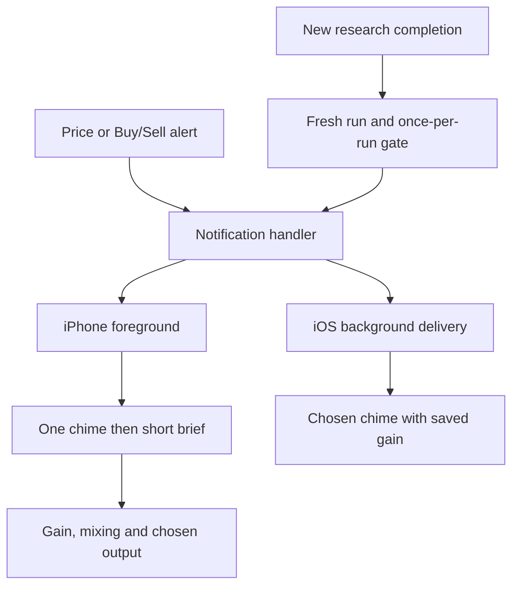

# iPhone notification audio and research completion

The owner requested light, playful game-style alert tunes, a notification handler with Settings controls, and a brief spoken announcement when iPhone research finishes. The previous app used the system default notification sound and vibrated after ordinary full refreshes.

## Behavior

- Four original 1.45-second PCM bell motifs: Rising sparkle, Gentle tumble, Little bell and Playful reveal. No sampled game music or looping ringtone.
- iPhone Settings → Notification audio controls research-completion notifications, chimes, spoken briefs, gain (−24 to 0 dB), mixing/ducking/pausing other audio, system output routing, English/Arabic voice selection, each event's sound and previews.
- Foreground delivery plays one chime followed by a short spoken brief. At most one current and one newest pending event are retained; banners remain available for all enqueued notifications. Playback has a ten-second cleanup limit and releases ducking/interruption afterward.
- Background notifications use the selected tone with gain baked into a bounded local PCM copy. Background speech/mixing/output overrides are not claimed. Normal iOS notification sound controls, system volume and Silent mode apply; no critical-alert entitlement, microphone use or background-audio mode is added.
- Existing saved-level and Buy/Sell alert senders share one delivery path. Their decision rules, accepted-delivery latches and rate budget are unchanged. No retired automatic research or signal polling is enabled.
- Newly completed, saved horizon research and terminal same-day/cap receipts receive one notification per run. Restored history, outcome reviews and partial progress do not ring. Completion briefs distinguish qualified candidates, incomplete checks and stopped research; they never claim an executed trade. Tapping research notifications opens Saved research.
- Ordinary price refreshes no longer trigger the success vibration. Previews do not fetch data, run research, place trades or send external messages.

The handler observes existing published completion receipts; model prompts, numeric computation, qualification, ranking and history persistence are unchanged. API credentials and model readiness are separate from audio readiness. This task does not authorize or run live research or trades.

## Verification

The focused serial native gate passed **46 definitions / 53 executions / zero failures or skips**, with no xcresult runtime warnings and a passing targeted native UI diagnostic guard. Suites: `StockSageNotificationAudioTests`, `StockSageMonitorTests`, `StockSageNotificationBudgetTests` and `StockSageAlertDecisionTests`. The test host uses the existing test isolation and an external ad hoc signing override; tracked project signing is unchanged.

The initial compile attempt was invalidated by concurrent source editing, and the initial test compile exposed a mutating-expression limitation in `#expect`; both were corrected before the final checks. Only completed final receipts count. `tools/gate.sh . all` passed: macOS module 251 seconds, iOS module 195 seconds, all test-source typechecking 399 seconds. These are build-check durations, not inference or audio latency measurements. The physical iPhone Release built successfully with only the existing unused-local warning in `StockSageAllocationOptimizer.swift:152`. Assets measured mono PCM16 at 44.1 kHz, 1.45 seconds each, peak −10.46 dBFS and RMS −23.21 to −22.65 dBFS. The checked-in generator reproduces these original waveforms.

Native fixtures cover bundled resources and duration, lossless unity gain, attenuation without timing/header changes, corrupt format rejection, malformed/default preference handling and replay-safe research completion gates. Existing monitor, alert-decision and notification-budget suites provide regression coverage without real notifications or provider calls.

Apple references: [notification sound resources](https://developer.apple.com/documentation/usernotifications/unnotificationsound), [custom sound lookup](https://developer.apple.com/documentation/usernotifications/unnotificationsound/init(named:)), [audio output picker](https://developer.apple.com/documentation/avkit/avroutepickerview), [ducking](https://developer.apple.com/documentation/avfaudio/avaudiosession/categoryoptions-swift.struct/duckothers). The installed iOS SDK explicitly permits ducking with the Ambient category and Default mode; SoloAmbient provides the optional interruption mode while retaining Silent-switch behavior.

## Physical installation

Strict signature verification passed. All four WAV files in the signed bundle match their source hashes. All 458 source/test/resource files match the pre-build manifest. Binary SHA-256: `d1f283695e02ad64316c43a5759a40d138092120563769fa05f562b5785214a6`.

The update is installed over `com.salman.StockSageX` on the connected iPhone 16 Pro Max. The first launch was blocked by iOS `Locked`; after owner unlock, launch succeeded with `activatedWhenStarted: true`. A separate process listing verified main PID **8843** in the new installed app container. Previous app archive is preserved; tracked signing configuration and app identity are unchanged. The required existing widget dependency compiled, but its behavior was not tested.

Physical output audibility and actual OS foreground/background notification delivery are not established by the resource/unit tests or process check. The owner was asked to try Settings → Notification audio → Preview research ready. No live research was used to trigger an alert. Local build, source, signature, installation and process receipts are under `/Users/salman/Documents/Codex/StockSage-Builds-2026-09-22/notification-audio/`.

Verified application source commit: `8744624335a7e89e9f371026d0bb38c83fc28317`. The installed binary was built before this commit; its unchanged source manifest binds it to these exact bytes. The source commit does not rely on an un-emitted custom Info.plist stamp.

Guide edition 42: eleven pages, extracted-text checks and all-page visual review passed. PDF SHA-256 `d8f2d0947cd900a63393eae74a8ddf96d2a98dd70c1a32949afc9fd81f31b163`. Previous local editions are preserved. The exact owner attachment path is absent on this Mac, so its replacement remains pending. No PDF was sent.
